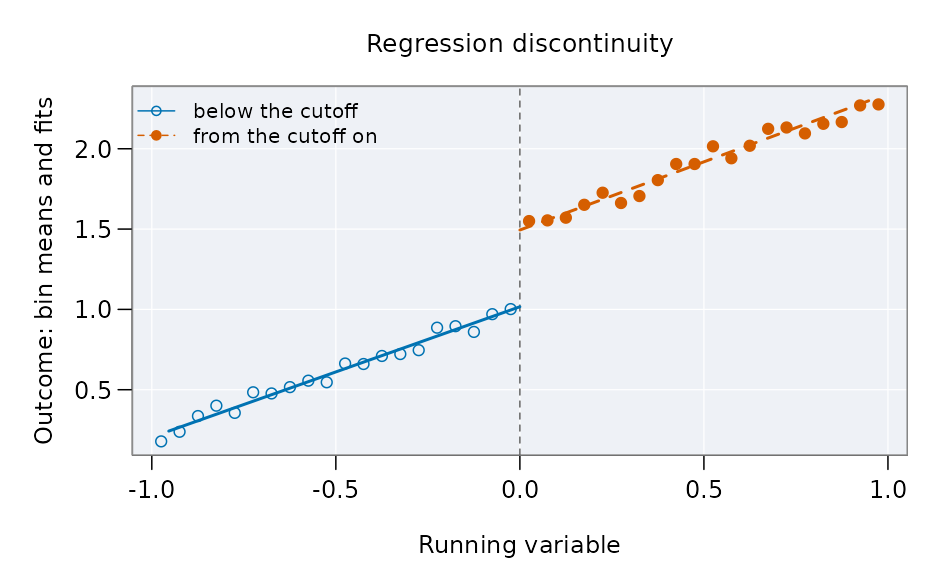
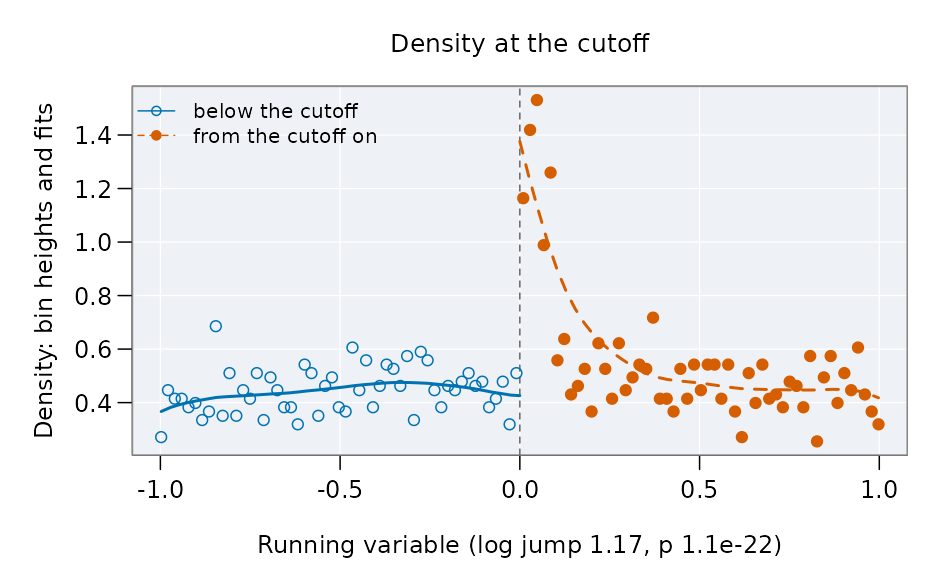

# Causal estimates and regression discontinuity

Double machine learning, balance, sensitivity of an estimate to what was
not measured, and regression discontinuity.

Each section is one help page: what the function is for, the example of
its help page as it runs, and the plot of its result where the package
draws one. [`?name`](https://rdrr.io/r/base/name.html) gives the
arguments and the value in full.

## Causal estimates

### Double machine learning by cross-fitting

[`dmlx()`](https://rootcoder007.github.io/crimlab/reference/dmlx.md):
Estimates a causal parameter from orthogonal scores whose nuisance
functions (outcome regressions, propensities) are learned out of fold:
each fold’s predictions come from learners fitted on the other folds, so
that the estimate keeps root-n inference while the learners are flexible
(Chernozhukov et al. 2018). The learning, the scores, the estimate and
its standard error are all compiled; the folds are the caller’s, so
results can be matched with other software fold for fold.

``` r

set.seed(1)
n <- 500
x <- matrix(rnorm(n * 5), n)
d <- x[, 1] + rnorm(n)
y <- 0.5 * d + x[, 1] - x[, 2] + rnorm(n)
fold <- sample(rep(1:5, length.out = n))
r <- dmlx(y, d, x, "plr", fold, lrn = "glm", lrnd = "glm")
c(r$coef, r$se)
#> [1] 0.52843259 0.04737872
```

### The U-learner of conditional average treatment effects

[`ulcate()`](https://rootcoder007.github.io/crimlab/reference/ulcate.md):
Estimates how the effect of a 0/1 treatment varies with the covariates
(Kunzel et al. 2019, sec. 2 and appendix): the outcome regression
`m(x) = E[y | x]` and the propensity `e(x) = P(d = 1 | x)` are learned
out of fold, as in
[`dmlx()`](https://rootcoder007.github.io/crimlab/reference/dmlx.md),
each fold predicted by learners fitted on the others; the pseudo-outcome
`u = (y - m) / (d - e)` has expectation `tau(x)` given `x` when the
treatment is unconfounded given `x`; and `tau` is the learner `lrnt`
fitted to `u` on all the rows. The mean of `tau` over the rows is
reported as `ate`.

``` r

set.seed(6)
n <- 400
x <- matrix(rnorm(n * 2), n)
d <- rbinom(n, 1, plogis(0.5 * x[, 1]))
y <- x[, 2] + d * (1 + x[, 1]) + rnorm(n)
fold <- sample(rep(1:4, length.out = n))
r <- ulcate(y, d, x, fold, lrn = "glm", lrnd = "glm")
r
#> ulcate: U-learner of the effect of d, 400 rows; mean effect 0.9368
#> tau from -2.416 to 3.844
```

### Design-based causal effects of a 0/1 treatment

[`cbatt()`](https://rootcoder007.github.io/crimlab/reference/cbatt.md):
The battery of estimators of the effect of a 0/1 treatment `d` on an
outcome `y` given covariates `x` that do not learn the nuisances by
cross-fitting: Hajek-normalised inverse probability weighting,
g-computation, subclassification on the propensity, nearest-neighbour
matching on the propensity with a caliper, and entropy balancing,
covariate-balancing weights for the effect on the treated.
[`dmlx()`](https://rootcoder007.github.io/crimlab/reference/dmlx.md)
gives the cross-fitted ones (augmented inverse probability weighting,
targeted maximum likelihood, the interactive model).

``` r

set.seed(1)
x <- matrix(rnorm(400), 200)
d <- rbinom(200, 1, plogis(x[, 1]))
y <- 2 * d + x[, 1] - x[, 2] + rnorm(200)
cbatt(y, d, x, reps = 99, seed = 1)$res
#>        est        se       lo      hi med n1  n0
#> 1 2.077253 0.1680322 1.747917 2.40659  NA 99 101
cbatt(y, d, x, est = "ebal", tgt = "att", reps = 99, seed = 1)$res
#>        est        se       lo       hi med n1  n0
#> 1 2.067763 0.1830696 1.708953 2.426573  NA 99 101
cbatt(y, d, x, est = "psm", tgt = "att", calip = 0.2)$res
#>        est        se       lo       hi      med n1  n0
#> 1 2.011912 0.2508233 1.520307 2.503517 2.228522 99 101
```

### Covariate balance and overlap

[`smdbal()`](https://rootcoder007.github.io/crimlab/reference/smdbal.md):
The standardised mean difference and variance ratio of each covariate
between the treated and the controls, before and after weighting, with a
verdict by a threshold; and the overlap of the propensity between the
arms.

``` r

set.seed(1)
x <- data.frame(age = rnorm(200, 40, 10), prior = rpois(200, 2))
d <- rbinom(200, 1, plogis((x$age - 40) / 10))
smdbal(x, d)
#> smdbal: balanced at 0.1: FALSE; overlap: FALSE
#>    var        m1        m0         smd        vr
#>    age 44.748673 36.687615  0.95167893 1.4812747
#>  prior  2.010989  2.119266 -0.07443683 0.7480863
#>        min1      max1       min0      max0  out     wmax
#>  0.07702527 0.9358613 0.04919905 0.7742637 0.09 12.98275
w <- cbatt(rnorm(200), d, x, est = "ebal", tgt = "att", reps = 0)$w
smdbal(x, d, w = w)$tab
#>     var        m1        m0         smd        vr       m1w       m0w          smdw
#> 1   age 44.748673 36.687615  0.95167893 1.4812747 44.748673 44.748673 -8.388583e-16
#> 2 prior  2.010989  2.119266 -0.07443683 0.7480863  2.010989  2.010989 -3.052964e-16
#>         vrw
#> 1 1.9940894
#> 2 0.6845163
```

### E-values: how strong an unmeasured confounder must be

[`evlx()`](https://rootcoder007.github.io/crimlab/reference/evlx.md):
The E-value of VanderWeele and Ding (2017): the smallest strength of
association, on the risk-ratio scale, that an unmeasured confounder
would need with both the treatment and the outcome to explain away an
estimate; and that of the confidence limit nearer the null.

``` r

evlx(3.9, 1.8, 8.7)
#>       rr   evalue    evlim 
#> 3.900000 7.263034 3.000000
evlx(0.8, 0.71, 0.91, type = "hr")
#>        rr    evalue     evlim 
#> 0.8567726 1.6088913 1.3360826
evlx(0.5, type = "smd", sd = 0.1)
#>       rr   evalue    evlim 
#> 1.576173 2.529142 1.968037
# how strong a confounder must be to move a ratio of 3.9 down to 2
evlx(3.9, 1.8, 8.7, true = 2)
#>       rr   evalue    evlim 
#> 3.900000 3.311066 1.000000
```

### Rosenbaum sensitivity bounds for matched pairs

[`rswp()`](https://rootcoder007.github.io/crimlab/reference/rswp.md),
[`rshl()`](https://rootcoder007.github.io/crimlab/reference/rswp.md):
How strong would hidden bias have to be to explain away a matched-pairs
result? `gam` is Gamma, the most the odds of treatment can differ within
a pair because of an unobserved covariate (1: no hidden bias).
[`rswp()`](https://rootcoder007.github.io/crimlab/reference/rswp.md)
gives the bounds on the one-sided p-value of Wilcoxon’s signed-rank test
at each Gamma (Rosenbaum 1987), from the normal approximation, and the
Gamma at which the upper bound reaches `alpha`.
[`rshl()`](https://rootcoder007.github.io/crimlab/reference/rswp.md)
gives the bounds on the Hodges-Lehmann estimate of the effect (Rosenbaum
1993), computed exactly from the Walsh averages, with no grid.

``` r

set.seed(1)
d <- rnorm(50, 0.5)
rswp(d, gam = c(1, 1.5, 2))
#> $p
#>   gam          plo          pup
#> 1 1.0 7.807040e-06 7.807040e-06
#> 2 1.5 7.347225e-09 8.087079e-04
#> 3 2.0 7.012883e-12 8.061278e-03
#> 
#> $gcrit
#> [1] 2.741017
#> 
#> $t
#> [1] 1085
rshl(d, gam = c(1, 1.5, 2))
#>   gam        lo        hi
#> 1 1.0 0.6526343 0.6526343
#> 2 1.5 0.4985346 0.7876529
#> 3 2.0 0.3952356 0.8803900
```

### Colliders of a directed acyclic graph

[`dagcol()`](https://rootcoder007.github.io/crimlab/reference/dagcol.md):
[`dagcol()`](https://rootcoder007.github.io/crimlab/reference/dagcol.md)
lists the colliders of a causal graph: every pair of causes
`a -> c <- b` of a common effect `c`. Conditioning on a collider (or on
a consequence of it), as a study of arrestees or of convicted people
does, opens a path between its causes and makes them associated when
they are not (Hernan and Robins 2020, ch. 8; see
[`colarr()`](https://rootcoder007.github.io/crimlab/reference/colarr.md)).
A collider whose causes are not adjacent is unshielded, a v-structure:
the v-structures and the skeleton of a graph are what the data can tell
apart (Verma and Pearl 1991).

``` r

# offending and mental illness both raise the chance of arrest; a study
# of arrestees conditions on the collider "arrest"
g <- dagcol(c("offend", "mental", "policing", "arrest"),
            c("arrest", "arrest", "arrest", "record"))
g
#> dagcol: 3 colliders among 5 nodes, 3 unshielded (v-structures)
#>       a      c        b shielded
#>  offend arrest   mental    FALSE
#>  offend arrest policing    FALSE
#>  mental arrest policing    FALSE
dagcol(c("a", "b", "a"), c("c", "c", "b"), triple = c("a", "c", "b"))$query
#> collider shielded 
#>     TRUE     TRUE
```

### Generalisability weights for a trial

[`gensw()`](https://rootcoder007.github.io/crimlab/reference/gensw.md):
The weights that make the units of a randomised trial stand for a target
population, and how far the trial is from it. The data hold the trial’s
units (`s = 1`) and a sample of the target (`s = 0`) with the same
covariates. The sampling score `ps`, the chance of being in the trial
given the covariates, is a logistic regression of `s` on `x`, trimmed to
\[trim, 1 - trim\].

``` r

set.seed(8)
n <- 600
d <- data.frame(age = rnorm(n, 35, 10), prior = rpois(n, 1.5))
d$s <- rbinom(n, 1, plogis(-1 + 0.04 * (d$age - 35) + 0.3 * d$prior))
g <- gensw(d, "s", c("age", "prior"), target = "transport")
g
#> gensw: 223 trial units to transport to 377; logit SMD 0.47, Tipton's index 0.96, effective size 183.7
#>    var target  trial wtrial    smd      wsmd
#>    age 33.012 36.075 32.979 0.3000 -0.003267
#>  prior  1.358  1.771  1.317 0.3693 -0.036677
g$bal
#>     var   target    trial    wtrial       smd         wsmd
#> 1   age 33.01239 36.07538 32.979032 0.2999789 -0.003266946
#> 2 prior  1.35809  1.77130  1.317055 0.3693281 -0.036677349
```

### Transport a trial’s effect to a target population

[`trnsp()`](https://rootcoder007.github.io/crimlab/reference/trnsp.md):
The average treatment effect of a randomised trial carried over to a
target population whose covariates differ from the trial’s, by the
outcome model and by inverse odds weighting (Dahabreh et al. 2020;
Westreich et al. 2017). The data hold the trial’s units (`s = 1`), with
outcome and treatment, and a sample of the target (`s = 0`), with the
covariates only; `y` and `d` are not read outside the trial and may be
`NA` there.

``` r

set.seed(9)
n <- 600
d <- data.frame(age = rnorm(n, 35, 10))
d$s <- rbinom(n, 1, plogis(-0.05 * (d$age - 35)))
d$t <- ifelse(d$s == 1, rbinom(n, 1, 0.5), NA)
d$y <- ifelse(d$s == 1, 0.5 * d$t + 0.02 * d$t * d$age + rnorm(n), NA)
trnsp(d, "y", "t", "s", "age", nboot = 100, seed = 1)
#> trnsp: the trial's effect transported to the rows outside it, 100 bootstrap draws (0 failed)
#>  method   est     se     lo    hi
#>      om 1.182 0.1282 0.9308 1.433
#>     iow 1.197 0.1288 0.9442 1.449
```

### Targeted maximum likelihood for a randomised trial

[`rcttml()`](https://rootcoder007.github.io/crimlab/reference/rcttml.md):
The average treatment effect of a randomised trial with adjustment for
baseline covariates by targeted maximum likelihood (Moore and van der
Laan 2009): more precise than the difference in means when the
covariates predict the outcome, and consistent whatever the outcome
model, since the chance of treatment is known by design.

``` r

set.seed(10)
n <- 300
d <- data.frame(prior = rpois(n, 2), age = runif(n, 18, 50),
                t = rbinom(n, 1, 0.5))
d$days <- 30 - 6 * d$t + 3 * d$prior - 0.1 * d$age + rnorm(n, sd = 4)
rcttml(d, "days", "t", c("prior", "age"))
#> rcttml: gaussian outcome, 300 participants; targeted maximum likelihood, g-computation and the difference in means
#>  method    est     se     lo     hi         p
#>    tmle -6.454 0.4857 -7.406 -5.502 2.775e-40
#>   gcomp -6.454     NA     NA     NA        NA
#>   unadj -6.760 0.6640 -8.061 -5.459 2.424e-24
d$rearrest <- rbinom(n, 1, plogis(-1 - 0.6 * d$t + 0.4 * d$prior))
rcttml(d, "rearrest", "t", "prior", fam = "binomial")$tab
#>   method        est         se         lo          hi           p
#> 1   tmle -0.1443982 0.05330437 -0.2488729 -0.03992356 0.006749907
#> 2  gcomp -0.1443982         NA         NA          NA          NA
#> 3  unadj -0.1570057 0.05574479 -0.2662635 -0.04774791 0.004854871
```

## Regression discontinuity

### Regression discontinuity by local polynomials

[`rdloc()`](https://rootcoder007.github.io/crimlab/reference/rdloc.md):
Estimates the jump at a cutoff in a running variable: the outcome’s
(sharp design) or its ratio to the jump in the treatment (fuzzy design),
by local-linear fits on either side with kernel weights, with the
bandwidth of Imbens and Kalyanaraman (2012) or one given, conventional
and robust intervals, clustered errors and placebo cutoffs. Carrillo,
Lopez-Luzuriaga and Malik (2018, equation 6, p. 8) use the sharp design
in space: crime counts by distance to a restriction border, a line on
each side, within a window.

``` r

set.seed(5)
d <- data.frame(r = runif(2000, -1, 1))
d$y <- 1 + 0.8 * d$r + 0.5 * (d$r >= 0) + rnorm(2000, 0, 0.3)
f <- rdloc(d, "y", "r")
f
#> rdloc: sharp regression discontinuity at 0, tri kernel, bandwidth 0.9542 (Imbens-Kalyanaraman); 964 + 947 rows within it
#>        method    est      se  stat         p     lo     hi
#>        robust 0.4699 0.04637 10.13 3.931e-24 0.3790 0.5608
#>  conventional 0.4777 0.03129 15.26 1.326e-52 0.4163 0.5390
plot(f)
```


``` r

# a given bandwidth, the uniform kernel and two placebo cutoffs
summary(rdloc(d, "y", "r", bw = "user", h = 0.3, kern = "uni",
              plac = c(-0.5, 0.5)))
#>         method       est         se     stat            p        lo        hi
#> 1       robust 0.5041150 0.07625604 6.610821 3.821953e-11 0.3546559 0.6535741
#> 2 conventional 0.4957812 0.05126063 9.671775 3.974255e-22 0.3953122 0.5962502
# fuzzy: treatment taken up more often above the cutoff
d$t <- as.numeric(runif(2000) < 0.2 + 0.6 * (d$r >= 0))
d$y2 <- 1 + 0.8 * d$r + 0.7 * d$t + rnorm(2000, 0, 0.3)
rdloc(d, "y2", "r", trt = "t")$coef
#>         method       est         se      stat            p        lo        hi
#> 1       robust 0.7215609 0.07361641  9.801631 1.107817e-22 0.5772754 0.8658464
#> 2 conventional 0.7069529 0.04952302 14.275239 3.122150e-46 0.6098896 0.8040162
```

``` r

plot(f)
```



### The density test of McCrary at a cutoff

[`rddens()`](https://rootcoder007.github.io/crimlab/reference/rddens.md):
Tests whether the density of a running variable jumps at the cutoff,
which manipulation of the running variable would cause, by the two-step
estimator of McCrary (2008): a finely binned histogram, then
local-linear smoothing of the bin heights on each side with the triangle
kernel.

``` r

set.seed(6)
rddens(runif(3000, -1, 1))
#> rddens: McCrary density test at 0, 3000 rows, binsize 0.02105, bandwidth 0.484
#>     theta    se    stat     p      lo     hi    fl     fr
#>  -0.06265 0.115 -0.5447 0.586 -0.2881 0.1628 0.516 0.4846
# bunching just above the cutoff
r <- rddens(c(runif(3000, -1, 1), runif(300, 0, 0.1)))
r
#> rddens: McCrary density test at 0, 3300 rows, binsize 0.01901, bandwidth 0.3126
#>  theta     se  stat         p     lo    hi     fl    fr
#>  1.173 0.1196 9.805 1.073e-22 0.9383 1.407 0.4259 1.376
plot(r)
```



``` r

plot(r)
```


