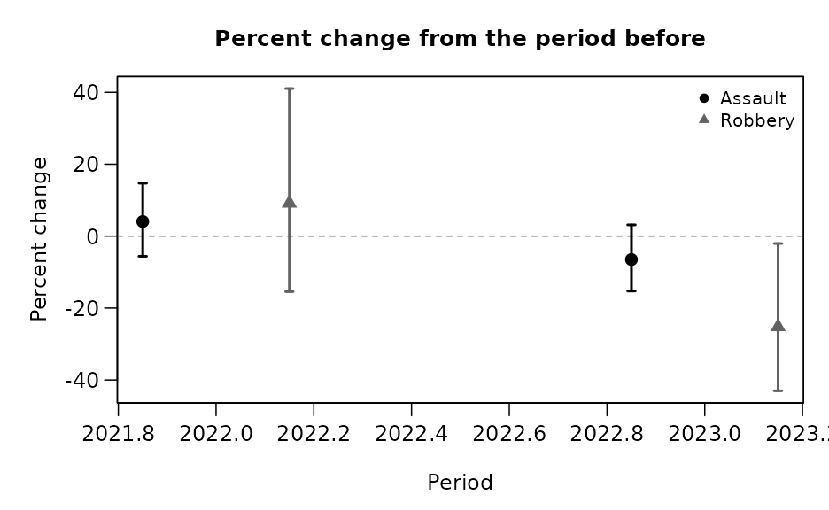

# Change tables, drift between releases and region maps

Year-over-year tables in several formats, tests that a new release of
data still looks like the last, and checks of a region map.

Each section is one help page: what the function is for, the example of
its help page as it runs, and the plot of its result where the package
draws one. [`?name`](https://rdrr.io/r/base/name.html) gives the
arguments and the value in full.

## Change tables out

### Label the periods of a change table without changing them

[`yoylbl()`](https://rootcoder007.github.io/crimlab/reference/yoylbl.md),
[`fylbl()`](https://rootcoder007.github.io/crimlab/reference/yoylbl.md):
A period’s value and its name are not the same thing: a fiscal year
keyed by the year it ends (2023 for the year that runs from 2022 into
2023) printed as “2023” names a calendar year the row is not about.
[`yoylbl()`](https://rootcoder007.github.io/crimlab/reference/yoylbl.md)
adds a column `perlbl` that the writers show in place of the period; the
comparison still runs on the value, so relabelling cannot change an
answer.
[`fylbl()`](https://rootcoder007.github.io/crimlab/reference/yoylbl.md)
names a fiscal year by the years it spans.

``` r

fylbl(c(2023, 2024))
#> [1] "2022/23" "2023/24"
fylbl(2023, sep = "-", short = FALSE)
#> [1] "2022-2023"
# simulated admissions to custody by fiscal year
y <- yoypx(c(120, 131, 98), 2021:2023)
yoylbl(y, fylbl)
#> yoypx: change on the earlier period
#>   prd value prev change     pctchg              flag     pctlo     pctup          p
#>  2021   120   NA     NA         NA no earlier period        NA        NA         NA
#>  2022   131  120     11   9.166667              <NA> -15.43629 41.033275 0.52799664
#>  2023    98  131    -33 -25.190840              <NA> -43.01728 -2.059398 0.03423381
#>        padj signif  perlbl
#>          NA     NA 2020/21
#>  0.52799664  FALSE 2021/22
#>  0.06846762  FALSE 2022/23
yoylbl(y, c("2023" = "the last year"))
#> yoypx: change on the earlier period
#>   prd value prev change     pctchg              flag     pctlo     pctup          p
#>  2021   120   NA     NA         NA no earlier period        NA        NA         NA
#>  2022   131  120     11   9.166667              <NA> -15.43629 41.033275 0.52799664
#>  2023    98  131    -33 -25.190840              <NA> -43.01728 -2.059398 0.03423381
#>        padj signif        perlbl
#>          NA     NA          2021
#>  0.52799664  FALSE          2022
#>  0.06846762  FALSE the last year
```

### Summarise a change table

[`yoysmry()`](https://rootcoder007.github.io/crimlab/reference/yoysmry.md):
One row per series (per group of a grouped table): the first and last
period with a value, the values there, the change from the first to the
last in percent, the compound rate per step, and how many of the
period-to-period changes went up, down or nowhere.

``` r

# simulated police-reported counts of two offences
d <- data.frame(year = rep(2019:2023, 2),
                offence = rep(c("Assault", "Robbery"), each = 5),
                n = c(812, 845, 790, 901, 954, 120, 131, 98, 105, 140))
yoysmry(yoypx(d$n, d$year, d$offence))
#> yoysmry: 2 series
#>    group from   to first last totalpct  cagrpct periods up down flat
#>  Assault 2019 2023   812  954 17.48768 4.111352       5  3    1    0
#>  Robbery 2019 2023   120  140 16.66667 3.928988       5  3    1    0
```

### Write a change table as delimited text, JSON or Markdown

[`yoycsv()`](https://rootcoder007.github.io/crimlab/reference/yoycsv.md),
[`yoytsv()`](https://rootcoder007.github.io/crimlab/reference/yoycsv.md),
[`yoyjs()`](https://rootcoder007.github.io/crimlab/reference/yoycsv.md),
[`yoymd()`](https://rootcoder007.github.io/crimlab/reference/yoycsv.md):
[`yoycsv()`](https://rootcoder007.github.io/crimlab/reference/yoycsv.md)
and
[`yoytsv()`](https://rootcoder007.github.io/crimlab/reference/yoycsv.md)
write every column of the table, one row per line, numbers with every
digit (the shortest text that reads back as the same number), text as it
is (a code such as `046` stays `046`), `TRUE` and `FALSE` as such and
missing values as `na`; `meta` lines come first as comments. In CSV a
field holding a comma, a quote or a line break is quoted, and an empty
text field is written as `""` so that it stays apart from a missing
value written as empty. A TSV field cannot hold a tab or a line break,
so those become spaces.
[`yoyjs()`](https://rootcoder007.github.io/crimlab/reference/yoycsv.md)
writes a JSON object of the `meta` lines, the summary
([`yoysmry()`](https://rootcoder007.github.io/crimlab/reference/yoysmry.md))
and the rows, every digit kept.
[`yoymd()`](https://rootcoder007.github.io/crimlab/reference/yoycsv.md)
writes a Markdown table for reading, with the values rounded for display
and Markdown’s own characters escaped.

``` r

# simulated police-reported counts by offence and year, any agency
d <- data.frame(year = rep(2021:2023, 2),
                offence = rep(c("Assault", "Robbery"), each = 3),
                n = c(812, 845, 790, 120, 131, 98))
y <- yoypx(d$n, d$year, d$offence)
cat(yoycsv(y, meta = "simulated counts"))
#> # simulated counts
#> group,prd,value,prev,change,pctchg,flag,pctlo,pctup,p,padj,signif
#> Assault,2021,812,,,,no earlier period,,,,,
#> Assault,2022,845,812,33,4.064039408866995,,-5.603768879212168,14.72749053634146,0.43180618441086355,0.5279966429637909,FALSE
#> Assault,2023,790,845,-55,-6.508875739644971,,-15.259175908374855,3.136515563139186,0.18170438539856754,0.3634087707971351,FALSE
#> Robbery,2021,120,,,,no earlier period,,,,,
#> Robbery,2022,131,120,11,9.166666666666666,,-15.436293185543326,41.033274698316255,0.5279966429637909,0.5279966429637909,FALSE
#> Robbery,2023,98,131,-33,-25.19083969465649,,-43.01727965764448,-2.0593979283887176,0.03423381228214208,0.13693524912856833,FALSE
cat(yoymd(y))
#> | group   | prd  | value | previous | change | change % |     interval | note              |
#> | ------- | ---- | ----: | -------: | -----: | -------: | -----------: | ----------------- |
#> | Assault | 2021 |   812 |        — |      — |        — |              | no earlier period |
#> | Assault | 2022 |   845 |      812 |     33 |    +4.1% |  [-6%, +15%] |                   |
#> | Assault | 2023 |   790 |      845 |    -55 |    -6.5% |  [-15%, +3%] |                   |
#> | Robbery | 2021 |   120 |        — |      — |        — |              | no earlier period |
#> | Robbery | 2022 |   131 |      120 |     11 |    +9.2% | [-15%, +41%] |                   |
#> | Robbery | 2023 |    98 |      131 |    -33 |   -25.2% |  [-43%, -2%] |                   |
# simulated admissions to custody, with a code that must stay "046"
a <- data.frame(code = c("046", "112"), n = c(1 / 3, 2))
cat(yoytsv(a))
#> code n
#> 046  0.3333333333333333
#> 112  2
cat(yoyjs(y, pretty = FALSE))
#> {"summary":[{"group":"Assault","from":2021,"to":2023,"first":812,"last":790,"totalpct":-2.7093596059113323,"cagrpct":-1.3639820379549805,"periods":3,"up":1,"down":1,"flat":0},{"group":"Robbery","from":2021,"to":2023,"first":120,"last":98,"totalpct":-18.333333333333336,"cagrpct":-9.63038858849361,"periods":3,"up":1,"down":1,"flat":0}],"rows":[{"group":"Assault","prd":2021,"value":812,"prev":null,"change":null,"pctchg":null,"flag":"no earlier period","pctlo":null,"pctup":null,"p":null,"padj":null,"signif":null},{"group":"Assault","prd":2022,"value":845,"prev":812,"change":33,"pctchg":4.064039408866995,"flag":null,"pctlo":-5.603768879212168,"pctup":14.72749053634146,"p":0.43180618441086355,"padj":0.5279966429637909,"signif":false},{"group":"Assault","prd":2023,"value":790,"prev":845,"change":-55,"pctchg":-6.508875739644971,"flag":null,"pctlo":-15.259175908374855,"pctup":3.136515563139186,"p":0.18170438539856754,"padj":0.3634087707971351,"signif":false},{"group":"Robbery","prd":2021,"value":120,"prev":null,"change":null,"pctchg":null,"flag":"no earlier period","pctlo":null,"pctup":null,"p":null,"padj":null,"signif":null},{"group":"Robbery","prd":2022,"value":131,"prev":120,"change":11,"pctchg":9.166666666666666,"flag":null,"pctlo":-15.436293185543326,"pctup":41.033274698316255,"p":0.5279966429637909,"padj":0.5279966429637909,"signif":false},{"group":"Robbery","prd":2023,"value":98,"prev":131,"change":-33,"pctchg":-25.19083969465649,"flag":null,"pctlo":-43.01727965764448,"pctup":-2.0593979283887176,"p":0.03423381228214208,"padj":0.13693524912856833,"signif":false}]}
```

``` r

plot(y)
```



### Render a change table to HTML or PDF

[`yoyhtml()`](https://rootcoder007.github.io/crimlab/reference/yoyhtml.md),
[`yoypdf()`](https://rootcoder007.github.io/crimlab/reference/yoyhtml.md):
[`yoyhtml()`](https://rootcoder007.github.io/crimlab/reference/yoyhtml.md)
writes one self-contained HTML page (every style inlined, nothing
fetched, so the file renders the same years later): the table, a card
per series with its change over the span
([`yoysmry()`](https://rootcoder007.github.io/crimlab/reference/yoysmry.md))
and the notes.
[`yoypdf()`](https://rootcoder007.github.io/crimlab/reference/yoyhtml.md)
writes a PDF of the table, paginated when it does not fit, with the
standard Helvetica font and no other program: crimlab writes the file
itself.

``` r

# simulated police-reported counts by offence and year, any agency
d <- data.frame(year = rep(2021:2023, 2),
                offence = rep(c("Assault", "Robbery"), each = 3),
                n = c(812, 845, 790, 120, 131, 98))
y <- yoypx(d$n, d$year, d$offence)
f <- tempfile(fileext = ".html")
yoyhtml(y, f, title = "Reported offences (simulated)", better = "lower")
g <- tempfile(fileext = ".pdf")
yoypdf(y, g, title = "Reported offences (simulated)")
# simulated days in segregation by fiscal year
s <- yoylbl(yoypx(c(4100, 3900, 4400), 2021:2023), fylbl)
yoyhtml(s, f, title = "Days in segregation (simulated)", better = "lower")
unlink(c(f, g))
```

``` r

plot(y)
```


### Write a change table in the format its file name says

[`yoywr()`](https://rootcoder007.github.io/crimlab/reference/yoywr.md):
Picks the writer from the extension of `file` (`.html` or `.htm`,
`.pdf`, `.csv`, `.tsv` or `.tab`, `.json`, `.md` or `.markdown`), or
from `format`, and passes the other arguments to it.

``` r

# simulated police-reported counts by offence and year
y <- yoypx(c(812, 845, 790), 2021:2023)
f <- tempfile(fileext = ".csv")
yoywr(y, f)
readLines(f)
#> [1] "prd,value,prev,change,pctchg,flag,pctlo,pctup,p,padj,signif"                                                            
#> [2] "2021,812,,,,no earlier period,,,,,"                                                                                     
#> [3] "2022,845,812,33,4.064039408866995,,-5.603768879212168,14.72749053634146,0.43180618441086355,0.43180618441086355,FALSE"  
#> [4] "2023,790,845,-55,-6.508875739644971,,-15.259175908374855,3.136515563139186,0.18170438539856754,0.3634087707971351,FALSE"
unlink(f)
```

## Drift between releases

### Two-sample Kolmogorov-Smirnov test (C backend)

[`drftks()`](https://rootcoder007.github.io/crimlab/reference/drftks.md):
Tests whether two numeric samples come from the same distribution, for
example a column of last year’s release of a table and the same column
of this year’s. It needs no assumption about the shape of either
distribution and reacts to any kind of change: a shift, a change in
spread or a change in shape.

``` r

set.seed(1)
ref <- stats::rnorm(200)
drftks(ref, stats::rnorm(200))
#> drftks: statistic =   0.0600, p_value =   0.8643, neff = 100.0000 
#> inputs: nx = 200, ny = 200
drftks(ref, stats::rnorm(200, mean = 0.8))
#> drftks: statistic = 3.250e-01, p_value = 1.338e-09, neff = 1.000e+02 
#> inputs: nx = 200, ny = 200
drftks(ref, stats::rnorm(200, sd = 2.5))
#> drftks: statistic = 3.150e-01, p_value = 4.813e-09, neff = 1.000e+02 
#> inputs: nx = 200, ny = 200
drftks(ref, ref)[["statistic"]]
#> [1] 0
# simulated monthly counts of an offence in two releases
drftks(c(41, 38, 52, 47, 44, 50), c(41, 38, 52, 47, 61, 66))
#> drftks: statistic = 0.3333, p_value = 0.8928, neff = 3.0000 
#> inputs: nx = 6, ny = 6
```

### Population stability index and Jensen-Shannon divergence (C backend)

[`drftpsi()`](https://rootcoder007.github.io/crimlab/reference/drftpsi.md):
Two effect sizes of how far the distribution of a numeric column has
moved from a reference sample. Both samples are binned on the
reference’s quantiles and the two sets of bin shares compared. Unlike a
p-value they do not grow with the sample size, so they say how large a
shift is rather than whether it is detectable.

``` r

set.seed(2)
ref <- stats::rnorm(500)
drftpsi(ref, stats::rnorm(500))
#> drftpsi: psi = 0.022072, jsdiv = 0.002753 
#> inputs: nx = 500, ny = 500, bins = 10
drftpsi(ref, stats::rnorm(500, mean = 1))
#> drftpsi: psi = 0.9543, jsdiv = 0.1053 
#> inputs: nx = 500, ny = 500, bins = 10
drftpsi(ref, ref)
#> drftpsi: psi = 0, jsdiv = 0 
#> inputs: nx = 500, ny = 500, bins = 10
drftpsi(c(1, 1, 1), c(9, 9, 9))[["jsdiv"]] <= log(2)
#> [1] TRUE
drftpsi(ref, stats::rnorm(500, mean = 1), bins = 4, eps = 0.01)
#> drftpsi: psi = 0.69315, jsdiv = 0.08235 
#> inputs: nx = 500, ny = 500, bins = 4
try(drftpsi(ref, ref, bins = 1))
#> Error : drftpsi: `bins` must be one whole number of at least 2.
```

### Chi-square test of a categorical column against a known distribution

[`drftchisq()`](https://rootcoder007.github.io/crimlab/reference/drftchisq.md):
Tests whether the category counts of a new sample agree with a reference
distribution taken as known (proportions fixed by a specification, or a
published breakdown): Pearson’s chi-square goodness-of-fit test. When
the reference is itself a sample, use
[`drfthomog()`](https://rootcoder007.github.io/crimlab/reference/drfthomog.md),
which carries the reference’s own sampling error.

``` r

ref <- c(a = 50, b = 30, c = 20)
drftchisq(c(a = 100, b = 60, c = 40), ref)
#> drftchisq: statistic = 0, df = 2, p_value = 1, logpvalue = 0 
#> inputs: n = 200, k = 3
drftchisq(c(a = 40, b = 60, c = 100), ref)
#> drftchisq: statistic =  1.26e+02, df =  2.00e+00, p_value =  4.36e-28, logpvalue = -6.30e+01 
#> inputs: n = 200, k = 3
drftchisq(c("a", "a", "b", "b"), c("a", "b"))
#> drftchisq: statistic = 0, df = 1, p_value = 1, logpvalue = 0 
#> inputs: n = 4, k = 2
drftchisq(c("a", "a", "b", "d"), c("a", "a", "b", "b"))
#> drftchisq: statistic =  Inf, df =    1, p_value =    0, logpvalue = -Inf 
#> inputs: n = 4, k = 3
```

### Chi-square test of homogeneity of two categorical samples

[`drfthomog()`](https://rootcoder007.github.io/crimlab/reference/drfthomog.md):
Tests whether two samples of a categorical variable (offence type,
region, race in last year’s and this year’s release) were drawn from the
same distribution, by Pearson’s chi-square on the 2-by-k table of their
counts.

``` r

set.seed(1)
a <- sample(c("x", "y", "z"), 300, TRUE)
b <- sample(c("x", "y", "z"), 300, TRUE)
drfthomog(a, b)
#> drfthomog: statistic =  0.5150, df =  2.0000, p_value =  0.7730, logpvalue = -0.2575 
#> inputs: nx = 300, ny = 300, k = 3 
#> method: chi-square approximation
drfthomog(a, sample(c("x", "y", "z"), 300, TRUE, prob = c(0.7, 0.2, 0.1)))
#> drfthomog: statistic =  6.978e+01, df =  2.000e+00, p_value =  7.030e-16, logpvalue = -3.489e+01 
#> inputs: nx = 300, ny = 300, k = 3 
#> method: chi-square approximation
drfthomog(c(a = 30, b = 20), c(a = 25, b = 25))
#> drfthomog: statistic =  1.0101, df =  1.0000, p_value =  0.3149, logpvalue = -1.1556 
#> inputs: nx = 50, ny = 50, k = 2 
#> method: chi-square approximation
attr(drfthomog(c(a = 3, b = 1, c = 2), c(a = 1, b = 4, c = 1)), "method")
#> [1] "Monte Carlo permutation (small expected counts)"
try(drfthomog(c(1, 2), c(a = 3)))
#> Error : drfthomog: a numeric `x` must be named.
```

### Drift of a whole table between two releases

[`drfttab()`](https://rootcoder007.github.io/crimlab/reference/drfttab.md),
[`drftcal()`](https://rootcoder007.github.io/crimlab/reference/drfttab.md):
Compares a reference table and a current one column by column, with the
tests of this family: a numeric (or date) column by the two-sample
Kolmogorov-Smirnov test
([`drftks()`](https://rootcoder007.github.io/crimlab/reference/drftks.md))
and the population stability index
([`drftpsi()`](https://rootcoder007.github.io/crimlab/reference/drftpsi.md)),
a text, factor or logical column by the chi-square test of homogeneity
([`drfthomog()`](https://rootcoder007.github.io/crimlab/reference/drfthomog.md)).
[`drftcal()`](https://rootcoder007.github.io/crimlab/reference/drfttab.md)
then says how often these screens fire on a table that has not changed
at all, which is what a flag has to be read against.

``` r

set.seed(1)
ref <- data.frame(age = rnorm(300, 35, 9),
                  charge = sample(c("assault", "theft", "drugs"), 300, TRUE))
cur <- data.frame(age = rnorm(300, 39, 9),
                  charge = sample(c("assault", "theft", "drugs"), 300, TRUE))
drfttab(ref, cur)
#> drfttab: 2 columns, 1 flagged, 0 not testable (alpha 0.01, PSI above 0.25)
#>  column    type        test statistic        p   psi nref ncur  flag
#>     age numeric          ks     0.200 1.23e-05 0.309  300  300  TRUE
#>  charge   label homogeneity     2.029 3.63e-01    NA  300  300 FALSE
# how often the screens fire when nothing changed
drftcal(ref, n = 20)
#> drftcal: 20 half-splits of unchanged data at alpha 0.01
#> any column flagged on 5% of splits; per-column level for a family-wise 0.01: 0.005
#>  column  far
#>  charge 0.05
try(drfttab(ref, data.frame(other = 1)))
#> Error : drfttab: `ref` and `cur` share no column.
```

## Region maps

### Internal soundness of a region map

[`rgnmapintg()`](https://rootcoder007.github.io/crimlab/reference/rgnmapintg.md):
Checks that a region map (a crosswalk from units, such as correctional
facilities or police detachments, to the statistical regions that
contain them) lists each unit once, gives every unit a region, and names
only regions the reference geography knows. Run it on any crosswalk
before tables are built on it.

``` r

# a simulated crosswalk of facilities to census divisions
cw <- data.frame(inst = c("North Jail", "South Jail", "East Jail"),
                 cd = c("3557", "3520", "3506"))
rgnmapintg(cw, "inst", "cd", regs = c("3557", "3520", "3506"))
#> rgnmapintg: every check passed 
#>                                        check observed expected pass
#>          units assigned more than one region        0        0 TRUE
#>                     units assigned no region        0        0 TRUE
#>  region codes not in the reference geography        0        0 TRUE
cw$cd[3] <- "2406"
rgnmapintg(cw, "inst", "cd", regs = c("3557", "3520", "3506"))
#> rgnmapintg: 1 of 3 checks failed 
#>                                        check observed expected  pass
#>          units assigned more than one region        0        0  TRUE
#>                     units assigned no region        0        0  TRUE
#>  region codes not in the reference geography        1        0 FALSE
cw2 <- rbind(cw, data.frame(inst = c("North Jail", "West Jail"),
                            cd = c("3560", "")))
rgnmapintg(cw2, "inst", "cd")
#> rgnmapintg: 2 of 2 checks failed 
#>                                check observed expected  pass
#>  units assigned more than one region        1        0 FALSE
#>             units assigned no region        1        0 FALSE
try(rgnmapintg(cw, "institution", "cd"))
#> Error : rgnmapintg: `map` has no column `institution`.
```

### Compare a recomputed region map against a published one

[`rgnmapcmp()`](https://rootcoder007.github.io/crimlab/reference/rgnmapcmp.md):
Matches two region maps on the unit and compares the named columns cell
by cell, reporting for each column how many cells disagree and the first
disagreement. Use it to confirm that a region map rebuilt from a
boundary file reproduces the one that was published.

``` r

pub <- data.frame(inst = c("North Jail", "South Jail"),
                  cd = c("3557", "3520"))
obs <- pub
obs$cd[2] <- "3521"
rgnmapcmp(pub, obs, "inst")
#> rgnmapcmp: the maps disagree 
#>  column cells mismatched                                       first
#>    rows     2          0                                            
#>      cd     2          1 South Jail: published 3520, recomputed 3521
pub$lat <- c(44.39, 43.65)
obs2 <- data.frame(inst = c("North Jail", "Hill Jail"),
                   cd = c("3557", "3506"), lat = c(44.39 + 1e-12, 45.1))
rgnmapcmp(pub, obs2, "inst", cols = c("cd", "lat"))
#> rgnmapcmp: the maps disagree 
#>  column cells mismatched                      first
#>    rows     3          2 published only: South Jail
#>      cd     1          0                           
#>     lat     1          0
try(rgnmapcmp(pub, obs, "inst", cols = "lat"))
#> Error : rgnmapcmp: both frames need the compared columns; missing: lat.
```

### Check a region map against an independently derived assignment

[`rgnmapalt()`](https://rootcoder007.github.io/crimlab/reference/rgnmapalt.md):
Compares the region each unit was assigned with the region a different
method assigns it (a name lookup, a postal geography, an administrative
list), and marks the disagreements that are already known and explained.
This is the only check here that can catch an error in the method that
built the map, because it does not use that method.

``` r

cw <- data.frame(inst = c("North Jail", "South Jail", "Hill Jail"),
                 cd = c("3557", "3520", "3506"))
route <- c("North Jail" = "3557", "South Jail" = "3521",
           "Hill Jail" = "3519")
d <- rgnmapalt(cw, "inst", "cd", route, known = "Hill Jail")
d
#>         unit primary second known
#> 1 South Jail    3520   3521 FALSE
#> 2  Hill Jail    3506   3519  TRUE
sum(!d$known)
#> [1] 1
try(rgnmapalt(cw, "inst", "cd", c("3557", "3520")))
#> Error : rgnmapalt: `route` must be named by unit, or be a data frame.
```
