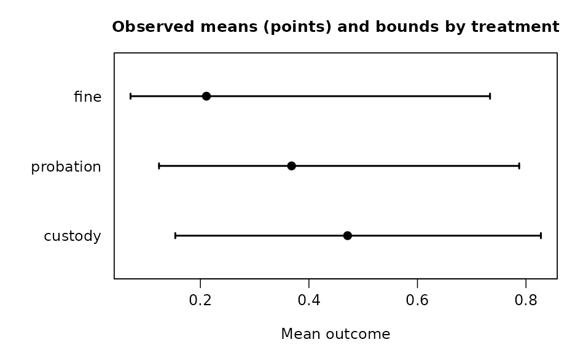
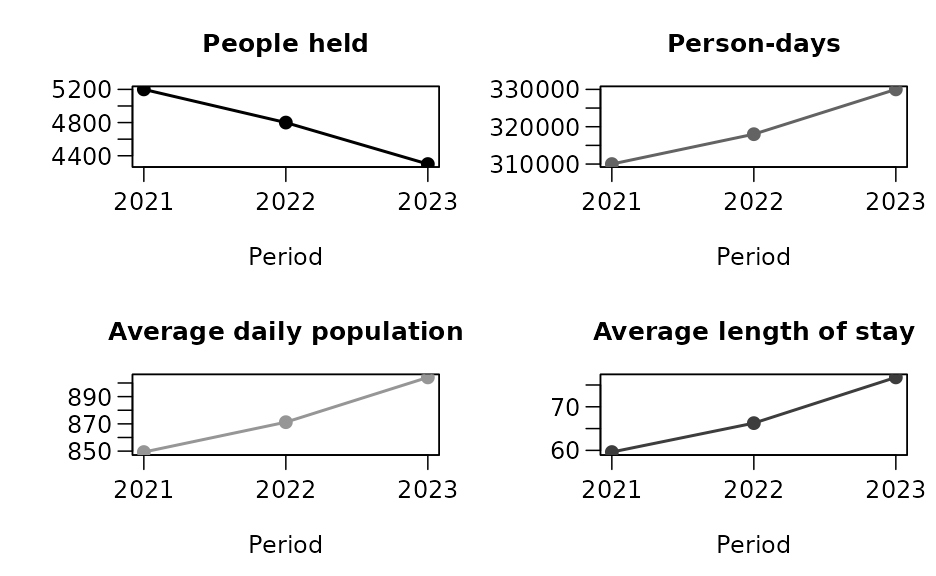
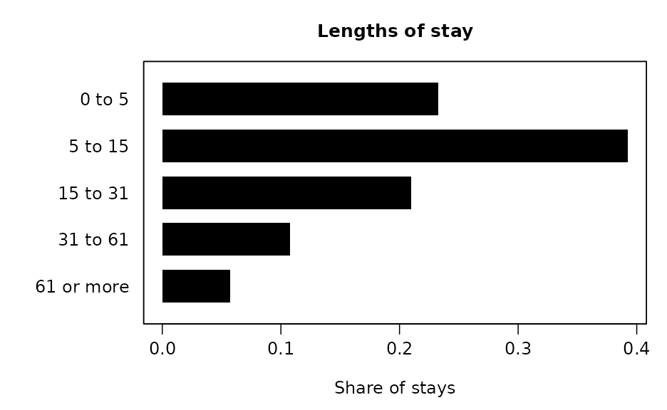
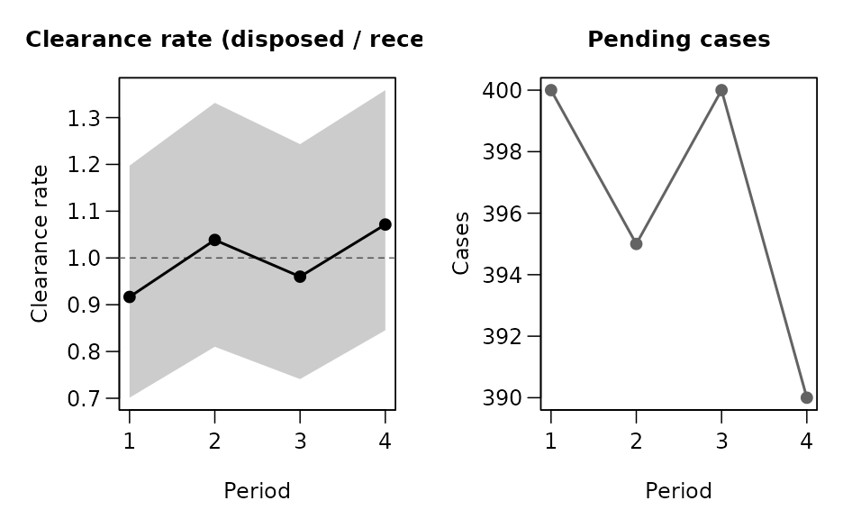
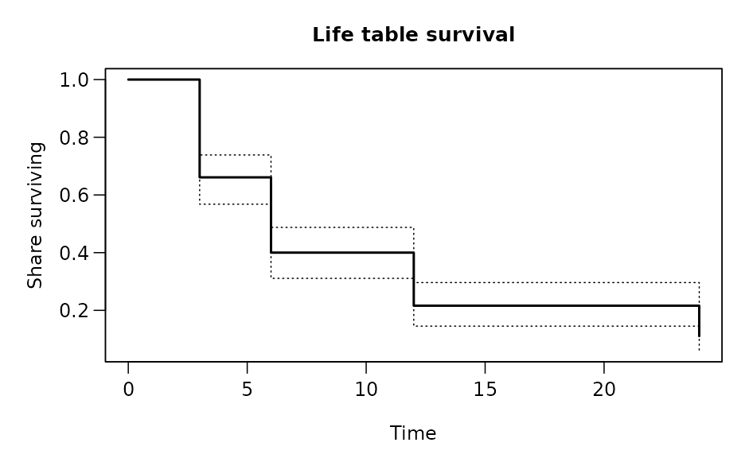
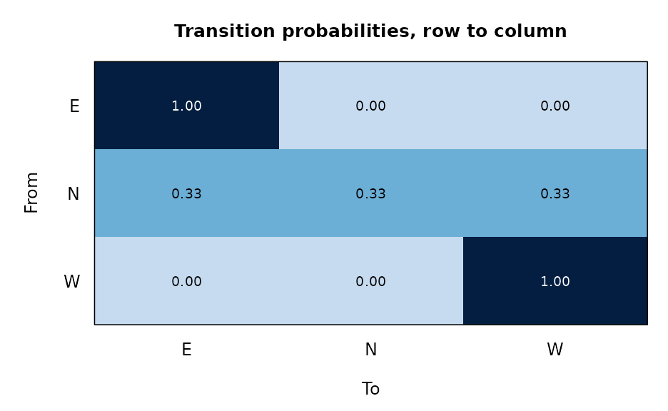

# Corrections, custody and court flow

Incapacitation, bounds on sentence effects, stock and flow in custody
and court backlogs, and segregation against the Mandela Rules.

Each section is one help page: what the function is for, the example of
its help page as it runs, and the plot of its result where the package
draws one. [`?name`](https://rdrr.io/r/base/name.html) gives the
arguments and the value in full.

## Corrections

### Incapacitation: crime rate, share prevented and the marginal year

[`incap()`](https://rootcoder007.github.io/crimlab/reference/incap.md):
An offender commits crimes at rate `lam` a year while free, and each
crime leads to a custodial sentence of `s` years with probability `q`.
Over a career the crime rate is lam / (1 + lam q s): the share of
offending prevented, lam q s / (1 + lam q s), never reaches 1, longer or
surer sentences lower the rate, and one more year of sentence prevents
lam^2 q / ((1 + lam q s) (1 + lam q (s + 1))) crimes a year, less for
each year added. A sentence uniform across offenders prevents a larger
share of the offending of those with the higher rate. The model holds
the rate fixed over the career and replaces nobody; see
[`incapr()`](https://rootcoder007.github.io/crimlab/reference/incapr.md)
for both. See `proof("incap")`.

``` r

incap(lam = c(low = 2, high = 10), q = 0.1, s = 1, share = c(0.8, 0.2))
#>   group  lam   q  s     rate      prev      marg
#> 1   low  2.0 0.1  1 1.666667 0.1666667 0.2380952
#> 2  high 10.0 0.1  1 5.000000 0.5000000 1.6666667
#> 3   all  3.6  NA NA 2.333333 0.3518519        NA
```

### Incapacitation under desistance and replacement

[`incapr()`](https://rootcoder007.github.io/crimlab/reference/incapr.md):
Crimes prevented by a sentence of `s` periods served from career age
`t0`, when the offending rate falls with career age and a share `r` of
the crimes prevented is committed by someone else instead. The count is
at most `s` times the rate at the start of the sentence and at least `s`
times the rate at its end; the same sentence served one period later
prevents no more; and, net of replacement, the estimate from the rate at
the start is still an upper bound. The usual constant-rate estimate
therefore overstates what a sentence buys under both assumptions. See
`proof("incapr")`.

``` r

incapr(lam = c(12, 10, 8, 6, 5, 4, 3, 2, 2, 1), t0 = 2, s = 3, r = 0.25)
#>  prev   net upper lower later 
#> 19.00 14.25 24.00 12.00 15.00
```

### Evaluating a release rule from the released alone

[`sellab()`](https://rootcoder007.github.io/crimlab/reference/sellab.md):
Failures (a missed court date, a new arrest) are seen only for the
defendants a judge released. A proposed rule that releases only people
the judge released is scored exactly from their outcomes; one that
releases people the judge detained has a failure rate known only up to
the worst and best cases for them, an interval whose width is the share
of the rule’s releases the judge detained. Both ends can occur. The
naive score on the rule’s observed releases alone always lies inside the
interval, but reports one point of it as if it were known. See
`proof("sellab")`.

``` r

set.seed(4)
risk <- runif(500)
y <- rbinom(500, 1, risk)
sellab(y, rel = risk < 0.7, rule = risk < 0.8)
#>       obs     unobs     lower     upper     width     naive 
#> 0.3488372 0.1202046 0.3069054 0.4271100 0.1202046 0.3488372
```

### Mean time in custody from completed and current stays

[`losbnd()`](https://rootcoder007.github.io/crimlab/reference/losbnd.md):
The mean length of stay of the people released (or of the cases
disposed) leaves out everyone still inside. Their elapsed time is a
lower bound on their stay, so the mean over everyone admitted is at
least `lower`, the mean of the completed stays and the elapsed times
together; the released-only mean falls short of it by `m / (n + m)`
times the excess of the mean elapsed time over the released mean, and
understates the truth for certain when that excess is positive. No upper
bound exists without a cap on how long the current stays will last. See
`proof("losbnd")`.

``` r

losbnd(done = c(30, 45, 60, 90, 120), open = c(100, 150, 200))
#>    mean     age   lower    bias 
#>  69.000 150.000  99.375  30.375
```

### Bounds on a sentence’s effect without assumptions

[`sntbnd()`](https://rootcoder007.github.io/crimlab/reference/sntbnd.md):
Each person receives one of two sentences and shows the outcome (say,
reconviction) under that one only. With no assumption about who receives
which, the chance of the outcome under a sentence is known only up to an
interval whose width is the share who received the other sentence, and
the effect of one sentence against the other lies in an interval of
width exactly 1 that always contains 0: observational data alone cannot
even sign it. See `proof("sntbnd")`.

``` r

set.seed(1)
z <- sample(c("community", "custody"), 500, TRUE, c(0.6, 0.4))
y <- rbinom(500, 1, ifelse(z == "custody", 0.55, 0.35))
sntbnd(y, z, treat = "custody")
#>        term share  lower upper  observed
#> 1 community 0.624  0.208 0.584 0.3333333
#> 2   custody 0.376  0.192 0.816 0.5106383
#> 3    effect    NA -0.392 0.608 0.1773050
```

### Bounds on sentence effects under monotone response and selection

[`mtrbnd()`](https://rootcoder007.github.io/crimlab/reference/mtrbnd.md):
Asks what can be said about the effect of a harsher sentence (a longer
term, custody against probation) on an outcome such as reconviction when
who received which sentence was not random. With no assumption the mean
outcome everyone would have under sentence `t` is known only to an
interval (see
[`sntbnd()`](https://rootcoder007.github.io/crimlab/reference/sntbnd.md)
for two sentences). Manski and Pepper (2000) narrow it with two
assumptions about ordered treatments:

``` r

set.seed(13)
z <- factor(sample(c("fine", "probation", "custody"), 800, TRUE),
            levels = c("fine", "probation", "custody"))
y <- rbinom(800, 1, c(0.2, 0.35, 0.5)[as.integer(z)])
mtrbnd(y, z, assume = "both")
#> mtrbnd: bounds under both
#>          z   share      mean     lower     upper atelo     atehi
#>       fine 0.33750 0.2111111 0.2111111 0.3487500    NA        NA
#>  probation 0.33625 0.3680297 0.3150697 0.4017100     0 0.1905989
#>    custody 0.32625 0.4712644 0.3487500 0.4712644     0 0.2601533
mtrbnd(y, z, assume = "none")
#> mtrbnd: bounds under none
#>          z   share      mean   lower   upper atelo   atehi
#>       fine 0.33750 0.2111111 0.07125 0.73375    NA      NA
#>  probation 0.33625 0.3680297 0.12375 0.78750 -0.61 0.71625
#>    custody 0.32625 0.4712644 0.15375 0.82750 -0.58 0.75625
```

``` r

res <- mtrbnd(y, z, assume = "none")
plot(res)
```



### Period-two hazards after selective depletion

[`hzdsel()`](https://rootcoder007.github.io/crimlab/reference/hzdsel.md):
A share `s` of a cohort is at high risk of reconviction, `h` a period,
and the rest at low risk, `l`. If a programme changes who survives the
first period without reconviction, the period-two hazard among the
survivors is a weighted average of `h` and `l` with weight the share of
high-risk survivors, and it rises with that share. An arm that keeps
more of its high-risk people out of reconviction in period one therefore
shows the higher period-two hazard even if it has no effect on anyone in
period two: a period-by-period hazard ratio is not a causal contrast; a
risk difference at a fixed follow-up is. See `proof("hzdsel")`.

``` r

hzdsel(s = 0.5, h = 0.5, l = 0.1, surh = c(0.5, 0.8), surl = c(0.9, 0.9))
#>    share0    share1      haz0      haz1     ratio 
#> 0.3571429 0.4705882 0.2428571 0.2882353 1.1868512
```

## Custody and court flow

### Stock and flow of a population held over time

[`stkflw()`](https://rootcoder007.github.io/crimlab/reference/stkflw.md):
Person-days divided by the length of a period give the average daily
population (a stock: how many are held at once); divided by the people
admitted or released, the average length of stay (how long each stays).
The two share a numerator and `days = adp * t = people * alos` (Little’s
law in the words of corrections planning; Lakner 1976), so any two of
people, days, average daily population and average length of stay give
the rest, except days with the average daily population, which carry the
same information. When the length of stay moves, the stock and the flow
can move in opposite directions; `pshare` is the share of the change in
days (on the log scale) that the change in people accounts for, the rest
coming from the length of stay. See `proof("stkflw")`.

``` r

stkflw(people = c(5200, 4800, 4300), days = c(310000, 318000, 330000),
       prd = 2021:2023)
#> stkflw: stock and flow, changes against the first period
#>  period   t people   days      adp     alos     peochg  aloschg  dayschg   adpchg
#>    2021 365   5200 310000 849.3151 59.61538   0.000000  0.00000 0.000000 0.000000
#>    2022 365   4800 318000 871.2329 66.25000  -7.692308 11.12903 2.580645 2.580645
#>    2023 365   4300 330000 904.1096 76.74419 -17.307692 28.73218 6.451613 6.451613
#>     pshare
#>         NA
#>  -3.141506
#>  -3.039708
# admissions implied by a population and a length of stay
stkflw(adp = 900, alos = 61)$flow$people
#> [1] 5385.246
```

``` r

res <- stkflw(people = c(5200, 4800, 4300), days = c(310000, 318000, 330000),
              prd = 2021:2023)
plot(res)
```



### Lengths of stay: their distribution and its fit

[`lostay()`](https://rootcoder007.github.io/crimlab/reference/lostay.md):
The lengths of stay of a set of placements (or of people): the mean with
its t interval, the median and quartiles, the longest; the share of
stays in each band and at or below each threshold (15 days, the Mandela
Rules’ limit, say), with the share of each band carrying a flag (no
review on record); and the fit of lognormal, exponential and Pareto laws
by maximum likelihood, compared by AIC: a heavy tail (Pareto or
lognormal beating the exponential) separates a few long stays from many
short ones. A stay still open is a lower bound on its length; see
[`losbnd()`](https://rootcoder007.github.io/crimlab/reference/losbnd.md)
for the mean it bounds.

``` r

set.seed(3)
s <- round(rlnorm(400, 2.3, 1.1)) + 1
r <- lostay(s, breaks = c(0, 5, 15, 31, 61, Inf), thr = 15)
r$bands
#>   lo  hi   n  share
#> 1  0   5  93 0.2325
#> 2  5  15 157 0.3925
#> 3 15  31  84 0.2100
#> 4 31  61  43 0.1075
#> 5 61 Inf  23 0.0575
r$fit
#>         model      aic  best
#> 1   lognormal 3105.502  TRUE
#> 2 exponential 3228.711 FALSE
#> 3      pareto 3249.590 FALSE
```

``` r

plot(r)
```



### Little’s law on a court docket

[`bklog()`](https://rootcoder007.github.io/crimlab/reference/bklog.md):
From the arrival and disposition times of cases (a disposition missing
or after the horizon: still pending), the time-average backlog equals
the filing rate times the mean time to disposition when every case has
been disposed (Little 1961): `resid` is that identity’s residual, 0 up
to rounding. The backlog counts each pending case to the horizon; the
mean time is over the disposed cases, which understates the truth when
cases are pending (see
[`losbnd()`](https://rootcoder007.github.io/crimlab/reference/losbnd.md)).
Given a target backlog, `need` is the mean time to disposition that
holds it at the present filing rate. See `proof("bklog")`.

``` r

bklog(arrive = c(0, 2, 3, 7, 9), dispose = c(5, 4, 12, NA, 15),
      horizon = 20, target = 2)
#> bklog: Little's law over a horizon of 20 
#>   cases pending    rate    wait backlog   occup   resid 
#>    5.00    1.00    0.25    5.50    1.75   35.00      NA
```

### Case flow through a court

[`dktflw()`](https://rootcoder007.github.io/crimlab/reference/dktflw.md):
Cases received and disposed by period: the clearance rate (disposed over
received, above 1 when the caseload shrinks) with its exact interval,
the net, the clearance over a rolling window, and with the pending
caseload its change and the periods it would take to clear at the recent
pace. With the length of each period (`span`) the filing rate gives, by
Little’s law, the mean time to disposition the pending caseload implies,
to set beside a published mean (`mtime`): their `ratio` far from 1 means
the published mean leaves out the long-pending cases. Published duration
bands (`shares` of cases in bands starting at `floors`) bound the mean
from below.

``` r

dktflw(recv = c(120, 130, 125, 140), disp = c(110, 135, 120, 150),
       pend = c(400, 395, 400, 390), win = 2, span = 91)
#> dktflw: case flow
#>  period recv disp     clear        lo       hi net   rclear       rlo      rhi pend
#>       1  120  110 0.9166667 0.7011985 1.197368  10       NA        NA       NA  400
#>       2  130  135 1.0384615 0.8101053 1.331593  -5 0.980000 0.8183090 1.173541  395
#>       3  125  120 0.9600000 0.7409969 1.243285   5 1.000000 0.8373357 1.194264  400
#>       4  140  150 1.0714286 0.8453024 1.358733 -10 1.018868 0.8568263 1.211642  390
#>  pchg  toclear    frate     impl
#>    NA 3.636364 1.318681 303.3333
#>    -5 3.224490 1.428571 276.5000
#>     5 3.137255 1.373626 291.2000
#>   -10 2.888889 1.538462 253.5000
m <- matrix(c(50, 55, 60, 30, 28, 25, 20, 17, 15), 3,
            dimnames = list(2021:2023, c("guilty", "withdrawn", "other")))
dktflw(mix = m)$mix$trend
#>     outcome      stat         p      holm change
#> 1    guilty 2.0202020 0.1552185 0.4656555   0.10
#> 2 withdrawn 0.6246183 0.4293363 0.7006036  -0.05
#> 3     other 0.8723635 0.3503018 0.7006036  -0.05
```

``` r

res <- dktflw(recv = c(120, 130, 125, 140), disp = c(110, 135, 120, 150),
              pend = c(400, 395, 400, 390), win = 2, span = 91)
plot(res)
```



### Actuarial life table of grouped times

[`lftab()`](https://rootcoder007.github.io/crimlab/reference/lftab.md):
How long cases take, from the counts of cases ending (and censored) in
each band of time: the conditional probability of ending in each band
with the censored counted as half a case at risk, the survival (the
share still open at the end of each band) with Greenwood’s standard
error and a plain, log or log-log interval, the hazard, and the median,
linear within its band.

``` r

lftab(c(0, 3, 6, 12, 24, Inf), events = c(40, 30, 20, 10, 5),
      cens = c(2, 2, 3, 3, 4))
#> lftab: life table, log-log intervals, median 4.851282 
#>  lower upper entering atrisk events cens         q       surv         se          lo
#>      0     3      119  118.0     40    2 0.3389831 0.66101695 0.04357669 0.568007817
#>      3     6       77   76.0     30    2 0.3947368 0.40008921 0.04548923 0.310878228
#>      6    12       45   43.5     20    3 0.4597701 0.21614015 0.03896034 0.145266720
#>     12    24       22   20.5     10    3 0.4878049 0.11070593 0.03110609 0.059213092
#>     24   Inf        9    7.0      5    4 0.7142857 0.03163027 0.02088777 0.006579202
#>          hi     hazard
#>  0.73860814 0.13605442
#>  0.48760071 0.16393443
#>  0.29631969 0.09950249
#>  0.18020436 0.05376344
#>  0.09308838         NA
```

``` r

res <- lftab(c(0, 3, 6, 12, 24, Inf), events = c(40, 30, 20, 10, 5),
             cens = c(2, 2, 3, 3, 4))
plot(res)
```



### Transition matrix between states

[`trnmat()`](https://rootcoder007.github.io/crimlab/reference/trnmat.md):
The moves of people between states (regions, institutions, security
levels) from their sequence of records: the counts and probabilities of
each move between consecutive records of the same person, the stationary
distribution of the chain (where the population would settle if the
probabilities held), the share of moves that stay in their state, and
the Theil index of the moves between states (0 when they spread evenly
over the pairs of states, higher when a few pairs carry them).

``` r

r <- trnmat(c("N", "N", "E", "N", "W", "W", "E", "E"),
            c(1, 1, 1, 2, 2, 2, 3, 3), time = c(1, 2, 3, 1, 2, 3, 1, 2))
r$prob
#>           E         N         W
#> E 1.0000000 0.0000000 0.0000000
#> N 0.3333333 0.3333333 0.3333333
#> W 0.0000000 0.0000000 1.0000000
r$pi
#>  E  N  W 
#> NA NA NA
```

``` r

plot(r)
```



## Segregation and the Mandela Rules

### Segregation placements under the Mandela Rules

[`mndla()`](https://rootcoder007.github.io/crimlab/reference/mndla.md):
The United Nations Standard Minimum Rules for the Treatment of Prisoners
(the Mandela Rules) define solitary confinement as 22 hours or more a
day without meaningful human contact (Rule 44), and prolonged solitary
confinement, which Rule 43 prohibits, as more than 15 consecutive days
of it.
[`mndla()`](https://rootcoder007.github.io/crimlab/reference/mndla.md)
classifies each placement and gives the share that meets the rules,
overall and by group (a year, a region), with three denominators that
answer different questions:

``` r

set.seed(6)
d <- data.frame(id = sample(1:80, 150, TRUE), yr = sample(2021:2022, 150,
                TRUE), days = rgeom(150, 0.08) + 1)
mndla(d$days, d$id, d$yr)$tab
#>   group    den   n  k     share        lo        hi
#> 1  2021  stays  78 26 0.3333333 0.2305852 0.4491667
#> 2  2021 people  49 22 0.4489796 0.3066538 0.5976946
#> 3  2021  cumul  49 25 0.5102041 0.3633783 0.6557526
#> 4  2022  stays  72 20 0.2777778 0.1786429 0.3959058
#> 5  2022 people  47 18 0.3829787 0.2450682 0.5362006
#> 6  2022  cumul  47 24 0.5106383 0.3606447 0.6592430
#> 7   all  stays 150 46 0.3066667 0.2340520 0.3871003
#> 8   all people  68 38 0.5588235 0.4331781 0.6791799
#> 9   all  cumul  68 43 0.6323529 0.5066791 0.7461021
# the rule of Rules 43 and 44 with hours out of cell
mndla(c(5, 20, 30), hours = c(1, 1.5, 3), miss = c(100, 100, 40))$tab
#>   group   den n k     share         lo        hi sol tor
#> 1   all stays 3 2 0.6666667 0.09429932 0.9915962   1   1
```

### Was the review held, and in time?

[`rvwtim()`](https://rootcoder007.github.io/crimlab/reference/rvwtim.md):
A stay in a restrictive unit is to be reviewed by a set day.
[`rvwtim()`](https://rootcoder007.github.io/crimlab/reference/rvwtim.md)
takes the length of each stay and the day of its first review, and gives
how many stays of each length were never reviewed, how many of those
past the day a review was due had none, and how long the reviews that
were held took. Sprott, Doob and Iftene (2021, Tables 2 and 15) asked
this of the reviews by Independent External Decision Makers of stays in
Canada’s Structured Intervention Units; the question is the same for any
review a rule sets a day for (a bail review, a segregation review, a
hearing).

``` r

days <- c(12, 40, 75, 90, 130, 150, 64, 20)
first <- c(NA, 31, 48, NA, 61, NA, 33, NA)
rvwtim(days, first, due = 60, cuts = c(60, 120))
#> $cov
#>   group           band n rev never     share          lo        hi
#> 1   all       up to 60 3   1     2 0.6666667 0.094299324 0.9915962
#> 2   all over 60 to 120 3   2     1 0.3333333 0.008403759 0.9057007
#> 3   all       over 120 2   1     1 0.5000000 0.012579117 0.9874209
#> 
#> $sum
#>   group n rev past pastnever share         lo        hi late  med
#> 1   all 8   4    5         2   0.4 0.05274495 0.8533672    1 40.5
#> 
#> $due
#> [1] 60
#> 
#> $level
#> [1] 0.95
```

### Days on which an entitlement was missed

[`entcmp()`](https://rootcoder007.github.io/crimlab/reference/entcmp.md):
The law may give a person held in a restrictive unit something every
day: hours out of the cell, time with other people.
[`entcmp()`](https://rootcoder007.github.io/crimlab/reference/entcmp.md)
takes, for each stay, the percentage of its days on which that was
missed, and gives the stays by how often it was missed, the share that
missed it every day, and the share of all days missed. With the hours
received on the days it was missed, it shows how far short those days
fell; with the percentage of days the person refused, how many stays
missed more days than refusal accounts for. These are the tables of
Sprott and Doob (2021, Tables 6, 7, 14, 17 and 21) on the four hours out
of cell and the two hours of human contact in Canada’s Structured
Intervention Units.

``` r

miss <- c(100, 100, 80, 45, 10, 0, 100, 60)
entcmp(miss, days = c(20, 35, 16, 40, 18, 5, 62, 30),
       hours = c(0.4, 1.5, 2.2, 3, 3.5, NA, 0.8, 1),
       ref = c(10, 100, 5, 0, 0, 0, 30, 60))
#> $tab
#>   group                 band n share
#> 1   all                    0 1 0.125
#> 2   all         over 0 to 20 1 0.125
#> 3   all        over 20 to 50 1 0.125
#> 4   all over 50 to under 100 2 0.250
#> 5   all                  100 3 0.375
#> 
#> $sum
#>   group n none all share         lo        hi half    dayshr
#> 1   all 8    1   3 0.375 0.08523341 0.7551368    5 0.7415929
#> 
#> $hrs
#>            band n     share
#> 1     up to 0.5 1 0.1428571
#> 2 over 0.5 to 1 2 0.2857143
#> 3   over 1 to 2 1 0.1428571
#> 4   over 2 to 3 2 0.2857143
#> 5        over 3 1 0.1428571
#> 
#> $ref
#>   group n most net
#> 1   all 8    2   5
#> 
#> $level
#> [1] 0.95
```

### Do decision makers decide alike?

[`dmvar()`](https://rootcoder007.github.io/crimlab/reference/dmvar.md):
When cases are shared among several decision makers (reviewers, judges,
panels), the share of their decisions that go one way should differ by
no more than chance if the cases are alike.
[`dmvar()`](https://rootcoder007.github.io/crimlab/reference/dmvar.md)
gives each decision maker’s rate with its exact interval and the share
of all such decisions that are theirs, the chi-square test that the
rates are equal, the same test without the decision makers who decided
few cases, and the test with each decision maker left out in turn, which
shows whether one of them makes the difference. Sprott, Doob and Iftene
(2021, Tables 10 and 11) found the share of reviews that kept a person
in a Structured Intervention Unit to run from 37.5% to over 75% across
twelve decision makers, with and without the one who had decided fewest.

``` r

dm <- rep(c("a", "b", "c", "d"), c(30, 28, 25, 4))
dec <- rep(c("remain", "remove", "remain", "remove", "remain", "remove",
             "remain"), c(24, 6, 10, 18, 15, 10, 4))
dmvar(dec, dm, out = "remain")
#> $tab
#>   dm  n  k      rate        lo        hi     share
#> 1  a 30 24 0.8000000 0.6143335 0.9228645 0.4528302
#> 2  b 28 10 0.3571429 0.1864067 0.5593497 0.1886792
#> 3  c 25 15 0.6000000 0.3866535 0.7887452 0.2830189
#> 4  d  4  4 1.0000000 0.3976354 1.0000000 0.0754717
#> 
#> $test
#>         set m     stat df           p low
#> 1       all 4 14.63426  3 0.002157435   2
#> 2 n >= nmin 3 11.75893  2 0.002796286   0
#> 
#> $drop
#>   dm      stat df            p
#> 1  a  7.270408  2 0.0263785505
#> 2  b  4.356395  2 0.1132454520
#> 3  c 14.672556  2 0.0006514707
#> 4  d 11.758926  2 0.0027962859
#> 
#> $out
#> [1] "remain"
#> 
#> $level
#> [1] 0.95
```
