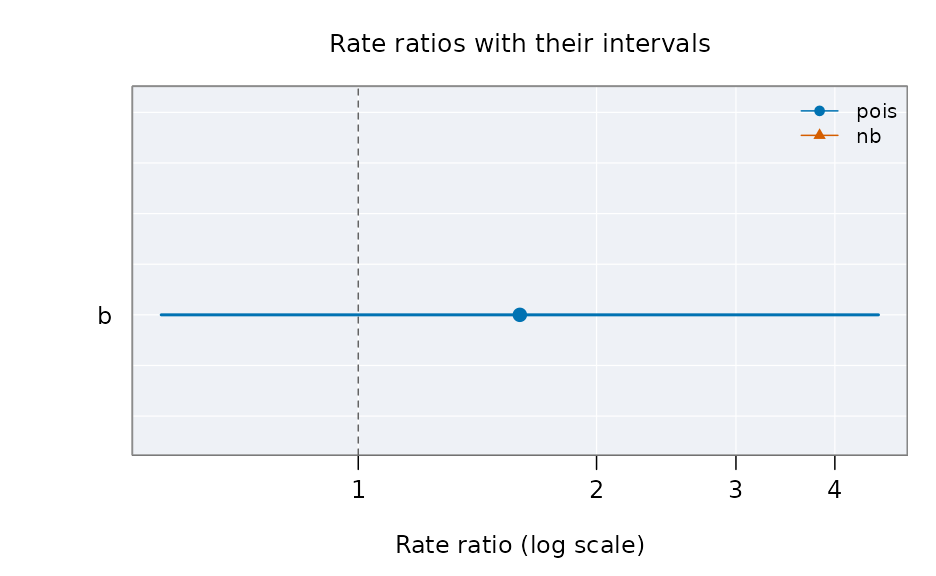
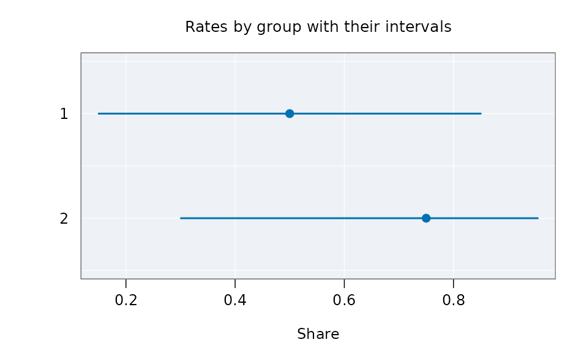
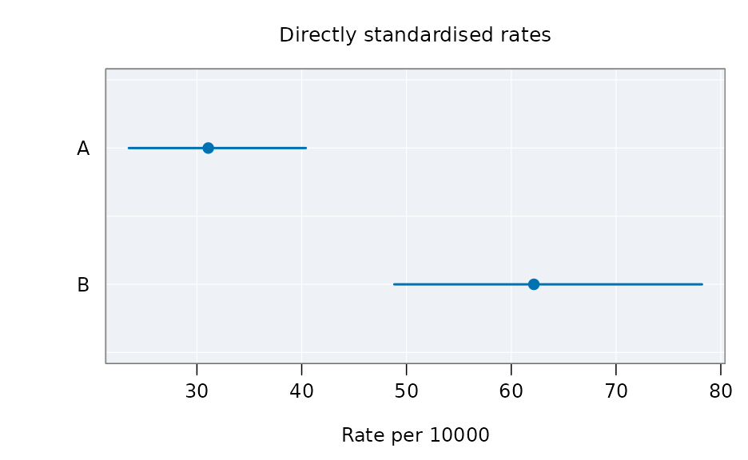
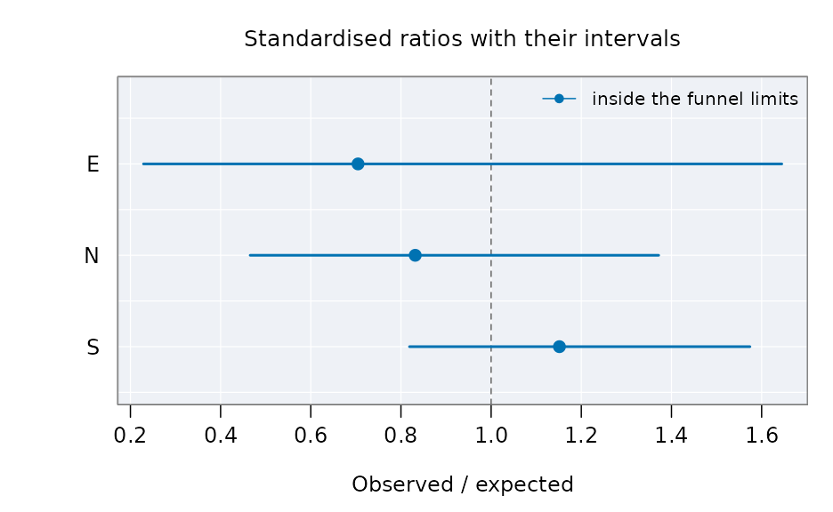
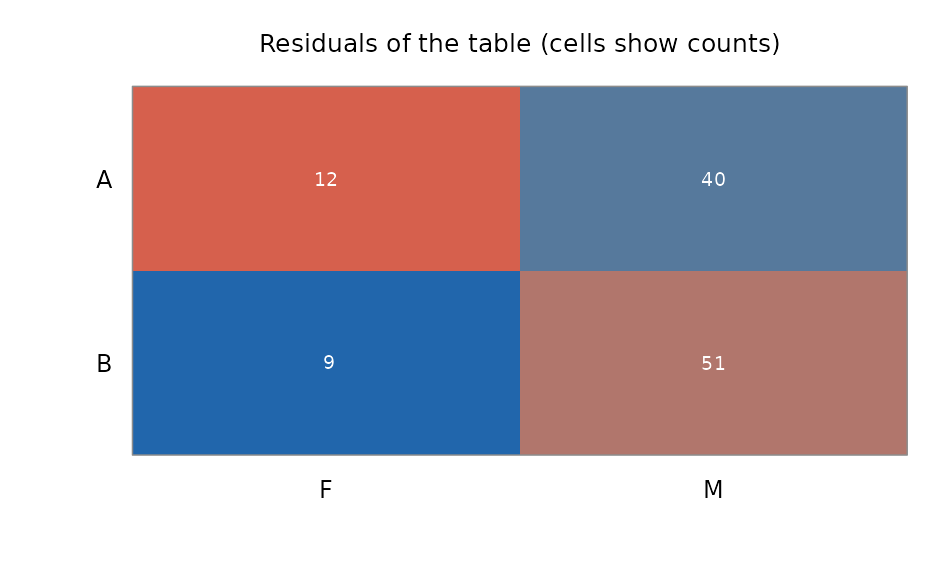
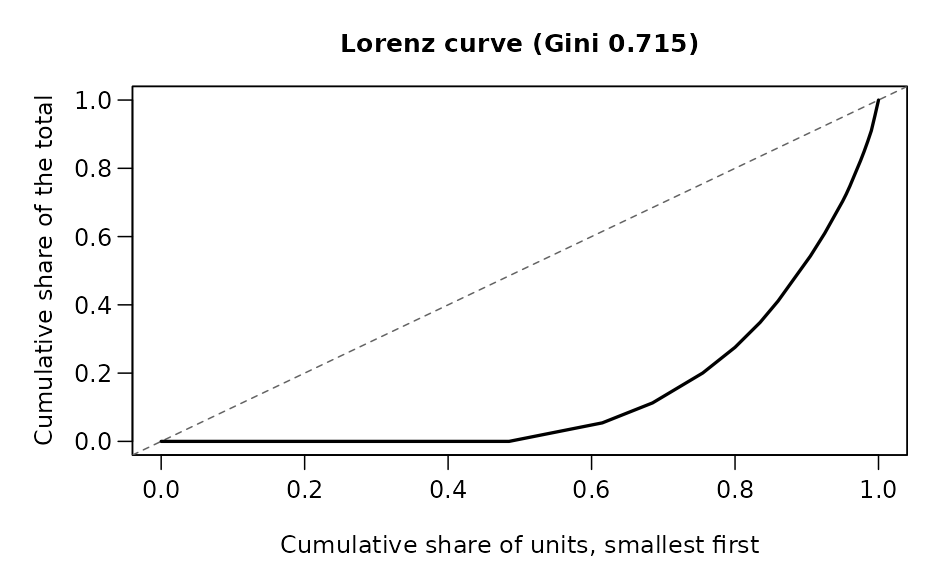
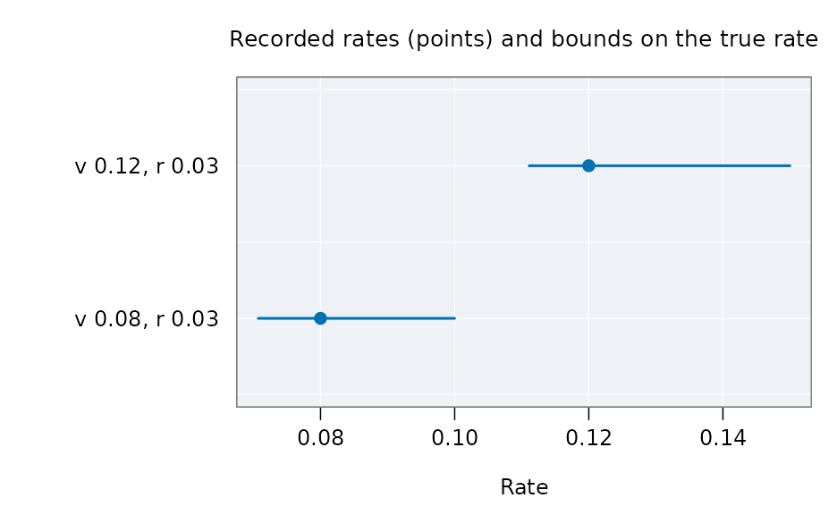
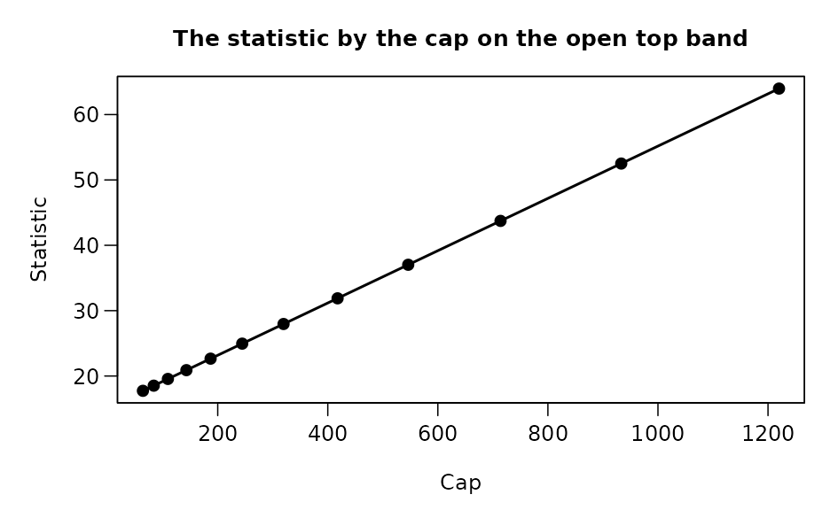
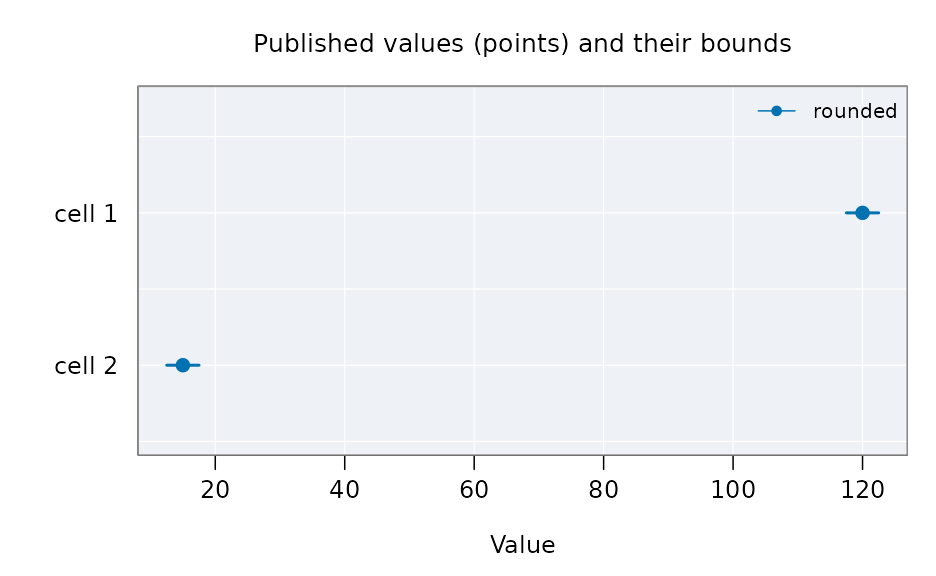
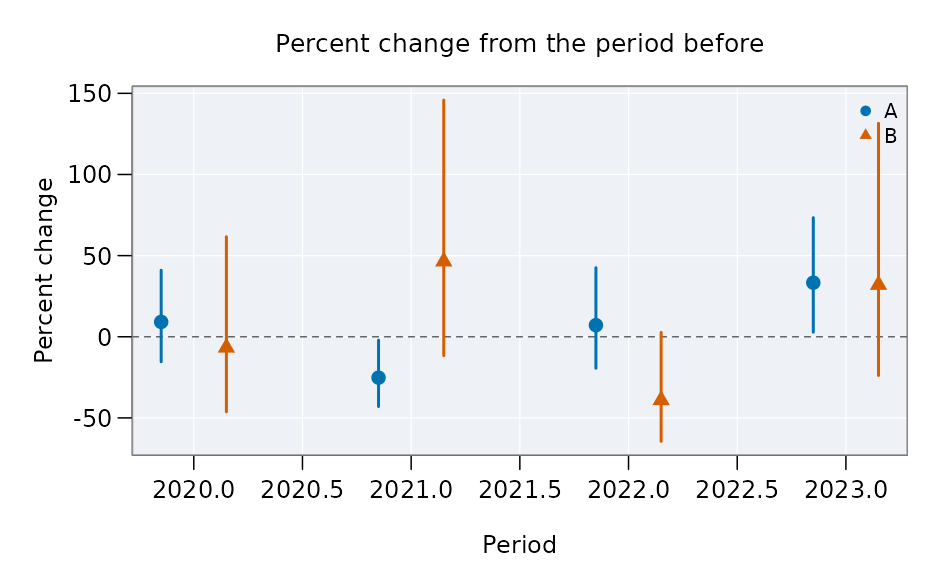

# Counts, rates, concentration and published tables

Count regression, standardised rates, cross-tables, concentration of
crime, the dark figure, and tables published in bands.

Each section is one help page: what the function is for, the example of
its help page as it runs, and the plot of its result where the package
draws one. [`?name`](https://rdrr.io/r/base/name.html) gives the
arguments and the value in full.

## Counts, rates and tables

### Count regression: rate ratios between groups

[`cntreg()`](https://rootcoder007.github.io/crimlab/reference/cntreg.md):
Fits a log-linear model of a count on a group, with adjustment columns,
an exposure and clusters, by Poisson and negative binomial maximum
likelihood, and reports the incidence rate ratio (IRR) of each group
against the reference with its interval. The same model serves counts of
people, placements, days or deaths in the cells of a published table and
counts per person or per area.

``` r

# placements by group in eight institutions over three years
d <- data.frame(
  n = c(12, 30, 8, 25, 14, 41, 9, 22, 11, 35, 7, 28),
  female = rep(c("no", "yes"), 6),
  year = factor(rep(c(2021, 2022, 2023), each = 4)),
  inst = rep(c("A", "B", "C", "D"), each = 2, length.out = 12)
)
cntreg(d$n, d$female, adj = d["year"], clus = d$inst)
#> cntreg: 12 counts, 4 clusters; reference no
#> rate ratios (95% intervals):
#>     fit term      irr       lo       hi            p   sep
#>    pois  yes 2.967213 2.219882 3.966137 2.036053e-13 FALSE
#>      nb  yes 2.967220 2.211509 3.981170 4.108785e-13 FALSE
#>  poiscl  yes 2.967213 2.610266 3.372972 4.107025e-62 FALSE
#>    nbcl  yes 2.967220 2.610217 3.373050 4.296535e-62 FALSE
#> negative binomial theta 581.5672; AIC Poisson 74.68582, negative binomial 76.67518
# rates: a count per person-days of exposure
cntreg(c(5, 12), c("a", "b"), expo = c(1000, 1500))
#> Warning: cntreg: the negative binomial fit failed (theta has no finite estimate); its
#> rows are NA.
#> cntreg: 2 counts; reference a
#> rate ratios (95% intervals):
#>   fit term irr       lo       hi         p   sep
#>  pois    b 1.6 0.563681 4.541576 0.3772454 FALSE
#>    nb    b  NA       NA       NA        NA FALSE
```

``` r

res <- cntreg(c(5, 12), c("a", "b"), expo = c(1000, 1500))
#> Warning: cntreg: the negative binomial fit failed (theta has no finite estimate); its
#> rows are NA.
plot(res)
```



### Rates and proportions by group: ratios and differences

[`grprr()`](https://rootcoder007.github.io/crimlab/reference/grprr.md):
The rate (events over exposure) or the proportion (events over trials)
of each group, and its ratio to and difference from a reference group,
with approximate and exact intervals. Rows that share a group are
pooled: give one row per group, or one per case (0/1 outcomes with
`n = 1`, the default for proportions), or anything between.

``` r

# use-of-force incidents per 1,000 contacts by perceived race
grprr(c(white = 120, black = 95, other = 30),
      c(white = 60000, black = 21000, other = 15000), per = 1000)
#> grprr: rates per 1000, 95% intervals
#>  group   x     n    rate       lo       hi      elo      ehi       rep
#>  white 120 60000 2.00000 1.672347 2.391849 1.658199 2.391510 0.7836735
#>  black  95 21000 4.52381 3.699754 5.531409 3.660032 5.530123 1.7725948
#>  other  30 15000 2.00000 1.398372 2.860470 1.349392 2.855124 0.7836735
#> against white:
#>  group    ratio        lo       hi       elo      ehi    diff        dlo       dhi
#>  black 2.261905 1.7281381 2.960535 1.7096642 2.985434 2.52381  1.5462750 3.5013441
#>  other 1.000000 0.6702691 1.491938 0.6468078 1.502337 0.00000 -0.8001519 0.8001519
# proportions from one row per case
grprr(c(1, 0, 0, 1, 1, 0, 1, 1), grp = c(1, 1, 1, 1, 2, 2, 2, 2),
      type = "prop")
#> grprr: proportions, 95% intervals
#>  group x n rate        lo        hi        elo       ehi rep
#>      1 2 4 0.50 0.1500390 0.8499610 0.06758599 0.9324140 0.8
#>      2 3 4 0.75 0.3006418 0.9544127 0.19412045 0.9936905 1.2
#> against 1:
#>  group ratio        lo       hi elo ehi diff        dlo       dhi
#>      2   1.5 0.4837821 4.650854  NA  NA 0.25 -0.3195573 0.6552867
```

``` r

res <- grprr(c(1, 0, 0, 1, 1, 0, 1, 1), grp = c(1, 1, 1, 1, 2, 2, 2, 2),
             type = "prop")
plot(res)
```



### Directly standardised rates

[`dastd()`](https://rootcoder007.github.io/crimlab/reference/dastd.md):
The rate each group would have with the stratum make-up (age bands, say)
of a standard population: the sum over strata of the standard’s weights
times the group’s stratum rates. The interval is Fay and Feuer’s gamma
interval; the ratio of two standardised rates has a log-normal interval
and their difference a normal one.

``` r

d <- data.frame(age = rep(c("18-29", "30-49", "50+"), 2),
                grp = rep(c("A", "B"), each = 3),
                x = c(30, 22, 5, 41, 30, 12),
                n = c(5000, 9000, 6000, 3000, 8000, 7000))
dastd(d$x, d$n, d$age, d$grp, std = c(30, 45, 25), per = 1e4)
#> dastd: standardised rates per 10000
#>  group  x     rate       lo       hi      var
#>      A 57 31.08333 23.49743 40.39982 17.16806
#>      B 83 62.16071 48.83268 78.21030 52.02280
#> against A:
#>  group    ratio       lo      hi     diff     dlo      dhi
#>      B 1.999809 1.414352 2.82761 31.07738 14.7742 47.38057
```

``` r

res <- dastd(d$x, d$n, d$age, d$grp, std = c(30, 45, 25), per = 1e4)
plot(res)
```



### Indirect standardisation: standardised ratios with shrinkage

[`sirex()`](https://rootcoder007.github.io/crimlab/reference/sirex.md):
The events observed in each group (an area, a police service) against
those expected from stratum rates, the standardised incidence ratio
(SIR) with its exact Poisson interval, funnel-plot limits for a ratio of
1 at its expected count, and the ratio shrunk towards the overall one by
the empirical Bayes estimate of Marshall (a gamma prior fitted by
moments), so that groups with little exposure are not ranked on noise.

``` r

d <- data.frame(area = rep(c("N", "S", "E"), each = 2),
                age = rep(c("young", "old"), 3),
                x = c(12, 3, 30, 9, 4, 1),
                n = c(4000, 2000, 8000, 3000, 1500, 900))
sirex(d$x, d$n, d$age, d$area)
#> sirex: observed over expected, 95% intervals and funnel limits
#>  group obs      expd       sir        lo       hi eb shr       flo      fhi   out
#>      E   5  7.094162 0.7048049 0.2288482 1.644779  1   1 0.2819220 1.832493 FALSE
#>      N  15 18.036409 0.8316511 0.4654688 1.371682  1   1 0.5544341 1.496972 FALSE
#>      S  39 33.869429 1.1514809 0.8188155 1.574112  1   1 0.6790785 1.358157 FALSE
```

``` r

res <- sirex(d$x, d$n, d$age, d$area)
plot(res)
```



### Cross-tabulation with tests and measures of association

[`ctabx()`](https://rootcoder007.github.io/crimlab/reference/ctabx.md):
Builds a two-way table from labels (counting rows, summing a count
column of an aggregate table, or counting distinct ids per cell) and
gives Pearson’s chi-square test, the likelihood-ratio test, Cramer’s V
with an interval and its bias-corrected form, the contingency
coefficient, phi for a 2 x 2 table, the share on the diagonal (the rows
whose label is also the column’s, as a region at placement against the
region now), and on request Fisher’s exact test with, for a 2 x 2 table,
the conditional odds ratio and its exact interval.

``` r

# force type by weapon, one row per incident
wp <- c("none", "none", "knife", "gun", "none", "knife", "gun", "none")
fc <- c("hands", "hands", "CEW", "firearm", "CEW", "hands", "firearm",
        "hands")
ctabx(wp, fc)
#> ctabx: 3 x 3 table (n), n = 8
#>       CEW firearm hands
#> gun     0       2     0
#> knife   1       0     1
#> none    1       0     3
#> chi-square 8.5 on 4 df, p = 0.07488723
#> Cramer's V 0.728869 [0, 1], bias-corrected 0.586302
# region at placement against region now: the diagonal share
ctabx(c("N", "N", "E", "W", "E"), c("N", "E", "E", "W", "E"))
#> ctabx: 3 x 3 table (n), n = 5
#>   E N W
#> E 2 0 0
#> N 1 1 0
#> W 0 0 1
#> chi-square 6.666667 on 4 df, p = 0.1545873
#> Cramer's V 0.8164966 [0, 1], bias-corrected 0.5773503
#> diagonal share 0.8
# a published aggregate table: sum its count column
d <- data.frame(race = c("A", "A", "B", "B"), sex = c("F", "M", "F", "M"),
                n = c(12, 40, 9, 51))
ctabx(d$race, d$sex, w = d$n, exact = TRUE)
#> ctabx: 2 x 2 table (sum), n = 112
#>    F  M
#> A 12 40
#> B  9 51
#> chi-square 1.192899 on 1 df, p = 0.2747455
#> Cramer's V 0.1032031 [0, 0.2883748], bias-corrected 0.04070387
#> Fisher's exact p = 0.3348875
```

``` r

res <- ctabx(d$race, d$sex, w = d$n, exact = TRUE)
plot(res)
```



## Concentration

### Concentration of crime across places, people or units

[`cconc()`](https://rootcoder007.github.io/crimlab/reference/cconc.md):
How unequally a total is spread across units: the Gini coefficient and
the Lorenz curve, the share held by the top units, and what chance alone
would show. A few places holding most of the incidents, or a few people
most of the placements, is the law of crime concentration (Weisburd
2015); with sparse counts much of the Gini comes from the units with no
events at all, and a Poisson process at the same mean already leaves
many units at zero (Bernasco and Steenbeek 2017).

``` r

set.seed(2)
n <- rnbinom(200, mu = 2, size = 0.4)
r <- cconc(n, nsim = 200, seed = 1)
r$stat[c("gini", "zero", "gpos", "gnull")]
#>      gini      zero      gpos     gnull 
#> 0.7151670 0.4850000 0.4469262 0.4973515
r$top
#>   frac units      share
#> 1 0.01     2 0.08977035
#> 2 0.05    10 0.29645094
#> 3 0.10    20 0.47181628
#> 4 0.25    50 0.80584551
#> 5 0.50   100 0.99373695
# people by number of placements, from a banded table
cconc(c(1, 2, 4, 8), w = c(500, 120, 40, 9), nsim = 0)$stat["gini"]
#>      gini 
#> 0.2599236
# the place of each incident, in order
cconc(sample(letters[1:8], 60, TRUE, prob = 8:1), nsim = 0)$grow$mhat
#> [1] 2.254821
```

``` r

plot(r)
```



### Tail index of a heavy-tailed count

[`hilltl()`](https://rootcoder007.github.io/crimlab/reference/hilltl.md):
The exponent `alpha` of a power-law tail, `P(X = k)` proportional to
`k^-alpha` above a threshold `xmin`, as when a few people account for
most repeat placements or most steps of an offender’s path are short and
a few very long (Clauset, Shalizi and Newman 2009). For counts the
maximum likelihood estimate of the discrete law is the default, its
normalising constant the Hurwitz zeta function `zeta(alpha, xmin)`;
`approx = TRUE` gives the closed form with `xmin - 1/2`, and
`discrete = FALSE` the continuous Hill estimator 1 + n / sum log(x /
xmin) for measurements such as distances. `ks` is the Kolmogorov-Smirnov
distance between the tail and the fitted law: an exponent is only as
good as that fit. The values at or below 0 are left out.

``` r

set.seed(4)
k <- floor(runif(400)^(-1 / 1.5))
hilltl(k, xmin = 1)
#> hilltl: discrete maximum likelihood
#> alpha 2.146 (se 0.0619), xmin 1, 400 tail values, KS 0.0377
```

## Dark figure

### Capture-recapture estimates of a hidden population

[`crcap()`](https://rootcoder007.github.io/crimlab/reference/crcap.md):
How many offenders, victims or incidents no list records, from the
overlap of two or three lists (police records, hospital records, a
survey). With two lists the Lincoln-Petersen estimate n1 n2 / m assumes
the lists are independent; when being on one list changes the odds of
being on the other by at most a factor `kappa`, the truth lies within
\[n1 n2 / (kappa m), kappa n1 n2 / m\] (`lower`, `upper`), and no data
can narrow that box. Chapman’s estimate `(n1 + 1)(n2 + 1) / (m + 1) - 1`
is nearly unbiased, with Seber’s standard error.

``` r

crcap(c(n1 = 500, n2 = 400, m = 80), kappa = 1.5)
#> crcap: two lists 
#>  petersen     lower     upper   chapman        se     floor 
#> 2500.0000 1666.6667 3750.0000 2479.2593  224.0262  820.0000
crcap(c("100" = 120, "010" = 90, "001" = 60, "110" = 30, "101" = 20,
        "011" = 15, "111" = 8), int = c(-0.5, 0, 0.5))
#> crcap: three lists 
#> observed  missing    total 
#>      343      576      919 
#>  lists  n1  n2  m floor petersen  chapman
#>    1-2 178 143 38   283 669.8421 659.9231
#>    1-3 178 103 28   253 654.7857 640.9310
#>    2-3 143 103 23   223 640.3913 623.0000
#>   int  missing     total
#>  -0.5 949.6635 1292.6635
#>   0.0 576.0000  919.0000
#>   0.5 349.3617  692.3617
```

### The dark figure of crime: bounds instead of a point

[`dkfig()`](https://rootcoder007.github.io/crimlab/reference/dkfig.md):
What recorded crime and a victimisation survey together say about the
crime that is never recorded, as intervals that hold under stated limits
on the errors (Manski 2003).

``` r

dkfig(v = c(0.12, 0.08), r = 0.03, amax = 0.01, bmax = 0.2, thr = 0.15)
#> dkfig: bounds on the dark figure
#>      v    r         lo   hi        dlo  dhi    ratio       brk
#> 1 0.12 0.03 0.11111111 0.15 0.08111111 0.12 5.000000 0.2000000
#> 2 0.08 0.03 0.07070707 0.10 0.04070707 0.07 3.333333 0.4666667
dkfig(va = 900, ra = 300, rb = 450, lam = 0.5)
#> dkfig: bounds on the dark figure
#>         rate       rateup        totlo        tothi         dklo         dkhi 
#>    0.3333333    0.5555556 1350.0000000 3600.0000000  600.0000000 2850.0000000 
#>        width 
#> 2250.0000000
dkfig(k = c(1, 1, 2, 1, 3))
#> dkfig: bounds on the dark figure
#> incid offen ratio extra lower upper 
#>   5.0   8.0   1.6   0.6   5.0  15.0
```

``` r

res <- dkfig(v = c(0.12, 0.08), r = 0.03, amax = 0.01, bmax = 0.2, thr = 0.15)
plot(res)
```



## Published tables

### Banded categories: bounds, values and what the open band costs

[`bandx()`](https://rootcoder007.github.io/crimlab/reference/bandx.md):
Justice statistics are often published in bands (“1-5 days”, “16 to 30”,
“Over 60”, “Less than 1 year”).
[`bandx()`](https://rootcoder007.github.io/crimlab/reference/bandx.md)
reads each label into a lower and an upper end, places a value in each
band (the midpoint, an end, or the geometric mean), expands a banded
frequency table into one value per unit, and shows how much a statistic
of those values depends on the cap assumed for an open top band.

``` r

b <- c("1-5", "6-15", "16-30", "31-60", "Over 60")
n <- c(40, 25, 15, 12, 8)
r <- bandx(b, n, stat = mean)
r$bands
#>     label lower upper openlo openup value lo  hi
#> 1     1-5     1     5  FALSE  FALSE   3.0  1   5
#> 2    6-15     6    15  FALSE  FALSE  10.5  6  15
#> 3   16-30    16    30  FALSE  FALSE  23.0 16  30
#> 4   31-60    31    60  FALSE  FALSE  45.5 31  60
#> 5 Over 60    61    NA  FALSE   TRUE  91.5 61 122
r$sens
#>           cap    value
#> 1    64.05000 17.73700
#> 2    83.72753 18.52410
#> 3   109.45042 19.55302
#> 4   143.07594 20.89804
#> 5   187.03193 22.65628
#> 6   244.49214 24.95469
#> 7   319.60536 27.95921
#> 8   417.79498 31.88680
#> 9   546.15054 37.02102
#> 10  713.93968 43.73259
#> 11  933.27724 52.50609
#> 12 1220.00000 63.97500
```

``` r

plot(r)
```



### Bounds implied by rounding and suppression in a published table

[`pbbnd()`](https://rootcoder007.github.io/crimlab/reference/pbbnd.md):
A published count stands for every true count that could have produced
it. Rounded to the nearest multiple of `rnd`, a true count lies within
`rnd / 2` of it (randomly rounded, within `rnd - 1`); suppressed below a
limit `k` (a cell written `"<k"`, or a marker such as `"x"` with
`suplim = k`), it lies from 0 to `k - 1`. Given the cells of an earlier
period, `chg` holds every change the two columns allow, and an interval
that spans 0 cannot tell a rise from a fall. See `proof("pbbnd")`.

``` r

pbbnd(c("1,240", "35", "<5", "x"), rnd = 5, suplim = 10)
#> pbbnd: what the published cells allow
#>  value  lower  upper     status
#>   1240 1237.5 1242.5    rounded
#>     35   32.5   37.5    rounded
#>     NA    0.0    4.0 suppressed
#>     NA    0.0    9.0 suppressed
pbbnd(c(120, 15), rnd = 5, prev = c(100, 20), pop = 5e4)
#> pbbnd: what the published cells allow
#>  value lower upper  status
#>    120 117.5 122.5 rounded
#>     15  12.5  17.5 rounded
#>  chglo chgup     pctlo    pctup ratelo rateup
#>     15    25  14.63415 25.64103   2.35   2.45
#>    -10     0 -44.44444  0.00000   0.25   0.35
```

``` r

res <- pbbnd(c(120, 15), rnd = 5, prev = c(100, 20), pop = 5e4)
plot(res)
```



### Year-over-year change in a published series

[`yoypx()`](https://rootcoder007.github.io/crimlab/reference/yoypx.md):
The change of each period against the period `lag` before it, within
groups (an agency, a region): the difference, the percent change (or,
for percentages, the change in points), and for counts the exact
interval of the percent change, from the conditional binomial of the
count now among both, the exact two-sided p-value of no change (as
[`stats::binom.test()`](https://rdrr.io/r/stats/binom.test.html)), and
the p-values adjusted for the number of comparisons (as
[`stats::p.adjust()`](https://rdrr.io/r/stats/p.adjust.html)). With
`rnd`, the counts are taken as rounded, and the envelope of the change
they allow is added, with a percent interval that covers both.

``` r

d <- data.frame(year = rep(2019:2023, 2),
                svc = rep(c("A", "B"), each = 5),
                n = c(120, 131, 98, 105, 140, 30, 28, 41, 25, 33))
yoypx(d$n, d$year, d$svc, rnd = 5)
#> yoypx: change on the earlier period
#>  group  prd value prev change     pctchg              flag      pctlo      pctup
#>      A 2019   120   NA     NA         NA no earlier period         NA         NA
#>      A 2020   131  120     11   9.166667              <NA> -15.436293  41.033275
#>      A 2021    98  131    -33 -25.190840              <NA> -43.017280  -2.059398
#>      A 2022   105   98      7   7.142857              <NA> -19.421106  42.569190
#>      A 2023   140  105     35  33.333333              <NA>   2.787153  73.399950
#>      B 2019    30   NA     NA         NA no earlier period         NA         NA
#>      B 2020    28   30     -2  -6.666667              <NA> -46.269451  61.661111
#>      B 2021    41   28     13  46.428571              <NA> -11.610446 145.863553
#>      B 2022    25   41    -16 -39.024390              <NA> -64.464747   2.692906
#>      B 2023    33   25      8  32.000000              <NA> -23.859990 131.538008
#>           p      padj signif envlo envup     envplo    envpup     cpctlo     cpctup
#>          NA        NA     NA    NA    NA         NA        NA         NA         NA
#>  0.52799664 0.7039955  FALSE     6    16   4.897959  13.61702 -15.436293  41.033275
#>  0.03423381 0.1369352  FALSE   -38   -28 -28.464419 -21.78988 -43.017280  -2.059398
#>  0.67377407 0.7700275  FALSE     2    12   1.990050  12.56545 -19.421106  42.569190
#>  0.02963430 0.1369352  FALSE    30    40  27.906977  39.02439   2.787153  73.399950
#>          NA        NA     NA    NA    NA         NA        NA         NA         NA
#>  0.89568321 0.8956832  FALSE    -7     3 -21.538462  10.90909 -46.269451  61.661111
#>  0.14803218 0.2960644  FALSE     8    18  26.229508  70.58824 -11.610446 145.863553
#>  0.06401750 0.1707133  FALSE   -21   -11 -48.275862 -28.57143 -64.464747   2.692906
#>  0.35814330 0.5730293  FALSE     3    13  10.909091  57.77778 -23.859990 131.538008
```

``` r

res <- yoypx(d$n, d$year, d$svc, rnd = 5)
plot(res)
```



### One call on a published table: check, change, rates and trend

[`tabrpt()`](https://rootcoder007.github.io/crimlab/reference/tabrpt.md):
The questions asked of a table an agency publishes are nearly always the
same: are its categories sound, what changed from one period to the next
and how sure can one be, what are the rates where there is a population,
and does a short series trend.
[`tabrpt()`](https://rootcoder007.github.io/crimlab/reference/tabrpt.md)
answers them in one call on a table in long form (one row per period and
group), with the steps a reviewer needs and that are easy to forget on a
deadline: exact intervals and p-values adjusted over every comparison,
and the envelope that rounding in the release allows.

``` r

d <- data.frame(year = rep(2019:2023, 2),
                svc = rep(c("A", "B"), each = 5),
                n = c(120, 131, 98, 105, 140, 30, 28, 41, 25, 33),
                pop = rep(c(50000, 12000), each = 5))
r <- tabrpt(d, "n", "year", by = "svc", pop = "pop", rnd = 5)
r
#> tabrpt: 10 group-periods, 8 changes tested, 0 marked after adjustment
#> groups: no problem found
#> rates per 1000: A 2.38, B 2.62
#> trend A: rate ratio per period 1.01, p 0.839
#> trend B: rate ratio per period 1.01, p 0.901
r$change[, c("group", "prd", "pctchg", "padj")]
#> yoypx: change on the earlier period
#>  group  prd     pctchg      padj
#>      A 2019         NA        NA
#>      A 2020   9.166667 0.7039955
#>      A 2021 -25.190840 0.1369352
#>      A 2022   7.142857 0.7700275
#>      A 2023  33.333333 0.1369352
#>      B 2019         NA        NA
#>      B 2020  -6.666667 0.8956832
#>      B 2021  46.428571 0.2960644
#>      B 2022 -39.024390 0.1707133
#>      B 2023  32.000000 0.5730293
```
