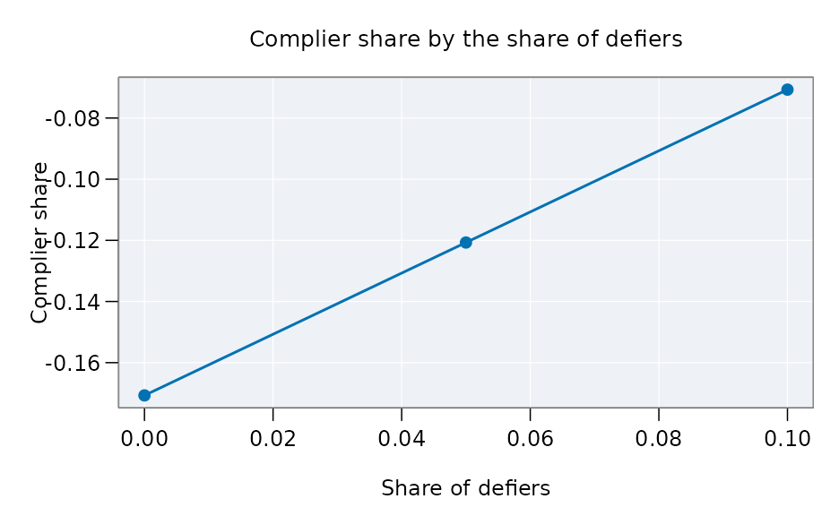
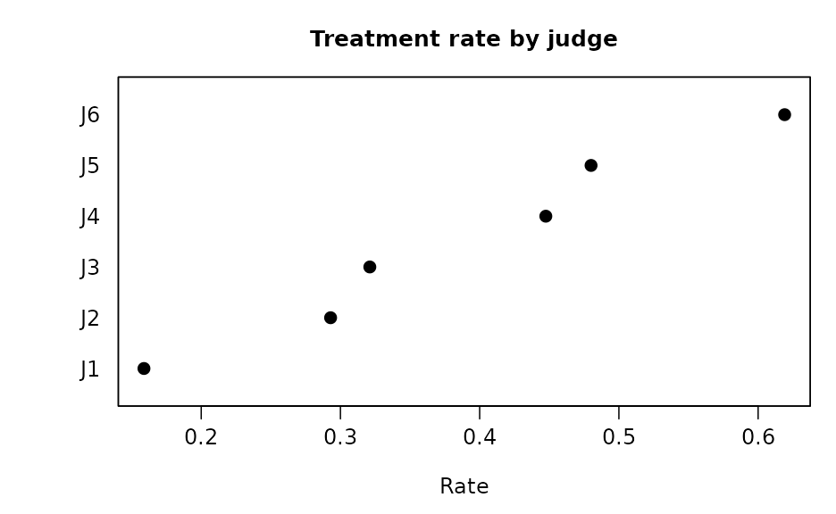
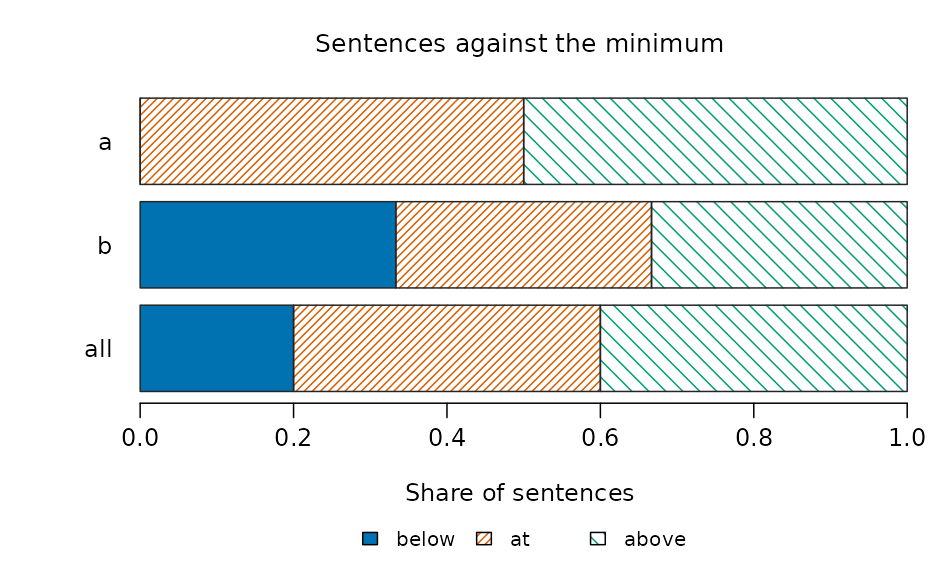
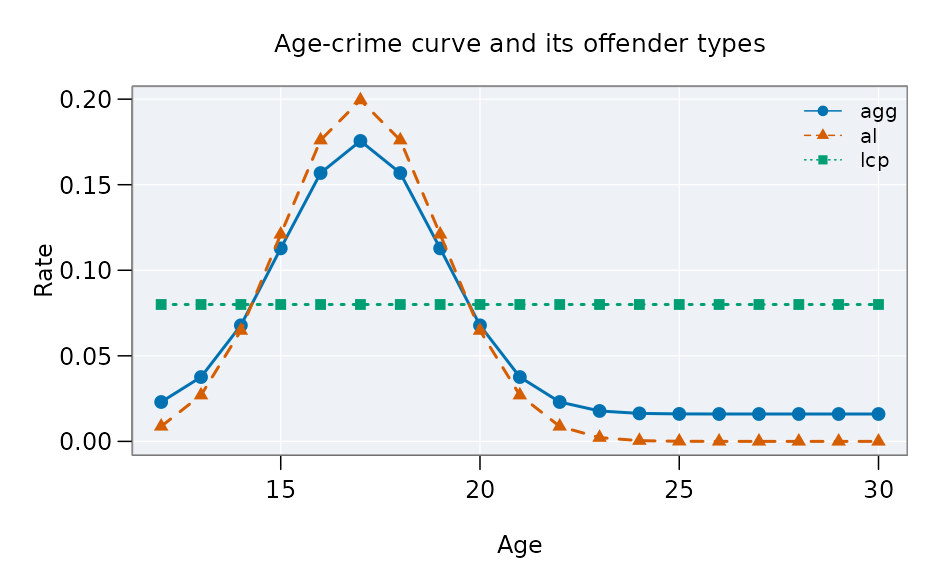
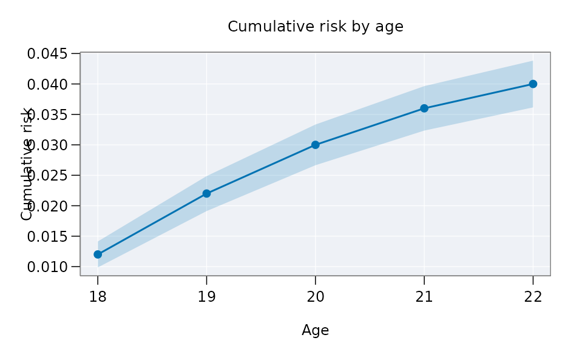
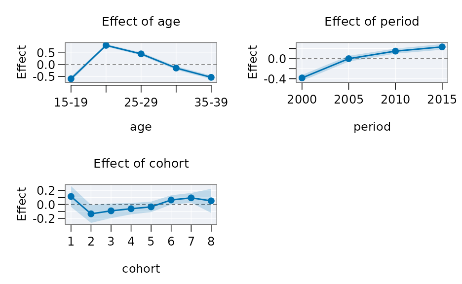
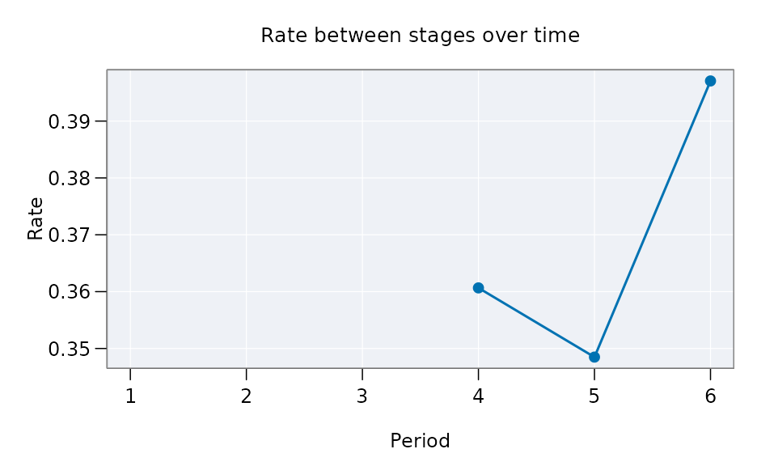

# Courts, sentencing and the life course

Judge-leniency designs, sentencing models, the age-crime curve,
cumulative risk and the justice pipeline.

Each section is one help page: what the function is for, the example of
its help page as it runs, and the plot of its result where the package
draws one. [`?name`](https://rdrr.io/r/base/name.html) gives the
arguments and the value in full.

## Courts and sentencing

### The judge-leniency instrument

[`jdgiv()`](https://rootcoder007.github.io/crimlab/reference/jdgiv.md):
When cases are assigned to judges at random, the judge’s leniency is an
instrument for the decision (detention, a custodial sentence): the
difference in outcomes between lenient and strict judges over the
difference in decisions is the Wald ratio (Imbens and Angrist 1994). It
is the average effect on the compliers, the cases whose decision depends
on the judge, only if no case defies (is detained by the lenient judge
and released by the strict one). With a share of defiers `s` whose
effect is `e`, the compliers number the first stage plus `s` and their
effect is `(wald * fs + s * e) / (fs + s)`; `sens` gives it over a grid,
so a reader sees how far the conclusion rests on monotonicity (de
Chaisemartin 2017). Code `z` so that the first stage is positive (1 for
the judge whose decision is more often 1); with a negative one the
complier share is negative and `ceff` is `NA`.

``` r

set.seed(7)
z <- rbinom(1000, 1, 0.5)
d <- rbinom(1000, 1, ifelse(z == 1, 0.3, 0.5))
y <- rbinom(1000, 1, 0.2 + 0.1 * d)
jdgiv(z, d, y)
#> jdgiv: observed 
#>          fs         itt        wald 
#> -0.17071258  0.01969084 -0.11534496 
#>   complier     always      never 
#> -0.1707126  0.4723320  0.6983806 
#>   dsh deff      cshare ceff
#>  0.00    0 -0.17071258   NA
#>  0.05    0 -0.12071258   NA
#>  0.10    0 -0.07071258   NA
```

``` r

res <- jdgiv(z, d, y)
plot(res)
```



### Do judges’ leniency rankings hold? Monotonicity checks

[`jmono()`](https://rootcoder007.github.io/crimlab/reference/jmono.md):
The decision rate of each judge (with a chi-square test that the rate is
the same for all, and its range), and two checks of the monotonicity a
judge-leniency design rests on.

``` r

set.seed(9)
j <- sample(paste0("J", 1:6), 1200, TRUE)
len <- c(J1 = 0.2, J2 = 0.3, J3 = 0.35, J4 = 0.4, J5 = 0.5, J6 = 0.6)
d <- rbinom(1200, 1, len[j])
g <- sample(c("adult", "youth"), 1200, TRUE)
r <- jmono(j, d, grp = g)
r$sub$summary
#>       pairs    reversed       share      signif     refuted      judges 
#> 30.00000000  1.00000000  0.03333333  0.00000000  0.00000000  0.00000000
```

``` r

plot(r)
```



### Sentences at, below and above a mandatory minimum

[`mmshr()`](https://rootcoder007.github.io/crimlab/reference/mmshr.md):
The shares of sentences at the mandatory minimum, below it (where a
court found a way around it) and above it, and the mean excess of those
above, overall and by group (offence, court).

``` r

mmshr(c(365, 400, 300, 365, 730), 365, c("a", "a", "b", "b", "b"))
#> mmshr: sentences against the minimum
#>  group n        at     below     above mexcess
#>      a 2 0.5000000 0.0000000 0.5000000      35
#>      b 3 0.3333333 0.3333333 0.3333333     365
#>    all 5 0.4000000 0.2000000 0.4000000     200
```

``` r

res <- mmshr(c(365, 400, 300, 365, 730), 365, c("a", "a", "b", "b", "b"))
plot(res)
```



### Credit for pre-sentence custody

[`pscred()`](https://rootcoder007.github.io/crimlab/reference/pscred.md):
The credit a Canadian court gives for time held in custody before
sentence: each day held counts for at most one day of the sentence
(Criminal Code s. 719(3)) or, where the circumstances justify it, for at
most one and a half days (s. 719(3.1)). With the sentence imposed, the
time left to serve after the credit is given too.

``` r

pscred(c(10, 30, 45))
#>   days ratio credit
#> 1   10   1.5   15.0
#> 2   30   1.5   45.0
#> 3   45   1.5   67.5
pscred(c(10, 30, 45), ratio = c(1, 1.5, 1.5), sentence = 60)
#>   days ratio credit sentence remain
#> 1   10   1.0   10.0       60     50
#> 2   30   1.5   45.0       60     15
#> 3   45   1.5   67.5       60      0
```

### The generalised ordered logit

[`gologt()`](https://rootcoder007.github.io/crimlab/reference/gologt.md):
An ordered outcome (a risk level, a charge’s seriousness, a sentence
band) regressed on covariates without forcing each covariate to act the
same way at every cut of the scale. For an outcome with levels 1, …, M,
each threshold `j < M` has its own intercept and slopes, P(y \> j) =
F(a_j + x b_j) with `F` the logistic distribution function (Peterson and
Harrell 1990; Williams 2006, the parameterisation of ‘gologit2’); a
covariate named in `par` keeps one slope for all the thresholds, as in
the proportional-odds model, so that `par = x` is that model. O’Connell
and Laniyonu (2025) find racial disparity in a risk tool concentrated at
the low-to-medium cut and absent at the medium-to-high one, which a
proportional-odds fit averages away.

``` r

set.seed(7)
n <- 400
d <- data.frame(race = rbinom(n, 1, 0.4), age = rnorm(n))
e1 <- 0.5 + 0.8 * d$race - 0.5 * d$age
e2 <- -1 + 0.1 * d$race - 0.5 * d$age
u <- runif(n)
d$risk <- factor(1 + (u < plogis(e1)) + (u < plogis(e2)), 1:3,
                 c("low", "med", "high"))
r <- gologt(d, "risk", c("race", "age"), par = "age")
r
#> gologt: generalised ordered logit, 400 rows, 3 levels; log-likelihood -414.564
#>         term      thr        est         se          z            p         lo
#>  (Intercept)  low|med  0.5549532 0.14198273  3.9085966 9.283381e-05  0.2766722
#>  (Intercept) med|high -0.8280251 0.14776492 -5.6036652 2.098659e-08 -1.1176390
#>         race  low|med  0.5972905 0.22943154  2.6033496 9.231777e-03  0.1476129
#>         race med|high -0.1312269 0.22560745 -0.5816604 5.607954e-01 -0.5734094
#>          age      all -0.5709891 0.09757872 -5.8515741 4.869423e-09 -0.7622399
#>          hi
#>   0.8332342
#>  -0.5384112
#>   1.0469681
#>   0.3109556
#>  -0.3797383
#> against proportional odds: LR 8.875 on 1 df, p 0.00289
```

### The slopes of a generalised ordered logit by threshold

[`gocoef()`](https://rootcoder007.github.io/crimlab/reference/gocoef.md):
The coefficients of
[`gologt()`](https://rootcoder007.github.io/crimlab/reference/gologt.md)
laid out as a table: one row per threshold of the outcome, one column
per term, so that a covariate’s slopes can be read across the cuts of
the scale (a parallel covariate repeats its one slope), with their
standard errors and, for the free covariates, the Wald test that the
slopes are equal.

``` r

set.seed(8)
n <- 300
d <- data.frame(race = rbinom(n, 1, 0.4), age = rnorm(n))
u <- runif(n)
d$risk <- 1 + (u < plogis(0.5 + 0.8 * d$race)) +
  (u < plogis(-1 + 0.1 * d$race - 0.3 * d$age))
gocoef(gologt(d, "risk", c("race", "age")), "race")
#> $est
#>            race
#> 1|2  0.69848026
#> 2|3 -0.03629893
#> 
#> $se
#>          race
#> 1|2 0.2765599
#> 2|3 0.2509516
#> 
#> $wald
#>   term     stat df          p
#> 1 race 6.354064  1 0.01171127
```

## Life course and the justice pipeline

### The age-crime curve of a mixture of offender types

[`agemix()`](https://rootcoder007.github.io/crimlab/reference/agemix.md):
The aggregate age-crime curve is the share-weighted mean of the curves
of latent types (adolescence-limited, life-course persistent, and so
on), and one aggregate curve fits many mixtures: the aggregate alone
cannot tell one type from several (Moffitt 1993; Gottfredson and Hirschi
1990). What does tell them apart is the covariance of an individual’s
offending at two ages: with one type it is 0 (given the type, ages are
independent), with several it is the covariance across types of their
curves at the two ages, which `cov` gives for every pair of ages. With a
panel of individuals observed at two ages, the observed covariance and
its permutation test say whether one type is enough. See
`proof("agemix")`.

``` r

ages <- 12:30
al <- dnorm(ages, 17, 2)
lcp <- rep(0.08, length(ages))
r <- agemix(cbind(al = al, lcp = lcp), c(0.8, 0.2), ages)
r$cov["15", "25"]
#> [1] -0.0005241738
```

``` r

plot(r)
```



### Cumulative risk of a first event by age

[`cumrsk()`](https://rootcoder007.github.io/crimlab/reference/cumrsk.md):
The share of a birth cohort that has had a first arrest, conviction or
prison admission by each age, from first events by age and the
population: the hazard at each age is the first events over those still
without one, and the cumulative risk is one minus the product of the
complements, with Greenwood’s interval on the log scale of the survival
(Bonczar 2003; Pettit and Western 2004). With death rates the first
events count only among the cohort still alive, and no interval is
given.

``` r

cumrsk(18:22, c(120, 100, 80, 60, 40), rep(10000, 5))
#> cumrsk: cumulative risk of a first event by age
#>  age      hazard atrisk cumrisk          lo         hi
#>   18 0.012000000  10000   0.012 0.009863582 0.01413181
#>   19 0.010121457   9880   0.022 0.019120830 0.02487072
#>   20 0.008179959   9780   0.030 0.026650783 0.03333769
#>   21 0.006185567   9700   0.036 0.032341858 0.03964431
#>   22 0.004149378   9640   0.040 0.036151577 0.04383306
```

``` r

res <- cumrsk(18:22, c(120, 100, 80, 60, 40), rep(10000, 5))
plot(res)
```



### Age-period-cohort model by the intrinsic estimator

[`apcie()`](https://rootcoder007.github.io/crimlab/reference/apcie.md):
Asks how much of the change in a rate (arrests, imprisonment,
victimisation per head) over the years belongs to age, to the period and
to the generation (cohort) people were born into. From a table of counts
by age group (rows) and period (columns), with equal widths, and the
population at risk in each cell, the Poisson log-linear model

``` r

# arrests by five-year age group (rows) and five-year period (columns)
set.seed(11)
ag <- c(-1, 0.5, 0.2, -0.3, -0.6)
pe <- c(-0.2, 0, 0.1, 0.1)
co <- seq(-0.4, 0.4, length.out = 8)
ck <- outer(1:5, 1:4, function(i, j) j - i + 5)
eta <- outer(ag, pe, "+") + matrix(co[ck], 5)
pop <- matrix(1e5, 5, 4)
y <- matrix(rpois(20, pop * exp(-6 + eta)), 5,
            dimnames = list(c("15-19", "20-24", "25-29", "30-34", "35-39"),
                            c(2000, 2005, 2010, 2015)))
apcie(y, pop)
#> apcie: 5 ages, 4 periods, 8 cohorts; deviance 7.1182 on 6 df
#>         term level           est         se           lo           hi
#>  (Intercept)       -6.2524461958 0.02235638 -6.296263896 -6.208628495
#>          age 15-19 -0.5967910284 0.04565097 -0.686265286 -0.507316770
#>          age 20-24  0.8181347740 0.02738804  0.764455203  0.871814345
#>          age 25-29  0.4571013806 0.03144387  0.395472536  0.518730225
#>          age 30-34 -0.1427156034 0.03780542 -0.216812864 -0.068618343
#>          age 35-39 -0.5357295228 0.04059046 -0.615285353 -0.456173692
#>       period  2000 -0.3837793842 0.03014061 -0.442853889 -0.324704880
#>       period  2005 -0.0003931638 0.02913733 -0.057501287  0.056714960
#>       period  2010  0.1501259914 0.02581925  0.099521189  0.200730794
#>       period  2015  0.2340465566 0.02873443  0.177728103  0.290365010
#>       cohort     1  0.1133769341 0.07568888 -0.034970536  0.261724405
#>       cohort     2 -0.1340621684 0.06597129 -0.263363521 -0.004760816
#>       cohort     3 -0.0913148531 0.05301973 -0.195231623  0.012601917
#>       cohort     4 -0.0613495318 0.04112454 -0.141952150  0.019253087
#>       cohort     5 -0.0350107914 0.03827002 -0.110018660  0.039997077
#>       cohort     6  0.0636191215 0.03380790 -0.002643152  0.129881395
#>       cohort     7  0.0937161963 0.03550707  0.024123611  0.163308782
#>       cohort     8  0.0510250929 0.08760061 -0.120668942  0.222719128
```

``` r

res <- apcie(y, pop)
plot(res)
```



### Rates between stages of the justice pipeline

[`jpipe()`](https://rootcoder007.github.io/crimlab/reference/jpipe.md):
Cases moving from one stage to the next (charges to convictions,
admissions to releases) take time, so a rate of this period’s outflow
over this period’s inflow mixes cohorts.
[`jpipe()`](https://rootcoder007.github.io/crimlab/reference/jpipe.md)
divides the numerator summed over a window by the denominator summed
over the same window moved back by the lag between the stages.

``` r

jpipe(num = c(5, 7, 6, 9, 8, 10), den = c(20, 22, 19, 25, 24, 26),
      win = 3, lag = 1)
#> jpipe: lagged rates between stages
#>  group index num den      rate
#>    all     1  NA  NA        NA
#>    all     2  NA  NA        NA
#>    all     3  18  NA        NA
#>    all     4  22  61 0.3606557
#>    all     5  23  66 0.3484848
#>    all     6  27  68 0.3970588
```

``` r

res <- jpipe(num = c(5, 7, 6, 9, 8, 10), den = c(20, 22, 19, 25, 24, 26),
             win = 3, lag = 1)
plot(res)
```



### Group-based trajectory model for counts

[`zgll()`](https://rootcoder007.github.io/crimlab/reference/zgll.md),
[`zgem()`](https://rootcoder007.github.io/crimlab/reference/zgll.md):
The finite mixture of Nagin (1999) for counts over time, zero-inflated
Poisson within groups (Lambert 1992; Nielsen et al. 2014): unit `i`
belongs to group `k` with probability `prob[k]`; given `k`, its counts
are independent Poisson with log mean off + x_t’ beta_k and, when `z` is
given, zero with extra probability plogis(z_t’ gamma_k).
[`zgll()`](https://rootcoder007.github.io/crimlab/reference/zgll.md)
evaluates the log-likelihood and the posterior memberships;
[`zgem()`](https://rootcoder007.github.io/crimlab/reference/zgll.md)
fits by a generalised EM from the values given (the log-likelihood never
decreases). One start per call: the model has local maxima, so several
starts are the caller’s loop, and the number of groups is the caller’s
choice (compare the log-likelihoods with a penalty such as BIC).

``` r

set.seed(1)
x <- cbind(1, (1:6 - 3.5) / 2.5)
b <- cbind(c(0.5, -1), c(1.5, 0.5))
y <- t(vapply(rep(1:2, each = 50),
              function(k) rpois(6, exp(x %*% b[, k])), integer(6)))
f <- zgem(y, x, par = b + 0.2, prob = c(0.5, 0.5))
f$par
#>            [,1]     [,2]
#> [1,]  0.4069311 1.530861
#> [2,] -1.1301323 0.481301
```

### Group-based multivariate trajectories

[`mvtll()`](https://rootcoder007.github.io/crimlab/reference/mvtll.md),
[`mvtem()`](https://rootcoder007.github.io/crimlab/reference/mvtll.md):
The group-based trajectory model with several normal indicators per unit
(Nagin 1999; Magrini 2022): given group `k`, the `r` indicators of a
unit at period `t` are multivariate normal with mean B_k’ x_t and
covariance `S_k`, independently over periods.
[`mvtll()`](https://rootcoder007.github.io/crimlab/reference/mvtll.md)
evaluates the log-likelihood and posterior memberships;
[`mvtem()`](https://rootcoder007.github.io/crimlab/reference/mvtll.md)
fits by EM with closed-form steps from the values given. A period with
any missing indicator is left out for that unit.

``` r

set.seed(1)
x <- cbind(1, 1:5)
y <- array(rnorm(40 * 5 * 2), c(40, 5, 2))
y[1:20, , 1] <- y[1:20, , 1] + 3
b <- array(c(0, 0, 0, 0, 3, 0, 0, 0), c(2, 2, 2))
s <- array(diag(2), c(2, 2, 2))
mvtem(y, x, b, s, prob = c(0.5, 0.5))$prob
#> [1] 0.5000024 0.4999976
```
