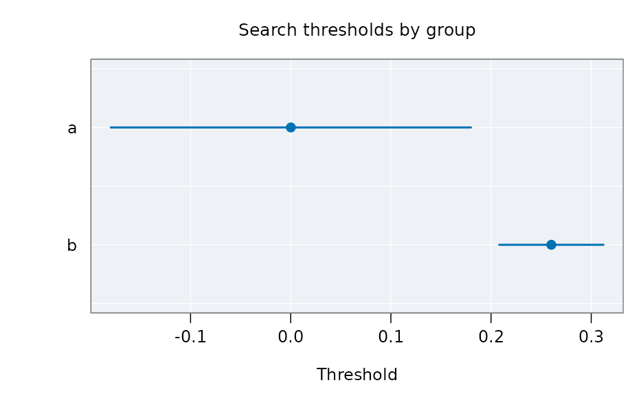
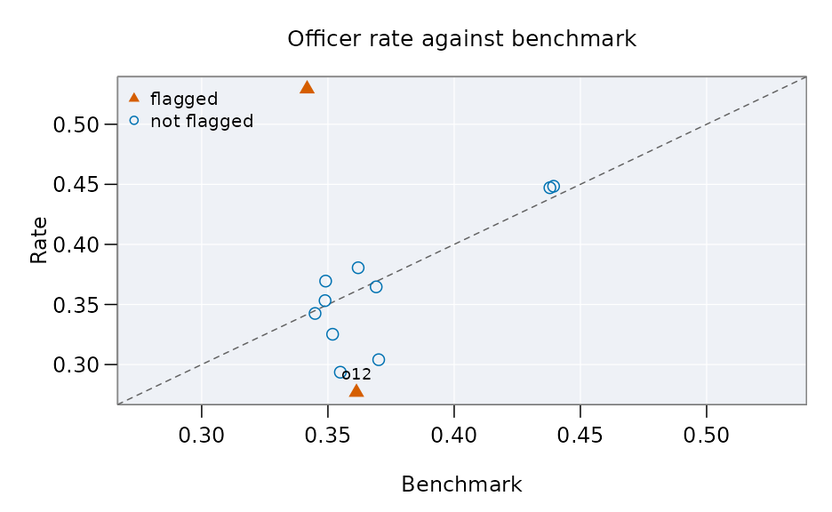
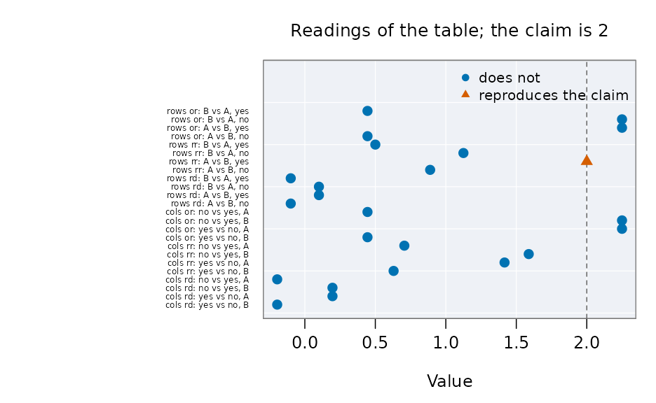

# Disparities, benchmarks and checks of a reported number

Tests of disparity in stops and outcomes, and checks that a published
ratio or table says what it is taken to say.

Each section is one help page: what the function is for, the example of
its help page as it runs, and the plot of its result where the package
draws one. [`?name`](https://rdrr.io/r/base/name.html) gives the
arguments and the value in full.

## Disparities

### Veil-of-darkness test

[`vodtst()`](https://rootcoder007.github.io/crimlab/reference/vodtst.md):
Compares each group’s share of stops made in daylight, when a driver’s
race can be seen, with its share in darkness, when it cannot. The ratio
of the two odds against a reference group is the factor by which
visibility changes that group’s chance of being stopped; 1 means no
change.

``` r

vodtst(day = c(white = 600, black = 400),
       night = c(white = 700, black = 300))
#>   group   ref shday shnight    ratio sign
#> 1 white  TRUE   0.6     0.7 1.000000   -1
#> 2 black FALSE   0.4     0.3 1.555556    1
# one table of groups by day and night
stops <- data.frame(day = c(600, 400), night = c(700, 300),
                    row.names = c("white", "black"))
vodtst(stops)
#>   group   ref shday shnight    ratio sign
#> 1 white  TRUE   0.6     0.7 1.000000   -1
#> 2 black FALSE   0.4     0.3 1.555556    1
```

### Risks behind an odds ratio

[`orrisk()`](https://rootcoder007.github.io/crimlab/reference/orrisk.md):
An odds ratio is not a relative risk: it lies further from 1, and by
more the more common the outcome. Given the odds ratio, the overall rate
of the outcome and the share exposed, this returns the two risks and the
relative risk they imply. See `proof("orrisk")`.

``` r

orrisk(or = 3, rate = 0.4, share = 0.5)
#>   exposed unexposed        rr        or 
#> 0.5282202 0.2717798 1.9435596 3.0000000
```

### Outcome test

[`outtst()`](https://rootcoder007.github.io/crimlab/reference/outtst.md):
The stop rate and the hit rate of a group searched whenever the chance
of guilt exceeds a threshold. Hit rates compare averages, not
thresholds: two groups held to the same threshold can show different hit
rates, and a group held to a lower threshold can show the higher one
(infra-marginality). See `proof("outtst")`.

``` r

outtst(q = c(0.1, 0.5, 0.9), t = 0.3)
#>      stop       hit 
#> 0.6666667 0.7000000
```

### Tests of discrimination in searches: hit rates, thresholds, rank order

[`thrtst()`](https://rootcoder007.github.io/crimlab/reference/thrtst.md):
Asks whether the police search people of one group on less evidence than
people of another. Three tests read the same counts of stops, searches
and successful searches (“hits”, contraband found):

``` r

# stops, searches and hits of two groups in four areas
d <- data.frame(
  grp = rep(c("a", "b"), 4), area = rep(1:4, each = 2),
  stops = c(1200, 800, 900, 1100, 1500, 700, 1000, 1000),
  srch = c(60, 70, 50, 95, 80, 66, 52, 90),
  hits = c(24, 18, 19, 25, 30, 17, 21, 24)
)
thrtst(d$stops, d$srch, d$hits, d$grp, area = d$area)
#> thrtst: reference a
#> hit rates (chi-square 10.25 on 1 df, p 0.00137):
#>  group stops srch hits      srate     hrate       diff         se        z          p
#>      a  4600  242   94 0.05260870 0.3884298  0.0000000         NA       NA         NA
#>      b  3600  321   84 0.08916667 0.2616822 -0.1267475 0.03979326 -3.18515 0.00144679
#> thresholds (likelihood ratio 0.03214 on 1 df, p 0.858):
#>  group          thr         se         lo        hi    diff        dse        z
#>      a 0.0001513307 0.09175977 -0.1796945 0.1799972 0.00000         NA       NA
#>      b 0.2601813432 0.02657569  0.2080940 0.3122687 0.26003 0.09569318 2.717331
#>           p
#>          NA
#>  0.00658108
# the rank-order test needs the officers' groups
thrtst(c(100, 100, 100, 100), c(10, 20, 30, 10), c(5, 5, 5, 5),
       grp = c(1, 1, 2, 2), off = c("x", "y", "x", "y"))$rank
#>   off1 off2   meas      zmin     zmax   rej
#> 1    x    y search -2.000000 3.651484  TRUE
#> 2    x    y    hit -1.936492 1.348400 FALSE
# the joint test of three officer groups
thrtst(rep(600, 9), c(72, 48, 60, 60, 72, 48, 48, 60, 72),
       rep(c(36, 24, 30), 3), grp = rep(1:3, each = 3),
       off = rep(c("a", "b", "c"), 3), rank = "joint")$rank
#>     meas off rank   rej
#> 1 search   a   NA  TRUE
#> 2 search   b   NA  TRUE
#> 3 search   c   NA  TRUE
#> 4    hit   a    1 FALSE
#> 5    hit   b    3 FALSE
#> 6    hit   c    2 FALSE
```

``` r

res <- thrtst(d$stops, d$srch, d$hits, d$grp, area = d$area)
plot(res)
```



### Internal benchmarking of officers

[`ibench()`](https://rootcoder007.github.io/crimlab/reference/ibench.md):
Asks whether an officer stops more people of a group (or searches,
arrests, uses force more often) than other officers do in the same
circumstances. Officers work different places and hours, so each
officer’s stops are compared not with all other stops but with the other
officers’ stops weighted to look like this officer’s: the propensity
`e(x)` that a stop with circumstances `x` (place, hour, day, reason) is
this officer’s comes from a logistic regression on `x` (over all stops),
and each other officer’s stop gets the weight `e / (1 - e)`, the weights
of the effect on the treated (Ridgeway and MacDonald 2009). The
benchmark is the weighted share of the outcome among those stops, and
the z statistic compares the officer’s share with it, with the variance
of a proportion for the officer and, for the benchmark, that of a
proportion over its effective number of stops, (sum w)^2 / sum w^2. With
many officers some will stand out by chance: `q` is the false discovery
rate of Benjamini and Hochberg (1995) over the officers tested, and
`flag` marks those with `q` below `fdr`.

``` r

set.seed(2)
n <- 3000
off <- sample(sprintf("o%02d", 1:12), n, TRUE)
night <- rbinom(n, 1, ifelse(off %in% c("o01", "o02"), 0.7, 0.3))
y <- rbinom(n, 1, plogis(-1 + night + 0.8 * (off == "o03")))
ibench(y, off, data.frame(night), minn = 50)
#> ibench: 12 officers, 12 tested; flagged at a false discovery rate of 0.05: 2
#>  off   n      rate     bench      ess          z            p            q  flag
#>  o01 252 0.4484127 0.4393818 1738.745  0.2694671 7.875702e-01 9.391220e-01 FALSE
#>  o02 246 0.4471545 0.4379157 1725.956  0.2727291 7.850615e-01 9.391220e-01 FALSE
#>  o03 255 0.5294118 0.3417565 2701.527  5.7630501 8.260725e-09 9.912870e-08  TRUE
#>  o04 266 0.3646617 0.3691144 2733.526 -0.1439985 8.855016e-01 9.391220e-01 FALSE
#>  o05 247 0.3805668 0.3619805 2740.723  0.5767080 5.641367e-01 9.391220e-01 FALSE
#>  o06 273 0.3040293 0.3701072 2717.313 -2.2521013 2.431587e-02 9.726348e-02 FALSE
#>  o07 246 0.3252033 0.3518533 2638.673 -0.8519623 3.942350e-01 9.391220e-01 FALSE
#>  o08 235 0.3531915 0.3488650 2641.215  0.1330054 8.941891e-01 9.391220e-01 FALSE
#>  o09 254 0.3425197 0.3449036 2577.094 -0.0763735 9.391220e-01 9.391220e-01 FALSE
#>  o10 235 0.2936170 0.3549139 2651.348 -1.9692089 4.892911e-02 1.467873e-01 FALSE
#>  o11 249 0.3694779 0.3490945 2646.200  0.6377712 5.236226e-01 9.391220e-01 FALSE
#>  o12 242 0.2768595 0.3613048 2687.908 -2.7944882 5.198194e-03 3.118917e-02  TRUE
ibench(y, off, data.frame(night), minn = 50, dr = TRUE)$tab
#>    off   n      rate     bench      ess           z            p            q  flag
#> 1  o01 252 0.4484127 0.4393818 1738.745  0.27653108 7.821402e-01 9.384964e-01 FALSE
#> 2  o02 246 0.4471545 0.4379157 1725.956  0.28607426 7.748212e-01 9.384964e-01 FALSE
#> 3  o03 255 0.5294118 0.3417565 2701.527  5.92119984 3.196012e-09 3.835214e-08  TRUE
#> 4  o04 266 0.3646617 0.3691144 2733.526 -0.14637442 8.836258e-01 9.384964e-01 FALSE
#> 5  o05 247 0.3805668 0.3619805 2740.723  0.58858288 5.561411e-01 9.384964e-01 FALSE
#> 6  o06 273 0.3040293 0.3701072 2717.313 -2.27360614 2.298968e-02 9.195871e-02 FALSE
#> 7  o07 246 0.3252033 0.3518533 2638.673 -0.86671658 3.860973e-01 9.266336e-01 FALSE
#> 8  o08 235 0.3531915 0.3488650 2641.215  0.13672962 8.912445e-01 9.384964e-01 FALSE
#> 9  o09 254 0.3425197 0.3449036 2577.094 -0.07715986 9.384964e-01 9.384964e-01 FALSE
#> 10 o10 235 0.2936170 0.3549139 2651.348 -2.01670530 4.372628e-02 1.311788e-01 FALSE
#> 11 o11 249 0.3694779 0.3490945 2646.200  0.65262224 5.139998e-01 9.384964e-01 FALSE
#> 12 o12 242 0.2768595 0.3613048 2687.908 -2.86006053 4.235602e-03 2.541361e-02  TRUE
```

``` r

res <- ibench(y, off, data.frame(night), minn = 50)
plot(res)
```



### Benchmark decomposition of a disparity

[`dspbm()`](https://rootcoder007.github.io/crimlab/reference/dspbm.md):
Splits each group’s disparity in force per resident, against a reference
group, into a disparity in contact per resident times a disparity in
force per contact. The split is a product, never a sum. See
`proof("dspbm")`.

``` r

dspbm(pop = c(a = 9000, b = 1000), contact = c(a = 900, b = 300),
      force = c(a = 9, b = 6))
#>   group   ref cd fd rd
#> 1     a  TRUE  1  1  1
#> 2     b FALSE  3  2  6
```

### Dyadic offending rates

[`dyadrt()`](https://rootcoder007.github.io/crimlab/reference/dyadrt.md):
Offences by one group against another, as a rate per member of the
offending group and as a rate per offender-victim pair exposed. The rate
per offender rises with the size of the victim group even when offenders
choose victims at random; the rate per pair does not. See
`proof("dyadrt")`.

``` r

pop <- c(a = 800, b = 200)
dyadrt(count = outer(pop, pop) / 1000, pop = pop)
#>   off vic count rtoff rtpair nulloff ratio
#> 1   a   a   640   0.8      1     0.8     1
#> 2   b   a   160   0.8      1     0.8     1
#> 3   a   b   160   0.2      1     0.2     1
#> 4   b   b    40   0.2      1     0.2     1
```

## Checks

### Which labelling reproduces a reported contrast?

[`relchk()`](https://rootcoder007.github.io/crimlab/reference/relchk.md):
A reported odds ratio, risk ratio or risk difference depends on which
group is the reference, which outcome is the event and which margin of
the table holds the groups.
[`relchk()`](https://rootcoder007.github.io/crimlab/reference/relchk.md)
recomputes the contrast from the table under every such reading and says
which ones reproduce the reported value: the labelling the report
states, another one, or none.

``` r

tab <- matrix(c(20, 10, 80, 90), 2,
              dimnames = list(c("A", "B"), c("yes", "no")))
# 2.25 is the odds ratio of A against B for "yes"
relchk(tab, 2.25, ref = "B", event = "yes")
#> relchk: reported 2.25, to 2 decimals
#> claim: or, ref B, event yes
#> verdict: the claim holds
#>   grp type group ref event value claim
#>  rows   or     B   A    no  2.25 FALSE
#>  rows   or     A   B   yes  2.25  TRUE
#>  cols   or    no yes     B  2.25 FALSE
#>  cols   or   yes  no     A  2.25 FALSE
# 0.44 is the same contrast read with the reference group swapped
relchk(tab, 0.44, ref = "B", event = "yes")
#> relchk: reported 0.44, to 2 decimals
#> claim: or, ref B, event yes
#> verdict: only readings the claim does not allow match
#>   grp type group ref event     value claim
#>  rows   or     B   A   yes 0.4444444 FALSE
#>  rows   or     A   B    no 0.4444444 FALSE
#>  cols   or    no yes     A 0.4444444 FALSE
#>  cols   or   yes  no     B 0.4444444 FALSE
# a risk ratio reported as an odds ratio
relchk(tab, 2.0, type = "or", digits = 1)
#> relchk: reported 2, to 1 decimal
#> claim: or
#> verdict: only readings the claim does not allow match
#>   grp type group ref event value claim
#>  rows   rr     A   B   yes     2 FALSE
```

``` r

res <- relchk(tab, 2.0, type = "or", digits = 1)
plot(res)
```



### Audit categorical inputs before an analysis

[`catchk()`](https://rootcoder007.github.io/crimlab/reference/catchk.md):
Reports, for each variable, what the functions of this package would
make of it: its storage type, its levels and their counts, missing
values, unused levels, levels counted fewer than `nmin` times, labels
that differ only by case or white space, a 0/1 or logical coding,
integer codes that look like categories, value labels (as haven makes)
that do not match the values, and which level a default would take as
the reference, and why. Nothing is changed.

``` r

d <- data.frame(sex = c("Male", "male", "Female", "Female", NA),
                custody = c(TRUE, FALSE, TRUE, TRUE, FALSE),
                court = c(1L, 2L, 2L, 3L, 1L))
catchk(d, nmin = 2)
#> catchk: 3 variables, 2 with problems
#>      var      type nlev   ref                            why
#>      sex character    3  <NA>             no order: state it
#>  custody   logical    2 FALSE logical: TRUE is the treatment
#>    court   integer    3  <NA>             no order: state it
#> sex: 1 missing; seen fewer than 2 times: "Male", "male"; differ only by case or spaces: "Male", "male"
#> court: seen fewer than 2 times: "3"; numbers that look like category codes
catchk(factor(c("b", "a", "b"), levels = c("a", "b", "c")), ref = "b")
#> catchk: 1 variable, 1 with problems
#>  var   type nlev ref                     why
#>    x factor    3   a factor: the first level
#> x: never seen: "c"; seen fewer than 5 times: "a", "b"; reference "b": seen fewer than nmin times
```

## Shares

### Share of a total, in percent

[`shrs()`](https://rootcoder007.github.io/crimlab/reference/shrs.md):
Expresses each count as a percentage of a total (for example each
division’s share of all stops, or each offence’s share of all
admissions), with a Wilson confidence interval. A share’s denominator is
the total of the same events, so shares over a complete grouping sum to
100. Use a rate (such as
[`grprr()`](https://rootcoder007.github.io/crimlab/reference/grprr.md))
instead when the denominator is a population; “40% of stops” and “40
stops per 1,000 residents” are different claims.

``` r

# simulated stops by division
stops <- data.frame(division = c("North", "South", "East"),
                    stops = c(412, 77, 3))
shrs(stops, stops, by = "division")
#> shrs: shares of 492 in percent, 95% Wilson intervals
#>  division count total      share      lower     upper
#>      East     3   492  0.6097561  0.2075843  1.777215
#>     North   412   492 83.7398374 80.2200225 86.736863
#>     South    77   492 15.6504065 12.7074531 19.125597
shrs(stops, "stops", by = "division", total = 10000)
#> shrs: shares of 10000 in percent, 95% Wilson intervals
#>  division count total share      lower      upper
#>      East     3 10000  0.03 0.01020322 0.08817358
#>     North   412 10000  4.12 3.74774662 4.52748907
#>     South    77 10000  0.77 0.61657440 0.96123408
shrs(c(murder = 3, robbery = 7))
#> shrs: shares of 10 in percent, 95% Wilson intervals
#>    label count total share    lower    upper
#>   murder     3    10    30 10.77913 60.32219
#>  robbery     7    10    70 39.67781 89.22087
try(shrs(c(5, 2), total = 4))
#> Error : shrs: a count is larger than the total, so these are not shares of it.
```
