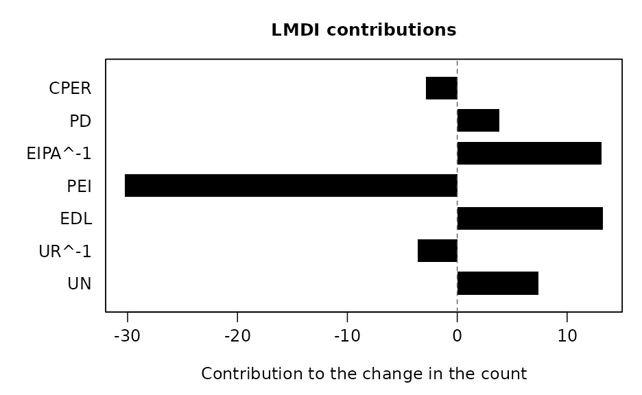
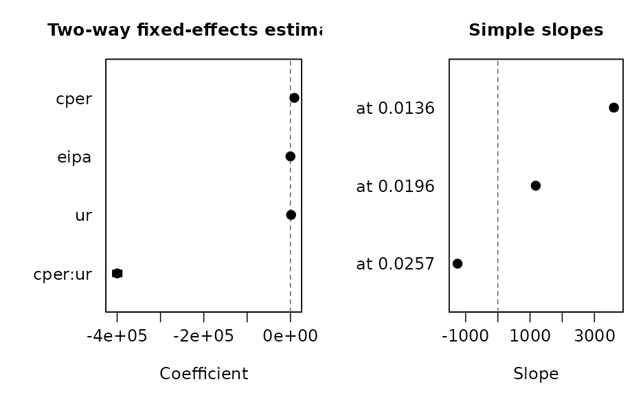
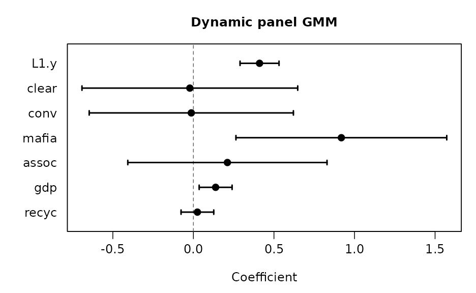
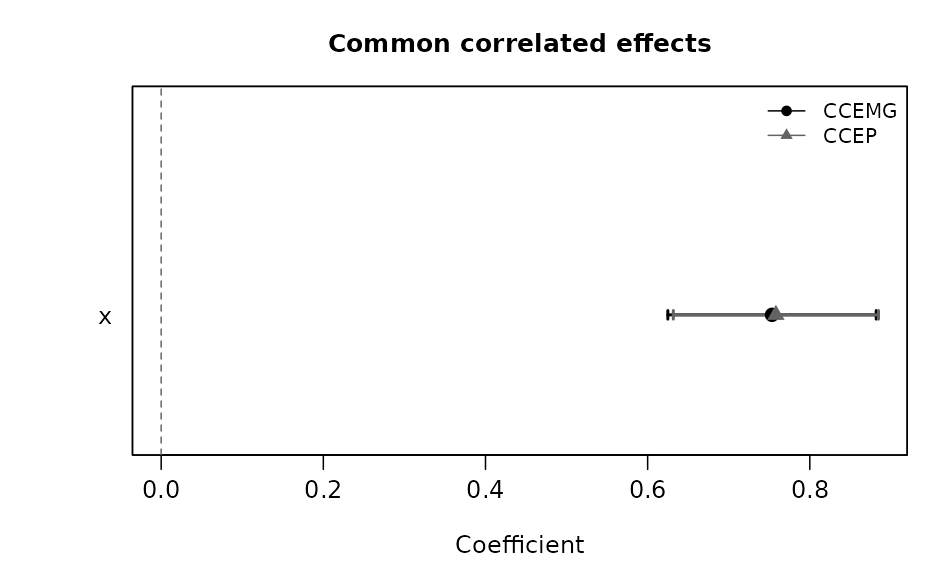

# Environmental crime, panels and search and rescue

Panel models and tests used for environmental crime, and the search
theory behind a search-and-rescue plan.

Each section is one help page: what the function is for, the example of
its help page as it runs, and the plot of its result where the package
draws one. [`?name`](https://rdrr.io/r/base/name.html) gives the
arguments and the value in full.

## Environmental crime

### LMDI decomposition of a count over the factors of a Kaya identity

[`lmdix()`](https://rootcoder007.github.io/crimlab/reference/lmdix.md):
How much of a change in recorded environmental offences (pollution
cases, waste violations) between two years, or of a region’s gap to a
reference region, is owed to each factor of an identity that multiplies
out to the count: the additive log-mean Divisia index (LMDI)
decomposition, temporal and spatial, as Duan et al. (2026, eqs 1-5,
pp. 8-9) apply it to crimes of polluting the environment in 30 Chinese
provinces, 2016-2023.

``` r

# six provinces over four years: cases, population (millions), area
# (1000 km2), emissions (1000 t), GDP (billions) and the unemployed
# (millions), simulated
set.seed(1)
d <- expand.grid(year = c(2016, 2018, 2020, 2023), prov = LETTERS[1:6])
i <- match(d$prov, LETTERS)
d$P <- 10 * i * (1 + 0.01 * (d$year - 2016))
d$S <- 50 + 20 * i
d$W <- 30 * i * (1 - 0.03 * (d$year - 2016))
d$GDP <- 40 * i * (1 + 0.05 * (d$year - 2016))
d$UN <- 0.3 * i * (1 + 0.02 * (d$year - 2016))
d$cases <- rpois(24, 2 * i + 8 * (d$year == 2018))
q <- d[c("P", "S", "W", "GDP", "P", "UN")]
f <- c("CPER", "PD", "EIPA^-1", "PEI", "EDL", "UR^-1", "UN")
r <- lmdix(d$cases, q, d$prov, d$year, at = c(2016, 2018, 2020, 2023),
           fnm = f)
r
#> lmdix: time decomposition, 18 rows, 7 factors
#> contributions summed over the rows decomposed:
#>         dy       CPER         PD    EIPA^-1        PEI        EDL      UR^-1         UN 
#>   1.000000  -2.821646   3.821646  13.156108 -30.253445  13.275691  -3.597145   7.418791
# the gap of each province to the average province, by year
lmdix(d$cases, q, d$prov, d$year, type = "space", fnm = f)$dec
#>    unit time       ref  y         dy       CPER         PD    EIPA^-1           PEI
#> 1     A 2016  6.833333  1 -5.8333333 -2.0307857 -2.1665160  2.1665160  0.000000e+00
#> 2     B 2016  6.833333  7  0.1666667  4.0371552 -1.8807839  1.8807839  0.000000e+00
#> 3     C 2016  6.833333  4 -2.8333333 -2.0177490 -0.3552223  0.3552223  0.000000e+00
#> 4     D 2016  6.833333 10  3.1666667  2.0561626  0.4448347 -0.4448347  0.000000e+00
#> 5     E 2016  6.833333  7  0.1666667 -2.3002157  0.9235474 -0.9235474  0.000000e+00
#> 6     F 2016  6.833333 12  5.1666667  0.2211070  1.7496734 -1.7496734  0.000000e+00
#> 7     A 2018 15.166667  8 -7.1666667  6.8691582 -7.9969646  7.9969646  0.000000e+00
#> 8     B 2018 15.166667 17  1.8333333 10.8240664 -4.3688607  4.3688607  0.000000e+00
#> 9     C 2018 15.166667 10 -5.1666667 -3.2545020 -0.8328306  0.8328306  0.000000e+00
#> 10    D 2018 15.166667 25  9.8333333  7.2060378  1.0524161 -1.0524161  0.000000e+00
#> 11    E 2018 15.166667 15 -0.1666667 -5.5464590  2.0140780 -2.0140780  0.000000e+00
#> 12    F 2018 15.166667 16  0.8333333 -7.5640268  2.9708745 -2.9708745  0.000000e+00
#> 13    A 2020  8.333333  4 -4.3333333  3.0629439 -4.2140571  4.2140571 -1.310945e-15
#> 14    B 2020  8.333333  5 -3.3333333  0.3183746 -1.7744719  1.7744719 -1.448926e-15
#> 15    C 2020  8.333333  8 -0.3333333  0.9253891 -0.5482282  0.5482282  0.000000e+00
#> 16    D 2020  8.333333 10  1.6666667  0.4460084  0.4889592 -0.4889592 -2.029789e-15
#> 17    E 2020  8.333333  9  0.6666667 -2.4229913  1.1567012 -1.1567012  0.000000e+00
#> 18    F 2020  8.333333 14  5.6666667 -0.2206696  2.0828614 -2.0828614  0.000000e+00
#> 19    A 2023  7.000000  1 -6.0000000 -2.1372431 -2.2008204  2.2008204 -3.423251e-16
#> 20    B 2023  7.000000  1 -6.0000000 -4.2744862 -0.8384777  0.8384777 -3.423251e-16
#> 21    C 2023  7.000000  6 -1.0000000  0.0000000 -0.4355433  0.4355433 -7.202194e-16
#> 22    D 2023  7.000000 12  5.0000000  3.7612963  0.4961877 -0.4961877 -1.029898e-15
#> 23    E 2023  7.000000  8  1.0000000 -1.6710943  1.0000000 -1.0000000 -1.662864e-15
#> 24    F 2023  7.000000 14  7.0000000  1.5567469  1.9257507 -1.9257507 -1.121199e-15
#>              EDL         UR^-1          UN
#> 1   0.000000e+00  6.739784e-16  -3.8025477
#> 2   0.000000e+00  1.535734e-15  -3.8704886
#> 3   0.000000e+00  1.174799e-15  -0.8155843
#> 4   0.000000e+00  1.846618e-15   1.1105041
#> 5   0.000000e+00  1.535734e-15   2.4668823
#> 6   0.000000e+00  2.037369e-15   4.9455597
#> 7   2.487764e-15  0.000000e+00 -14.0358248
#> 8   3.567347e-15  0.000000e+00  -8.9907330
#> 9   0.000000e+00  0.000000e+00  -1.9121647
#> 10  4.368836e-15  0.000000e+00   2.6272955
#> 11  3.349139e-15  0.000000e+00   5.3797923
#> 12  0.000000e+00  0.000000e+00   8.3973601
#> 13 -1.310945e-15  1.310945e-15  -7.3962773
#> 14 -1.448926e-15  1.448926e-15  -3.6517079
#> 15 -1.813112e-15  1.813112e-15  -1.2587224
#> 16 -2.029789e-15  2.029789e-15   1.2206583
#> 17 -1.923437e-15  1.923437e-15   3.0896580
#> 18 -2.425343e-15  2.425343e-15   5.8873362
#> 19  0.000000e+00  0.000000e+00  -3.8627569
#> 20  0.000000e+00  0.000000e+00  -1.7255138
#> 21  1.440439e-15  0.000000e+00  -1.0000000
#> 22  0.000000e+00  0.000000e+00   1.2387037
#> 23  1.662864e-15 -8.314322e-16   2.6710943
#> 24  2.242399e-15  0.000000e+00   5.4432531
```

``` r

plot(r)
```



### Two-way fixed effects with an interaction, for counts of offences

[`fepnl()`](https://rootcoder007.github.io/crimlab/reference/fepnl.md):
The regression Duan et al. (2026, eqs 6-8, pp. 9-11) use to check the
drivers of recorded pollution crimes: the count on continuous drivers
and the product of two of them, with unit and period fixed effects,
errors clustered by unit, standardised coefficients, variance inflation
factors, the simple slopes of one driver at values of the other (p. 23),
and the Jarque-Bera test of the residuals (p. 25).

``` r

# 30 provinces over 8 years: cases on the case rate, the unemployment
# rate and their product, simulated
set.seed(2)
d <- expand.grid(year = 2016:2023, prov = paste0("p", 1:30))
d$cper <- runif(240, 0.005, 0.04)
d$ur <- runif(240, 0.01, 0.03)
d$eipa <- rnorm(240, 5)
d$cases <- 50 + 9000 * d$cper + 1500 * d$ur - 4e5 * d$cper * d$ur +
  rnorm(240, sd = 5)
r <- fepnl(d$cases, d[c("cper", "eipa", "ur")], d$prov, d$year,
           int = c("cper", "ur"))
r
#> fepnl: 240 rows, 30 units, 8 periods, 30 clusters, R2 0.9929, within R2 0.9916
#>     term           est           se            lo            hi           t
#>     cper  9.026466e+03  103.3399520  8.815113e+03  9.237820e+03  87.3473066
#>     eipa  1.888576e-01    0.3811923 -5.907681e-01  9.684834e-01   0.4954393
#>       ur  1.534870e+03  106.8914777  1.316252e+03  1.753488e+03  14.3591418
#>  cper:ur -3.997308e+05 4706.6920055 -4.093571e+05 -3.901046e+05 -84.9281898
#>             p         beta       vif
#>  1.128269e-36  1.785147290 11.771218
#>  6.240236e-01  0.003512598  1.001826
#>  1.030284e-14  0.174856822  5.533638
#>  2.539870e-36 -1.866182026 15.657058
#> simple slopes:
#>          at     slope       se        lo        hi         t            p
#>  0.01356247  3605.130 43.35037  3516.468  3693.791  83.16260 4.659674e-36
#>  0.01963659  1177.117 24.09165  1127.844  1226.390  48.85996 2.082308e-29
#>  0.02571071 -1250.895 30.26917 -1312.803 -1188.988 -41.32572 2.504726e-27
#> Jarque-Bera of the residuals 1.386, p 0.5002
r$slopes
#>           at     slope       se        lo        hi         t            p
#> 1 0.01356247  3605.130 43.35037  3516.468  3693.791  83.16260 4.659674e-36
#> 2 0.01963659  1177.117 24.09165  1127.844  1226.390  48.85996 2.082308e-29
#> 3 0.02571071 -1250.895 30.26917 -1312.803 -1188.988 -41.32572 2.504726e-27
```

``` r

plot(r)
#> Warning in graphics::arrows(x0[!z], y0[!z], x1[!z], y1[!z], length = 0.03, :
#> zero-length arrow is of indeterminate angle and so skipped
```



### Pesaran’s CD test of cross-sectional dependence in a panel

[`pcdtst()`](https://rootcoder007.github.io/crimlab/reference/pcdtst.md):
Whether the residuals (or any variable) of a unit-by-period panel move
together across units, the test Andreatta et al. (2023, p. 1376) run on
the residuals of their waste-crime models before deciding a spatial
model is not needed. For each pair of units the correlation `rho_ab` of
their values over the `T_ab` periods they share, about the means over
those periods; CD = sum sqrt(T_ab) rho_ab / sqrt(m) over the `m` pairs,
which for a balanced panel of `N` units and `T` periods is sqrt(2 T / (N
(N - 1))) sum rho_ab, standard normal under no dependence. Pairs that
share fewer than two periods, or along which a unit does not vary, are
left out. This is the statistic of `plm::pcdtest(test = "cd")`. For
dependence between neighbours rather than across all pairs, use
[`gmoran()`](https://rootcoder007.github.io/crimlab/reference/gmoran.md)
on each period’s residuals, as Andreatta et al. also do.

``` r

set.seed(3)
d <- expand.grid(year = 2009:2017, prov = paste0("p", 1:20))
common <- rnorm(9)
d$e <- rnorm(180) + 0.8 * common[d$year - 2008]
pcdtst(d$e, d$prov, d$year)
#>           cd            p          rho       absrho        pairs        units 
#> 9.390043e+00 5.997592e-21 2.270751e-01 3.385986e-01 1.900000e+02 2.000000e+01 
#>      periods 
#> 9.000000e+00
# the residuals of a two-way fit
d$x <- rnorm(180)
d$y <- d$x + d$e
pcdtst(fepnl(d$y, d$x, d$prov, d$year)$resid, d$prov, d$year)
#>           cd            p          rho       absrho        pairs        units 
#>  -2.14401630   0.03203158  -0.05184776   0.29758687 190.00000000  20.00000000 
#>      periods 
#>   9.00000000
```

### Difference and system GMM for dynamic panels

[`gmmpnl()`](https://rootcoder007.github.io/crimlab/reference/gmmpnl.md):
The generalized method of moments estimators of a dynamic panel with
unit effects: the difference estimator of Arellano and Bond (1991) and
the system estimator of Arellano and Bover (1995) and Blundell and Bond
(1998), with the instrument matrix built as Roodman (2009) describes it.
Andreatta et al. (2023, pp. 1372-1374, table 3) fit the logged rate of
waste crime in Italian provinces this way: one-step system GMM with
robust errors, time effects, the lagged rate and four enforcement and
organised-crime variables instrumented GMM-style by their second and
third lags, the AR(1) and AR(2) tests, the Hansen test, the Hansen test
of the differenced equations alone and the difference-in-Hansen test of
the level instruments, with no more instruments than provinces.

``` r

# 60 provinces over 8 years: a logged rate with persistence 0.5 and one
# endogenous driver, simulated
set.seed(7)
d <- expand.grid(year = 2010:2017, prov = paste0("p", 1:60))
u <- rnorm(60)[as.integer(substring(d$prov, 2))]
d$enf <- u + rnorm(480)
d$y <- 0
for (i in which(d$year > 2010)) {
  d$y[i] <- 0.5 * d$y[i - 1] + 0.3 * d$enf[i] + u[i] + rnorm(1)
}
r <- gmmpnl(d$y, d["enf"], d$prov, d$year, gmm = "enf", lagmax = 3,
            collapse = TRUE)
r
#> gmmpnl: system GMM (fd), step 1, 420 rows, 60 groups, 13 instruments
#> robust variance
#>     term         est         se           z            p         lo        hi
#>     L1.y  0.63565326 0.06952086  9.14334550 6.054957e-20  0.4993949 0.7719116
#>      enf  0.92497344 0.19159312  4.82780094 1.380490e-06  0.5494578 1.3004891
#>  (const) -0.06954309 0.13468780 -0.51632809 6.056253e-01 -0.3335263 0.1944401
#>    t2011  0.26161153 0.23231848  1.12609006 2.601274e-01 -0.1937243 0.7169474
#>    t2012 -0.01923081 0.19584762 -0.09819271 9.217793e-01 -0.4030851 0.3646235
#>    t2013 -0.03271092 0.19746408 -0.16565506 8.684284e-01 -0.4197334 0.3543116
#>    t2014  0.19530957 0.21204614  0.92107109 3.570133e-01 -0.2202932 0.6109124
#>    t2015  0.04273779 0.21878075  0.19534529 8.451226e-01 -0.3860646 0.4715402
#>    t2016  0.08698987 0.18530371  0.46944485 6.387517e-01 -0.2761987 0.4501785
#> Wald chi2(8) = 1275.2, p 5.394e-270
#> Wald chi2(8) = 1560.9, p 0 (every coefficient, as xtabond2 prints it)
#>                      test       stat df            p
#>                     AR(1) -5.0629586 NA 4.127995e-07
#>                     AR(2)  0.6919913 NA 4.889428e-01
#>                    Sargan  8.8777291  4 6.422940e-02
#>                    Hansen  9.3189947  4 5.360236e-02
#>  Hansen without level GMM  0.6621633  2 7.181465e-01
#>      Difference-in-Hansen  8.6568314  2 1.318843e-02
r$tests
#>                       test       stat df            p
#> 1                    AR(1) -5.0629586 NA 4.127995e-07
#> 2                    AR(2)  0.6919913 NA 4.889428e-01
#> 3                   Sargan  8.8777291  4 6.422940e-02
#> 4                   Hansen  9.3189947  4 5.360236e-02
#> 5 Hansen without level GMM  0.6621633  2 7.181465e-01
#> 6     Difference-in-Hansen  8.6568314  2 1.318843e-02

# the specification of Andreatta et al. (2023, table 3) on simulated
# data: the lagged rate and four drivers GMM-style by their second and
# third lags, collapsed so that the instruments stay below the
# provinces, two exogenous drivers, time effects, one-step robust
# errors with small-sample adjustments
set.seed(23)
np <- 102
d <- expand.grid(year = 2010:2019, prov = paste0("p", 1:np))
u <- rnorm(np)[as.integer(substring(d$prov, 2))]
n <- nrow(d)
for (v in c("clear", "conv", "mafia", "assoc")) d[[v]] <- u + rnorm(n)
d$gdp <- rnorm(n)
d$recyc <- rnorm(n)
d$wcrim <- 0
for (i in which(d$year > 2010)) {
  d$wcrim[i] <- 0.4 * d$wcrim[i - 1] - 0.1 * d$clear[i] +
    0.2 * d$mafia[i] + 0.1 * d$gdp[i] + u[i] + rnorm(1)
}
en <- c("clear", "conv", "mafia", "assoc")
a <- gmmpnl(d$wcrim, d[c(en, "gdp", "recyc")], d$prov, d$year, gmm = en,
            lagmin = 2, lagmax = 3, collapse = TRUE, small = TRUE)
a$tests
#>                       test      stat df            p
#> 1                    AR(1) -4.694829 NA 0.0000026683
#> 2                    AR(2)  1.432563 NA 0.1519828001
#> 3                   Sargan  9.750661 10 0.4626343573
#> 4                   Hansen 11.268943 10 0.3369524384
#> 5 Hansen without level GMM  1.868157  5 0.8670707506
#> 6     Difference-in-Hansen  9.400786  5 0.0941069902
a$fit$inst < a$fit$groups
#> [1] TRUE
# the static model's serial correlation and the dynamic residuals'
# cross-sectional dependence
wsctst(d$wcrim, d[c(en, "gdp", "recyc")], d$prov, d$year)
#> wsctst: Wooldridge test of serial correlation, F(1, 101) = 73.206, p 1.336e-13
#> lagged residual -0.2747 (se 0.02634; -0.5 without correlation), 816 pairs
k <- !is.na(a$resid)
pcdtst(a$resid[k], d$prov[k], d$year[k])
#>            cd             p           rho        absrho         pairs         units 
#> -2.063590e+00  3.905661e-02 -9.584211e-03  2.965807e-01  5.151000e+03  1.020000e+02 
#>       periods 
#>  9.000000e+00
```

``` r

plot(a)
```



### Wooldridge’s test for serial correlation in a panel

[`wsctst()`](https://rootcoder007.github.io/crimlab/reference/wsctst.md):
Whether the idiosyncratic errors of a linear panel model with unit
effects are serially correlated, by the test Wooldridge (2002) derives
and Drukker (2003) sets out and evaluates, the test Andreatta et
al. (2023, p. 1373) run on the residuals of their static models before
choosing a dynamic one. The first differences of `y` are regressed on
those of `x`, without a constant, which differencing removes (Drukker
2003, sec. 2); without serial correlation the residuals `e_it` of
consecutive differences correlate at -0.5, so `e_it` is regressed on
e_i,t-1 with the variance clustered by unit, and the coefficient is
tested against -0.5: `F = ((coef + 0.5) / se)^2` on 1 and `G - 1`
degrees of freedom, `G` the units with a pair. A difference needs the
period before, so a gap removes two differences and the pairs that use
them. Drukker does not say whether the second regression has a constant;
`cons = FALSE` (the default) leaves it out, since the residuals of the
first have none to absorb.

``` r

set.seed(8)
d <- expand.grid(year = 1:8, prov = paste0("p", 1:40))
d$x <- rnorm(320)
d$e <- 0
for (i in which(d$year > 1)) d$e[i] <- 0.6 * d$e[i - 1] + rnorm(1)
d$y <- d$x + rnorm(40)[as.integer(substring(d$prov, 2))] + d$e
wsctst(d$y, d["x"], d$prov, d$year)
#> wsctst: Wooldridge test of serial correlation, F(1, 39) = 5.1486, p 0.02888
#> lagged residual -0.3814 (se 0.05228; -0.5 without correlation), 240 pairs
```

### Common correlated effects for panels with unobserved common factors

[`ccepnl()`](https://rootcoder007.github.io/crimlab/reference/ccepnl.md):
The common correlated effects estimators of Pesaran (2006) for a panel
whose errors hold unobserved common factors with unit-specific loadings,
correlated with the regressors: the dependent variable and the
regressors averaged across units in each period (with the weights `w`)
are added to each unit’s regression, with the observed common factors
`d_t` (a constant, with `cons = TRUE`, and the columns of `fac`). With H
= (D, ybar_w, Xbar_w) and M = I - H (H’H)^- H’ (eq 15, a generalized
inverse), the unit estimates are b_i = (X_i’M X_i)^-1 X_i’M y_i. The
mean group estimator `CCEMG` is their mean (eq 53), with the
nonparametric variance sum (b_i - b_MG)(b_i - b_MG)’ / (N (N - 1)) (eq
58). The pooled estimator `CCEP` is (sum w_i X_i’M X_i)^-1 sum w_i X_i’M
y_i, the pooling weights equal to the averaging weights as Theorem 3
requires, with the variance of eqs 67-69, sum w_i^2 Psi^-1 R Psi^-1, Psi
= sum w_i X_i’M X_i / T and R = sum wt_i^2 (X_i’M X_i / T) (b_i -
b_MG)(b_i - b_MG)’ (X_i’M X_i / T) / (N - 1),
`wt_i = w_i / sqrt(mean(w^2))`. Inference is normal.

``` r

# 30 provinces over 12 years, one unobserved factor in y and x
set.seed(9)
d <- expand.grid(year = 1:12, prov = paste0("p", 1:30))
f <- rnorm(12)[d$year]
g <- rnorm(30, 1)[as.integer(substring(d$prov, 2))]
d$x <- g * f + rnorm(360)
d$y <- 1 + 0.7 * d$x + g * f + rnorm(360)
r <- ccepnl(d$y, d["x"], d$prov, d$year)
r
#> ccepnl: common correlated effects, 30 units, 12 periods
#> mean group (CCEMG):
#>  term       est         se        z            p        lo        hi
#>     x 0.7534011 0.06556476 11.49095 1.464985e-30 0.6248965 0.8819056
#> pooled (CCEP):
#>  term       est         se        z            p        lo        hi
#>     x 0.7581987 0.06456047 11.74401 7.580526e-32 0.6316625 0.8847349
#> heterogeneity bias of CCEP: chi2(1) = 0.0165, p 0.898
r$nfac
#>  er thr avg 
#>   1   2   2
# a dynamic panel: y depends on its lag; jackknife-corrected mean group
set.seed(10)
tt <- 40
d <- expand.grid(year = 1:tt, prov = paste0("p", 1:40))
f <- rnorm(tt)[d$year]
g <- rnorm(40, 1)[as.integer(substring(d$prov, 2))]
d$x <- g * f + rnorm(nrow(d))
d$y <- 0
for (i in which(d$year > 1)) {
  d$y[i] <- 0.5 * d$y[i - 1] + 0.7 * d$x[i] + g[i] * f[i] + rnorm(1)
}
ccepnl(d$y, d["x"], d$prov, d$year, ylag = 1, bias = "jack")
#> ccepnl: common correlated effects, 40 units, 40 periods, 1 lags of y, 3 of the averages
#> mean group (CCEMG, jack):
#>  term       est         se        z            p        lo        hi
#>  L1.y 0.5946119 0.04214017 14.11033 3.280167e-45 0.5120187 0.6772051
#>     x 0.6781777 0.06129760 11.06369 1.881911e-28 0.5580366 0.7983187
```

``` r

plot(r)
```



## Search and rescue

### Search theory for search and rescue planning

[`ltrlrng()`](https://rootcoder007.github.io/crimlab/reference/ltrlrng.md),
[`swpwdth()`](https://rootcoder007.github.io/crimlab/reference/ltrlrng.md),
[`srchpod()`](https://rootcoder007.github.io/crimlab/reference/ltrlrng.md),
[`pswppod()`](https://rootcoder007.github.io/crimlab/reference/ltrlrng.md)
and others: The quantities a search and rescue planner works with
(Koopman’s search theory, as used in the U.S. Coast Guard and IAMSAR
planning methods):

``` r

# inverse cube detection 0.5, 1 and 2 sweep widths off the track
ltrlrng(c(0.5, 1, 2), W = 1)
#> Lateral range curve: inverse cube model, sweep width W = 1
#>  range       pod
#>    0.5 0.2726227
#>    1.0 0.0764935
#>    2.0 0.0196978
#> pod: the chance of detecting the object at that distance from the track;
#> the sweep width W is the area under this curve.

# the area under the curve is the sweep width
xs <- seq(-200, 200, by = 0.01)
swpwdth(xs, ltrlrng(xs, W = 1, model = "definite"))
#> [1] 1.01

# POD at coverage 1 under the three models
srchpod(1)
#> Probability of detection: random search model
#>  coverage      pod
#>         1 0.632121
srchpod(c(0.5, 1, 2), model = "invcube")
#> Probability of detection: inverse cube model
#>  coverage      pod
#>       0.5 0.469116
#>       1.0 0.789909
#>       2.0 0.987811

# a parallel sweep at spacing 1.3 W, without and with navigation error
pswppod(1, 1.3)
#> [1] 0.6649981
pswppod(1, 1.3, navsd = 0.3, npts = 201)
#> [1] 0.6460403

# three areas searched once; the containment after finding nothing
srchscs(c(0.5, 0.3, 0.2), c(0.8, 0.5, 0))
#> Probability of success 0.55 after 1 search over 3 areas
#>  area poc cumpod posarea pocupd
#>     1 0.5    0.8    0.40 0.2222
#>     2 0.3    0.5    0.15 0.3333
#>     3 0.2    0.0    0.00 0.4444

# a point datum on a 10 x 10 grid, and the best use of 30 units of track
m <- datumpmap(seq(-5, 5), seq(-5, 5), sigma = 2)
a <- opteffort(m, W = 1, effort = 30)
a$pos
#> [1] 0.4520985
optcrcsrch(sigma = 2, W = 1, effort = 30)$pos
#> [1] 0.4571532

# a simulated search, step by step: a last known position 2 km east and
# 3 km north of the base, known to about 1.5 km, on a grid of 1 km cells
own <- datumpmap(seq(-3, 7), seq(-2, 8), center = c(2, 3), sigma = 1.5)
own
#> Datum probability map (point datum), sigma 1.5: 10 x 10 cells (x by y); 0.2% of the probability lies outside the grid
#> The most likely cells:
#>    x   y     poc
#>  1.5 2.5 0.06126
#>  1.5 3.5 0.06126
#>  2.5 2.5 0.06126
#>  2.5 3.5 0.06126
#>  0.5 2.5 0.03992
# 0.6 km sweep width; 12 km of track walked in each of the four cells
# round the position, none elsewhere
walked <- matrix(0, nrow(own$poc), ncol(own$poc))
walked[5:6, 5:6] <- 12
pd <- srchpod(W = 0.6, effort = walked, area = own, model = "invcube")
# the chance that the search found the person, and the map if it did not
day1 <- srchscs(own, pd)
day1
#> Probability of success 0.245 after 1 search over 100 areas
#>  area     poc cumpod posarea  pocupd
#>    45 0.06126      1 0.06126 0.00000
#>    46 0.06126      1 0.06126 0.00000
#>    55 0.06126      1 0.06126 0.00000
#>    56 0.06126      1 0.06126 0.00000
#>    35 0.03992      0 0.00000 0.05287
#>    36 0.03992      0 0.00000 0.05287
#>    44 0.03992      0 0.00000 0.05287
#>    47 0.03992      0 0.00000 0.05287
#>    54 0.03992      0 0.00000 0.05287
#>    57 0.03992      0 0.00000 0.05287
#>    65 0.03992      0 0.00000 0.05287
#>    66 0.03992      0 0.00000 0.05287
#>    34 0.02601      0 0.00000 0.03445
#>    37 0.02601      0 0.00000 0.03445
#>    64 0.02601      0 0.00000 0.03445
#>    67 0.02601      0 0.00000 0.03445
#>    25 0.01694      0 0.00000 0.02244
#>    26 0.01694      0 0.00000 0.02244
#>    43 0.01694      0 0.00000 0.02244
#>    53 0.01694      0 0.00000 0.02244
#> The 20 most likely of 100 cells.
#> Map: 10 x 10 cells (x by y), updated in $map
# the best use of the next day's 40 km on what is left
opteffort(day1$map, W = 0.6, effort = 40)
#> Optimal allocation of effort: POS 0.5369 from effort 40 over 28 of 100 cells (W = 0.6)
#>  cell     poc effort coverage    pod
#>    35 0.05287  2.551   1.5303 0.7835
#>    36 0.05287  2.551   1.5303 0.7835
#>    44 0.05287  2.551   1.5303 0.7835
#>    47 0.05287  2.551   1.5303 0.7835
#>    54 0.05287  2.551   1.5303 0.7835
#>    57 0.05287  2.551   1.5303 0.7835
#>    65 0.05287  2.551   1.5303 0.7835
#>    66 0.05287  2.551   1.5303 0.7835
#>    34 0.03445  1.837   1.1021 0.6678
#>    37 0.03445  1.837   1.1021 0.6678
#>    64 0.03445  1.837   1.1021 0.6678
#>    67 0.03445  1.837   1.1021 0.6678
#>    25 0.02244  1.122   0.6735 0.4901
#>    26 0.02244  1.122   0.6735 0.4901
#>    43 0.02244  1.122   0.6735 0.4901
#>    53 0.02244  1.122   0.6735 0.4901
#>    48 0.02244  1.122   0.6735 0.4901
#>    58 0.02244  1.122   0.6735 0.4901
#>    75 0.02244  1.122   0.6735 0.4901
#>    76 0.02244  1.122   0.6735 0.4901
#> ... and 8 more cells

# inputs that cannot be right are refused
try(ltrlrng(1, W = -1))
#> Error : ltrlrng: `W` must be positive.
try(srchpod(1, W = 0.6))
#> Error : srchpod: give either `coverage` or `W`, `effort` and `area`, not both.
try(srchscs(c(0.8, 0.8), c(0.5, 0.5)))
#> Error : srchscs: `poc` must sum to at most 1, got 1.6.
```

### The optimal search square for a circular normal datum

[`optsqr()`](https://rootcoder007.github.io/crimlab/reference/optsqr.md):
For a point datum with a circular normal distribution of position error,
the square centred on the datum that a given effort, spread evenly,
should cover to make the probability of success as large as possible
(Frost 1996, chapter 6). With several efforts, each search is optimized
in turn against the distribution as earlier unsuccessful searches left
it.

``` r

# Frost's example: an effort of 4 E^2 on a point datum
optsqr(4)
#> Optimal square searches: 1, total effort 4, chance found by the end 0.4578
#>  search effort releff cumeff factor  side   poc coverage    pod    pos cumpos
#>       1      4      4      4  1.021 2.042 0.594   0.9592 0.7707 0.4578 0.4578
#> Each search covers the square (of side 'side') that gives it the best chance of
#> success after the searches before it. poc is the chance the object is in that
#> square, pod the chance of detecting it there, pos their product and cumpos
#> the running chance it has been found.
# poor search conditions: the random search curve
optsqr(4, model = "random")
#> Optimal square searches: 1, total effort 4, chance found by the end 0.3664
#>  search effort releff cumeff factor  side    poc coverage    pod    pos cumpos
#>       1      4      4      4  1.028 2.055 0.5986    0.947 0.6121 0.3664 0.3664
#> Each search covers the square (of side 'side') that gives it the best chance of
#> success after the searches before it. poc is the chance the object is in that
#> square, pod the chance of detecting it there, pos their product and cumpos
#> the running chance it has been found.
# three searches in a row, each optimal for what the last ones left
optsqr(c(4, 4, 8), E = 2)
#> Optimal square searches: 3, total effort 16, chance found by the end 0.419
#>  search effort releff cumeff factor  side    poc coverage    pod    pos cumpos
#>       1      4      1      1 0.6432 2.573 0.3038   0.6043 0.5511 0.1674 0.1674
#>       2      4      1      2 0.9360 3.744 0.4382   0.2854 0.2794 0.1224 0.2694
#>       3      8      2      4 1.1183 4.473 0.5339   0.3998 0.3837 0.2049 0.4190
#> Each search covers the square (of side 'side') that gives it the best chance of
#> success after the searches before it. poc is the chance the object is in that
#> square, pod the chance of detecting it there, pos their product and cumpos
#> the running chance it has been found.
try(optsqr(-1))
#> Error : optsqr: `effort` must be positive.
```

### The figures of The Theory of Search

[`srchfig()`](https://rootcoder007.github.io/crimlab/reference/srchfig.md):
Lists the figures of Frost (1996), “The Theory of Search: A Simplified
Explanation”, with how each is computed from the search theory functions
with the book’s parameters, and one line of R that computes a version of
it from the reader’s own numbers.

``` r

head(srchfig())
#>   fig                                                              caption       how
#> 1 3-1     Probability density distribution for a point datum with top view     model
#> 2 3-2 Circle of radius one standard deviation and its circumscribed square     model
#> 3 3-3                      Circle of radius E and its circumscribed square     model
#> 4 3-4                                    Probability map for a point datum     model
#> 5 3-5                  Circle of radius 1.1 E and its circumscribed square     model
#> 6 3-6                       Line datum: circles at the end points boxed in schematic
#>                                                                                                                               yours
#> 1                       plot(datumpmap(seq(-4, 4, by = 0.25), seq(-4, 4, by = 0.25), center = c(0, 0), sigma = 1.5), view = "both")
#> 2                                                                       sum(datumpmap(c(-1.5, 1.5), c(-1.5, 1.5), sigma = 1.5)$poc)
#> 3                                                   sum(datumpmap(c(-1, 1) * 1.177 * 1.5, c(-1, 1) * 1.177 * 1.5, sigma = 1.5)$poc)
#> 4                                      plot(datumpmap(c(-3, -1, 1, 3) * 1.77, c(-3, -1, 1, 3) * 1.77, sigma = 1.5), view = "cells")
#> 5                                                   sum(datumpmap(c(-1, 1) * 1.295 * 1.5, c(-1, 1) * 1.295 * 1.5, sigma = 1.5)$poc)
#> 6 plot(datumpmap(seq(-4, 4, by = 0.25), seq(-4, 4, by = 0.25), "line", center = c(0, -2), end = c(0, 2), sigma = 1), view = "both")
srchfig("3-4")
#>   fig                           caption   how
#> 1 3-4 Probability map for a point datum model
#>                                                                                          yours
#> 1 plot(datumpmap(c(-3, -1, 1, 3) * 1.77, c(-3, -1, 1, 3) * 1.77, sigma = 1.5), view = "cells")
srchfig(5, 8)
#>   fig      caption   how
#> 1 5-8 Inverse cube model
#>                                                                                        yours
#> 1 plot(srchpod(seq(0, 3, by = 0.1), "invcube"), models = c("invcube", "definite", "random"))
try(srchfig("9-9"))
#> Error : srchfig: `fig` must be one of the book's figures, 3-1, 3-2, 3-3, 3-4, 3-5, 3-6, 3-7, 3-8, 3-9, 3-10, 3-11, 3-12, 3-13, 3-14, 4-1, 4-2, 4-3, 4-4, 4-5, 4-6, 4-7, 5-1, 5-2, 5-3, 5-4, 5-5, 5-6, 5-7, 5-8, 5-9, 6-1, 6-2, 6-3, 6-4, 6-5, 6-6; got "9-9".
```
