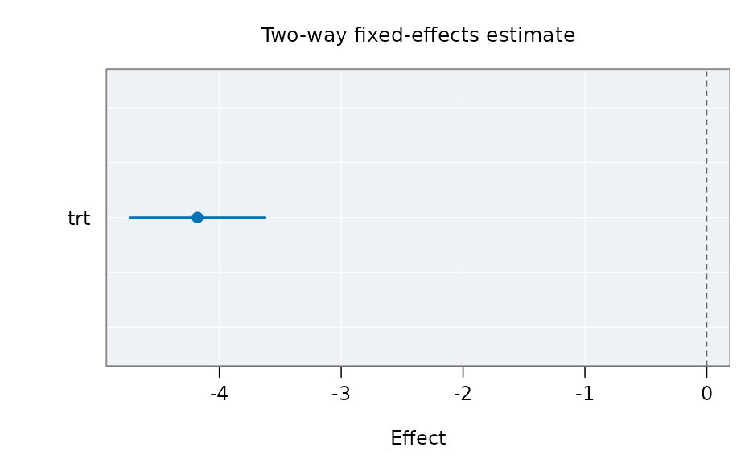
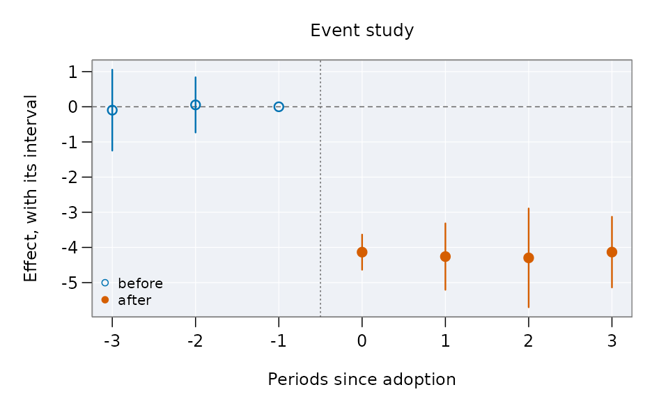
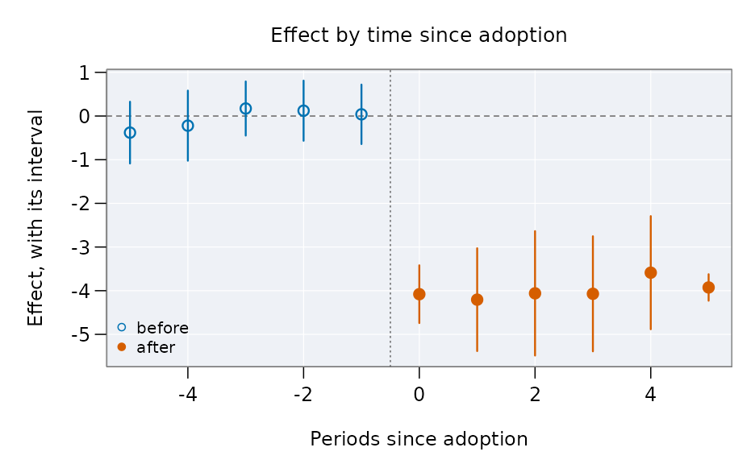
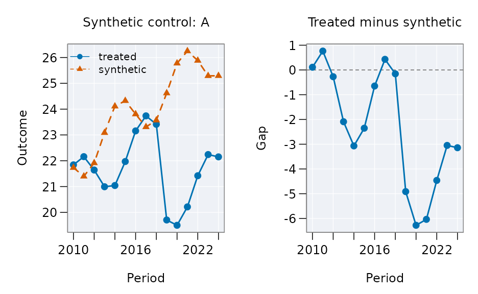

# Experiments and policy evaluation

Randomisation, power, falsification tests, difference-in-differences,
event studies and synthetic controls.

Each section is one help page: what the function is for, the example of
its help page as it runs, and the plot of its result where the package
draws one. [`?name`](https://rdrr.io/r/base/name.html) gives the
arguments and the value in full.

## Experiments

### Randomisation lists for a trial

[`rndalc()`](https://rootcoder007.github.io/crimlab/reference/rndalc.md):
Allocates participants to arms by simple, permuted-block or stratified
block randomisation from a seed, so that the list can be made again
exactly from the seed and the settings, in R or on the command line.

``` r

a <- rndalc(40, seed = 12)
a
#> rndalc: 40 participants, seed 12
#>      A  B
#> all 20 20
head(a$alloc)
#>    id block arm
#> 1 P01     1   A
#> 2 P02     1   B
#> 3 P03     1   A
#> 4 P04     1   A
#> 5 P05     1   B
#> 6 P06     1   B
s <- rndalc(arms = c("drug", "placebo"), ratio = c(2, 1),
            strata = c(Toronto = 30, Ottawa = 24), seed = 7)
s$tab
#>         drug placebo
#> Toronto   21       9
#> Ottawa    16       8
rndalc(20, block = 0, seed = 1)$tab
#>      A B
#> all 13 7
```

### Permutation test within blocks

[`blkprm()`](https://rootcoder007.github.io/crimlab/reference/blkprm.md):
The randomisation test of a treatment effect in a blocked (or
stratified, or matched) experiment: the treatment labels are permuted
within each block, so that every arrangement keeps each block’s number
of treated units, as the design randomised them, and the observed
statistic is compared with its values over the arrangements (Rosenbaum
2002, ch. 2; Good 2005, sec. 3.6).

``` r

set.seed(4)
d <- data.frame(site = rep(1:6, each = 4), t = rep(c(1, 0, 1, 0), 6))
d$y <- d$site + 0.8 * d$t + rnorm(24, sd = 0.5)
blkprm(d, "y", "t", "site", nperm = 999, seed = 1)
#> blkprm: difference in means 0.9952, p = 0.001 (two.sided, 999 arrangements within 6 blocks)
blkprm(d[1:12, ], "y", "t", "site", stat = "strat", exact = TRUE)$p
#> [1] 0.01851852
```

### Power of the one-way analysis of variance

[`pwranv()`](https://rootcoder007.github.io/crimlab/reference/pwranv.md):
The power of the F test of equal means in `k` groups of `n` with Cohen’s
effect size `f` (the standard deviation of the group means about their
mean, over the common standard deviation), from the noncentral F
distribution; or, given the power wanted, the smallest whole `n` per
group that reaches it.

``` r

pwranv(3, n = c(20, 40, 60), f = 0.25)
#>   k  n    f df1 df2   ncp    fcrit     power
#> 1 3 20 0.25   2  57  3.75 3.158843 0.3744311
#> 2 3 40 0.25   2 117  7.50 3.073763 0.6756745
#> 3 3 60 0.25   2 177 11.25 3.047012 0.8546381
pwranv(4, f = c(0.1, 0.25, 0.4), power = 0.8)
#>   k   n    f df1  df2   ncp    fcrit     power
#> 1 4 274 0.10   3 1092 10.96 2.613053 0.8007324
#> 2 4  45 0.25   3  176 11.25 2.655939 0.8039869
#> 3 4  19 0.40   3   72 12.16 2.731807 0.8234006
```

### Power by simulation

[`pwrsim()`](https://rootcoder007.github.io/crimlab/reference/pwrsim.md):
The power of a two-arm trial found by simulating it: for each control
arm size in `n` and each effect in `eff`, `nsim` trials are drawn, each
is tested, and the power is the share rejected at `alpha`, with its
Monte Carlo standard error and Wilson’s interval (Morris, White and
Crowther 2019). It answers what a formula cannot: an outcome that is
binary or a count, unequal arms, a permutation test.

``` r

pwrsim(c(20, 50), eff = c(0, 0.5), nsim = 400, seed = 1)
#> pwrsim: normal outcome, welch test (two.sided) at alpha 0.05, 400 trials per design
#>   n n1 eff  power          se         lo         hi rej
#>  20 20 0.0 0.0375 0.009499178 0.02285503 0.06094384  15
#>  50 50 0.0 0.0350 0.009188988 0.02096129 0.05788514  14
#>  20 20 0.5 0.3425 0.023727292 0.29769102 0.39030535 137
#>  50 50 0.5 0.6925 0.023072914 0.64562516 0.73571260 277
pwrsim(100, eff = 0.15, fam = "binary", p0 = 0.3, nsim = 400,
       seed = 2)$tab
#>     n  n1  eff power        se       lo        hi rej
#> 1 100 100 0.15 0.585 0.0246361 0.536129 0.6322539 234
```

### Falsification with negative-control outcomes

[`falsctl()`](https://rootcoder007.github.io/crimlab/reference/falsctl.md):
Estimates the “effect” of the treatment on outcomes it cannot have
affected (negative controls: an outcome measured before treatment, or
one with no plausible path from it), by the same regression as the
outcome of interest. An association with a negative control points to
confounding or another bias that the adjustment did not remove
(Lipsitch, Tchetgen Tchetgen and Cohen 2010; Shi, Miao and Tchetgen
Tchetgen 2020).

``` r

set.seed(5)
n <- 300
d <- data.frame(age = runif(n, 18, 60), u = rnorm(n))
d$t <- rbinom(n, 1, plogis(0.8 * d$u))
d$arrest <- 0.4 * d$t + 0.5 * d$u + rnorm(n)
d$prior <- 0.5 * d$u + rnorm(n)     # before treatment: a control
d$height <- rnorm(n)                # no path from treatment
falsctl(d, "arrest", "t", c("prior", "height"), x = "age")
#> falsctl: 1 of 2 negative control(s) associated with the treatment at alpha 0.05 (holm)
#>  outcome    role     est     se   stat         p      lo       hi pperm     padj
#>   arrest primary  0.8024 0.1308  6.134 2.730e-09  0.5450 1.059832    NA       NA
#>    prior control  0.3816 0.1282  2.976 3.159e-03  0.1293 0.633989    NA 0.006318
#>   height control -0.2236 0.1171 -1.909 5.720e-02 -0.4541 0.006887    NA 0.057202
```

### Does the analysis recover a planted effect?

[`plntfx()`](https://rootcoder007.github.io/crimlab/reference/plntfx.md):
Plants effects of known size in the real data and checks that the
analysis finds them: the outcome is shuffled across rows, which removes
whatever association it had with the treatment and the covariates while
keeping its distribution, an effect `eff` is added to the treated (y\* =
shuffled y + eff d), and the analysis is run again, `nrep` times for
each effect. An analysis that is biased, or whose intervals are too
narrow, shows it here on data where the truth is known, a positive
control in the sense of Lipsitch, Tchetgen Tchetgen and Cohen (2010).

``` r

set.seed(6)
d <- data.frame(age = runif(200, 18, 60), t = rbinom(200, 1, 0.4))
d$y <- 0.02 * d$age + rnorm(200)
plntfx(d, "y", "t", x = "age", eff = c(0, 0.25, 0.5), nrep = 200,
       seed = 1)
#> plntfx: 3 of 3 planted effect(s) recovered within tolerance over 200 shuffles
#>   eff      mean      bias     sd   rmse cover   rej     tol   ok
#>  0.00 -0.002595 -0.002595 0.1514 0.1511  0.93 0.070 0.03212 TRUE
#>  0.25  0.247405 -0.002595 0.1514 0.1511  0.93 0.395 0.03212 TRUE
#>  0.50  0.497405 -0.002595 0.1514 0.1511  0.93 0.920 0.03212 TRUE
```

### Specification curve

[`specrv()`](https://rootcoder007.github.io/crimlab/reference/specrv.md):
The estimate of a treatment effect under every reasonable specification
at once, and whether the specifications as a whole show an effect: the
specification curve of Simonsohn, Simmons and Nelson (2020). A finding
that holds under one specification only is fragile; one that survives
the choices an analyst could defensibly have made is not.

``` r

set.seed(7)
n <- 200
d <- data.frame(t = rbinom(n, 1, 0.5), age = runif(n, 18, 60),
                prior = rpois(n, 2), male = rbinom(n, 1, 0.5))
d$arrest <- 0.3 * d$t + 0.1 * d$prior + rnorm(n)
d$charge <- 0.2 * d$t + 0.1 * d$prior + rnorm(n)
s <- specrv(d, c("arrest", "charge"), "t", opt = c("age", "prior",
            "male"), nsim = 200, seed = 1)
s
#> specrv: 16 specifications, 0 significant; perm null, 200 data sets
#>    stat    obs       p
#>  median 0.1427 0.06468
#>    nsig 0.0000 1.00000
#>       z 3.9272 0.07463
head(s$spec)
#>   outcome        ctrl       est        se     stat          p          lo        hi
#> 1  arrest        none 0.2145197 0.1434022 1.495931 0.13626394 -0.06827189 0.4973113
#> 2  arrest         age 0.2124390 0.1436782 1.478575 0.14085117 -0.07090585 0.4957839
#> 3  arrest       prior 0.2389817 0.1435041 1.665330 0.09743638 -0.04401974 0.5219832
#> 4  arrest age + prior 0.2373957 0.1437597 1.651337 0.10027101 -0.04611867 0.5209100
#> 5  arrest        male 0.2095342 0.1439181 1.455926 0.14700476 -0.07428369 0.4933520
#> 6  arrest  age + male 0.2077787 0.1442450 1.440457 0.15133357 -0.07669274 0.4922501
#>     sig
#> 1 FALSE
#> 2 FALSE
#> 3 FALSE
#> 4 FALSE
#> 5 FALSE
#> 6 FALSE
```

## Policy evaluation

### A simulated policy panel for the examples

[`polex()`](https://rootcoder007.github.io/crimlab/reference/polex.md):
Twenty districts in four regions over 36 months; a reform adopted region
by region in three stages (months 13, 19 and 25), with the fourth region
never adopting it; crime and arrest rates and counts. The numbers are
made up, with a known effect of the reform (a fall of 3 in the crime
rate per 100,000), so the examples and tests can check that each
estimator recovers it.

``` r

# the panel is simulated: made-up numbers with a known effect of -3
p <- polex()
head(p)
#>   district region month refmonth reformed population   logpop crimes crmrate arrrate
#> 1      D01     R1     1       13        0     152152 11.93264     80  39.732  15.394
#> 2      D01     R1     2       13        0     152152 11.93264     56  42.708  16.387
#> 3      D01     R1     3       13        0     152152 11.93264     68  41.228  16.043
#> 4      D01     R1     4       13        0     152152 11.93264     68  43.296  17.148
#> 5      D01     R1     5       13        0     152152 11.93264     62  42.036  15.443
#> 6      D01     R1     6       13        0     152152 11.93264     59  40.197  15.568
# the same seed gives the same panel
identical(polex(7), polex(7))
#> [1] TRUE
```

### Difference in differences with two-way fixed effects

[`didfe()`](https://rootcoder007.github.io/crimlab/reference/didfe.md):
The effect of a policy on a unit-by-period panel (towns by year, beats
by month, courts by quarter) from a regression of the outcome on the
treatment with unit and period fixed effects, with standard errors
clustered by unit or by any coarser grouping, one-way or two-way. Counts
can be fitted by Poisson or negative binomial regression with the same
effects. Options give the estimate leaving out each treated unit in
turn, its Goodman-Bacon decomposition, and the estimate after matching
treated units to comparison units on their outcomes before treatment.

``` r

# twelve towns over ten years; four adopt a by-law in 2019, four in 2021
d <- expand.grid(year = 2015:2024, town = LETTERS[1:12])
i <- match(d$town, LETTERS)
first <- c(2019, 2019, 2019, 2019, 2021, 2021, 2021, 2021, NA, NA, NA, NA)
d$bylaw <- as.integer(!is.na(first[i]) & d$year >= first[i])
d$rate <- 30 + i + 0.5 * (d$year - 2015) - 4 * d$bylaw + sin(seq_len(120))
r <- didfe(d$rate, d$town, d$year, d$bylaw)
r
#> didfe: ols, 120 rows, 12 units, 10 periods, 12 clusters
#>  term       est        se       lo        hi      stat            p
#>   trt -4.179346 0.2529069 -4.73599 -3.622702 -16.52524 4.095738e-09
#> comparison mean 41.26246, relative effect -0.1012869
# its comparisons, and each adopting town left out in turn
didfe(d$rate, d$town, d$year, d$bylaw, bacon = TRUE, loo = TRUE)$bacon
#>               type treated control       est weight
#> 1 treated vs never    2019     Inf -4.081194  0.375
#> 2 treated vs never    2021     Inf -4.029237  0.375
#> 3 earlier vs later    2019    2021 -4.561454  0.125
#> 4 later vs earlier    2021    2019 -4.542020  0.125
# the simulated panel of polex(): a reform with a known effect of -3
p <- polex()
didfe(p$crmrate, p$district, p$month, p$reformed)
#> didfe: ols, 720 rows, 20 units, 36 periods, 20 clusters
#>  term      est        se        lo        hi      stat           p
#>   trt -3.23164 0.1164121 -3.475293 -2.987986 -27.76034 7.66007e-17
#> comparison mean 26.52167, relative effect -0.121849
```

``` r

plot(r)
```



### An event study: the effect period by period around adoption

[`evtst()`](https://rootcoder007.github.io/crimlab/reference/evtst.md):
Leads and lags of a policy’s adoption from a two-way fixed-effects
regression on indicators of the time since adoption, with the joint test
that the leads are zero (no effect before the policy, the testable part
of parallel trends), and the raw mean outcome of each adoption cohort
around its adoption.

``` r

d <- expand.grid(year = 2015:2024, town = LETTERS[1:12])
i <- match(d$town, LETTERS)
d$first <- c(2019, 2019, 2019, 2019, 2021, 2021, 2021, 2021,
             NA, NA, NA, NA)[i]
on <- !is.na(d$first) & d$year >= d$first
d$rate <- 30 + i + 0.5 * (d$year - 2015) - 4 * on + sin(seq_len(120))
e <- evtst(d$rate, d$town, d$year, d$first, leads = 3, lags = 3)
e
#> evtst: 120 rows, 12 clusters
#>  evtm         est        se         lo         hi        stat            p
#>    -3 -0.09567324 0.5231309 -1.2470766  1.0557301  -0.1828859 8.582148e-01
#>    -2  0.05394300 0.3573220 -0.7325173  0.8404033   0.1509647 8.827364e-01
#>    -1  0.00000000        NA         NA         NA          NA           NA
#>     0 -4.13423655 0.2277190 -4.6354427 -3.6330304 -18.1549928 1.505547e-09
#>     1 -4.25980824 0.4295541 -5.2052505 -3.3143660  -9.9168141 8.036081e-07
#>     2 -4.29625671 0.6385691 -5.7017379 -2.8907756  -6.7279431 3.251955e-05
#>     3 -4.13228464 0.4571512 -5.1384677 -3.1261016  -9.0392074 2.008834e-06
#> leads jointly zero: F = 0.07293073 on 2 and 11 df, p = 0.9301109
e$pre
#>            f df1 df2         p
#> 1 0.07293073   2  11 0.9301109
# how far trends may bend before the effect is lost
evtst(d$rate, d$town, d$year, d$first, leads = 3, lags = 3,
      mbar = c(0, 1, 2), seed = 1)$sens
#>   mbar       lob       upb        lo         hi
#> 1    0 -4.205647 -4.205647 -4.930333 -3.4716191
#> 2    1 -4.579687 -3.831606 -7.339214 -1.5703317
#> 3    2 -4.953728 -3.457565 -9.831768  0.8305316
# the simulated panel of polex(): a reform with a known effect of -3
p <- polex()
evtst(p$crmrate, p$district, p$month, p$refmonth, leads = 3,
      lags = 3)$est
#>   evtm         est        se        lo        hi      stat            p
#> 1   -3  0.08755551 0.3504296 -0.645902  0.821013  0.249852 8.053833e-01
#> 2   -2  0.46611111 0.4549055 -0.486017  1.418239  1.024633 3.184058e-01
#> 3   -1  0.00000000        NA        NA        NA        NA           NA
#> 4    0 -3.15973333 0.4472770 -4.095895 -2.223572 -7.064377 1.009440e-06
#> 5    1 -3.12400000 0.4185681 -4.000073 -2.247927 -7.463541 4.625249e-07
#> 6    2 -3.39773333 0.5021704 -4.448788 -2.346679 -6.766096 1.834298e-06
#> 7    3 -3.06167839 0.3638868 -3.823302 -2.300055 -8.413821 7.860720e-08
```

``` r

plot(e)
```



### Effects of a policy adopted at different times

[`stgdid()`](https://rootcoder007.github.io/crimlab/reference/stgdid.md):
Difference-in-differences estimators for staggered adoption that never
use an already-treated unit as a control: the group-time effects of
Callaway and Sant’Anna (2021), optionally with covariates; the
regression on cohort-period cells of Wooldridge (2021); and, for a
treatment that switches on and off, the estimator of de Chaisemartin and
D’Haultfoeuille (2020) with its placebo. Standard errors come from the
cluster bootstrap.

``` r

d <- expand.grid(year = 2015:2024, town = LETTERS[1:12])
i <- match(d$town, LETTERS)
d$first <- c(2019, 2019, 2019, 2019, 2021, 2021, 2021, 2021,
             NA, NA, NA, NA)[i]
on <- !is.na(d$first) & d$year >= d$first
d$rate <- 30 + i + 0.5 * (d$year - 2015) - 4 * on + sin(seq_len(120))
s <- stgdid(d$rate, d$town, d$year, d$first, reps = 99, seed = 1)
s$overall
#>   term       est        se        lo        hi
#> 1  att -4.034678 0.4943916 -5.003667 -3.065688
s$dynamic
#>    evtm         est        se         lo         hi
#> 1    -5 -0.37997631 0.3609287 -1.0873837  0.3274310
#> 2    -4 -0.22087536 0.4097379 -1.0239469  0.5821962
#> 3    -3  0.17184724 0.3162810 -0.4480521  0.7917466
#> 4    -2  0.12208141 0.3516011 -0.5670441  0.8112069
#> 5    -1  0.03901677 0.3476043 -0.6422751  0.7203086
#> 6     0 -4.07991970 0.3376486 -4.7416987 -3.4181407
#> 7     1 -4.20529807 0.6010068 -5.3832497 -3.0273464
#> 8     2 -4.06033981 0.7271590 -5.4855453 -2.6351344
#> 9     3 -4.07107236 0.6724557 -5.3890612 -2.7530835
#> 10    4 -3.58751419 0.6612129 -4.8834677 -2.2915606
#> 11    5 -3.92600168 0.1549628 -4.2297231 -3.6222803
# a by-law some towns repeal
d$law <- as.integer(on & !(i == 1 & d$year >= 2022))
stgdid(d$rate, d$town, d$year, trt = d$law, meth = "dcdh", reps = 49,
       seed = 1)$overall
#>      term        est        se         lo         hi n
#> 1  effect -3.6698465 0.4276516 -4.5080282 -2.8316647 9
#> 2 placebo -0.0742311 0.3569557 -0.7738514  0.6253892 9
# the simulated panel of polex(): a reform with a known effect of -3
p <- polex()
stgdid(p$crmrate, p$district, p$month, p$refmonth, reps = 49,
       seed = 1)$overall
#>   term       est        se       lo        hi
#> 1  att -2.825844 0.3376925 -3.48771 -2.163979
```

``` r

plot(s)
```



### Synthetic control for one treated unit

[`synthc()`](https://rootcoder007.github.io/crimlab/reference/synthc.md):
A weighted average of units never treated that tracks the treated unit
before the policy, as its counterfactual after; with the placebo test
that runs the same method on every comparison unit.

``` r

d <- expand.grid(year = 2010:2024, town = LETTERS[1:8])
i <- match(d$town, LETTERS)
d$first <- ifelse(d$town == "A", 2019, NA)
d$rate <- 20 + i + (d$year - 2010) * (0.2 + i / 20) +
  sin(seq_len(120)) - 3 * (d$town == "A" & d$year >= 2019)
s <- synthc(d$rate, d$town, d$year, d$first)
s
#> synthc: unit A, root mean squared gap 1.513816 before and 4.813741 after; placebo p 0.125
#>  unit          w
#>     B 0.97743517
#>     C 0.02256483
s$path
#>    time  treated    synth        gap
#> 1  2010 21.84147 21.73204  0.1094300
#> 2  2011 22.15930 21.39643  0.7628652
#> 3  2012 21.64112 21.91334 -0.2722228
#> 4  2013 20.99320 23.08438 -2.0911860
#> 5  2014 21.04108 24.10976 -3.0686850
#> 6  2015 21.97058 24.32360 -2.3530189
#> 7  2016 23.15699 23.80616 -0.6491748
#> 8  2017 23.73936 23.31002  0.4293338
#> 9  2018 23.41212 23.56819 -0.1560760
#> 10 2019 19.70598 24.62017 -4.9141882
#> 11 2020 19.50001 25.77562 -6.2756096
#> 12 2021 20.21343 26.24909 -6.0356627
#> 13 2022 21.42017 25.88213 -4.4619607
#> 14 2023 22.24061 25.28897 -3.0483649
#> 15 2024 22.15029 25.29182 -3.1415360
```

``` r

plot(s)
```



### Synthetic difference in differences

[`sdidx()`](https://rootcoder007.github.io/crimlab/reference/sdidx.md):
The estimator of Arkhangelsky et al. (2021) for units adopting a policy
in one period: comparison units weighted so that their path before
adoption parallels the treated units’, periods before adoption weighted
so that they predict the comparison units’ level after, and the
difference in differences taken with both weights.

``` r

d <- expand.grid(year = 2010:2024, town = LETTERS[1:10])
i <- match(d$town, LETTERS)
d$first <- ifelse(i <= 3, 2019, NA)
d$rate <- 20 + i + (d$year - 2010) * (0.2 + i / 20) +
  sin(seq_len(150)) - 3 * (i <= 3 & d$year >= 2019)
sdidx(d$rate, d$town, d$year, d$first)
#> sdidx: standard error by jackknife
#>        est        se        lo        hi
#>  -4.019258 0.2406598 -4.490942 -3.547573
```

### Inference for a difference in differences with few clusters

[`wcbx()`](https://rootcoder007.github.io/crimlab/reference/wcbx.md):
Tests of the two-way fixed-effects effect of
[`didfe()`](https://rootcoder007.github.io/crimlab/reference/didfe.md)
that stay accurate when a policy was assigned to a handful of clusters
(districts, states), where the cluster-robust t test over-rejects: the
restricted wild cluster bootstrap, and the permutation of the adoption
dates across clusters; and the power of a design simulated on real
untreated data.

``` r

d <- expand.grid(year = 2015:2024, town = LETTERS[1:8])
i <- match(d$town, LETTERS)
d$bylaw <- as.integer(i <= 3 & d$year >= 2019)
d$rate <- 30 + i + 0.5 * (d$year - 2015) - 2 * d$bylaw + sin(seq_len(80))
# eight towns: every one of the 2^8 sign patterns
wcbx(d$rate, d$town, d$year, d$bylaw)
#> wcbx: wild, 8 clusters, 256 draws (all enumerated)
#>        est      stat         p        lo        hi
#>  -1.987082 -9.207341 0.0078125 -2.524054 -1.431829
# every assignment of the by-law to three of the eight towns
wcbx(d$rate, d$town, d$year, d$bylaw, meth = "perm")$res
#>   outcome       est      stat          p      pstep
#> 1      y1 -1.987082 -9.207341 0.01785714 0.01785714
# the simulated panel of polex(), its four regions the clusters
p <- polex()
wcbx(p$crmrate, p$district, p$month, p$reformed, clus = p$region)
#> wcbx: wild, 4 clusters, 16 draws (all enumerated)
#>       est      stat     p   lo  hi
#>  -3.23164 -19.51674 0.125 -Inf Inf
```

### Westfall-Young stepdown p-values

[`wystep()`](https://rootcoder007.github.io/crimlab/reference/wystep.md):
Adjusted p-values for several hypotheses tested together, from the joint
null distribution of their statistics (permutations or bootstrap draws),
holding the family-wise error rate while using the correlation between
the tests.

``` r

set.seed(1)
null <- matrix(rnorm(3000), ncol = 3)
wystep(c(2.5, 0.4, -2.1), null)
#>   stat     p  padj
#> 1  2.5 0.012 0.044
#> 2  0.4 0.694 0.694
#> 3 -2.1 0.040 0.081
```
