# Environmental exposure and crime

Designs that estimate the effect of an environmental exposure on crime:
fixed effects, instruments and their diagnostics.

Each section is one help page: what the function is for, the example of
its help page as it runs, and the plot of its result where the package
draws one. [`?name`](https://rdrr.io/r/base/name.html) gives the
arguments and the value in full.

## Poisson pseudo-maximum likelihood with absorbed fixed effects

[`ppmlfe()`](https://rootcoder007.github.io/crimlab/reference/ppmlfe.md):
Fits a count model with one or two sets of fixed effects, such as place
and day, absorbed rather than estimated as columns, an optional exposure
(offset) and robust standard errors of several kinds. This is the
estimator of Bondy, Roth and Sager (2020): daily counts of offences by
ward, ward fixed effects and time effects, and ward population as the
offset. It serves any count by place and period against any exposure.

``` r

# simulated counts in 12 areas over 40 days
set.seed(1)
d <- expand.grid(day = 1:40, area = 1:12)
d$pop <- rep(round(runif(12, 1000, 5000)), each = 40)
d$pm <- rnorm(nrow(d), 20, 5)
d$temp <- rnorm(nrow(d), 15, 4)
d$crimes <- rpois(nrow(d), d$pop / 1000 *
  exp(0.02 * d$pm + 0.01 * d$temp + rnorm(12, 0, 0.3)[d$area]))
f <- ppmlfe(d, "crimes", c("pm", "temp"), fe = c("area", "day"),
            expo = "pop")
f
#> ppmlfe: Poisson pseudo-likelihood, 480 rows, fixed effects area and day; clustered errors (area; 12)
#>  term     est       se  stat        p       lo      hi    rr
#>    pm 0.01498 0.004784 3.131 0.001743 0.005602 0.02436 1.015
#>  temp 0.01570 0.004981 3.153 0.001617 0.005942 0.02547 1.016
plot(f)
```

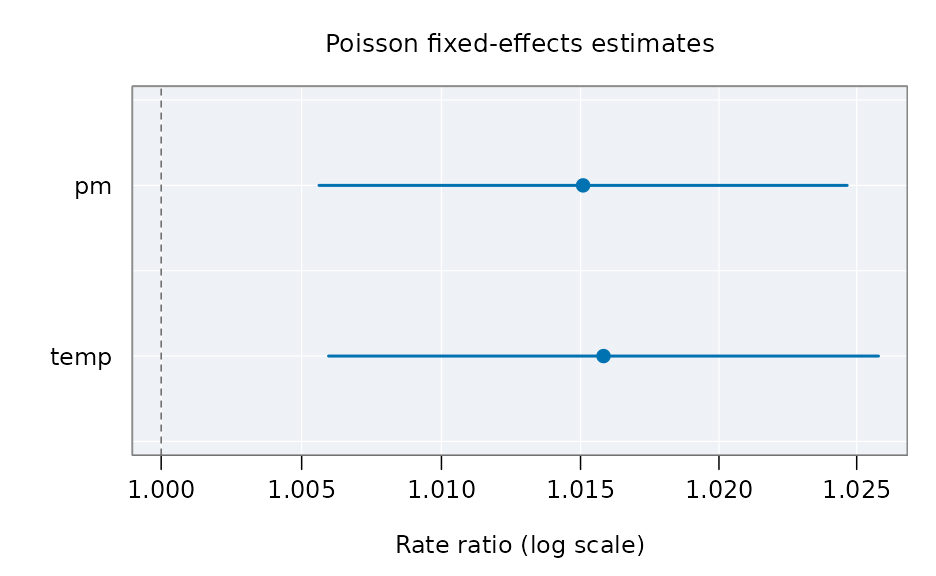

``` r

# two-way clustering by area and day; Newey-West within areas
summary(ppmlfe(d, "crimes", c("pm", "temp"), fe = c("area", "day"),
               expo = "pop", se = "twoway"))
#>   term        est          se     stat           p          lo         hi       rr
#> 1   pm 0.01497858 0.005057811 2.961475 0.003061691 0.005065455 0.02489171 1.015091
#> 2 temp 0.01570428 0.005172399 3.036170 0.002396039 0.005566569 0.02584200 1.015828
summary(ppmlfe(d, "crimes", c("pm", "temp"), fe = c("area", "day"),
               expo = "pop", se = "nw", time = "day", lag = 3))
#>   term        est          se     stat            p          lo         hi       rr
#> 1   pm 0.01497858 0.004748329 3.154495 0.0016077588 0.005672029 0.02428514 1.015091
#> 2 temp 0.01570428 0.004500216 3.489673 0.0004836117 0.006884022 0.02452455 1.015828
```

``` r

plot(f)
```


## Two-stage least squares with absorbed fixed effects

[`ivfe()`](https://rootcoder007.github.io/crimlab/reference/ivfe.md):
Estimates the effect of an exposure that is measured with error or
shares unmeasured causes with the outcome, by instrumental variables:
each endogenous column is first regressed on the excluded instruments
and the controls (the first stage), and the outcome on the fitted values
and the controls (the second stage), with one or two sets of fixed
effects absorbed throughout. This is the linear estimator of Herrnstadt,
Heyes, Muehlegger and Saberian (2019): the log of daily assaults near
each monitor on ozone, instrumented by a westerly wind, with monitor and
time fixed effects and errors clustered by monitor and by date. Without
`endo` and `inst` it is least squares with the fixed effects.

``` r

# simulated: an unmeasured daily shock u raises both the exposure and
# the outcome; the wind moves the exposure only
set.seed(2)
d <- expand.grid(day = 1:60, area = 1:12)
d$wind <- runif(nrow(d), 0, 360)
w <- windiv(d$wind, width = 90)
d <- cbind(d, w)
u <- rnorm(nrow(d))
d$oz <- 3 * w[, 1] - 2 * w[, 2] + u + rnorm(nrow(d))
d$out <- 0.5 * d$oz + u + rnorm(nrow(d))
f <- ivfe(d, "out", endo = "oz", inst = colnames(w), fe = c("area", "day"),
          se = "twoway")
f
#> ivfe: two-stage least squares, 720 rows, fixed effects area and day; two-way clustered errors (area, day; 12 and 60)
#>  term   est      se  stat        p     lo     hi
#>    oz 0.516 0.03059 16.87 3.29e-09 0.4487 0.5833
#> first stage: robust Wald F, Kleibergen-Paap rk Wald F, effective F, its keff and 5% critical value (tau 10%):
#>  endo  wald    kp   eff  keff    cv ninst
#>    oz 489.3 489.3 442.5 1.818 19.73     3
#> over-identification: Sargan, and Hansen J clustered as the first stage:
#>    test  stat df       p
#>  sargan 5.220  2 0.07353
#>  hansen 3.573  2 0.16752
f$first
#>   endo     wald       kp      eff     keff       cv ninst
#> 1   oz 489.2895 489.2895 442.5469 1.818342 19.73326     3
f$fstab
#>   endo     inst        est        se        rel
#> 1   oz  w90_180  2.9213054 0.1237527 10.2179429
#> 2   oz w180_270 -1.9465070 0.1076014 -6.8083594
#> 3   oz   w270_0 -0.0517003 0.1525103 -0.1808338
plot(f)
```

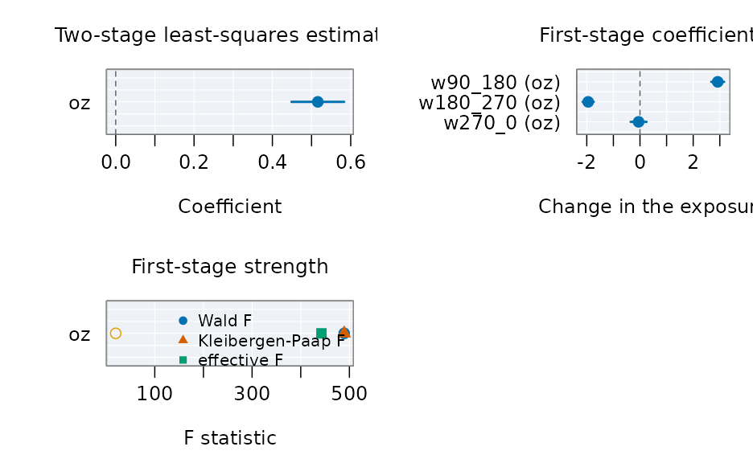

``` r


# shaped as Chen and Li (2020, equations 4-5, p. 4): county-season-year
# cells, the triple difference (treated state x summer x after) as the
# instrument of the AQI, county-by-year and state-by-season effects
# absorbed, the county-by-season effects as indicator columns, errors
# clustered by state (simulated)
set.seed(14)
g <- expand.grid(county = 1:30, season = c("s", "w"), year = 2000:2007)
g$state <- (g$county - 1) %/% 3 + 1
g$ddd <- as.numeric(g$state <= 5 & g$season == "s" & g$year >= 2003)
g$aqi <- 50 - 6 * g$ddd + rnorm(nrow(g), 0, 3)
g$lcrime <- 2 + 0.01 * g$aqi + rnorm(nrow(g), 0, 0.1)
g$cy <- paste(g$county, g$year)
g$ss <- paste(g$state, g$season)
# county x summer, less the first county of each state (the rest is
# absorbed by the two sets of effects)
for (k in unique(g$county[g$county %% 3 != 1])) {
  g[[paste0("cs", k)]] <- as.numeric(g$county == k & g$season == "s")
}
ivfe(g, "lcrime", endo = "aqi", inst = "ddd",
     x = grep("^cs", names(g), value = TRUE), fe = c("cy", "ss"),
     clus = "state")$coef[1, ]
#>   term        est           se     stat            p         lo        hi
#> 1  aqi 0.01381938 0.0009282825 14.88704 1.204632e-07 0.01171945 0.0159193

# shaped as Carrillo, Lopez-Luzuriaga and Malik (2018): the difference
# in differences of equation (4), p. 7 (city-day-hour counts, the
# treated city after the start, year-month and hour-by-weekday
# effects, errors clustered by week) and the spatial regression
# discontinuity of equation (6), p. 8 (counts by distance bin, the
# inside indicator, a line on each side, within a window)
set.seed(15)
h <- expand.grid(city = c("quito", "other"), day = 1:120, hour = 0:23)
h$after <- as.numeric(h$day > 60)
h$treat <- h$after * (h$city == "quito")
h$ym <- (h$day - 1) %/% 30
h$hd <- paste(h$hour, h$day %% 7)
h$week <- (h$day - 1) %/% 7
h$crimes <- rpois(nrow(h), 2 + 0.3 * h$treat)
h$q <- as.numeric(h$city == "quito")
ivfe(h, "crimes", x = c("treat", "q"), fe = c("ym", "hd"),
     clus = "week")$coef[1, ]
#>    term    est         se     stat          p         lo       hi
#> 1 treat 0.1875 0.08224276 2.279836 0.03579739 0.01398295 0.361017
b <- data.frame(dist = seq(-975, 975, by = 50))
b$inside <- as.numeric(b$dist > 0)
b$dside <- b$dist * b$inside
b$n <- rpois(nrow(b), 20 + 5 * b$inside)
b$one <- 1
ivfe(b[abs(b$dist) <= 800, ], "n", x = c("inside", "dist", "dside"),
     fe = "one", se = "hc1")$coef[1, ]
#>     term      est       se    stat          p          lo       hi
#> 1 inside 5.968382 3.073507 1.94188 0.05215164 -0.05558163 11.99235
```

``` r

plot(f)
```


## Instrumental variables for a count outcome with fixed effects

[`ppmlcf()`](https://rootcoder007.github.io/crimlab/reference/ppmlcf.md):
Instruments an exposure in the count model of
[`ppmlfe()`](https://rootcoder007.github.io/crimlab/reference/ppmlfe.md),
in one of two ways (`how`). The first stages regress each endogenous
column on the excluded instruments and the controls with the fixed
effects (as in
[`ivfe()`](https://rootcoder007.github.io/crimlab/reference/ivfe.md)).
Then:

``` r

# simulated counts; the shock u raises pollution and crime together
set.seed(3)
d <- expand.grid(day = 1:50, area = 1:15)
d$wind <- runif(nrow(d), 0, 360)
w <- windiv(d$wind, width = 90)
d <- cbind(d, w)
u <- rnorm(nrow(d), 0, 0.5)
d$pm <- 2 * w[, 1] - w[, 3] + u + rnorm(nrow(d))
d$crimes <- rpois(nrow(d), exp(1 + 0.1 * d$pm + 0.5 * u))
f <- ppmlcf(d, "crimes", endo = "pm", inst = colnames(w),
            fe = c("area", "day"), nboot = 49, seed = 1)
f
#> ppmlcf: Poisson control function, 750 rows, fixed effects area and day; 49 bootstrap draws of 15 clusters (area)
#>     term     est      se  stat         p      lo     hi    rr
#>       pm 0.08266 0.03095 2.671 0.0075737 0.02199 0.1433 1.086
#>  vhat:pm 0.14047 0.03845 3.654 0.0002587 0.06512 0.2158 1.151
#> first stage: robust Wald F, Kleibergen-Paap rk Wald F, effective F, its keff and 5% critical value (tau 10%):
#>  endo  wald    kp   eff  keff    cv ninst
#>    pm 255.2 255.2 342.5 2.151 18.98     3
plot(f)
```


``` r

# the paper's plug-in, with its naive errors
summary(ppmlcf(d, "crimes", endo = "pm", inst = colnames(w),
               fe = c("area", "day"), how = "plug", se = "naive"))
#>   term        est         se     stat           p         lo        hi       rr
#> 1   pm 0.07803114 0.02424708 3.218167 0.001290126 0.03050775 0.1255545 1.081156
```

``` r

plot(f)
```

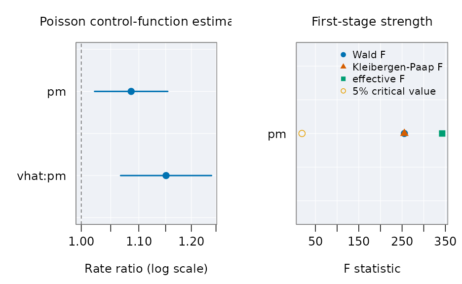

## Exponential-mean GMM for a count with an endogenous exposure

[`expgmm()`](https://rootcoder007.github.io/crimlab/reference/expgmm.md):
Estimates E(y \| x) = exp(x’b + log(expo)) with some regressors
endogenous, by the generalised method of moments on the first-order
moment conditions alone, as Mullahy (1997) and Windmeijer and Santos
Silva (1997) set it out: sum_i z_i u_i(b) = 0 with `z` the excluded
instruments and the exogenous regressors. The residual (`err`):

``` r

# simulated: an unmeasured shock v multiplies the mean and moves the
# exposure; two instruments, day effects, errors clustered by area
set.seed(4)
d <- expand.grid(day = 1:10, area = 1:40)
d$z1 <- rnorm(nrow(d))
d$z2 <- rnorm(nrow(d))
v <- rnorm(nrow(d), 0, 0.5)
d$pm <- 0.6 * d$z1 - 0.4 * d$z2 + v + rnorm(nrow(d), 0, 0.5)
d$crimes <- rpois(nrow(d), exp(0.5 + 0.2 * d$pm + v))
f <- expgmm(d, "crimes", endo = "pm", inst = c("z1", "z2"), fe = "day",
            clus = "area")
f
#> expgmm: exponential-mean GMM, multiplicative residual, two-step, 400 rows; errors clustered by area (40)
#>  term    est      se  stat       p      lo     hi    rr
#>    pm 0.1559 0.06466 2.412 0.01588 0.02921 0.2827 1.169
#> Hansen J = 3.22 on 1 df, p = 0.07274
f$j
#>       stat df          p
#> 1 3.220049  1 0.07274147
plot(f)
```


``` r

# the additive residual, one step
summary(expgmm(d, "crimes", endo = "pm", inst = c("z1", "z2"),
               fe = "day", clus = "area", err = "add", step = "one"))
#>   term       est         se     stat          p         lo        hi       rr
#> 1   pm 0.1582281 0.06382036 2.479273 0.01316505 0.03314248 0.2833137 1.171433
```

``` r

plot(f)
```

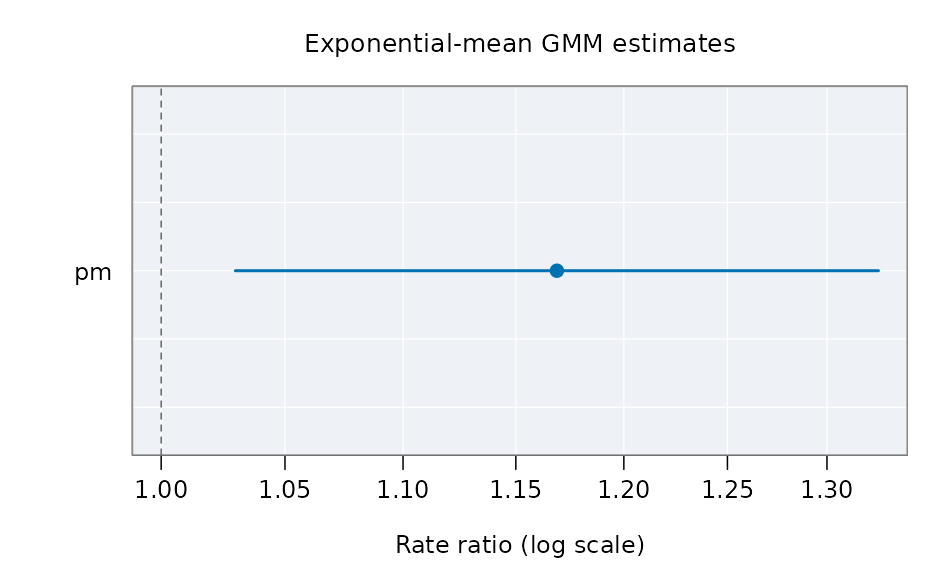

## Wind-direction instruments

[`windiv()`](https://rootcoder007.github.io/crimlab/reference/windiv.md):
Turns wind directions into indicators of the sector the wind blows from,
one sector left out, optionally one set per area so that the same wind
may act differently in different parts of a city; from hourly directions
it first makes one per day.

``` r

windiv(c(10, 100, 200, 300))
#>      w90_180 w180_270 w270_0
#> [1,]       0        0      0
#> [2,]       1        0      0
#> [3,]       0        1      0
#> [4,]       0        0      1
# the paper's whole-degree quadrants: 90 is in the first
windiv(c(90, 91), edges = "paper")
#>      w90_180 w180_270 w270_0
#> [1,]       0        0      0
#> [2,]       1        0      0
# quadrants by region, as in London
windiv(c(10, 100, 200, 300), area = c("east", "east", "west", "west"))
#>      w90_180:east w180_270:east w270_0:east w90_180:west w180_270:west w270_0:west
#> [1,]            0             0           0            0             0           0
#> [2,]            1             0           0            0             0           0
#> [3,]            0             0           0            0             1           0
#> [4,]            0             0           0            0             0           1
# one westerly sector
windiv(c(230, 300), sect = c(225, 285))
#>      w225_285
#> [1,]        1
#> [2,]        0
# hours to days: 350 and 10 degrees average to north
windiv(c(350, 10, 100, 120), by = c(1, 1, 2, 2))
#>   w90_180 w180_270 w270_0
#> 1       0        0      0
#> 2       1        0      0
#> attr(,"dir")
#> [1] 360 110
windiv(c(350, 10, 100, 120), by = c(1, 1, 2, 2), share = TRUE)
#>   w90_180 w180_270 w270_0
#> 1       0        0    0.5
#> 2       1        0    0.0
#> attr(,"dir")
#> [1] 360 110
```

## Temperature inversions

[`invsn()`](https://rootcoder007.github.io/crimlab/reference/invsn.md):
The instrument of Bondy, Roth and Sager (2020, p. 566-567): “the
continuous difference between temperatures at the ground level and
temperatures at circa 750 m altitude (925 hectopascals (hPa) pressure
level)”. On most days the air cools with height; in an inversion it is
warmer above than at the ground, and pollutants are trapped near the
ground.

``` r

invsn(c(10, 5, 2), c(8, 6, 2))
#>   diff inv
#> 1   -2   0
#> 2    1   1
#> 3    0   0
# three-hourly readings, one row per day: inverted when every reading is
invsn(c(1, 2, 3, 1, 2, 3), c(4, 5, 6, 4, 1, 6), by = c(1, 1, 1, 2, 2, 2))
#>   by n     diff inv
#> 1  1 3 3.000000   1
#> 2  2 3 1.666667   0
invsn(c(10, 5, 2), c(8, 6, 2), sign = "ground", brk = c(-Inf, -1, 0, Inf))
#>   diff inv       bin
#> 1    2   0   (0,Inf]
#> 2   -1   1 (-Inf,-1]
#> 3    0   0    (-1,0]
# the share of days without an inversion and the support (check 3)
attr(invsn(c(10, 5, 2), c(8, 6, 2)), "diag")
#>   n      zero min max
#> 1 3 0.6666667  -2   1
```

## Downwind exposure: places downwind of sources of pollution

[`dwnexp()`](https://rootcoder007.github.io/crimlab/reference/dwnexp.md):
Whether each place lies downwind of sources of pollution in each period,
and how far off the wind’s line it lies: the instruments of the papers
that let the wind carry smoke from fires that move from day to day (Bao
and Da 2026) or from a fixed set of sources (Ayesh 2023), for the
instrumental-variable estimators
[`ivfe()`](https://rootcoder007.github.io/crimlab/reference/ivfe.md),
[`ppmlcf()`](https://rootcoder007.github.io/crimlab/reference/ppmlcf.md)
and
[`expgmm()`](https://rootcoder007.github.io/crimlab/reference/expgmm.md).

``` r

# two plumes on day 1, one on day 2; four county points (planar, km)
s <- data.frame(x = c(0, 50, 0), y = c(0, 0, 0), day = c(1, 1, 2),
                from = c(180, 270, 0))
p <- data.frame(x = c(0, 100, 0, -80), y = c(100, 10, -60, 0))
r <- dwnexp(s$x, s$y, s$day, s$from, p$x, p$y)
r
#>   id per n any
#> 1  1   1 1   1
#> 2  2   1 1   1
#> 3  3   1 0   0
#> 4  4   1 0   0
#> 5  1   2 0   0
#> 6  2   2 0   0
#> 7  3   2 1   1
#> 8  4   2 0   0
# the county-month count of downwind days (Bao and Da 2026, eq 1)
r$month <- 1
aggregate(any ~ id + month, r, sum)
#>   id month any
#> 1  1     1   1
#> 2  2     1   1
#> 3  3     1   1
#> 4  4     1   0

# Ayesh's instrument: the angle off the mean wind of the source
# districts, times the mean distance to them
dwnexp(c(0, 10), c(0, 0), c(2020, 2020), c(240, 250), c(30, -30, 5),
       c(20, -20, 0), rule = "angle")
#>   id  per     angle     dist         z
#> 1  1 2020  13.65981 32.16989  439.4346
#> 2  2 2020 175.25512 40.38844 7078.2802
#> 3  3 2020  65.00000  5.00000  325.0000

# the wedge against a square county
sq <- data.frame(id = 1, x = c(-10, 10, 10, -10), y = c(40, 40, 60, 60))
dwnexp(0, 0, NULL, 180, sq$x, sq$y, sq$id, rule = "wedge", rad = 100)
#>   id per n any
#> 1  1   1 1   1
```

## The tailwind component of the wind along a flight course

[`tailwd()`](https://rootcoder007.github.io/crimlab/reference/tailwd.md):
The part of the wind that blows along a course, positive for a tailwind,
from which Hener (2022) builds the instrument of the landing direction
at Frankfurt Airport: aircraft land westbound (course 250 degrees)
unless the tailwind on that course exceeds 2.6 m/s, so the days of the
eastbound approach, and which municipalities lie under the noise, follow
from the wind.

``` r

# wind from the east (70 degrees) at 4 m/s is a 4 m/s tailwind westbound
tailwd(c(70, 340, 250), c(4, 4, 4))
#> [1]  4.000000e+00 -7.347881e-16 -4.000000e+00
# hourly readings to the daily maximum, then Hener's instrument for a
# municipality under the eastbound approach
tw <- tailwd(c(70, 90, 250, 260), c(3, 2, 5, 1), by = c(1, 1, 2, 2))
as.integer(tw$tw > 2.6)
#> [1] 1 0
```

## Irrelevant-day placebo

[`plcday()`](https://rootcoder007.github.io/crimlab/reference/plcday.md):
Refits an estimator with the exposure taken from other days of the same
place, leads and lags in one call, and returns one table of
coefficients, the same day first. This is the placebo of Bondy, Roth and
Sager (2020, table A1 and footnote 27: 7, 31 and 365 days back and
forward) and of Herrnstadt, Heyes, Muehlegger and Saberian (2019, table
9: 100 days); `shifts = c(-365, -100, -31, -7, 7, 31, 100, 365)` runs
both.

``` r

# simulated: crime responds to same-day pollution only
set.seed(4)
d <- expand.grid(day = 1:80, area = 1:12)
d$pm <- rnorm(nrow(d), 20, 5)
d$crimes <- rpois(nrow(d), exp(0.5 + 0.03 * d$pm))
p <- plcday(d, "pm", "area", "day", shifts = c(-7, 7), y = "crimes",
            x = "pm", fe = c("area", "day"))
p
#> plcday: the coefficient of pm with values of other days (shift 0 is the same day; moved: both)
#>  shift        est       se        lo       hi         p   n
#>      0  0.0270936 0.004098  0.019062 0.035125 3.806e-11 960
#>     -7  0.0004221 0.003722 -0.006873 0.007717 9.097e-01 876
#>      7 -0.0088918 0.005132 -0.018950 0.001167 8.316e-02 876
plot(p)
```

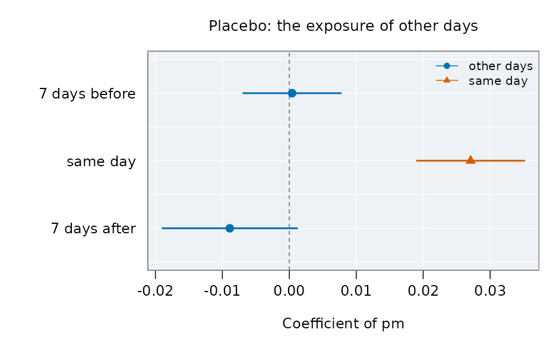

``` r

plot(p)
```


## The upwind and downwind design around a road or a point source

[`updwn()`](https://rootcoder007.github.io/crimlab/reference/updwn.md):
Compares counts on the downwind side of a pollution source with counts
on its upwind side on the same day, the design of Herrnstadt, Heyes,
Muehlegger and Saberian (2021) for the interstates of Chicago (first as
Herrnstadt and Muehlegger 2015). The upwind side shares the day’s
weather and everything else about the day near that road, so it is the
control for the downwind side; the side fixed effects take out what
differs between the two sides on every day.

``` r

# simulated: a road along the x axis, areas on both sides, crime up 10%
# on the downwind side
set.seed(5)
a <- data.frame(area = 1:40, ax = runif(40, 0, 5000),
                ay = runif(40, -4000, 4000))
d <- merge(a, data.frame(day = 1:120))
d$wind <- runif(120, 0, 360)[d$day]
blowsn <- cos((d$wind + 180) * pi / 180)  # +1 when the wind blows north
dn <- abs(d$ay) < 1600 &
  ((d$ay > 0 & blowsn > 0.5) | (d$ay < 0 & blowsn < -0.5))
d$crimes <- rpois(nrow(d), 3 * (1 + 0.1 * dn))
road <- data.frame(x0 = 0, y0 = 0, x1 = 5000, y1 = 0)
u <- updwn(d, "crimes", "ax", "ay", "day", "wind", road, band = 1600,
           offs = c(-1600, 0, 1600))
u
#> updwn: downwind against upwind, 154 side (area) days, outcome over its mean, tolerance 60 degrees
#>  term     est      se   stat      p       lo      hi
#>  down 0.01076 0.03251 0.3309 0.7407 -0.05296 0.07448
#> rows by classification:
#> 
#>   downwind     upwind      along   nosource twosources   onsource    missing 
#>        351        342        387       3720          0          0          0 
#> placebo segments moved sideways:
#>    off      est      se       lo       hi        p   n
#>  -1600 -0.02086 0.02290 -0.06575  0.02403 0.362503 154
#>      0  0.01076 0.03251 -0.05296  0.07448 0.740707 154
#>   1600 -0.07013 0.02327 -0.11574 -0.02453 0.002577 154
plot(u)
```

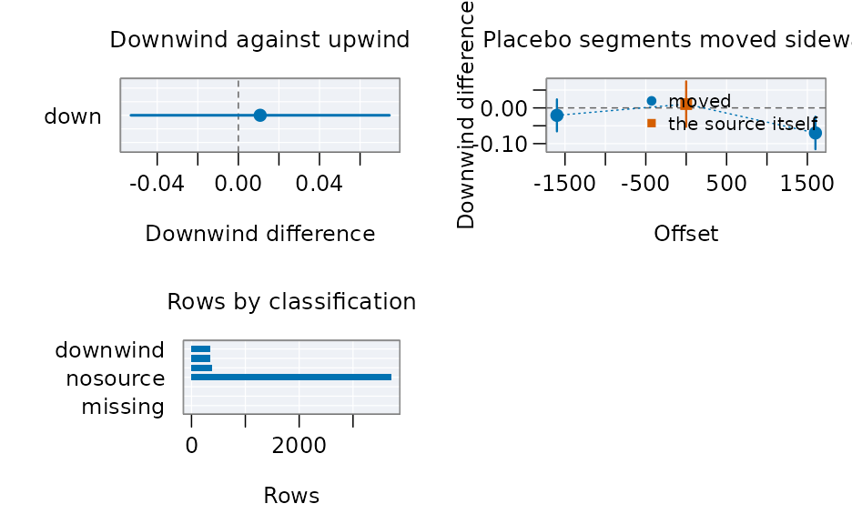

``` r

# the Poisson model and two distance rings
summary(updwn(d, "crimes", "ax", "ay", "day", "wind", road, band = 1600,
              norm = "pois", dist = c(0, 500, 1600)))
#>                 term         est         se       stat          p          lo
#> 1       down:[0,500]  0.11314531 0.06794356  1.6652838 0.09585616 -0.02002163
#> 2 down:(500,1.6e+03] -0.03814761 0.04628543 -0.8241818 0.40983628 -0.12886538
#>           hi        rr
#> 1 0.24631225 1.1197946
#> 2 0.05257017 0.9625708
```

``` r

plot(u)
```


## Join an exposure table to counts by place and day

[`expjn()`](https://rootcoder007.github.io/crimlab/reference/expjn.md):
Makes the analysis table of the estimators of this family: the rows of
the outcome table (place, day, count, …) with the exposure of the same
place and day joined on. Exposure may come from monitors (assigned to
areas beforehand, for example by inverse squared distance from the three
nearest, as Bondy, Roth and Sager do) or from crimlab’s dispersion
functions
([`gplume()`](https://rootcoder007.github.io/crimlab/reference/pgsig.md),
[`plmfld()`](https://rootcoder007.github.io/crimlab/reference/plmfld.md)).

``` r

ex <- data.frame(
  area = c("a", "a", "b"),
  day = c(1, 2, 1),
  pm = c(10, 12, 8)
)
oc <- data.frame(area = c("a", "a", "b", "b"), day = c(1, 2, 1, 2),
                 crimes = c(3, 1, 0, 2))
j <- expjn(ex, oc)
j
#> expjn: 3 rows joined; 1 outcome row(s) without an exposure left out; 0 exposure row(s) without an outcome
j$data
#>   area day crimes pm
#> 1    a   1      3 10
#> 2    a   2      1 12
#> 3    b   1      0  8
```

## Smoke instruments from plume data

[`smkiv()`](https://rootcoder007.github.io/crimlab/reference/smkiv.md):
Builds the wildfire-smoke instruments of the recent papers from a daily
smoke-plume record by place: the presence of a plume; the presence
adjusted to the plumes that reached the ground; plume density classes;
smoke-attributable fine particles; and counts by month.

``` r

# simulated plumes and PM2.5 in two places over 120 days
set.seed(6)
d <- data.frame(place = rep(c("a", "b"), each = 120),
                day = rep(as.Date("2024-06-01") + 0:119, 2))
d$plume <- rbinom(240, 1, 0.2)
d$pm <- rnorm(240, 8, 2) + d$plume * rbinom(240, 1, 0.5) * 15
d$near <- ifelse(d$place == "a", "b", "a")
s <- smkiv(d, "plume", "place", "day", pm = "pm", adj = "own")
table(raw = d$plume, adjusted = s$smoke)
#>    adjusted
#> raw   0   1
#>   0 186   0
#>   1  25  29
head(smkiv(d, "plume", "place", "day", pm = "pm", adj = "nbr", nbr = "near"))
#>   smoke       bg spm
#> 1     0 7.978119   0
#> 2     0 7.978119   0
#> 3     0 7.978119   0
#> 4     0 7.978119   0
#> 5     0 7.978119   0
#> 6     0 7.978119   0
```

## Runs of exposed days

[`exprun()`](https://rootcoder007.github.io/crimlab/reference/exprun.md),
[`runfx()`](https://rootcoder007.github.io/crimlab/reference/exprun.md):
Counts, for each place and day, how many days in a row the place has
been exposed (smoke present, pollution above a threshold), and makes the
indicators of the first, second, … day of a run.
[`runfx()`](https://rootcoder007.github.io/crimlab/reference/exprun.md)
fits a model with them: the effect by day in the run, as Lee and Lee
(2026, equation 3, p. 12) estimate it, Crime = b1 Day1 + b2 Day2 + b3
Day3+ + …, which shows whether the effect fades as people adapt (it
rises on the first and second smoke days and falls from the third in
their 21 cities).

``` r

d <- data.frame(area = 1, day = 1:8, smoke = c(0, 1, 1, 1, 1, 0, 1, 0))
cbind(d, exprun(d, "smoke", "area", "day"))
#>   area day smoke run run1 run2 run3p
#> 1    1   1     0   0    0    0     0
#> 2    1   2     1   1    1    0     0
#> 3    1   3     1   2    0    1     0
#> 4    1   4     1   3    0    0     1
#> 5    1   5     1   4    0    0     1
#> 6    1   6     0   0    0    0     0
#> 7    1   7     1   1    1    0     0
#> 8    1   8     0   0    0    0     0
# simulated: crime up on the first two smoke days
set.seed(7)
d <- expand.grid(day = 1:120, area = 1:12)
d$smoke <- rbinom(nrow(d), 1, 0.3)
r <- exprun(d, "smoke", "area", "day")
d$crimes <- rpois(nrow(d), exp(1 + 0.2 * r$run1 + 0.1 * r$run2))
f <- runfx(d, "crimes", "smoke", "area", "day", fe = c("area", "day"))
f
#> runfx: the effect by day of a run of exposed days
#>   term      est      se    stat         p       lo      hi     rr
#>   run1  0.19460 0.03834  5.0753 3.870e-07  0.11945 0.26975 1.2148
#>   run2  0.06225 0.05863  1.0617 2.884e-01 -0.05267 0.17717 1.0642
#>  run3p -0.03799 0.05251 -0.7234 4.694e-01 -0.14091 0.06493 0.9627
plot(f)
```

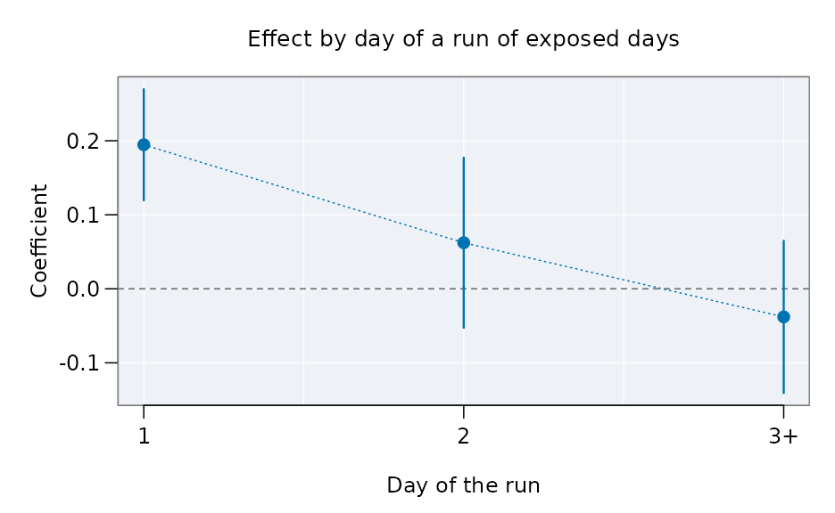

``` r

plot(f)
```


## Effects by a moderator, with the joint test of equality

[`hetfx()`](https://rootcoder007.github.io/crimlab/reference/hetfx.md):
Estimates the effect of an exposure separately for each level of a
moderator (household wealth, income quantile, rural or urban, offence
context) and tests whether the effects are equal.

``` r

# simulated: pollution matters in poor areas only
set.seed(8)
d <- expand.grid(day = 1:60, area = 1:20)
d$poor <- ifelse(d$area <= 10, "poor", "not poor")
d$pm <- rnorm(nrow(d), 20, 5)
d$crimes <- rpois(nrow(d), exp(0.5 + 0.04 * d$pm * (d$poor == "poor")))
h <- hetfx(d, "pm", "poor", y = "crimes", x = "pm", fe = c("area", "day"))
h
#> hetfx: the effect by level (interactions)
#>     level       est       se       lo       hi         p   n
#>  not poor -0.002938 0.005806 -0.01432 0.008441 6.128e-01 600
#>      poor  0.043931 0.004062  0.03597 0.051892 2.910e-27 600
#> Wald test of equal effects: 41.96 on 1 df, p = 9.31e-11
plot(h)
```

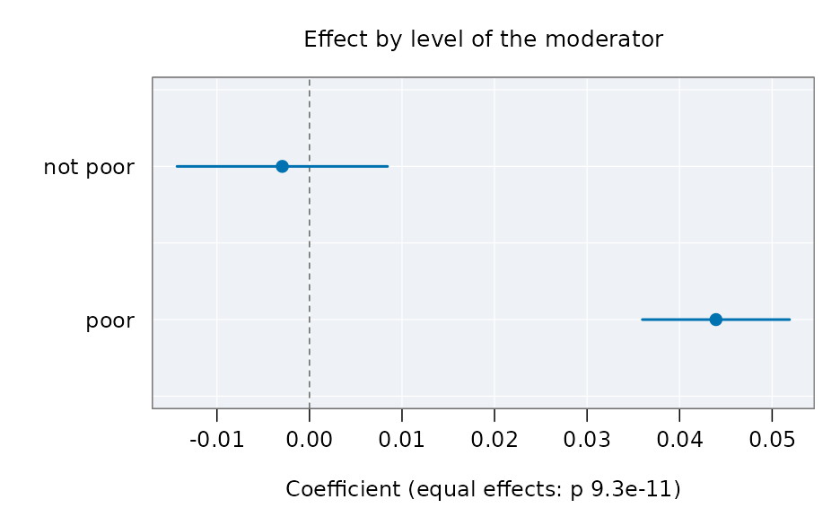

``` r

plot(h)
```


## The time-stratified case-crossover design

[`ccross()`](https://rootcoder007.github.io/crimlab/reference/ccross.md):
Compares each day’s count with the counts of the same place on the other
days of its stratum, the case-crossover design for counts: a Poisson
model with one fixed effect per stratum, which gives the same
coefficients as the conditional Poisson model. Ju et al. (2026,
equations 1 and 2, p. 7) use the space-time stratum “one region nested
in the same weekday of same month from the same year” (`strat = "ymw"`,
the default), a control function for wildfire PM2.5 driven by wind
speed, the 2-day moving average of exposure (`ma`), and errors clustered
by calendar year-month (the default `clus` here).

``` r

set.seed(9)
d <- expand.grid(day = as.Date("2023-01-01") + 0:364, area = 1:4)
d$pm <- rnorm(nrow(d), 15, 4)
d$crimes <- rpois(nrow(d), exp(1 + 0.02 * d$pm))
ccross(d, "crimes", "area", "day", ma = "pm", x = "pm")
#> ppmlfe: Poisson pseudo-likelihood, 1456 rows, fixed effects .strat; clustered errors (.ym; 12)
#>  term     est       se  stat         p       lo      hi    rr
#>    pm 0.01792 0.005167 3.467 0.0005256 0.007789 0.02804 1.018

# shaped as Burkhardt et al. (2019, JEEM, equation 1, p. 5): county-day
# counts on PM2.5 and ozone together, county-by-year-by-month-by-weekday
# effects, errors clustered by county (simulated)
d$o3 <- rnorm(nrow(d), 0.03, 0.01)
ccross(d, "crimes", "area", "day", x = c("pm", "o3"), clus = "area")
#> Warning: ccross: fewer than ten clusters; cluster-robust errors are unreliable with so
#> few (wcbx() is made for this case).
#> ppmlfe: Poisson pseudo-likelihood, 1460 rows, fixed effects .strat; clustered errors (area; 4)
#>  term     est       se    stat         p        lo     hi    rr
#>    pm 0.01407 0.002616 5.37971 7.461e-08  0.008946 0.0192 1.014
#>    o3 0.11728 1.936045 0.06058 9.517e-01 -3.677299 3.9119 1.124

# shaped as Han et al. (2026, Methods p. 2 and table 1): city-day
# counts, same-weekday-same-month strata, a holiday indicator, natural
# splines of temperature (6 df) and humidity (3 df), NO2 at lag 0, the
# percent change per interquartile range (simulated)
d$no2 <- rnorm(nrow(d), 30, 10)
d$temp <- 15 + 10 * sin(2 * pi * as.numeric(d$day) / 365) +
  rnorm(nrow(d))
d$rh <- runif(nrow(d), 30, 90)
d$hol <- as.numeric(format(d$day, "%m-%d") %in% c("01-01", "10-01"))
d$crimes <- rpois(nrow(d), exp(1 + 0.004 * d$no2))
h <- ccross(d, "crimes", "area", "day", x = c("no2", "hol"),
            ns = c(temp = 6, rh = 3), clus = "area")
#> Warning: ccross: fewer than ten clusters; cluster-robust errors are unreliable with so
#> few (wcbx() is made for this case).
b <- h$coef[h$coef$term == "no2", ]
100 * (exp(c(b$est, b$lo, b$hi) * IQR(d$no2)) - 1)
#> [1]  1.4930239 -0.7746229  3.8124944
plot(h, terms = "no2")
```

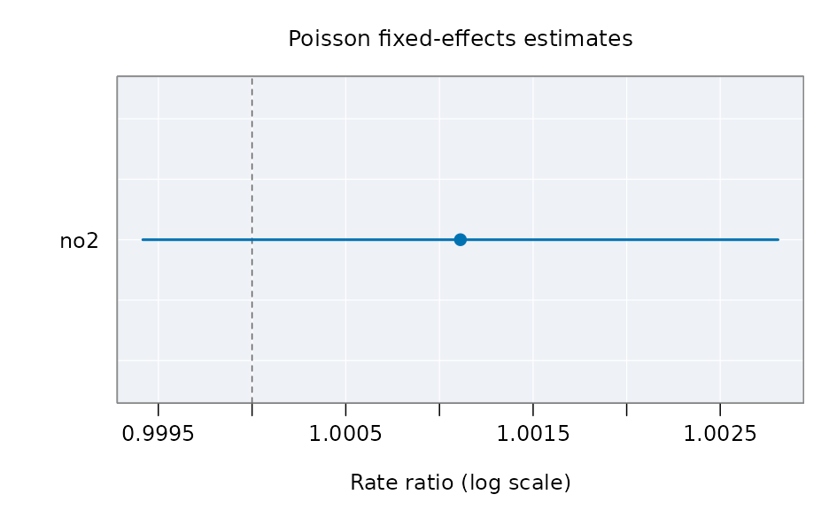

``` r

plot(h)
```

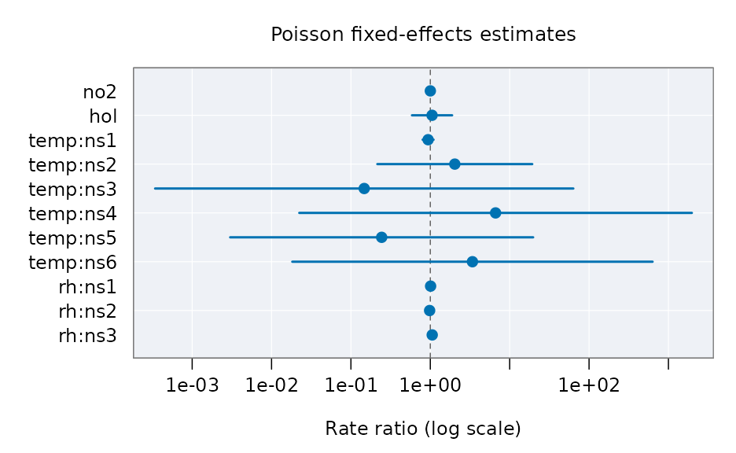

## Two exposures together: their interaction and the surface of effects

[`jntx()`](https://rootcoder007.github.io/crimlab/reference/jntx.md):
Estimates how two exposures (heat and ozone, smoke and heat) act
together on a count, as a surface of rate ratios over both, the effect
of one at chosen levels of the other, and a test of the interaction.

``` r

set.seed(10)
d <- expand.grid(day = 1:150, city = 1:10)
d$temp <- rnorm(nrow(d), 25, 4)
d$o3 <- 0.6 * d$temp + rnorm(nrow(d), 30, 6)
d$crimes <- rpois(
  nrow(d),
  exp(1 + 0.02 * d$temp + 0.001 * d$temp * d$o3 / 10)
)
j <- jntx(d, "crimes", "temp", "o3", fe = "city")
#> Warning: jntx: the joint test of 12 restrictions is not computed: the covariance has
#> rank 9 (too few clusters for it).
j
#> jntx: the effect of x1 (spline surface) at levels of x2
#>     x2   p2    est      se       lo     hi    rr
#>  34.36 0.05 0.4016 0.08776  0.22956 0.5736 1.494
#>  45.04 0.50 0.3180 0.02645  0.26611 0.3698 1.374
#>  55.19 0.95 0.1665 0.12481 -0.07812 0.4111 1.181
#> Wald test of no interaction: NA on 12 df, p = NA
plot(j)
```


``` r

plot(j)
```

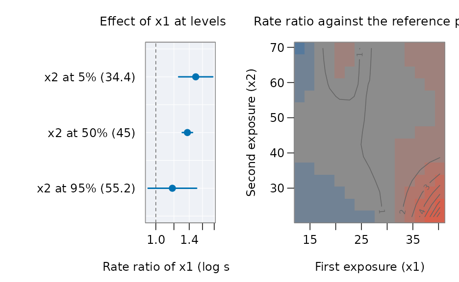

## Exposure in bins: dose-response and tests of non-linearity

[`dosebin()`](https://rootcoder007.github.io/crimlab/reference/dosebin.md):
Replaces a continuous exposure by indicators of its bins, the reference
bin left out, fits the model, and tests whether the bins matter and
whether their effects follow a straight line.

``` r

set.seed(11)
d <- expand.grid(day = 1:100, area = 1:10)
d$aqi <- rgamma(nrow(d), 4, 0.1)
d$crimes <- rpois(nrow(d), exp(1 + 0.3 * (d$aqi > 50)))
b <- dosebin(d, "crimes", "aqi", fe = c("area", "day"))
b
#> dosebin: the effect of each bin against the reference
#>          bin   mid   n      est      se       lo     hi         p
#>  [4.35,22.8] 16.77 200  0.00000      NA       NA     NA        NA
#>  (22.8,32.5] 27.82 200  0.01200 0.05795 -0.10159 0.1256 8.360e-01
#>  (32.5,42.2] 37.07 200 -0.08752 0.05118 -0.18783 0.0128 8.727e-02
#>  (42.2,55.1] 47.41 200  0.04748 0.04284 -0.03649 0.1314 2.678e-01
#>   (55.1,138] 67.78 200  0.21854 0.04937  0.12177 0.3153 9.580e-06
#>    test  stat df         p
#>     all 25.25  4 0.0000448
#>  linear 14.72  3 0.0020678
plot(b)
```

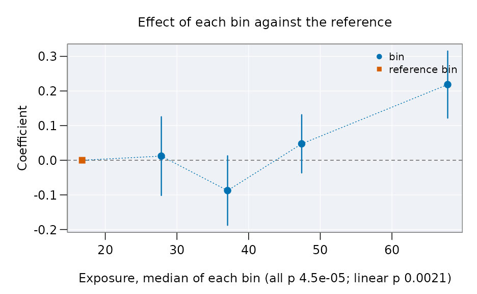

``` r

plot(b)
```


## Effects by offence type in one call, with a multiple-testing correction

[`typefx()`](https://rootcoder007.github.io/crimlab/reference/typefx.md):
Fits the same model to several outcomes (assault, robbery, burglary,
property crime, …) and adjusts the p-values for the number of outcomes
tested.

``` r

set.seed(12)
d <- expand.grid(day = 1:60, area = 1:12)
d$pm <- rnorm(nrow(d), 20, 5)
d$assault <- rpois(nrow(d), exp(0.5 + 0.03 * d$pm))
d$theft <- rpois(nrow(d), 2)
r <- typefx(d, c("assault", "theft"), "pm", x = "pm",
            fe = c("area", "day"))
r
#> typefx: one fit per outcome, p-values adjusted by holm
#>        y       est       se       lo       hi         p      padj   n
#>  assault  0.028269 0.007333  0.01390 0.042642 0.0001157 0.0002314 720
#>    theft -0.002616 0.006038 -0.01445 0.009219 0.6648421 0.6648421 720
plot(r)
```

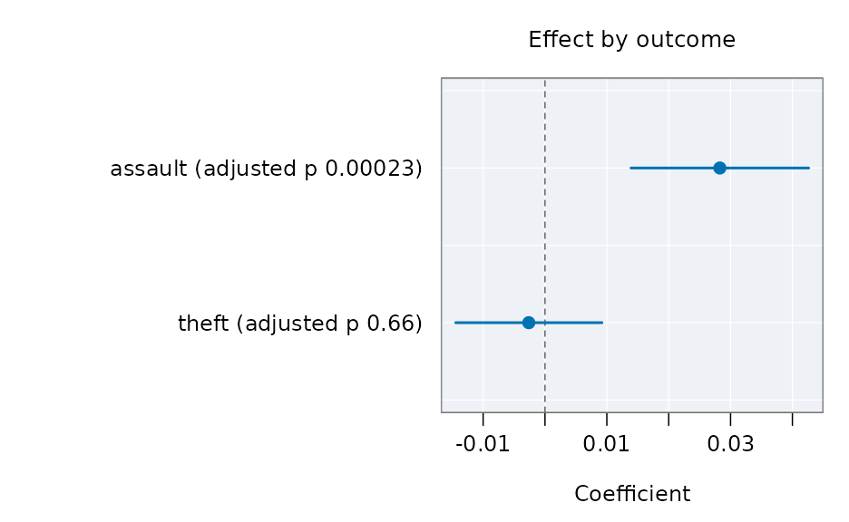

``` r

plot(r)
```


## Inverse-distance-weighted interpolation, and zonal means

[`idwint()`](https://rootcoder007.github.io/crimlab/reference/idwint.md):
Carries the values of monitors to target points as the mean of the
nearest monitors weighted by their distance to the power `-p`, and
averages the targets of each zone. Exposure papers assign monitor
readings to places this way: Rahman et al. (2023, sec. 2.3) take
“inverse distance squared weighting of observations from up to four
nearby (\<50 km) monitoring locations” for census tract centroids
(`p = 2`, `k = 4`, `rad = 50`, `lonlat = TRUE`); Wongchanapai et
al. (2025) interpolate a surface of annual PM2.5 “using the inverse
distance weight method” and take “zonal statistics” per municipality
(targets on a grid over the state, `zone` the municipality of each grid
point; they used ArcGIS Pro and state neither the power nor the
neighbours, so give both); Wesselbaum (2022) matches each crime “to the
measures of the nearest weather, pollution station” (`k = 1`).

``` r

m <- data.frame(x = c(0, 10, 0), y = c(0, 0, 10), pm = c(8, 12, 10))
idwint(m$x, m$y, m$pm, c(5, 0), c(0, 0))
#>   val used
#> 1  10    3
#> 2   8    1
# the nearest monitor only
idwint(m$x, m$y, m$pm, c(9, 1), c(0, 1), k = 1)
#>   val used
#> 1  12    1
#> 2   8    1
# a grid over two zones, and the zonal means
g <- expand.grid(x = 0:10, y = 0:10)
idwint(m$x, m$y, m$pm, g$x, g$y, zone = ifelse(g$x < 5, "west", "east"))
#>   zone      val  n
#> 1 east 10.69539 66
#> 2 west  9.33759 55
```

## Geographically and temporally weighted regression

[`gtwreg()`](https://rootcoder007.github.io/crimlab/reference/gtwreg.md):
The regression of Kuo and Putra (2021, eqs 4-9), after Huang, Wu and
Barry (2010): at each observation `i` the least-squares fit of all
observations weighted by a Gaussian kernel of their space-time distance,
so that the coefficients vary over places and periods. They relate
robbery, domestic violence and fraud in the local government areas of
New South Wales to the air quality index month by month.

``` r

set.seed(4)
d <- expand.grid(u = 1:6, v = 1:6, t = 1:4)
d$aqi <- rnorm(nrow(d))
d$y <- 1 + (0.2 + 0.1 * d$u) * d$aqi + rnorm(nrow(d), 0, 0.3)
r <- gtwreg(d$y, d["aqi"], d$u, d$v, d$t, h = c(1.5, 3, 6),
            tau = c(0, 1))
r
#> gtwreg: geographically and temporally weighted regression, h = 1.5, tau = 0
#> CV 13.488, AICc 70.291, R2 0.796, effective parameters 13.35
#> local coefficients (quartiles):
#>                0%       25%       50%       75%      100%
#> (const) 0.9361268 0.9679731 0.9848207 0.9955117 1.0355406
#> aqi     0.2981053 0.4329041 0.5922378 0.6711381 0.7942628
r$grid
#>     h tau       cv     aicc
#> 1 1.5   0 13.48802 70.29134
#> 2 3.0   0 14.16615 75.47577
#> 3 6.0   0 15.53506 88.76016
#> 4 1.5   1 13.72343 74.63537
#> 5 3.0   1 14.16584 75.13253
#> 6 6.0   1 15.53053 88.64167
```

## Association rules between two categorical variables

[`asrule()`](https://rootcoder007.github.io/crimlab/reference/asrule.md):
The rules the Apriori algorithm (Agrawal et al. 1996) finds when each
observation holds one level of each of two variables: {} =\> {b} and {a}
=\> {b} with `a` a level of one variable and `b` of the other, each with
its support, confidence, coverage and lift. Wongchanapai et al. (2025)
cut the rate of intimate partner violence and the annual PM2.5 of New
Jersey’s municipalities into five groups each with
[`cut()`](https://rdrr.io/r/base/cut.html) and kept rules of “at least
10% support … and at least 20% confidence” (`minsup = 0.1`,
`minconf = 0.2`, the defaults here) in R’s arules package; with two
variables these are all its rules, the empty left-hand side included as
arules includes it by default (`empty`).

``` r

set.seed(5)
pm <- cut(rnorm(200), 5, labels = c("vl", "l", "m", "mh", "vh"))
ipv <- cut(rnorm(200), 5, labels = c("vl", "l", "m", "mh", "vh"))
asrule(pm, ipv, nm = c("pm25", "ipv"))
#>        lhs     rhs support confidence coverage     lift count
#> 1           pm25=l   0.225  0.2250000    1.000 1.000000    45
#> 2           pm25=m   0.405  0.4050000    1.000 1.000000    81
#> 3          pm25=mh   0.260  0.2600000    1.000 1.000000    52
#> 4            ipv=m   0.375  0.3750000    1.000 1.000000    75
#> 5           ipv=mh   0.365  0.3650000    1.000 1.000000    73
#> 6   pm25=m   ipv=m   0.160  0.3950617    0.405 1.053498    32
#> 7    ipv=m  pm25=m   0.160  0.4266667    0.375 1.053498    32
#> 8   pm25=m  ipv=mh   0.160  0.3950617    0.405 1.082361    32
#> 9   ipv=mh  pm25=m   0.160  0.4383562    0.365 1.082361    32
#> 10 pm25=mh   ipv=m   0.105  0.4038462    0.260 1.076923    21
#> 11   ipv=m pm25=mh   0.105  0.2800000    0.375 1.076923    21
```

## Generalized synthetic control with interactive fixed effects

[`ifesc()`](https://rootcoder007.github.io/crimlab/reference/ifesc.md):
The effect of a treatment adopted by some units of a balanced panel at
possibly different times, estimated as the generalized synthetic control
of Xu (2017): a model of the untreated outcome fitted to the units never
treated, then carried to each treated unit through its periods before
adoption.

``` r

set.seed(1)
p <- expand.grid(id = 1:30, yr = 1:12)
f <- cumsum(rnorm(12))
l <- rnorm(30)
p$tr <- as.integer(p$id <= 6 & p$yr >= 9)
p$y <- l[p$id] * f[p$yr] + 2 * p$tr + rnorm(nrow(p), 0, 0.3)
r <- ifesc(p, "y", "tr", "id", "yr", r = 1, nboot = 50, seed = 1)
r
#> ifesc: generalized synthetic control, 6 treated and 24 control units, 12 times, 1 factor(s)
#>    est     se  stat         p    lo    hi
#>  1.994 0.2222 8.974 2.851e-19 1.558 2.429
```

## Long-run effects from a common correlated effects fit

[`lrcce()`](https://rootcoder007.github.io/crimlab/reference/lrcce.md):
The cross-sectionally augmented autoregressive distributed lag (CS-ARDL)
long-run effects of Chudik et al. (2016) as Ditzen (2021, sec. 3.2) sets
them out, from the unit estimates of
[`ccepnl()`](https://rootcoder007.github.io/crimlab/reference/ccepnl.md).

``` r

set.seed(3)
tt <- 30
d <- expand.grid(year = 1:tt, prov = paste0("p", 1:25))
f <- rnorm(tt)[d$year]
g <- rnorm(25, 1)[as.integer(substring(d$prov, 2))]
d$x <- g * f + rnorm(nrow(d))
d$xl <- ave(d$x, d$prov, FUN = function(v) c(NA, v[-length(v)]))
d$y <- 0
for (i in which(d$year > 1)) {
  d$y[i] <- 0.4 * d$y[i - 1] + 0.5 * d$x[i] + 0.1 * d$xl[i] +
    g[i] * f[i] + rnorm(1)
}
k <- d$year > 1
# CS-ARDL: theta is 0.6 over 0.6, that is 1
r <- ccepnl(d$y[k], d[k, c("x", "xl")], d$prov[k], d$year[k], ylag = 1)
lrcce(r, c("x", "xl"))
#>   term       est         se         z            p        lo        hi
#> 1    x 1.2095957 0.26532667  4.558892 5.142412e-06 0.6895650 1.7296265
#> 2  phi 0.6980514 0.05501332 12.688771 6.824871e-37 0.5902273 0.8058755
# CS-DL: x and its first difference; the coefficient of x is theta
d$dx <- d$x - d$xl
ccepnl(d$y[k], d[k, c("x", "dx")], d$prov[k], d$year[k], lags = 3)$mg
#>   term        est         se         z            p         lo         hi
#> 1    x  0.8218133 0.10435066  7.875497 3.393915e-15  0.6172897  1.0263368
#> 2   dx -0.2750372 0.06408953 -4.291453 1.775074e-05 -0.4006504 -0.1494241
```

``` r

plot(r)
```

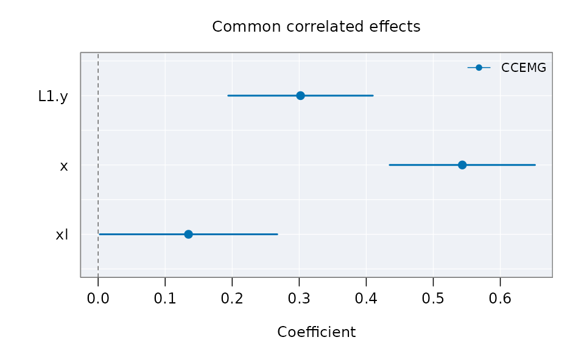

## Coarsened exact matching

[`cemtch()`](https://rootcoder007.github.io/crimlab/reference/cemtch.md):
The matching of Iacus, King and Porro (2012): each covariate is
coarsened into bins, the rows are grouped by their bins on every
covariate at once, and only the groups (strata) holding both treated and
control rows are kept, so that a later regression compares like with
like without extrapolating.

``` r

set.seed(2)
n <- 300
d <- data.frame(pov = rbinom(n, 1, 0.4), age = runif(n, 14, 18))
d$lead <- rbinom(n, 1, plogis(-1 + 1.5 * d$pov))
d$y <- 0.5 * d$lead + d$pov + 0.2 * d$age + rnorm(n)
m <- cemtch(d, "lead", c("pov", "age"), cut = list(age = 4))
m
#> cemtch: coarsened exact matching, 8 of 8 strata kept
#>           control treated
#> all           177     123
#> matched       177     123
#> unmatched       0       0
#> L1 imbalance: 0.416 before, 0.142 after
stats::lm(y ~ lead, d, weights = m$w, subset = m$keep)
#> 
#> Call:
#> stats::lm(formula = y ~ lead, data = d, subset = m$keep, weights = m$w)
#> 
#> Coefficients:
#> (Intercept)         lead  
#>      3.9217       0.5045
```

## Least squares with regression diagnostics and predictions

[`olsdx()`](https://rootcoder007.github.io/crimlab/reference/olsdx.md):
The multiple regression that Algahtany, Kumar and Barclay (2022) fit to
monthly counts of each kind of offence in two regions, with the mean
temperature, the mean relative humidity and the days of haze in the
month as predictors, together with the checks they report before reading
it: standardised coefficients, the tolerance and variance inflation of
each predictor and the correlations among them, the Durbin-Watson
statistic of the residuals, each row’s leverage, studentised residuals
and Cook’s distance, and the expected count, with its standard error and
interval, for a month of given weather.

``` r

# 84 months of weather and assaults, simulated
set.seed(4)
w <- data.frame(temp = rnorm(84, 26, 8), hum = runif(84, 10, 60),
                haze = rpois(84, 15))
assault <- 5 + 0.7 * w$temp + 0.15 * w$hum + 0.35 * w$haze +
  rnorm(84, sd = 4)
r <- olsdx(assault, w, at = c(temp = 35, hum = 74, haze = 25))
r
#> olsdx: 84 rows, 4 coefficients, R2 0.6862, adjusted 0.6744
#> F 58.3 on 3 and 80 df, p = 4.43e-20; Durbin-Watson 1.724
#>         term       est         se         t            p         lo        hi      beta
#>  (Intercept) 4.0071452 2.47472213  1.619230 1.093335e-01 -0.9177087 8.9319992        NA
#>         temp 0.6539668 0.06021597 10.860355 2.087182e-17  0.5341332 0.7738004 0.6808282
#>          hum 0.1836688 0.03019435  6.082888 3.838547e-08  0.1235802 0.2437575 0.3815577
#>         haze 0.3983768 0.09932576  4.010811 1.351956e-04  0.2007123 0.5960414 0.2513618
#>        tol      vif
#>         NA       NA
#>  0.9982123 1.001791
#>  0.9970319 1.002977
#>  0.9987934 1.001208
#> rows with Cook's distance above 1: 0; leverage from 0.2 to 0.5: 0, above: 0
#> pairs of predictors correlated above 0.7: 0; predictors with VIF above 10: 0
#> means at `at`:
#>      fit       se       lo      hi
#>  50.4469 1.693266 47.07719 53.8166
r$pred
#>       fit       se       lo      hi
#> 1 50.4469 1.693266 47.07719 53.8166
# one new month rather than the mean of such months
olsdx(assault, w, at = c(temp = 35, hum = 74, haze = 25),
      pred = "new")$pred
#>       fit       se       lo       hi
#> 1 50.4469 4.289069 41.91138 58.98242
# a stricter count of influential rows
print(r, cook = 4 / 84)
#> olsdx: 84 rows, 4 coefficients, R2 0.6862, adjusted 0.6744
#> F 58.3 on 3 and 80 df, p = 4.43e-20; Durbin-Watson 1.724
#>         term       est         se         t            p         lo        hi      beta
#>  (Intercept) 4.0071452 2.47472213  1.619230 1.093335e-01 -0.9177087 8.9319992        NA
#>         temp 0.6539668 0.06021597 10.860355 2.087182e-17  0.5341332 0.7738004 0.6808282
#>          hum 0.1836688 0.03019435  6.082888 3.838547e-08  0.1235802 0.2437575 0.3815577
#>         haze 0.3983768 0.09932576  4.010811 1.351956e-04  0.2007123 0.5960414 0.2513618
#>        tol      vif
#>         NA       NA
#>  0.9982123 1.001791
#>  0.9970319 1.002977
#>  0.9987934 1.001208
#> rows with Cook's distance above 0.04761905: 6; leverage from 0.2 to 0.5: 0, above: 0
#> pairs of predictors correlated above 0.7: 0; predictors with VIF above 10: 0
#> means at `at`:
#>      fit       se       lo      hi
#>  50.4469 1.693266 47.07719 53.8166
```
