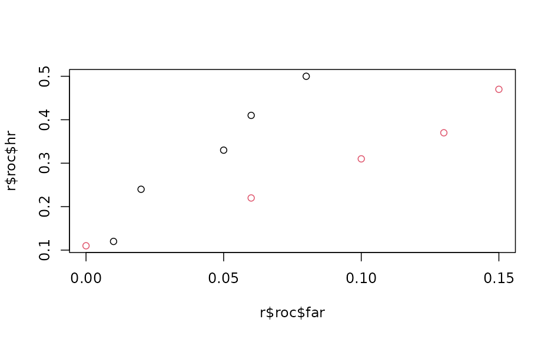
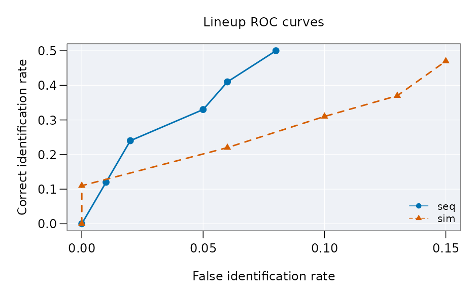
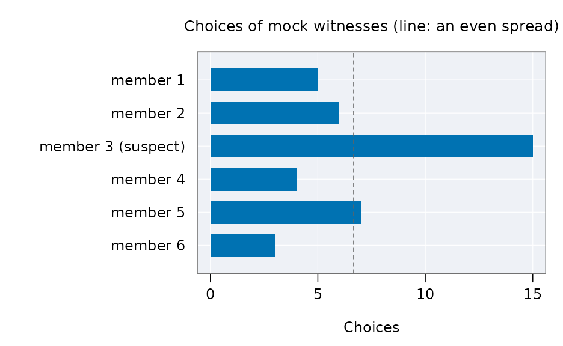

# Eyewitness identification, toxicology and taphonomy

Lineup performance, calibration of a toxicology method, post-mortem
redistribution and the time since death, and alcohol and drug use: a
blood alcohol concentration from what was drunk and the scores of
screening questionnaires.

Each section is one help page: what the function is for, the example of
its help page as it runs, and the plot of its result where the package
draws one. [`?name`](https://rdrr.io/r/base/name.html) gives the
arguments and the value in full.

## Eyewitness identification

### Eyewitness lineups: ROC curves, partial areas and confidence-accuracy

[`lnroc()`](https://rootcoder007.github.io/crimlab/reference/lnroc.md):
Asks how well a lineup procedure lets witnesses tell the culprit from an
innocent suspect, and how much a witness’s confidence is worth. Each
witness saw a lineup that held the culprit (target present, `tp`) or did
not (target absent), picked the suspect, a filler or nobody (`pick`),
and stated a confidence (`conf`, higher is surer). Counting only the
identifications made at confidence `c` or above gives, at each cut `c`
from the highest down, the hit rate (suspect identifications in
target-present lineups over those lineups) and the false alarm rate
(innocent-suspect identifications in target-absent lineups over those
lineups). The points trace the receiver operating characteristic (ROC)
of Mickes, Flowe and Wixted (2012); a procedure whose curve lies higher
discriminates better. When target-absent lineups have no designated
innocent suspect, give the lineup `size`: every identification in a
target-absent lineup then counts, divided by `size` (the rate at which
an innocent suspect would be picked in a fair lineup).

``` r

set.seed(3)
n <- 400
tp <- rep(0:1, each = n / 2)
proc <- rep(c("sim", "seq"), n / 2)
ch <- c("suspect", "filler", "none")
pick <- ifelse(tp == 1, sample(ch, n, TRUE, c(0.5, 0.15, 0.35)),
               sample(ch, n, TRUE, c(0.1, 0.3, 0.6)))
conf <- ifelse(pick == "none", NA, sample(1:5, n, TRUE))
r <- lnroc(tp, pick, conf, proc = proc, nboot = 200, seed = 1)
r$pauc
#>   proc    pauc          se          lo         hi   diff         dse         p
#> 1  seq 0.02375 0.006495450 0.011019152 0.03648085  0.000          NA        NA
#> 2  sim 0.01475 0.004086343 0.006740914 0.02275909 -0.009 0.007738077 0.2447972
plot(r$roc$far, r$roc$hr, col = factor(r$roc$proc))
```



``` r

plot(r)
```



### Fairness of a lineup from mock witnesses

[`lnsize()`](https://rootcoder007.github.io/crimlab/reference/lnsize.md):
Asks whether a lineup singles out its suspect. People who never saw the
crime (mock witnesses) read the witness’s description and pick the
lineup member who fits it best; in a fair lineup of `k` they pick each
member about equally often. A choice of 0 records a mock witness who
chose no one. With `n` mock witnesses, `m` of whom chose a member, and
`o_i` the choices of member `i`:

``` r

# 40 mock witnesses, a lineup of six, the suspect in position 3
ch <- c(rep(3, 15), rep(1, 5), rep(2, 6), rep(4, 4), rep(5, 7), rep(6, 3))
lnsize(ch, k = 6, susp = 3)
#> lnsize: 40 mock witnesses, lineup of 6, suspect in position 3
#>            n            k           nm        psusp         pbin        fsize 
#> 40.000000000  6.000000000 40.000000000  0.375000000  0.001282306  2.666666667 
#>        esize       esizeb          etr        etrlo        etrhi 
#>  4.700000000  4.700000000  4.444444444  3.345535088  6.618389805
```

``` r

res <- lnsize(ch, k = 6, susp = 3)
plot(res)
```



## Toxicology and taphonomy

### Calibration line of an assay

[`txcal()`](https://rootcoder007.github.io/crimlab/reference/txcal.md):
Fits the calibration line of a quantitative assay (the response, an
analyte to internal standard peak-area ratio say, against the known
concentration of each calibrator) by weighted least squares, and reads
unknown samples off it. Weights `1/x^2` or `1/x` keep the precise low
calibrators from being swamped by the high ones, as is usual when the
error grows with the concentration. The limits of detection and of
quantitation follow the calibration-curve rule of ICH Q2: `k[1]` and
`k[2]` (3.3 and 10) times the residual standard error over the slope.

``` r

conc <- c(5, 10, 25, 50, 100, 250)
resp <- c(0.051, 0.098, 0.26, 0.49, 1.02, 2.47)
txcal(conc, resp, unk = c(0.03, 0.6))
#> $fit
#>          int        slope           r2        sigma          lod          loq 
#> 0.0005578058 0.0100118968 0.9990611257 0.0002794509 0.0921092214 0.2791188527 
#> 
#> $unk
#>   resp      conc         flag
#> 1 0.03  2.940721 quantifiable
#> 2 0.60 59.872990 quantifiable
#> 
#> $w
#> [1] "1/x^2"
```

### Values below the limit of detection

[`lodimp()`](https://rootcoder007.github.io/crimlab/reference/lodimp.md):
Substitutes the values of an assay that fall below the limit of
detection (left-censored) by a fraction of that limit: `lod / 2`,
`lod / sqrt(2)` (Hornung and Reed 1990) or `lod` itself. A value not
measured (`NA`) stays `NA` and is not counted as censored. Substitution
is the simple choice; with much censoring it biases the mean and the
spread.

``` r

lodimp(c(0.4, 0.05, NA, 1.2, 0.08), lod = 0.1)
#> $tab
#>      x lod  imp  cens
#> 1 0.40 0.1 0.40 FALSE
#> 2 0.05 0.1 0.05  TRUE
#> 3   NA 0.1   NA FALSE
#> 4 1.20 0.1 1.20 FALSE
#> 5 0.08 0.1 0.05  TRUE
#> 
#> $frac
#> [1] 0.5
#> 
#> $nmiss
#> [1] 1
```

### Postmortem redistribution ratio

[`pmrrat()`](https://rootcoder007.github.io/crimlab/reference/pmrrat.md):
After death drugs move from organs into the central blood vessels, so
that heart blood can read well above the concentration at death. The
ratio of the central (heart) to the peripheral (femoral) concentration
flags it: at most `cut[1]` (1) minimal, at most `cut[2]` (2) modest,
above that significant, when the peripheral value is the better guide to
the concentration at death.

``` r

pmrrat(c(0.4, 1.5, 0.9), c(0.5, 1, 0.2))
#>   cen per ratio      redist
#> 1 0.4 0.5   0.8     minimal
#> 2 1.5 1.0   1.5      modest
#> 3 0.9 0.2   4.5 significant
```

### Ethanol in a decomposed body: drunk before death or made after

[`etohlr()`](https://rootcoder007.github.io/crimlab/reference/etohlr.md):
Microbes make ethanol in a body after death, and with it the higher
alcohols n-propanol and n-butanol; ethyl glucuronide, a metabolite, is
made only by a living body. So for each case: ethyl glucuronide present
(above 0) says the ethanol was taken before death; otherwise a higher
alcohol above `thr` says it was (at least partly) made after death;
otherwise the signals do not decide.

``` r

etohlr(c(0.8, 0.5, 0.3), prop = c(0, 0.02, NA), etg = c(1.1, NA, NA))
#>   eth prop but etg higher       verdict
#> 1 0.8 0.00   0 1.1   0.00    antemortem
#> 2 0.5 0.02   0  NA   0.02    postmortem
#> 3 0.3   NA   0  NA   0.00 indeterminate
```

### Reliability of specimen matrices in a submerged or decomposed body

[`mtxrel()`](https://rootcoder007.github.io/crimlab/reference/mtxrel.md):
Ranks the specimen matrices of a case (vitreous humour, liver, femoral
blood) by how far their results can be trusted. Each matrix starts from
a reliability in a fresh body, `base`, which the user sets from the
literature for the analyte at hand; decomposition lowers every matrix by
`stage / smax`, at most by `scap`, and water dilutes the matrices marked
`dil` (blood, urine) by a further `days / dmax`, at most `dcap`. A
transparent ordering, not an estimate.

``` r

base <- c(vitreous = 0.95, liver = 0.8, femoral = 0.55, heart = 0.35)
mtxrel(base, dil = c(FALSE, FALSE, TRUE, TRUE), days = 12, stage = 3)
#>     matrix base   rel   dil rank
#> 1 vitreous 0.95 0.665 FALSE    1
#> 2    liver 0.80 0.560 FALSE    2
#> 3  femoral 0.55 0.231  TRUE    3
#> 4    heart 0.35 0.147  TRUE    4
```

### Decay chain of a body

[`tpdmc()`](https://rootcoder007.github.io/crimlab/reference/tpdmc.md):
A discrete-time Markov chain of decomposition: from each transient stage
(fresh, bloat, active and advanced decay, or the user’s own stages) a
body advances to the next stage with probability `decay * (1 - pres)`
(after the last, to skeletal), mummifies with probability `mum * pres`,
and otherwise stays. `pres` is the strength of what preserves the body
(aridity, quicklime, a sealed casket), 0 for none. From the fundamental
matrix come the probability of ending skeletal or mummified from each
stage and the expected steps to get there. With no preservation nothing
mummifies, so the column `mummified` of `absorb` is also the change in
the chance of mummifying that the preservation makes. With `steps` above
0 one path is drawn from `start`.

``` r

tpdmc(pres = 0.4)$absorb
#>          skeletal mummified
#> fresh      0.1296    0.8704
#> bloat      0.2160    0.7840
#> active     0.3600    0.6400
#> advanced   0.6000    0.4000
tpdmc(pres = 0.4, steps = 50, seed = 1)$path
#> [1] "fresh"     "fresh"     "mummified"
```

### Bayesian preservation model

[`tpbhm()`](https://rootcoder007.github.io/crimlab/reference/tpbhm.md):
A Bayesian linear model of a preservation score (or any outcome) on
burial conditions and measurements, with a normal prior on each
coefficient and the noise variance fixed at the least-squares residual
variance (an empirical Bayes plug-in), so that the posterior is normal
in closed form. An informative prior on a treatment (say, that quicklime
preserves) is set through `pm` and `psd`, and the data revise it. With
groups (cemeteries, sites) the mean residual of each group is shrunk
towards 0 by the method of moments: `tau2` is the variance between the
group means beyond what the noise explains.

``` r

set.seed(1)
d <- data.frame(lime = rbinom(30, 1, 0.5), temp = rnorm(30, 12, 3))
y <- 0.3 + 0.2 * d$lime - 0.01 * d$temp + rnorm(30, sd = 0.05)
tpbhm(y, d, grp = rep(c("a", "b", "c"), 10), pm = c(0, 0.2, 0))$coef
#>          term        mean          sd          lo          hi      ppos prior
#> 1 (Intercept) 0.173071063 0.045858883  0.08318930 0.262952821 0.9999197    10
#> 2        lime 0.184805792 0.016328473  0.15280257 0.216809011 1.0000000    10
#> 3        temp 0.001683087 0.003552176 -0.00527905 0.008645224 0.6821854    10
```

### Log-ratio transforms of compositions

[`clrilr()`](https://rootcoder007.github.io/crimlab/reference/clrilr.md):
Element shares from portable X-ray fluorescence of bone or soil, or any
parts of a whole, live on the simplex: they sum to one, and ordinary
statistics on the raw shares mislead. The centred log-ratio (`"clr"`)
takes each part’s log over the geometric mean of its row; the isometric
log-ratio (`"ilr"`, Egozcue et al. 2003) gives `d - 1` coordinates in an
orthonormal basis (the default pivot basis: coordinate `i` contrasts the
first `i` parts with part `i + 1`), on which the usual methods apply.
Each row is closed to sum 1 after `ps` is added to every part, so that a
part below the detection limit (0) has a log.

``` r

x <- rbind(c(Ca = 60, P = 25, Fe = 10, Zn = 5),
           c(Ca = 80, P = 12, Fe = 6, Zn = 2))
clrilr(x)
#>            Ca         P         Fe        Zn
#> [1,] 1.288034 0.4125649 -0.5037257 -1.196873
#> [2,] 2.044066 0.1469466 -0.5462005 -1.644812
clrilr(x, "ilr")
#>           ilr1     ilr2     ilr3
#> [1,] 0.6190499 1.105557 1.382030
#> [2,] 1.3414664 1.340448 1.899266
```

### Simulated compositions from a Dirichlet distribution

[`dirsim()`](https://rootcoder007.github.io/crimlab/reference/dirsim.md):
Compositions that are closed (each row sums to `total`) and positive,
such as the element shares a portable X-ray fluorescence scan reports,
drawn from the Dirichlet distribution with concentrations `alpha`: each
part is a gamma variate of shape `alpha[j]` and rate 1 divided by the
sum of its row. Normal noise is the wrong model for such data, as it
leaves the simplex. The draws are for testing a compositional analysis
before real measurements exist
([`clrilr()`](https://rootcoder007.github.io/crimlab/reference/clrilr.md),
[`tpbhm()`](https://rootcoder007.github.io/crimlab/reference/tpbhm.md)),
never a substitute for them. The mean share of part `j` is
`alpha[j] / sum(alpha)`; larger concentrations give less spread around
it.

``` r

# a calcium-rich profile and a natural one, in parts per million
lime <- c(Ca = 85, P = 5, Fe = 2, Sr = 0.5, Pb = 0.2, Zn = 0.2)
soil <- c(Ca = 30, P = 15, Fe = 5, Sr = 1, Pb = 0.5, Zn = 0.5)
x <- rbind(dirsim(5, lime, 1e6, seed = 1), dirsim(5, soil, 1e6, seed = 2))
round(x)
#>           Ca      P     Fe    Sr   Pb    Zn
#>  [1,] 916028  64989   9709  8530  338   406
#>  [2,] 924519  59016  10998  3742 1585   139
#>  [3,] 926699  55681  13866     7  343  3403
#>  [4,] 948999  41626   6514    75    0  2786
#>  [5,] 918903  38403  34643  7958   93     0
#>  [6,] 545725 298947  82563 67504 1473  3788
#>  [7,] 656421 315410  24984   307 2854    24
#>  [8,] 490101 333923 148857 25907   52  1160
#>  [9,] 549398 336330  94906  4794  858 13714
#> [10,] 553314 280049  72463 29418 2497 62259
clrilr(x)[, "Ca"]
#>  [1] 4.582492 4.644030 5.378437 6.646381 6.411516 2.577556 4.556793 3.286704 2.856785
#> [10] 2.205577
```

## Alcohol and drug use

### Estimated blood alcohol concentration (Widmark)

[`ebac()`](https://rootcoder007.github.io/crimlab/reference/ebac.md):
The blood alcohol concentration a person would have after a number of
standard drinks, by Widmark’s formula: the alcohol drunk, spread over
the share of the body that takes it up, less what has been eliminated
since drinking began. It is the estimate surveys of drinking report (an
“eBAC”) and toxicologists use for back-calculation; it is not a
measurement, and a person’s own rate of elimination and body water move
it by a third either way.

``` r

# four drinks in two hours, 180 lb
ebac(4, 180, 2, unit = "lb")
#> [1] 0.06395652
# the same person at 0, 1, 2 and 3 hours, and a woman of the same weight
ebac(4, 81.6, 0:3)
#> [1] 0.09401021 0.07901021 0.06401021 0.04901021
ebac(4, 81.6, 2, sex = "female")
#> [1] 0.07398099
# the survey's way: body water from weight and height, 13.6 g a drink
ebac(5, 62, 3, sex = "female", height = 164, beta = 0.017, grams = 13.6)
#> [1] 0.119042
# over 0.08?
ebac(c(2, 5), c(70, 70), 1) >= 0.08
#> [1] FALSE  TRUE
try(ebac(4, 0, 2))
#> Error : ebac: `weight` must be positive numbers.
```

### Standard drinks in a volume of a beverage

[`stddrk()`](https://rootcoder007.github.io/crimlab/reference/stddrk.md):
The number of standard drinks in `vol` millilitres of a beverage of
`abv` per cent alcohol by volume: the grams of ethanol (the volume of
ethanol times its density, 0.789 g per mL at 20 degrees Celsius) over
the grams a country calls one drink. Countries differ by a factor of two
and more (Kalinowski and Humphreys 2016), so a count of drinks means
nothing without the standard it was counted in.

``` r

# a 341 mL bottle of 5% beer, a 142 mL glass of 12% wine, 43 mL of 40%
# spirits: one Canadian standard drink each
stddrk(c(341, 142, 43), c(5, 12, 40))
#> [1] 1.0001822 0.9995955 1.0089814
# a 750 mL bottle of 13% wine, by four standards
vapply(c("ca", "us", "uk", "au"), function(s) stddrk(750, 13, s), 0)
#>       ca       us       uk       au 
#> 5.719517 5.494821 9.615938 7.692750
try(stddrk(341, 500))
#> Error : stddrk: `abv` must be per cent, from 0 to 100.
```

### Heavy drinking, and drinking above the low-risk guideline

[`hvydrk()`](https://rootcoder007.github.io/crimlab/reference/hvydrk.md),
[`lrdg()`](https://rootcoder007.github.io/crimlab/reference/hvydrk.md):
Two flags from a number of standard drinks and a sex, as the Canadian
surveys of alcohol and drug use derive them (Health Canada 2022).
[`hvydrk()`](https://rootcoder007.github.io/crimlab/reference/hvydrk.md):
heavy drinking, four or more drinks for women and five or more for men
on one occasion, the measure of Wechsler et al. (1995).
[`lrdg()`](https://rootcoder007.github.io/crimlab/reference/hvydrk.md):
more drinks in a day than the daily limit of Canada’s Low-Risk Alcohol
Drinking Guidelines for chronic harm, two for women and three for men
(Stockwell et al. 2012).

``` r

d <- c(2, 3, 4, 5, NA)
hvydrk(d, "female")
#> [1] FALSE FALSE  TRUE  TRUE    NA
hvydrk(d, "male")
#> [1] FALSE FALSE FALSE  TRUE    NA
lrdg(d, c("female", "male", "male", "female", "male"))
#> [1] FALSE FALSE  TRUE  TRUE    NA
# another definition: six drinks for everyone
hvydrk(d, "female", f = 6, m = 6)
#> [1] FALSE FALSE FALSE FALSE    NA
try(hvydrk(-1, "male"))
#> Error : hvydrk: `drinks` must be numbers from 0.
# a survey's public file, by its preset: the codes 997 to 999 are not
# answers, and the sex is coded 1 and 2
d <- data.frame(alc13a = c(3, 5, 997, 2), dvdemq01 = c(1, 2, 1, 2))
lrdg(clprep(d, "cpads-lrdg"))
#> [1]  TRUE  TRUE FALSE
```

### Scores of the AUDIT, the DAST-10, the CUDIT-R and the ASSIST

[`auditc()`](https://rootcoder007.github.io/crimlab/reference/auditc.md),
[`dast10()`](https://rootcoder007.github.io/crimlab/reference/auditc.md),
[`cudit()`](https://rootcoder007.github.io/crimlab/reference/auditc.md),
[`canast()`](https://rootcoder007.github.io/crimlab/reference/auditc.md):
Scores four screening questionnaires from their item answers, one row
per respondent and one column per item, in the order of the
questionnaire. An answer outside the scoring of its item is refused, not
scored: a miscoded column must not pass for a low score.

``` r

# made-up answers of three respondents
a <- rbind(c(1, 0, 0, 0, 0, 0, 0, 0, 0, 0),
           c(3, 2, 2, 1, 1, 0, 1, 1, 0, 2),
           c(4, 4, 4, 3, 3, 2, 3, 3, 4, 4))
auditc(a, sex = c("female", "male", "male"))
#>   total auditc       zone  cpos
#> 1     1      1        low FALSE
#> 2    13      7  hazardous  TRUE
#> 3    34     12 dependence  TRUE
# the first three items alone are the AUDIT-C
auditc(a[, 1:3], sex = "female")
#>   total auditc zone  cpos
#> 1    NA      1 <NA> FALSE
#> 2    NA      7 <NA>  TRUE
#> 3    NA     12 <NA>  TRUE
dast10(rbind(c(1, 0, 1, 0, 0, 0, 0, 0, 0, 0),
             c(1, 1, 0, 1, 1, 0, 1, 1, 0, 1)))
#>   total       level
#> 1     1         low
#> 2     8 substantial
cudit(rbind(c(1, 0, 0, 0, 0, 0, 0, 0),
            c(4, 3, 2, 1, 2, 1, 2, 4)))
#>   total    level
#> 1     1      low
#> 2    19 disorder
# weekly use, a monthly desire, no problems: moderate risk
canast(rbind(c(1, 0, 0, 0, 0, 0), c(3, 2, 0, 0, 0, 0),
             c(4, 4, 3, 3, 2, 2)))
#>   total    level
#> 1     2      low
#> 2     8 moderate
#> 3    37     high
try(auditc(cbind(a[, 1:9], 3)))
#> Error : auditc: item 10 must be scored 0, 2 or 4.
```
