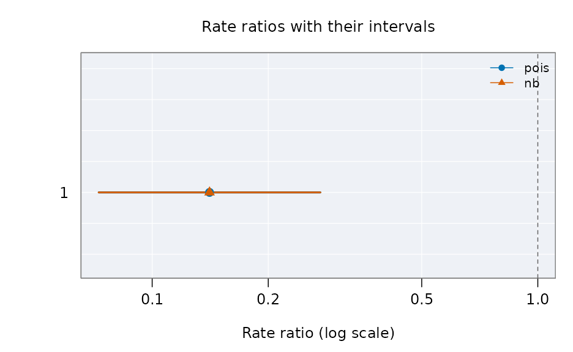

# Learners, presets and data larger than memory

Penalised regression and forests written in the package, checks before a
model is fitted, and summaries of data read in one pass.

Each section is one help page: what the function is for, the example of
its help page as it runs, and the plot of its result where the package
draws one. [`?name`](https://rdrr.io/r/base/name.html) gives the
arguments and the value in full.

## Learning

### Elastic net by coordinate descent, with cross-validation

[`enpath()`](https://rootcoder007.github.io/crimlab/reference/enpath.md):
Fits the lasso, ridge and elastic net path by cyclical coordinate
descent, for a numeric (gaussian) or a 0/1 (binomial) outcome, and
cross-validates it over folds the caller supplies. The objective, the
standardisation of the columns and the scale of `lambda` are those of
‘glmnet’, so that with the same `lambda` and the same folds the two give
the same coefficients, up to their convergence thresholds: the gaussian
family minimises (1 / 2n) \|y - a0 - x b\|^2 + lambda pen(b), the
binomial family the mean negative log-likelihood plus lambda pen(b),
with pen(b) = sum((1 - alpha) / 2 (s b)^2 + alpha \|s b\|), `s` the
population standard deviations of the columns. For the gaussian family
the outcome is scaled to unit variance while fitting, as ‘glmnet’ does.
The intercept is never penalised; a constant column keeps a zero
coefficient.

``` r

set.seed(1)
x <- matrix(rnorm(200 * 5), 200)
y <- x[, 1] - 0.5 * x[, 2] + rnorm(200)
f <- enpath(x, y, nlam = 20, fold = rep(1:5, 40))
f$lmin
#> [1] 0.04707722
f$beta[, f$lambda == f$lmin]
#> [1]  0.8700394 -0.4704137  0.0000000  0.0000000 -0.0208658
```

### Logistic regression

[`lgtreg()`](https://rootcoder007.github.io/crimlab/reference/lgtreg.md):
Maximum likelihood for a 0/1 outcome and a logit link, by Newton’s
method on the design with centred columns, the method
[`glm()`](https://rdrr.io/r/stats/glm.html) uses with
`family = binomial()` when the columns are not collinear. Standard
errors come from the inverse Fisher information.

``` r

set.seed(1)
x <- matrix(rnorm(300 * 2), 300)
y <- rbinom(300, 1, plogis(0.5 + x[, 1] - x[, 2]))
lgtreg(x, y)$coef
#> (Intercept)          x1          x2 
#>   0.4864763   1.0070780  -0.8877568
```

### Random forest for regression and probabilities

[`rfor()`](https://rootcoder007.github.io/crimlab/reference/rfor.md):
Grows a random forest (Breiman 2001) on `x` and `y` and returns its mean
prediction at the rows of `newx` and its out-of-bag prediction at each
row of `x`. Each tree is grown on a bag of rows drawn from `x`, as deep
as `minnode` allows, choosing at each node the best of `mtry` columns
drawn at random by the reduction in the sum of squares; for a 0/1
outcome this is the Gini split, and the forest’s mean is a probability,
as in a probability forest of ‘ranger’.

``` r

set.seed(1)
x <- matrix(rnorm(400 * 4), 400)
y <- sin(2 * x[, 1]) + x[, 2] + rnorm(400, sd = 0.3)
f <- rfor(x, y, ntree = 100)
mean((f$oob - y)^2)
#> [1] 0.184494
```

### Stacking: the super learner

[`suplrn()`](https://rootcoder007.github.io/crimlab/reference/suplrn.md):
Combines the learners of the package (least squares or logistic
regression, the elastic net of
[`enpath()`](https://rootcoder007.github.io/crimlab/reference/enpath.md),
the random forest of
[`rfor()`](https://rootcoder007.github.io/crimlab/reference/rfor.md))
into one predictor by stacking (van der Laan, Polley and Hubbard 2007).
Each learner is fitted K times, on the rows outside each fold, and
predicts the fold left out; the meta-weights are the non-negative least
squares fit of `y` on these cross-fitted predictions, scaled to sum to 1
(the `method.NNLS` of ‘SuperLearner’). With `disc = TRUE` the stack is
the discrete super learner: the one learner of least cross-validated
risk. The predictions are then the weighted sum of the learners fitted
on all the rows. Everything, the folds included, is computed in the
compiled core and is the same for the same `seed`; with one learner the
stack is that learner, bit for bit.

``` r

set.seed(1)
x <- matrix(rnorm(300 * 4), 300)
y <- sin(2 * x[, 1]) + x[, 2] + rnorm(300, sd = 0.3)
s <- suplrn(x, y, lrns = c("glm", "lasso", "forest"), ntree = 50)
s$wt
#>       glm     lasso    forest 
#> 0.0000000 0.0234579 0.9765421
s$risk
#>       glm     lasso    forest 
#> 0.5327638 0.5345319 0.2611013
```

## Presets

### Presets: a published dataset’s columns onto a generic function’s arguments

[`clprep()`](https://rootcoder007.github.io/crimlab/reference/clprep.md):
A preset says how the columns of one published dataset (an Ontario
segregation table, the Special Investigations Unit’s cases, a
use-of-force file) feed the arguments of one of crimlab’s generic
functions, so that `generic(clprep(data, preset))` gives the published
analysis while the same generic runs on anyone’s data given as plain
vectors. A preset describes a layout and ships no data: the user
supplies the table. The columns a preset reads, as
[`clprep()`](https://rootcoder007.github.io/crimlab/reference/clprep.md)
lists them, are the layout a table needs (what a zero-row template would
hold);
[`prechk()`](https://rootcoder007.github.io/crimlab/reference/prechk.md)
checks a table against them.

``` r

head(clprep())
#>         preset generic               args
#> 1 otis-b03-cnt  cntreg y grp adj clus gee
#> 2 otis-b04-cnt  cntreg          y grp adj
#> 3 otis-b06-cnt  cntreg y grp adj clus gee
#> 4 otis-b07-cnt  cntreg   recipe y grp adj
#> 5 otis-b08-cnt  cntreg y grp adj clus gee
#> 6 otis-b09-cnt  cntreg          y grp adj
#>                                                                                                                        source
#> 1 Ontario Ministry of the Solicitor General, segregation and restrictive confinement data (Ontario Data Catalogue), table b03
#> 2 Ontario Ministry of the Solicitor General, segregation and restrictive confinement data (Ontario Data Catalogue), table b04
#> 3 Ontario Ministry of the Solicitor General, segregation and restrictive confinement data (Ontario Data Catalogue), table b06
#> 4 Ontario Ministry of the Solicitor General, segregation and restrictive confinement data (Ontario Data Catalogue), table b07
#> 5 Ontario Ministry of the Solicitor General, segregation and restrictive confinement data (Ontario Data Catalogue), table b08
#> 6 Ontario Ministry of the Solicitor General, segregation and restrictive confinement data (Ontario Data Catalogue), table b09
# a table laid out as the published OTIS c01 table (numbers made up)
d <- data.frame(EndFiscalYear = rep(2020:2022, each = 2),
                Gender = rep(c("Female", "Male"), 3),
                NumberIndividuals_RestrictiveConfinement =
                  c(40, 310, 52, 335, 47, 360))
p <- clprep(d, "otis-c01-cnt")
cntreg(p)
#> cntreg: 6 counts; reference 0
#> rate ratios (95% intervals):
#>   fit term       irr        lo        hi             p   sep
#>  pois    1 0.1383085 0.1158296 0.1651497 6.153279e-106 FALSE
#>    nb    1 0.1383085 0.1158295 0.1651499 6.174131e-106 FALSE
#> negative binomial theta 7655874; AIC Poisson 48.8636, negative binomial 50.86374
# the same model on plain vectors
cntreg(d$NumberIndividuals_RestrictiveConfinement, d$Gender == "Female",
       adj = factor(d$EndFiscalYear))
#> cntreg: 6 counts; reference FALSE
#> rate ratios (95% intervals):
#>   fit term       irr        lo        hi             p   sep
#>  pois TRUE 0.1383085 0.1158296 0.1651497 6.153279e-106 FALSE
#>    nb TRUE 0.1383085 0.1158295 0.1651499 6.174131e-106 FALSE
#> negative binomial theta 7655874; AIC Poisson 48.8636, negative binomial 50.86374
# a preset of one's own, for another agency's columns
mine <- data.frame(preset = "my-cnt", generic = "cntreg",
                   arg = c("y", "grp", "adj"),
                   column = c("count", "sex", "year"),
                   recode = c("", "f=1;*=0", "fac"))
e <- data.frame(count = c(4, 30, 6, 41), sex = c("f", "m", "f", "m"),
                year = c(1, 1, 2, 2))
cntreg(clprep(e, mine))
#> cntreg: 4 counts; reference 0
#> rate ratios (95% intervals):
#>   fit term       irr         lo        hi            p   sep
#>  pois    1 0.1408451 0.07265014 0.2730529 6.508047e-09 FALSE
#>    nb    1 0.1408451 0.07265012 0.2730530 6.508134e-09 FALSE
#> negative binomial theta 19720034; AIC Poisson 23.74163, negative binomial 25.74164
```

``` r

res <- cntreg(clprep(e, mine))
plot(res)
```



### Check a table against a preset before use

[`prechk()`](https://rootcoder007.github.io/crimlab/reference/prechk.md):
[`prechk()`](https://rootcoder007.github.io/crimlab/reference/prechk.md)
reads a table the way
[`clprep()`](https://rootcoder007.github.io/crimlab/reference/clprep.md)
would under a preset and reports, in one error, every problem that would
stop it or quietly change its result: the columns the preset reads
(directly, in a filter or in a recipe) that the table lacks, the labels
of a column outside the codes the publisher lists for it, and the labels
a mapping recode with no `*` rule does not cover. A table that passes is
returned unchanged, so the check can sit in front of the call:
`clprep(prechk(d, p), p)`.

``` r

# a table laid out as the published OTIS b03 table, simulated
d <- data.frame(
  EndFiscalYear = rep(2021:2022, each = 4),
  Region_AtTimeOfPlacement = rep(c("Central", "Toronto"), 4),
  Institution_AtTimeOfPlacement = rep(c("Quinte Detention Centre",
                                        "Toronto South Detention Centre"),
                                      4),
  Alert_Type = "Mental Health Alert",
  Alert_Presence = rep(c("Yes", "Yes", "No", "No"), 2),
  Number_SegregationPlacements = c(31, 52, 140, 260, 28, 61, 133, 248)
)
prechk(d, "otis-b03-cnt")
# a region the publisher does not list, and a column missing
bad <- d[-6]
bad$Region_AtTimeOfPlacement[1] <- "Southern"
try(prechk(bad, "otis-b03-cnt"))
#> Error : prechk: the table does not fit preset otis-b03-cnt:
#> * `data` has no column Number_SegregationPlacements.
#> * column Region_AtTimeOfPlacement has labels not among its codes: Southern.
# a preset of one's own, and a label its recode does not cover
mine <- data.frame(preset = "my-cnt", generic = "cntreg",
                   arg = c("y", "grp"), column = c("count", "sex"),
                   recode = c("", "f=1;m=0"))
e <- data.frame(count = c(4, 30, 6, 41), sex = c("f", "m", "f", "x"))
try(prechk(e, mine))
#> Error : prechk: the table does not fit preset my-cnt:
#> * column sex has labels with no recode: x.
```

### Synthetic example data in the shape of published tables

[`synfix()`](https://rootcoder007.github.io/crimlab/reference/synfix.md):
Draws a data frame with the columns of a published administrative table
and values of the kinds it holds, for examples, tests and teaching where
the real table cannot be shipped or fetched. Each column is drawn on its
own, uniformly from its values: nothing in the result is a record of
anyone, and no relation between columns is kept.

``` r

head(synfix("otis-b02", n = 20, seed = 3))
#>   EndFiscalYear UniqueIndividual_ID Gender Region_MostRecentPlacement Age_Category
#> 1          2022           syn-00002 Female                    Toronto          50+
#> 2          2019           syn-00001 Female                    Central     18 to 24
#> 3          2021           syn-00004 Female                    Western     18 to 24
#> 4          2024           syn-00004 Female                    Eastern     25 to 49
#> 5          2021           syn-00003   Male                    Western          50+
#> 6          2019           syn-00002   Male                    Eastern     18 to 24
#>   TotalAggregatedDays_Segregation
#> 1                              57
#> 2                              76
#> 3                               8
#> 4                              49
#> 5                              54
#> 6                              44
x <- synfix("cuof", n = 5)
names(x)
#>  [1] "incidents"               "incident_type"           "indigenous"             
#>  [4] "inmate_incident"         "inmate_participant"      "institution_summary"    
#>  [7] "location_summary"        "race"                    "ethnic_origin"          
#> [10] "religion"                "select_incident_summary" "staff_incident"
synfix(list(year = 2019:2023, sex = c("F", "M")), n = 4, seed = 9)
#>   year sex
#> 1 2021   F
#> 2 2023   M
#> 3 2021   M
#> 4 2021   F
head(synfix())
#>       kind                     column   type                                   values
#> 1 otis-a01              EndFiscalYear  range                                2018|2024
#> 2 otis-a01        UniqueIndividual_ID     id                                         
#> 3 otis-a01   Region_AtTimeOfPlacement labels Central|Eastern|Northern|Toronto|Western
#> 4 otis-a01 Region_MostRecentPlacement labels Central|Eastern|Northern|Toronto|Western
#> 5 otis-a01                     Gender labels                              Female|Male
#> 6 otis-a01               Age_Category labels                    18 to 24|25 to 49|50+
```

## Data larger than memory

### Summary statistics accumulated in blocks

[`onlsmry()`](https://rootcoder007.github.io/crimlab/reference/onlsmry.md),
[`smryupd()`](https://rootcoder007.github.io/crimlab/reference/onlsmry.md),
[`smrymrg()`](https://rootcoder007.github.io/crimlab/reference/onlsmry.md),
[`smrystat()`](https://rootcoder007.github.io/crimlab/reference/onlsmry.md):
An accumulator for the count, mean, variance, skewness and kurtosis of a
numeric column that does not fit in memory, or that arrives in pieces (a
file read in chunks, results from several machines). Start one with
[`onlsmry()`](https://rootcoder007.github.io/crimlab/reference/onlsmry.md),
feed it blocks with
[`smryupd()`](https://rootcoder007.github.io/crimlab/reference/onlsmry.md),
combine two with
[`smrymrg()`](https://rootcoder007.github.io/crimlab/reference/onlsmry.md)
and read the result with
[`smrystat()`](https://rootcoder007.github.io/crimlab/reference/onlsmry.md).

``` r

set.seed(1)
x <- stats::rnorm(1000) # simulated
# accumulate in blocks of 100
acc <- onlsmry()
for (i in seq(1, 1000, by = 100)) acc <- smryupd(acc, x[i:(i + 99)])
smrystat(acc)
#>             n          mean      variance            sd      skewness      kurtosis 
#>  1.000000e+03 -1.164814e-02  1.071051e+00  1.034916e+00 -1.916710e-02 -1.775465e-03
all.equal(smrystat(acc)[["variance"]], stats::var(x))
#> [1] TRUE
# two accumulators built independently can be merged
a <- smryupd(onlsmry(), x[1:400])
b <- smryupd(onlsmry(), x[401:1000])
all.equal(smrystat(smrymrg(a, b)), smrystat(acc))
#> [1] TRUE
# an empty accumulator reports nothing rather than zero
smrystat(onlsmry())
#>        n     mean variance       sd skewness kurtosis 
#>        0      NaN      NaN      NaN      NaN      NaN
try(onlsmry(c("a", "b")))
#> Error : onlsmry: `x` must be numeric, not text such as "a".
```

### Uniform sample of a stream in one pass

[`rsvidx()`](https://rootcoder007.github.io/crimlab/reference/rsvidx.md),
[`rsvsmp()`](https://rootcoder007.github.io/crimlab/reference/rsvidx.md):
Vitter’s Algorithm R: draws `k` items from a stream, each item equally
likely to be retained, in a single pass and using memory proportional to
`k` rather than to the stream’s length.
[`rsvidx()`](https://rootcoder007.github.io/crimlab/reference/rsvidx.md)
returns the retained positions, so the same sample can be applied to a
file read line by line;
[`rsvsmp()`](https://rootcoder007.github.io/crimlab/reference/rsvidx.md)
applies it to a vector in memory.

``` r

rsvidx(1000, 5, seed = 1)
#> [1]  33  67 304 630 638
rsvsmp(letters, 4, seed = 2)
#> [1] "m" "r" "s" "z"
rsvidx(3, 10)
#> [1] 1 2 3
# sample rows of a data frame
df <- data.frame(id = 1:20, v = (1:20)^2)
df[rsvidx(nrow(df), 3, seed = 7), ]
#>   id  v
#> 3  3  9
#> 8  8 64
#> 9  9 81
try(rsvidx(10, -1))
#> Error : rsvidx: `k` must be a single non-negative whole number.
```

### Distinct-value count in fixed memory

[`dstnskch()`](https://rootcoder007.github.io/crimlab/reference/dstnskch.md),
[`dstncnt()`](https://rootcoder007.github.io/crimlab/reference/dstnskch.md),
[`skchmrg()`](https://rootcoder007.github.io/crimlab/reference/dstnskch.md):
HyperLogLog: estimates how many distinct values a column holds using a
fixed register per bucket, regardless of the column’s length or
cardinality.
[`dstnskch()`](https://rootcoder007.github.io/crimlab/reference/dstnskch.md)
builds or extends the registers,
[`dstncnt()`](https://rootcoder007.github.io/crimlab/reference/dstnskch.md)
turns them into an estimate, and
[`skchmrg()`](https://rootcoder007.github.io/crimlab/reference/dstnskch.md)
combines two sketches.

``` r

set.seed(1)
x <- sample(1:5000, 200000, replace = TRUE) # simulated
dstncnt(dstnskch(x))
#> [1] 5039.269
length(unique(x))
#> [1] 5000
dstncnt(dstnskch(c("a", "b", "c", "a", "b")))
#> [1] 3.000275
a <- dstnskch(x[1:100000])
b <- dstnskch(x[100001:200000])
dstncnt(skchmrg(a, b))
#> [1] 5039.269
try(skchmrg(dstnskch(1:10, p = 4), dstnskch(1:10, p = 5)))
#> Error : skchmrg: both sketches must have the same number of registers.
```
