# Plot helpers, proofs and the rest

The plot helpers shared by the package, the theorems behind a function,
and the functions no other guide holds.

Each section is one help page: what the function is for, the example of
its help page as it runs, and the plot of its result where the package
draws one. [`?name`](https://rdrr.io/r/base/name.html) gives the
arguments and the value in full.

## Plots

### Plot methods for the package’s results

[`plot.indgap()`](https://rootcoder007.github.io/crimlab/reference/plotm.md):
Every result of the package that holds something to draw has a
[`plot()`](https://rdrr.io/r/graphics/plot.default.html) method, on base
graphics only. No argument beyond the object is needed; every method
takes the same customisation: `main`, `col` or `pal`, and `...` passed
to the base-graphics call, with the session look set by
[`plotopt()`](https://rootcoder007.github.io/crimlab/reference/blpal.md).
Each method returns, invisibly, the data it drew (a data frame, or a
list of them), so the same picture can be drawn with any other tool.
Series that differ in colour also differ in line type or point shape,
and shaded cells carry their numbers, so no plot depends on colour
alone.

``` r

d <- expand.grid(year = 2015:2024, town = LETTERS[1:12])
i <- match(d$town, LETTERS)
first <- rep(c(2019, 2021, NA), each = 4)
d$first <- first[i]
d$bylaw <- as.integer(!is.na(d$first) & d$year >= d$first)
d$rate <- 30 + i + 0.5 * (d$year - 2015) - 4 * d$bylaw + sin(seq_len(120))
plot(evtst(d$rate, d$town, d$year, d$first, leads = 3, lags = 3))
```

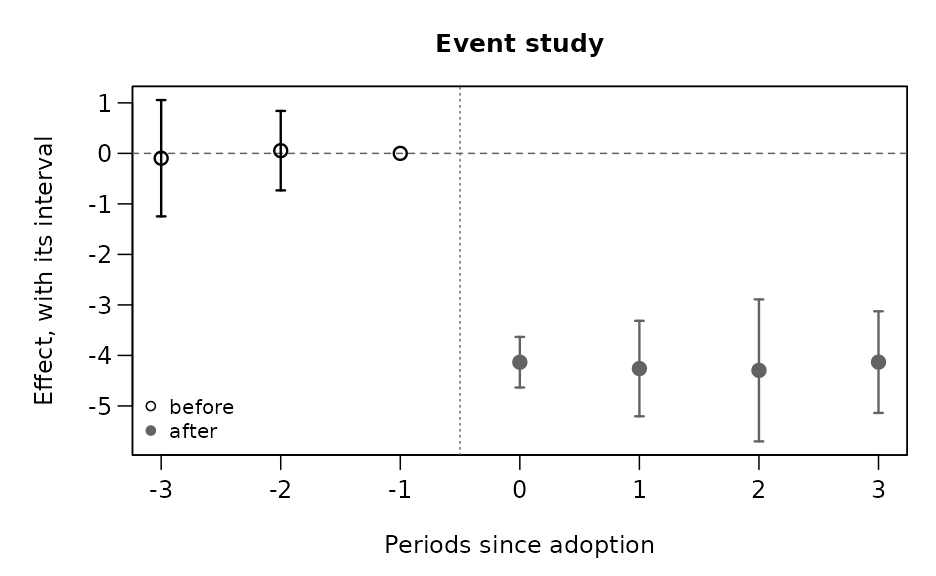

``` r

plot(didfe(d$rate, d$town, d$year, d$bylaw, bacon = TRUE, loo = TRUE))
```

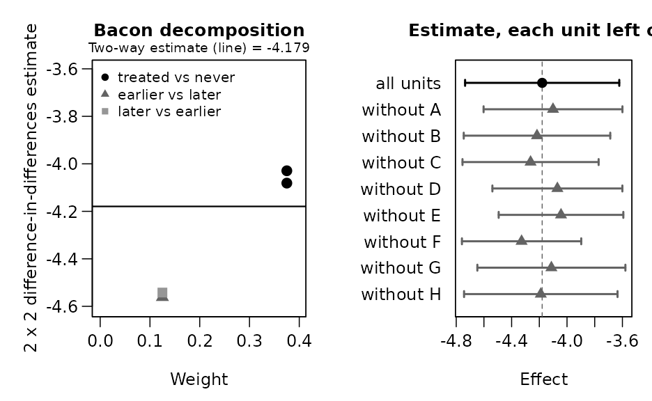

``` r

plot(didfe(d$rate, d$town, d$year, d$bylaw, loo = TRUE), type = "hist")
```

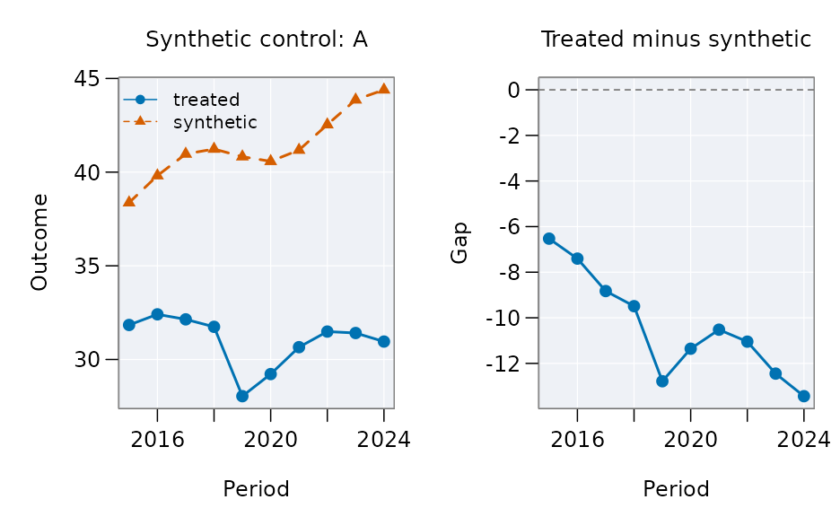

``` r

plot(wcbx(d$rate, d$town, d$year, d$bylaw, mthd = "perm", reps = 99,
          seed = 1))
```

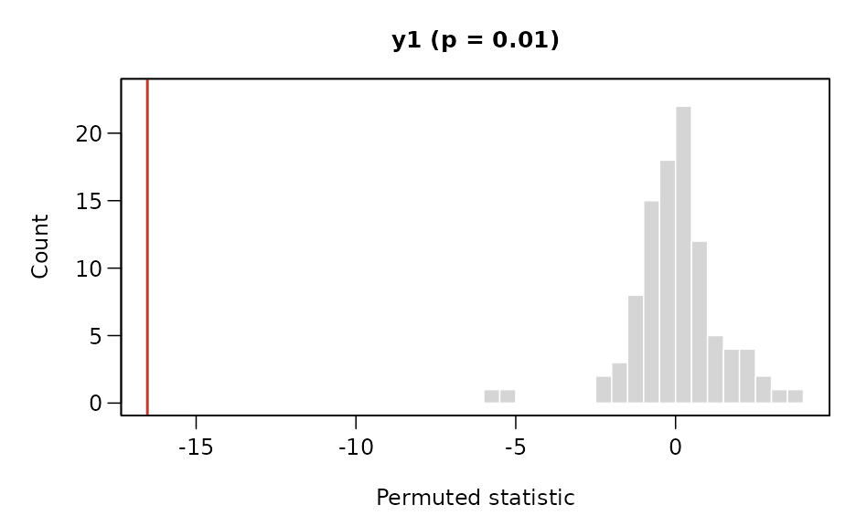

``` r

one <- d[d$town %in% c("A", "I", "J", "K", "L"), ]
plot(synthc(one$rate, one$town, one$year, one$first))
```

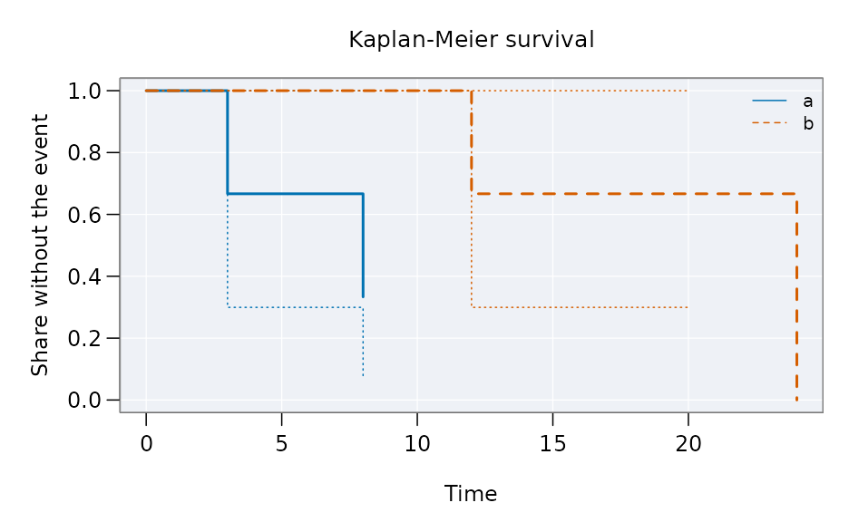

``` r

plot(grprr(c(a = 120, b = 95, c = 30), c(a = 6e4, b = 2.1e4, c = 1.5e4)))
```

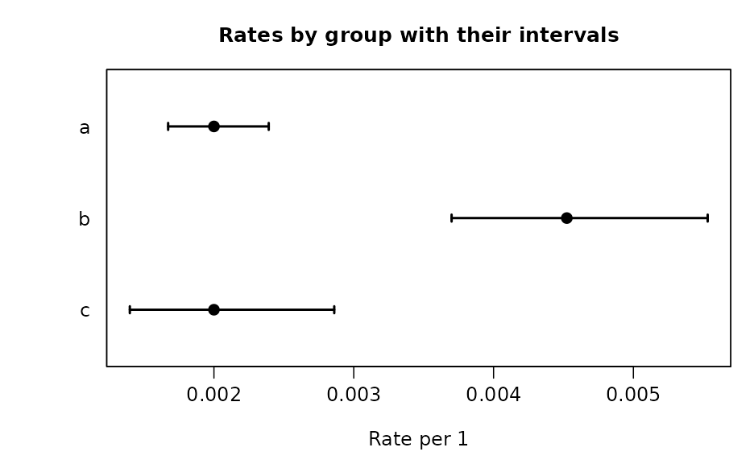

``` r

plot(kmrec(c(3, 8, 8, 12, 20, 24), event = c(1, 1, 0, 1, 0, 1),
           grp = c("a", "a", "a", "b", "b", "b")))
```

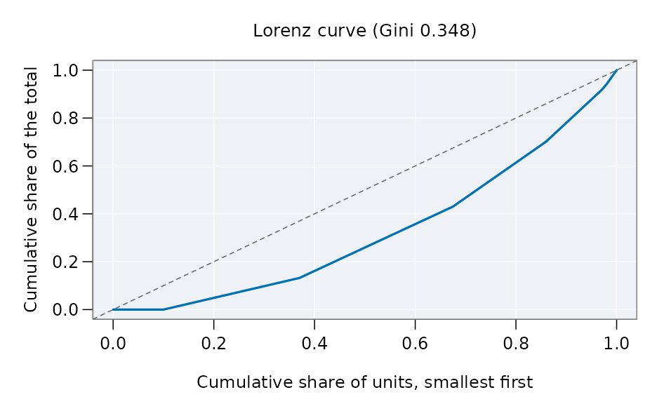

``` r

plot(trnmat(c("N", "N", "E", "N", "W", "W", "E", "E"),
            c(1, 1, 1, 2, 2, 2, 3, 3), time = c(1, 2, 3, 1, 2, 3, 1, 2)))
```

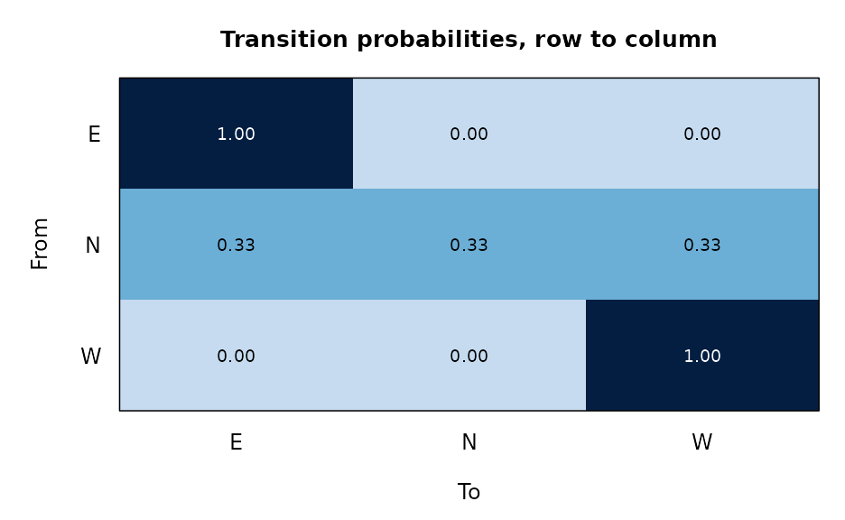

``` r

set.seed(1)
plot(cconc(rpois(200, 2), nsim = 0))
```

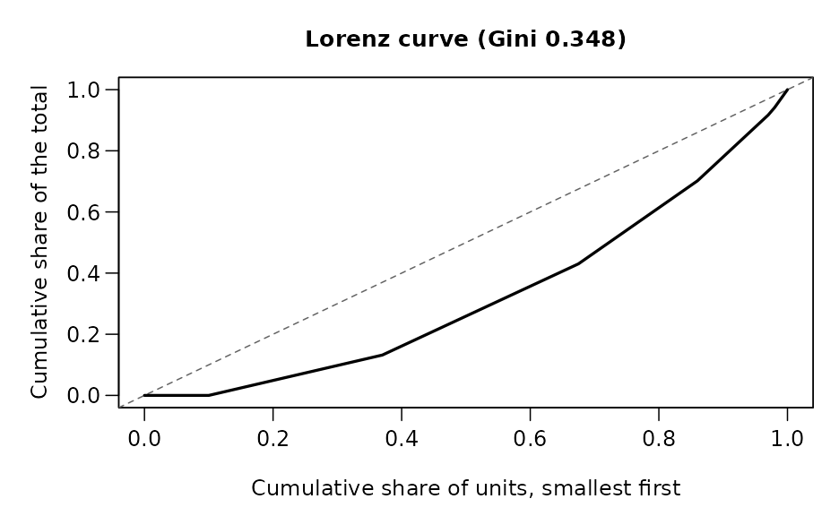

### Plot styling: palettes and session options

[`blpal()`](https://rootcoder007.github.io/crimlab/reference/blpal.md),
[`plotopt()`](https://rootcoder007.github.io/crimlab/reference/blpal.md),
[`yoypals()`](https://rootcoder007.github.io/crimlab/reference/blpal.md):
Every plot in the package draws with base graphics and one small set of
style choices, which these functions expose.
[`blpal()`](https://rootcoder007.github.io/crimlab/reference/blpal.md)
returns colour-blind-safe palettes: `"okabe"` (the Okabe-Ito categorical
set), `"diverging"` (blue, grey, orange-red), `"sequential"` (light to
dark blue) and `"grey"`.
[`plotopt()`](https://rootcoder007.github.io/crimlab/reference/blpal.md)
sets, for the session, the defaults every plot uses: `palette`, `grid`,
`cex`, `las`, `bg` and `panel`. Each plot also takes `main`, `col`
(which overrides the palette), `pal` and `...` (passed to the
base-graphics call), so one plot can change without changing the
session.

``` r

blpal("okabe", 3)
#> [1] "#0072B2" "#D55E00" "#009E73"
old <- plotopt()
plotopt(palette = "okabe", grid = TRUE)
plotopt(palette = old$palette, grid = old$grid)
plot(1:8, pch = 19, cex = 3, col = blpal())
```


### Lorenz and funnel plots

[`plotlrnz()`](https://rootcoder007.github.io/crimlab/reference/plotlrnz.md),
[`plotfnl()`](https://rootcoder007.github.io/crimlab/reference/plotlrnz.md):
[`plotlrnz()`](https://rootcoder007.github.io/crimlab/reference/plotlrnz.md)
draws the Lorenz curve of a total spread over units: the cumulative
share of the total held by the cumulative share of units, smallest
first, against the line of equality, with the Gini coefficient (from
[`cconc()`](https://rootcoder007.github.io/crimlab/reference/cconc.md))
in the title.
[`plotfnl()`](https://rootcoder007.github.io/crimlab/reference/plotlrnz.md)
draws a funnel plot (Spiegelhalter 2005): each area’s ratio of observed
to expected counts against its expected count, with exact Poisson
control limits around `target`; areas outside the outer limits are drawn
in a second colour and a second shape, and labelled when `area` is
given.

``` r

plotlrnz(c(0, 0, 1, 1, 2, 3, 8, 25))
```

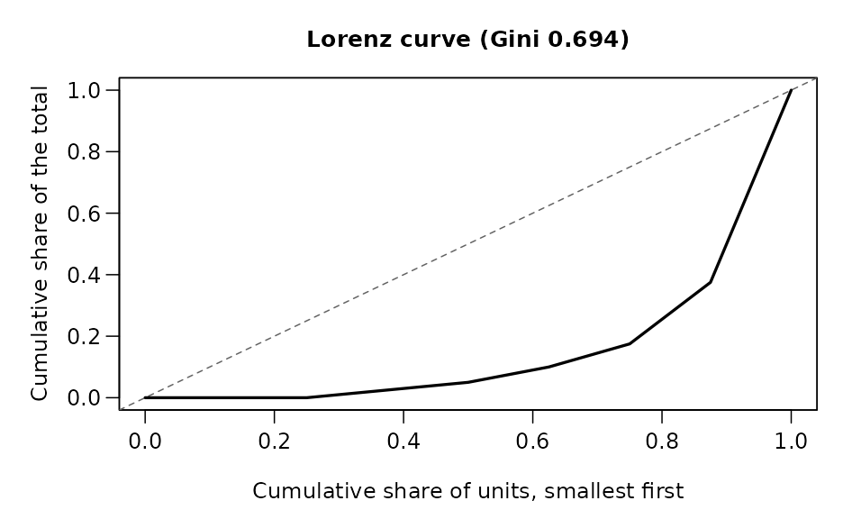

``` r

plotfnl(obs = c(4, 20, 50, 2), expd = c(5, 22, 40, 20),
        area = c("a", "b", "c", "d"))
```

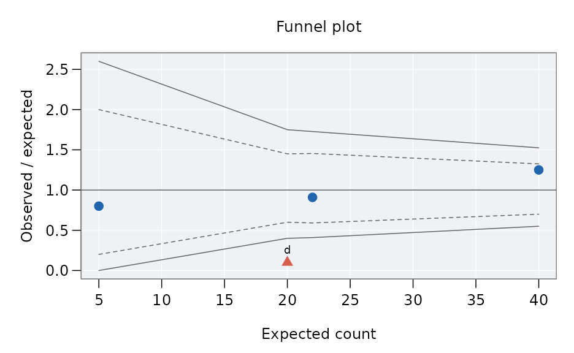

### Distributions by group: ridgelines, distribution functions, violins, hexagonal bins and concentration curves

[`plotrdg()`](https://rootcoder007.github.io/crimlab/reference/plotrdg.md),
[`plotcdfs()`](https://rootcoder007.github.io/crimlab/reference/plotrdg.md),
[`plotvln()`](https://rootcoder007.github.io/crimlab/reference/plotrdg.md),
[`plothex()`](https://rootcoder007.github.io/crimlab/reference/plotrdg.md)
and others: Plots of many values, split by a group.
[`plotrdg()`](https://rootcoder007.github.io/crimlab/reference/plotrdg.md)
stacks a kernel density per group (a ridgeline plot);
[`plotcdfs()`](https://rootcoder007.github.io/crimlab/reference/plotrdg.md)
overlays the empirical distribution functions;
[`plotvln()`](https://rootcoder007.github.io/crimlab/reference/plotrdg.md)
draws a violin per group with its median and quartiles;
[`plothex()`](https://rootcoder007.github.io/crimlab/reference/plotrdg.md)
counts two variables in hexagonal bins, shaded by count;
[`plotgain()`](https://rootcoder007.github.io/crimlab/reference/plotrdg.md)
overlays the concentration (Lorenz) curves of the groups with their Gini
coefficients.

``` r

set.seed(1)
x <- c(rnorm(100), rnorm(100, 2))
g <- rep(c("a", "b"), each = 100)
plotrdg(x, g)
```

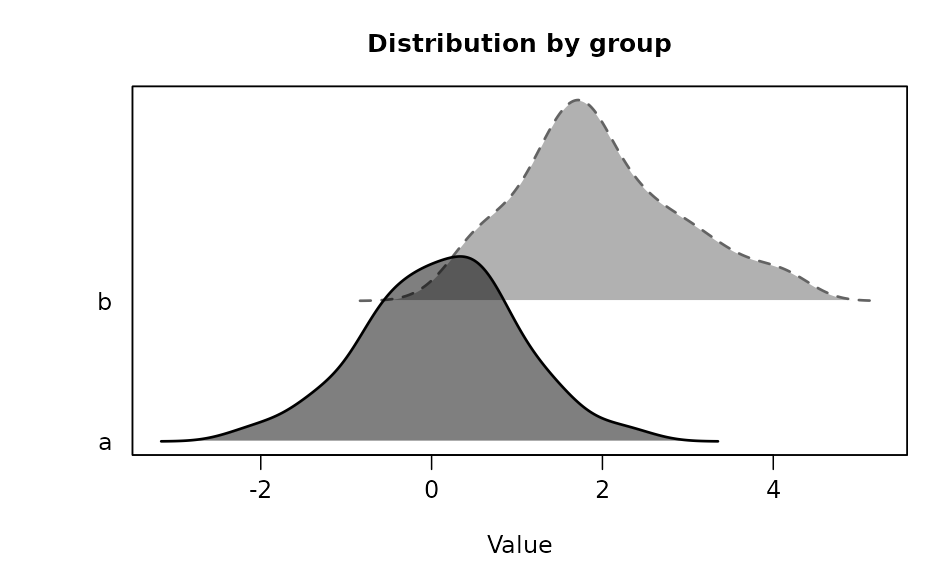

``` r

plotcdfs(x, g)
```

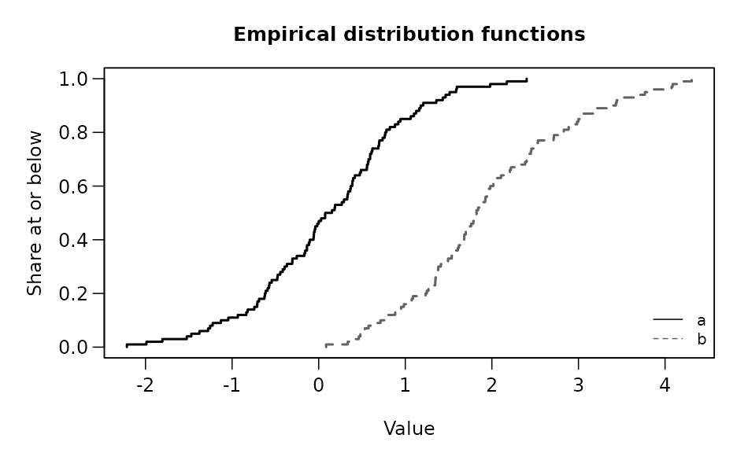

``` r

plotvln(x, g)
```

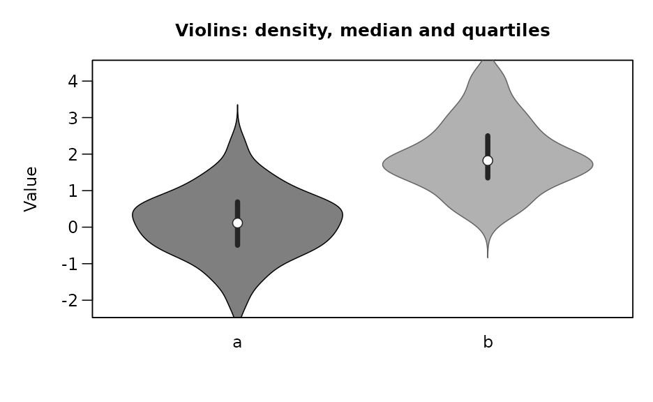

``` r

plothex(x, x + rnorm(200), bins = 10)
```

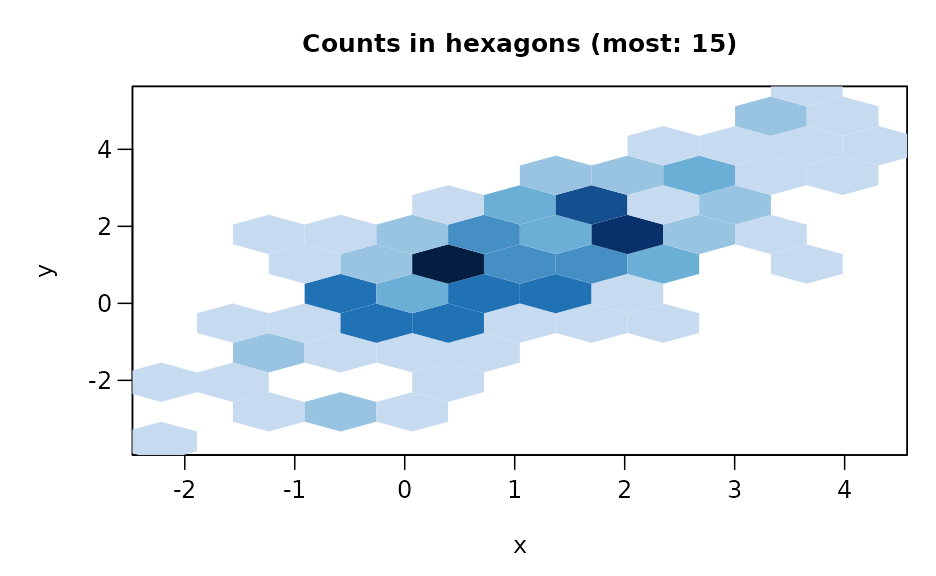

``` r

plotgain(rexp(200), g)
```

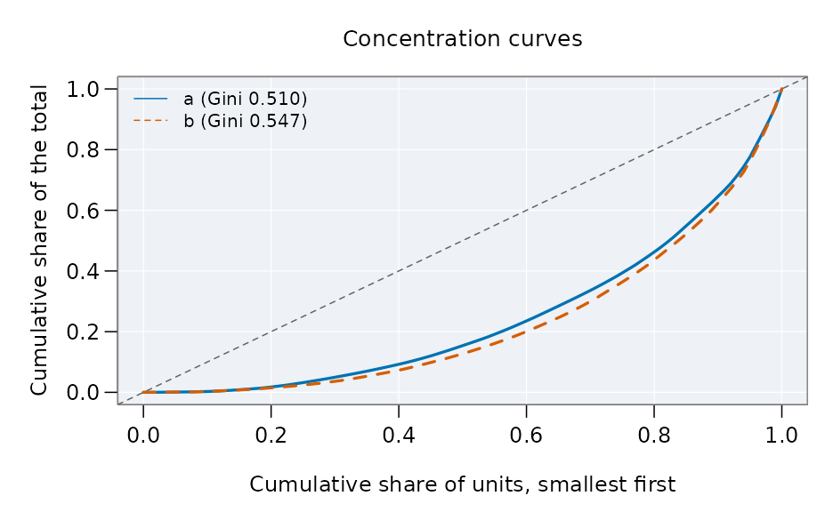

### Many series over time: calendar, horizon, small-multiple and bump charts

[`plotcal()`](https://rootcoder007.github.io/crimlab/reference/plotcal.md),
[`plothrz()`](https://rootcoder007.github.io/crimlab/reference/plotcal.md),
[`plotmult()`](https://rootcoder007.github.io/crimlab/reference/plotcal.md),
[`plotbump()`](https://rootcoder007.github.io/crimlab/reference/plotcal.md):
[`plotcal()`](https://rootcoder007.github.io/crimlab/reference/plotcal.md)
draws daily values as a calendar: one row of weeks per year, each day a
cell shaded by its value.
[`plothrz()`](https://rootcoder007.github.io/crimlab/reference/plotcal.md)
draws a horizon chart: each series’ distance from its own median, folded
into `bands` bands of darkening shade, blue above and red below, one row
per series.
[`plotmult()`](https://rootcoder007.github.io/crimlab/reference/plotcal.md)
draws each series in its own panel on a shared scale (small multiples).
[`plotbump()`](https://rootcoder007.github.io/crimlab/reference/plotcal.md)
draws the rank of each series in each period (a bump chart).

``` r

days <- seq(as.Date("2024-01-01"), as.Date("2024-03-31"), by = "day")
plotcal(days, seq_along(days) %% 7)
```

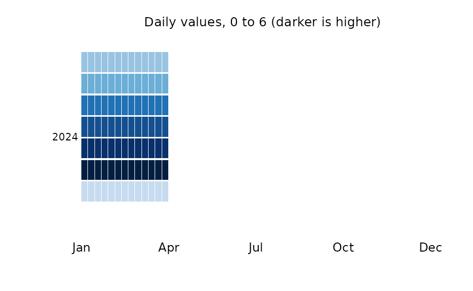

``` r

d <- expand.grid(year = 2015:2020, area = c("n", "s", "e"))
d$v <- c(1:6, 6:1, rep(3, 6))
plothrz(d$v, d$year, d$area, bands = 2)
```

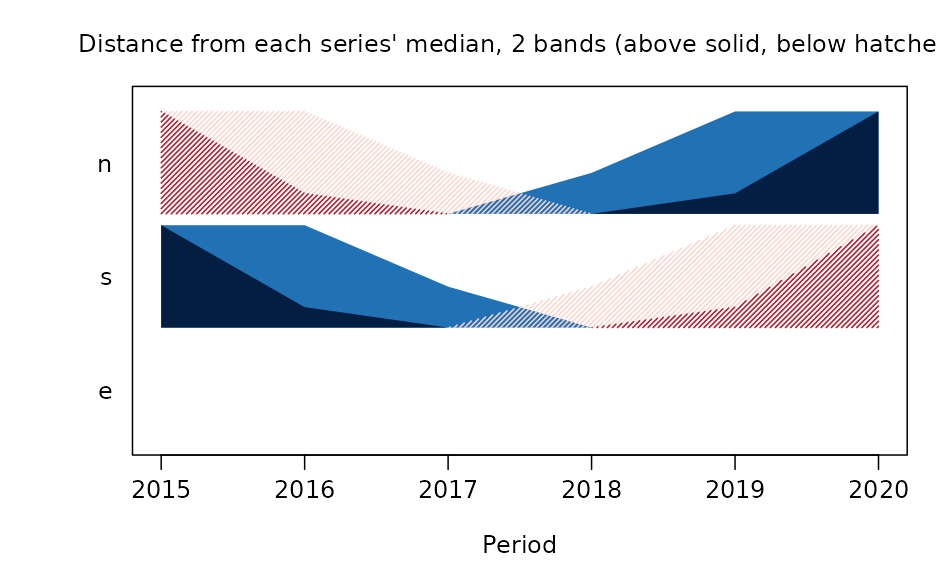

``` r

plotmult(d$v, d$year, d$area)
```

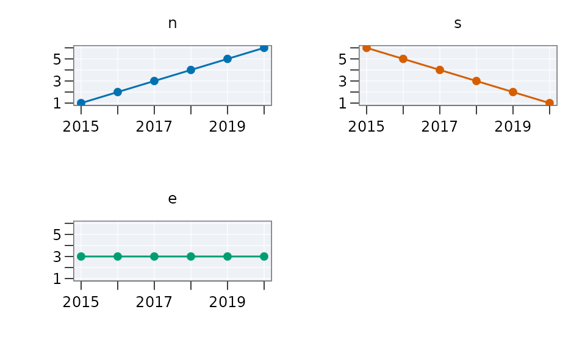

``` r

plotbump(d$v, d$year, d$area)
```

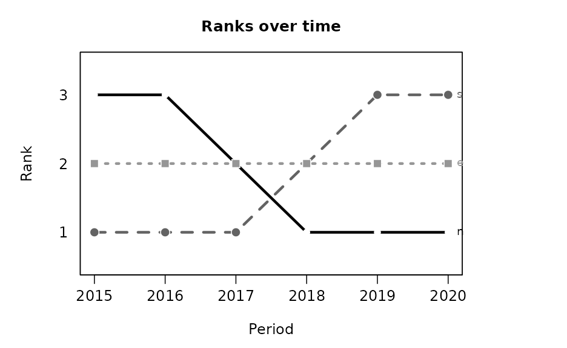

### Event studies for several outcomes in one grid

[`plotevgrid()`](https://rootcoder007.github.io/crimlab/reference/plotevgrid.md):
Draws the event-study path of each result in a named list, one panel
each, as [`plot()`](https://rdrr.io/r/graphics/plot.default.html) draws
one: estimates by time since adoption with their intervals, before
adoption in open circles and after in filled ones.

``` r

d <- expand.grid(year = 2015:2024, town = LETTERS[1:12])
i <- match(d$town, LETTERS)
first <- rep(c(2019, 2021, NA), each = 4)
d$first <- first[i]
d$rate <- 30 + i + 0.5 * (d$year - 2015) -
  4 * (!is.na(d$first) & d$year >= d$first) + sin(seq_len(120))
d$cases <- d$rate / 2 + cos(seq_len(120))
plotevgrid(list(
  Rate = evtst(d$rate, d$town, d$year, d$first, leads = 3, lags = 3),
  Cases = evtst(d$cases, d$town, d$year, d$first, leads = 3, lags = 3)
))
```

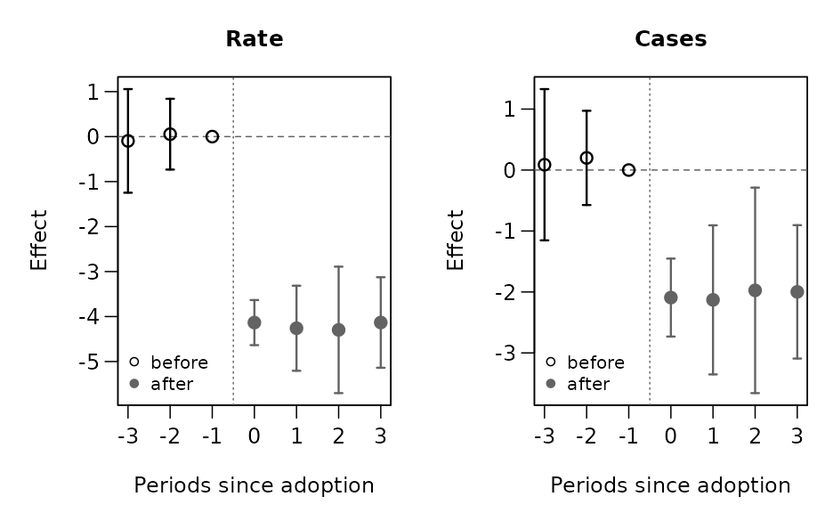

### Outcome by adoption cohort

[`plotcoh()`](https://rootcoder007.github.io/crimlab/reference/plotcoh.md):
The mean outcome of each adoption cohort by time since its adoption,
smoothed by a moving average and scaled to 1 in the period before
adoption: a look, before any model, at whether the cohorts moved
together before the policy. The period before adoption is shaded.

``` r

d <- expand.grid(year = 2012:2024, town = LETTERS[1:12])
i <- match(d$town, LETTERS)
d$first <- rep(c(2018, 2021, NA), each = 4)[i]
d$rate <- 30 + i + 0.5 * (d$year - 2012) + sin(seq_len(156)) -
  4 * (!is.na(d$first) & d$year >= d$first)
plotcoh(d$rate, d$town, d$year, d$first, win = c(-4, 3), ma = 1)
```

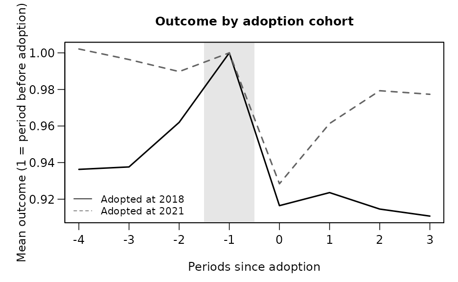

## Proofs

### Machine-checked proofs behind the package

[`proof()`](https://rootcoder007.github.io/crimlab/reference/proof.md):
Names the ‘Lean’ theorem each function rests on. The theorems ship with
the package: `file` is the path below
`system.file(package = "crimlab")`, and each file compiles against
‘Mathlib’.

``` r

proof("vodtst")
#>       fn                                 theorem           file
#> 1 vodtst Crimlab.Veil.odds_ratio_identifies_bias lean/Veil.lean
#> 2 vodtst                 Crimlab.Veil.share_sign lean/Veil.lean
#> 3 vodtst   Crimlab.Veil.exposure_shift_confounds lean/Veil.lean
```

## Package

### Ask whether a newer release exists

[`updchk()`](https://rootcoder007.github.io/crimlab/reference/updchk.md):
Asks the project’s release page once, now, for the number of the latest
release, and says whether it is newer than the installed package.
Nothing is sent but that request (a limit of two seconds), and nothing
is kept.

``` r

## Not run:
##D # needs the internet
##D updchk()
## End(Not run)
```

### Power and energy of the machine’s devices

[`hwpwr()`](https://rootcoder007.github.io/crimlab/reference/hwpwr.md):
Reads what the CPU packages, the memory and the GPUs of this machine
draw, from the operating system’s own energy counters and power
readings, over an interval: `dt` seconds from now, or since an earlier
reading (`since`). Every figure says how it was obtained, and a device
that cannot be measured is listed with the reason, never counted as
zero. It is the measured layer under an energy or carbon footprint of a
computation.

``` r

r <- hwpwr(0.5)
r[, c("kind", "name", "scope", "watts", "joules", "how")]
#>    kind           name  scope watts joules     how
#> 1   cpu            CPU device    NA     NA unknown
#> 2   gpu card1 (1414:6) device    NA     NA unknown
#> 3 total    all devices device    NA     NA     sum
a <- hwpwr(0)
x <- sum(sqrt(seq_len(1e6)))
b <- hwpwr(since = a)
b[b$kind == "total", c("joules", "why")]
#>   joules                              why
#> 3     NA not counted: CPU; card1 (1414:6)
```
