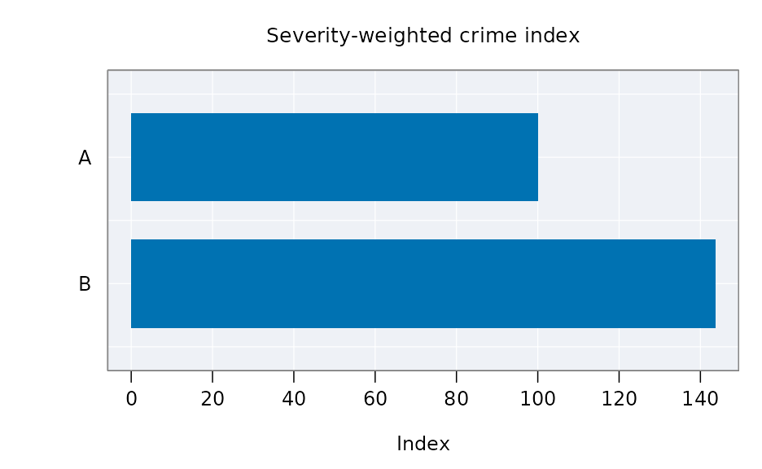
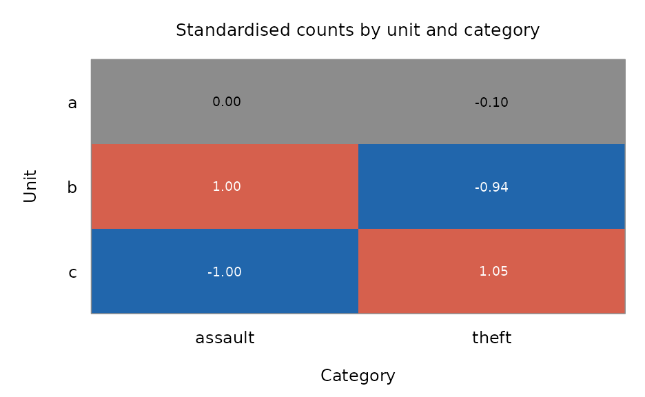
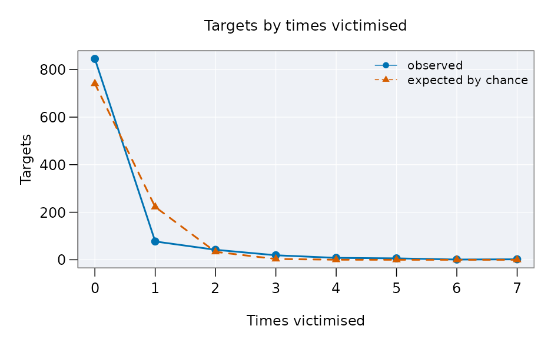

# Policing, police-reported crime and deterrence

Clearance rates, exposure bounds, crime severity and reporting, and how
inspection or arrest risk deters.

Each section is one help page: what the function is for, the example of
its help page as it runs, and the plot of its result where the package
draws one. [`?name`](https://rdrr.io/r/base/name.html) gives the
arguments and the value in full.

## Policing

### Clearance-rate decomposition and Simpson’s paradox

[`clrsmp()`](https://rootcoder007.github.io/crimlab/reference/clrsmp.md):
Splits the change in an aggregate clearance rate between two periods,
areas or services (A and B) into a rate effect, from each offence type
clearing more or less, and a mix effect, from the workload moving
between types that clear at different rates (Kitagawa’s decomposition).
The two always add up to the change. When every type clears better in B
and the aggregate still falls, the fall is all mix: Simpson’s paradox,
and the reason an aggregate clearance rate cannot be read as performance
without the split by type. See `proof("clrsmp")`.

``` r

# both types clear better in B, yet the aggregate falls
clrsmp(clra = c(minor = 90, serious = 20), reca = c(100, 50),
       clrb = c(19, 60), recb = c(20, 140))
#> $parts
#>      part ratea     rateb    sharea shareb    rateeff     mixeff
#> 1   minor   0.9 0.9500000 0.6666667  0.125 0.01979167 -0.1687066
#> 2 serious   0.4 0.4285714 0.3333333  0.875 0.01726190 -0.1079303
#> 
#> $total
#>       ratea       rateb      change     rateeff      mixeff          up        down 
#>  0.73333333  0.49375000 -0.23958333  0.03705357 -0.27663690  2.00000000  0.00000000 
#>     simpson 
#>  2.00000000
```

### Rates and disparities when exposure is measured by a proxy

[`expbnd()`](https://rootcoder007.github.io/crimlab/reference/expbnd.md):
Recorded counts (stops, searches, uses of force) are rates per unit of
exposure to police, and exposure is seldom observed. If each group’s
true exposure lies within a factor `gamma` of an observed proxy
(residents, drivers on the road, calls for service), each group’s true
rate lies within a factor `gamma` of its proxy rate, and the ratio of
two groups’ true rates within a factor `gamma^2` of the proxy ratio. The
direction of a disparity is settled only when the proxy ratio lies
outside that band. See `proof("expbnd")`.

``` r

expbnd(y = c(white = 100, black = 300), m = c(1000, 1000), gamma = 1.5)
#>   group   ref rate         lo   hi ratio       rlo  rhi sign
#> 1 white  TRUE  0.1 0.06666667 0.15     1 0.4444444 2.25    0
#> 2 black FALSE  0.3 0.20000000 0.45     3 1.3333333 6.75    1
```

### Risk difference when group membership is misrecorded

[`misrd()`](https://rootcoder007.github.io/crimlab/reference/misrd.md):
When the group a person is recorded in (an officer’s perception of race,
say) differs at random from the true one, with the same error rates
whatever the outcome, the measured groups are mixtures of the true ones.
The measured risk difference is then the true one times the factor (se +
sp - 1) p (1 - p) / (d1 d0), where `d1` and `d0` are the shares recorded
in each group. For any sensitivity and specificity it is never larger in
size than the true difference, so a disparity in recorded data
understates the true one; with `se + sp >= 1` it never has the opposite
sign, while with `se + sp < 1` a difference other than 0 has it. See
`proof("misrd")`.

``` r

misrd(r1 = 0.3, r0 = 0.1, prev = 0.4, se = 0.8, sp = 0.9)
#>      true  measured    factor        d1        d0 
#> 0.2000000 0.1426146 0.7130730 0.3800000 0.6200000
```

### Regression to the mean at selected hot spots

[`rtmhs()`](https://rootcoder007.github.io/crimlab/reference/rtmhs.md):
Places chosen because their count in a first period exceeds a cut show a
fall in the next period even with no treatment and no trend: if the two
periods are exchangeable, the selected places’ mean change is never
positive, and places chosen for being low never fall on average. This
reports the change at the selected places next to the same statistic on
the data together with its period-swapped copy, which is exchangeable by
construction and so never positive; the excess of the first over the
second is the part of the fall that selection alone does not explain. A
treatment effect needs a control group selected the same way. See
`proof("rtmhs")`.

``` r

set.seed(5)
mu <- rgamma(300, 2, 0.5)
x1 <- rpois(300, mu)
x2 <- rpois(300, mu)
rtmhs(x1, x2, cut = quantile(x1, 0.9))
#>       nsel     change     mirror        sym     excess        low     lowsym 
#> 27.0000000 -2.5555556 -1.8400000 -2.2115385 -0.3440171  0.1492537  0.2640449
```

## Police-reported crime

### Severity-weighted crime index

[`crsev()`](https://rootcoder007.github.io/crimlab/reference/crsev.md):
Police-reported crime weighted by seriousness, as the Crime Severity
Index of Statistics Canada is built (Wallace et al. 2009): each
offence’s count is multiplied by its weight (there, the incarceration
rate of the offence times its mean prison sentence in days), the
products are summed for each unit (a city, a neighbourhood) and period,
divided by the population and expressed against a base cell as 100.

``` r

d <- data.frame(city = rep(c("A", "B"), each = 2),
                off = rep(c("theft", "robbery"), 2),
                n = c(10, 2, 8, 3), pop = 1000)
crsev(d$n, d$off, c(theft = 1, robbery = 50), unit = d$city,
      pop = d$pop, base = 1)
#> crsev: severity-weighted counts and rates per 1e+05, index 100 at row 1
#>  unit count sev  pop rate srate      idx
#>     A    12 110 1000 1200 11000 100.0000
#>     B    11 158 1000 1100 15800 143.6364
```

``` r

res <- crsev(d$n, d$off, c(theft = 1, robbery = 50), unit = d$city,
             pop = d$pop, base = 1)
plot(res)
```



### Composite index of standardised counts

[`zcomp()`](https://rootcoder007.github.io/crimlab/reference/zcomp.md):
Ranks units (neighbourhoods, divisions) on several kinds of crime at
once: each category’s counts are standardised across the units (minus
the mean, over the standard deviation) and the standardised values are
summed with weights. A category whose counts do not vary contributes 0
to every unit. A unit with no row for a category counts 0 there, and its
standardised value is computed with that 0.

``` r

d <- data.frame(hood = rep(c("a", "b", "c"), 2),
                kind = rep(c("assault", "theft"), each = 3),
                n = c(5, 9, 1, 30, 22, 41))
zcomp(d$n, d$hood, d$kind)
#> zcomp: composite of 2 standardised categories
#>  unit        comp rank
#>     a -0.10482848    3
#>     b  0.05654365    1
#>     c  0.04828484    2
```

``` r

res <- zcomp(d$n, d$hood, d$kind)
plot(res)
```



### Repeat victimisation: how often the same targets are victimised again

[`rptvic()`](https://rootcoder007.github.io/crimlab/reference/rptvic.md):
Asks how much crime falls on targets (people, households, addresses,
businesses) already victimised, and how soon a repeat follows. From one
record per incident with the target’s identifier (and its date):

``` r

set.seed(8)
hh <- sample(1:400, 300, TRUE, prob = rgamma(400, 0.5))
day <- sort(sample(1:365, 300, TRUE))
rptvic(hh, t = day, pop = 1000, brk = c(0, 7, 30, 90, 365))
#> rptvic: 300 incidents, 155 victims, 145 repeats (48.3%)
#>  k victims incidents     expected
#>  0     845         0 7.408182e+02
#>  1      77        77 2.222455e+02
#>  2      42        84 3.333682e+01
#>  3      19        57 3.333682e+00
#>  4       8        32 2.500261e-01
#>  5       6        30 1.500157e-02
#>  6       1         6 7.500784e-04
#>  7       2        14 3.214622e-05
#>  lo  hi  n      share        cum
#>   0   7  9 0.06206897 0.06206897
#>   7  30 26 0.17931034 0.24137931
#>  30  90 58 0.40000000 0.64137931
#>  90 365 52 0.35862069 1.00000000
```

``` r

res <- rptvic(hh, t = day, pop = 1000, brk = c(0, 7, 30, 90, 365))
plot(res)
```



### Benford digit screens

[`bdig()`](https://rootcoder007.github.io/crimlab/reference/bdig.md),
[`bnft()`](https://rootcoder007.github.io/crimlab/reference/bdig.md):
[`bdig()`](https://rootcoder007.github.io/crimlab/reference/bdig.md)
takes the first `nd` significant digits of each value. With `dp = -1`
they are the digits of the shortest decimal that gives back the double,
decided exactly, so 0.29 gives 29 where truncating `x` times a power of
ten gives 28; with `dp` from 0 to 22 the data are taken as recorded to
`dp` decimals.
[`bnft()`](https://rootcoder007.github.io/crimlab/reference/bdig.md)
tests the digits against Benford’s law, `P(d) = log10(1 + 1 / d)`, by
the chi-square statistic with its exact upper tail, a Monte Carlo
p-value from samples of Benford digits of the same size, and Nigrini’s
mean absolute deviation. A departure from Benford’s law is a reason to
look, not a finding of fabrication: many honest data sets (bounded
amounts, assigned numbers) do not follow it.

``` r

set.seed(1)
x <- exp(runif(500, 0, 10))
d <- bdig(x)$dig
bnft(d, nsim = 199, seed = 1)$stat
#>            m        chisq           df            p          pmc          mad 
#> 500.00000000  15.41054423   8.00000000   0.05163739   0.05000000   0.01580472
```

### Constant reporters of a reporting panel

[`rptc()`](https://rootcoder007.github.io/crimlab/reference/rptc.md):
The units (agencies reporting to a national crime statistics programme,
say) that report at least `minrep` months in every year from `y0` to
`y1`. A year without a record of the unit, or with too few months,
disqualifies it, whatever other units do that year. Counts over time are
comparable only on such a constant panel; a trend from all reporters
mixes change in crime with change in who reports.

``` r

rptc(unit = c("a", "a", "b", "b", "b"), year = c(2020, 2021, 2020, 2021,
     2021), rep = c(12, 12, 12, 6, 12), y0 = 2020, y1 = 2021)
#>   unit const
#> 1    a  TRUE
#> 2    b  TRUE
```

## Deterrence

### Offending chosen under certainty and severity of sanction

[`detrsp()`](https://rootcoder007.github.io/crimlab/reference/detrsp.md):
An offender picks the level of offending `x` from a menu to maximise the
benefit less the expected sanction, `ben - p * sanc`, with the sanction
increasing in `x`. For any shape of the benefit (no concavity, no
smoothness) the chosen level never rises with the certainty `p`, and
never rises when the sanction schedule grows faster: convexity buys a
unique and smooth response, not its direction. Gives the chosen level at
each certainty; of tied optima (within `1e-12`), the largest.

``` r

x <- 0:10
detrsp(x, ben = 3 * sqrt(x) - (x %% 3 == 0), sanc = x^1.5,
       p = c(0.1, 0.3, 0.5, 1))
#>     p xopt    value
#> 1 0.1   10 6.324555
#> 2 0.3    4 3.600000
#> 3 0.5    2 2.828427
#> 4 1.0    1 2.000000
```

### Which deterrence effects a design identifies

[`dtrid()`](https://rootcoder007.github.io/crimlab/reference/dtrid.md):
For the response y = b0 + b1 p + b2 s + b3 c to the certainty `p`,
severity `s` and celerity (delay) `c` of the sanction regimes observed,
a dimension that never varies has no identified coefficient, and the
coefficients are identified exactly when the design (1, p, s, c) has
full rank. Gives the rank and, for each dimension, whether its effect is
identified given the others (full rank, or the rank falls without it).
With `log = TRUE` the design is (1, log p, log s, c): the expected cost
of an offence p s exp(-rho c) is linear on that scale, and with a
response `y` the ratio of the celerity to the certainty coefficient,
`-b3 / b1`, is the discount rate `rho` the response implies.

``` r

# certainty varied at fixed severity and celerity
dtrid(p = c(0.1, 0.3, 0.5), s = c(2, 2, 2), c = c(30, 30, 30))
#> $rank
#> [1] 2
#> 
#> $ident
#> certainty  severity  celerity 
#>      TRUE     FALSE     FALSE 
#> 
#> $const
#> certainty  severity  celerity 
#>     FALSE      TRUE      TRUE 
#> 
#> $coef
#> NULL
#> 
#> $disc
#> NULL
#> 
#> $cost
#> NULL
set.seed(2)
p <- runif(40, 0.1, 0.9)
s <- runif(40, 1, 10)
c <- runif(40, 0, 12)
y <- 2 - 0.8 * log(p) - 0.8 * log(s) + 0.08 * c + rnorm(40, sd = 0.1)
dtrid(p, s, c, y, log = TRUE)$disc
#> [1] 0.09283505
```

### The criminal, citizen and inspector game

[`inspg()`](https://rootcoder007.github.io/crimlab/reference/inspg.md):
Replicator dynamics of a rock-paper-scissors game of three strategies
(criminals, citizens, inspectors), each beating the next with stake `a`:
x_i’ = a x_i (x\_{i+1} - x\_{i+2}). The centroid is the only interior
rest point and x1 x2 x3 is conserved, so the shares circle the centroid
for ever and more inspection does not steadily lower crime (D’Orsogna
and Perc 2015). Integrated by fourth-order Runge-Kutta; the drift of the
invariant measures the integration error.

``` r

g <- inspg(1, c(0.5, 0.3, 0.2), steps = 200)
g$drift
#> [1] 3.334832e-14
```

### Phase diagram of the inspection game

[`insphs()`](https://rootcoder007.github.io/crimlab/reference/insphs.md):
The inspection game of Helbing et al. (2010) with cooperators (C),
criminals (P) and inspectors (O), against C, P, O: C earns (1, 0, 1), P
earns (T, 0, T - 1) for the temptation `T`, O earns `1 - g` whatever it
meets for the inspection cost `g`. Discrete replicator steps x += rate
\* x \* (f - mean f) (negative shares set to 0, the shares normalised)
run from `x0` at each point of a grid of temptations and costs; the
final shares map the phases of the game, the criminals’ share standing
for the crime rate.

``` r

ph <- insphs(seq(0.1, 1.8, by = 0.3), seq(0.1, 1.1, by = 0.25),
             steps = 200)
round(ph$crime, 2)
#>      0.1 0.35  0.6 0.85  1.1
#> 0.1 0.00 0.00 0.00 0.00 0.00
#> 0.4 0.00 0.00 0.00 0.00 0.00
#> 0.7 0.00 0.01 0.02 0.03 0.04
#> 1   0.00 0.06 0.19 0.29 0.35
#> 1.3 0.03 0.25 0.52 0.64 0.69
#> 1.6 0.11 0.40 0.67 0.79 0.82
```

### Collider bias of arrest data

[`colarr()`](https://rootcoder007.github.io/crimlab/reference/colarr.md):
Two causes of arrest with prevalences `a` and `e`, independent in the
population, and a background cause of prevalence `bg`; a person is
arrested when any is present. Among arrestees the two causes are no
longer independent: their odds ratio is exactly `bg`, below 1, and the
negative association grows as arrests for other reasons become rare.
Studying arrestees alone manufactures it (Hernan and Robins, Fine Point
8.2).

``` r

colarr(a = 0.3, e = 0.2, bg = c(0.5, 0.1, 0.01))
#>     a   e   bg   or        lor        c11       c10       c01        c00
#> 1 0.3 0.2 0.50 0.50 -0.6931472 0.08333333 0.3333333 0.1944444 0.38888889
#> 2 0.3 0.2 0.10 0.10 -2.3025851 0.12096774 0.4838710 0.2822581 0.11290323
#> 3 0.3 0.2 0.01 0.01 -4.6051702 0.13464991 0.5385996 0.3141831 0.01256732
```
