# Spatial crime analysis: hot spots, clusters and near repeats

Hot spots, clustering, scan statistics, near-repeat tests and surfaces
of crime density.

Each section is one help page: what the function is for, the example of
its help page as it runs, and the plot of its result where the package
draws one. [`?name`](https://rdrr.io/r/base/name.html) gives the
arguments and the value in full.

## Knox test of near repeats

[`knxnr()`](https://rootcoder007.github.io/crimlab/reference/knxnr.md):
Asks whether incidents close together in space also happen close
together in time more often than chance gives: the near-repeat pattern
of burglary and shootings (Knox 1964; Townsley, Homel and Chaseling
2003). Every pair of incidents within the largest distance is put in a
band of distance, (ds\[k - 1\], ds\[k\]\], and a band of time, (dt\[l -
1\], dt\[l\]\] (the first bands start at 0 and include it), and each
cell’s count is compared with its expectation when the times are
exchangeable among the locations, which is exact: E = S_k T_l / P, with
`S_k` the pairs in distance band `k`, `T_l` the pairs in time band `l`
and `P = n (n - 1) / 2`. Each cell has a one-sided permutation p-value,
the times shuffled among the locations `nsim` times from `seed`, and the
Poisson tail `P(X >= obs)` with the expectation as its mean, the
classical Knox approximation for a rare cell. Cells are tested
separately: a table of many cells shows some small p-values by chance
alone. A near-repeat pattern also arises when one offender commits a
series; the test speaks to timing, not to its cause.

``` r

set.seed(1)
p <- cbind(x = runif(150, 0, 2000), y = runif(150, 0, 2000))
k <- knxnr(p, t = runif(150, 0, 365), ds = c(200, 400), dt = c(14, 28),
           nsim = 99, seed = 2)
k
#> knxnr: 150 incidents, 1322 close pairs, 99 permutations
#>  dlo dhi tlo thi obs      exp     ratio    p      ppois
#>    0 200   0  14  31 25.41369 1.2198149 0.12 0.15624997
#>  200 400   0  14  94 76.08752 1.2354195 0.02 0.02588842
#>    0 200  14  28  29 23.99195 1.2087390 0.16 0.17702659
#>  200 400  14  28  56 71.83087 0.7796091 0.99 0.97655462
```

``` r

plot(k)
```

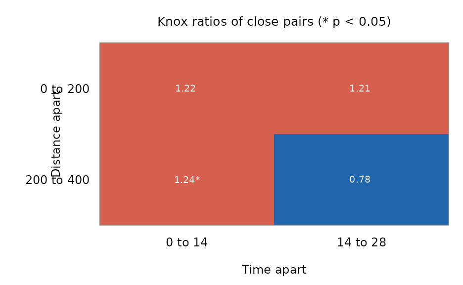

## Kernel intensity surface of incidents

[`kdsurf()`](https://rootcoder007.github.io/crimlab/reference/kdsurf.md):
Where incidents cluster: the intensity lambda(u) = sum_j w_j k(u - p_j)
with the product normal kernel of standard deviations `h` (along x and
y), in incidents per unit area, on a regular grid or at given locations.
On a grid it is the surface of
[`MASS::kde2d()`](https://rdrr.io/pkg/MASS/man/kde2d.html) times the
number of points, with the same default bandwidth (the normal reference
1.06 min(sd, IQR / 1.34) n^(-1/5) on each axis, a quarter of
[`MASS::bandwidth.nrd()`](https://rdrr.io/pkg/MASS/man/bandwidth.nrd.html)).
With a study rectangle `win` the edge corrections of
`spatstat.explore::density.ppp()` apply: `"uniform"` divides the
intensity at `u` by `e(u)`, the share of the kernel centred at `u`
inside `win` (Diggle 1985), and `"diggle"` divides each point’s kernel
by its own share `e(p_j)` (Jones 1993). On a grid the smallest sets of
cells holding each share `cover` of the surface’s mass (highest density
regions, Hyndman 1996) are reported with their area: half the incidents
in a few per cent of the map is concentration. The bandwidth decides how
sharp the surface is and should be reported with any map.

``` r

set.seed(1)
p <- cbind(x = c(rnorm(80, 2, 0.5), runif(40, 0, 6)),
           y = c(rnorm(80, 3, 0.5), runif(40, 0, 6)))
k <- kdsurf(p, win = c(0, 6, 0, 6), nx = 50, edge = "uniform")
k
#> kdsurf: 50 x 50 grid, sd 0.2794 by 0.2655, peak 49.54
#>  cover     level      area  share
#>    0.5 13.021117  2.413994 0.0644
#>    0.9  1.626066 15.773428 0.4208
image(k$x, k$y, k$z)
```

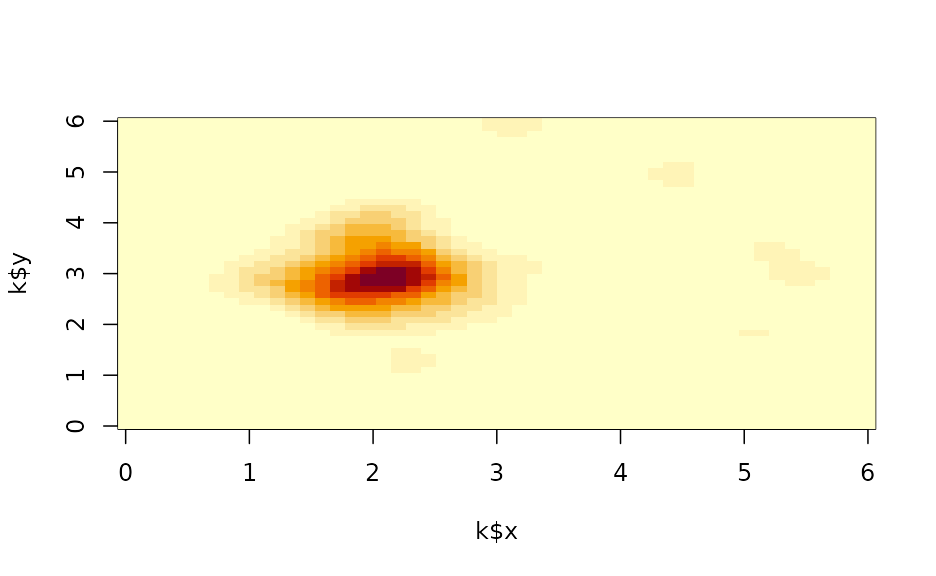

``` r

kdsurf(p, h = 0.4, at = "points")$z[1:5]
#> [1] 27.05935 34.01434 21.47548 14.47467 30.98250
```

``` r

plot(k)
```

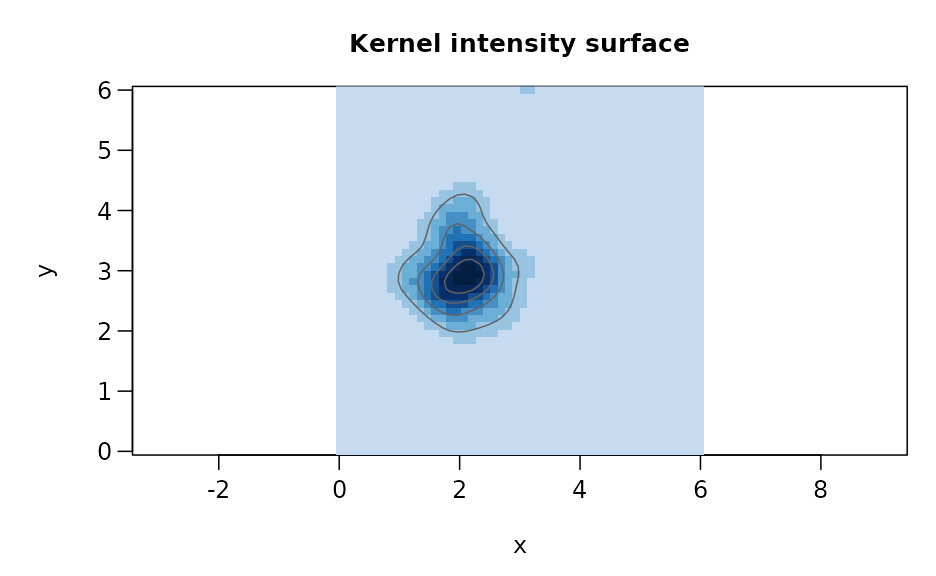

## DBSCAN clusters of incidents

[`dbscn()`](https://rootcoder007.github.io/crimlab/reference/dbscn.md):
Density-based clusters (Ester, Kriegel, Sander and Xu 1996): a core
point has at least `minpts` points within distance `eps`, itself
included; core points within `eps` of each other share a cluster, and a
point that is not core but lies within `eps` of a core point (a border
point) joins the first cluster that reaches it, clusters being grown
from the core points in input order. The rest is noise. With
`border = FALSE` border points are noise too (DBSCAN\*, Campello,
Moulavi and Sander 2013), which makes the result independent of the
order. These are the clusters of `dbscan::dbscan()`, numbered the same
way.

``` r

set.seed(1)
p <- rbind(cbind(x = rnorm(30, 0, 0.2), y = rnorm(30, 0, 0.2)),
           cbind(x = rnorm(30, 3, 0.2), y = rnorm(30, 1, 0.2)),
           cbind(x = runif(10, -2, 5), y = runif(10, -2, 3)))
d <- dbscn(p, eps = 0.3, minpts = 5)
d
#> dbscn: 2 clusters of 70 points, 10 noise
#>  cluster points
#>        1     30
#>        2     30
table(d$cl, useNA = "ifany")
#> 
#>    1    2 <NA> 
#>   30   30   10
```

## Hot spots and how long they last

[`hsper()`](https://rootcoder007.github.io/crimlab/reference/hsper.md):
Counts incidents in square grid cells of side `cell` (from the corner
`org`) for each period and marks as hot, in each period, the
`k = ceiling(top * m)` busiest of the `m` cells that ever hold an
incident, with every cell tied with the k-th; when a tie would make more
than 2 k cells hot the counts do not single them out and the tied cells
are left out (counted in `tiedout`). Each period gets its concentration
(the fewest cells holding half its incidents), the share of its
incidents in hot cells, and the Jaccard overlap of its hot set with the
period before (`NA` when either is empty); each cell gets the number of
periods it was hot and its longest run of successive hot periods, the
persistence that tells chronic hot spots from flare-ups (Weisburd,
Bushway, Lum and Yang 2004).

``` r

set.seed(1)
n <- 600
p <- cbind(x = c(rnorm(300, 2, 0.3), runif(300, 0, 10)),
           y = c(rnorm(300, 2, 0.3), runif(300, 0, 10)))
h <- hsper(p, prd = rep(2021:2024, length.out = n), cell = 1, top = 0.1)
h
#> hsper: 99 active cells, the 10 busiest hot in each of 4 periods
#>  period   n active nhalf      shalf hot tiedin tiedout    hotshr      jacc
#>    2021 150     57     4 0.04040404  20     10       0 0.7533333       NaN
#>    2022 150     57     4 0.04040404  19      9       0 0.7466667 0.2580645
#>    2023 150     54     4 0.04040404  11      1       0 0.6666667 0.2000000
#>    2024 150     62     4 0.04040404  17      7       0 0.7000000 0.2173913
subset(h$cells, nhot == 4)
#>           x        y  n nhot run
#> 11 1.513147 1.533045 88    4   4
#> 12 1.513147 2.533045 76    4   4
#> 21 2.513147 1.533045 90    4   4
#> 22 2.513147 2.533045 54    4   4
```

``` r

plot(h)
```

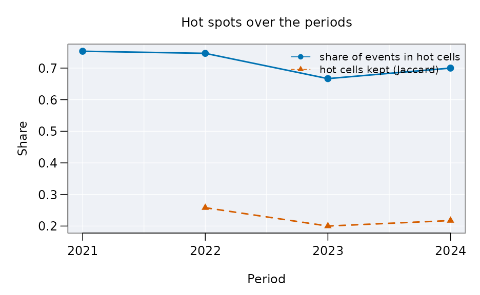

## Empirical-Bayes shrinkage of hot-spot counts

[`ebshr()`](https://rootcoder007.github.io/crimlab/reference/ebshr.md):
The places with the highest counts in one period tend to fall in the
next by chance alone: a count `y = theta + e` is a true rate plus noise
of variance `v` (for Poisson counts, the mean count, the default). The
linear shrinkage estimate (1 - B) y + B ybar toward the weighted mean
has expected loss (1 - B)^2 S_e + B^2 S_theta when the noise has
weighted mean 0 and is uncorrelated with the rates, which is smallest at
B\* = S_e / (S_e + S_theta), where it never exceeds the loss of the raw
counts (James and Stein 1961; Efron and Morris 1975). `S_theta` is
estimated as the excess of the weighted scatter of `y` over `v` (0 if
negative). The predicted fall of a place is `B (y - ybar)`: the size of
the regression to the mean a hot-spot programme should expect without
doing anything. That B\* lies in \[0, 1\], minimises the loss and never
does worse than no shrinkage is proved in Lean: see `proof("ebshr")`.

``` r

y <- c(40, 12, 9, 25, 7, 31, 5, 18)
s <- ebshr(y)
s
#> ebshr: shrinkage 0.1327 (B* 0.1327) toward 18.38; signal variance 120.1, noise 18.38
#>   y    shrunk        fall
#>  40 37.130656  2.86934447
#>  12 12.845876 -0.84587611
#>   9 10.243935 -1.24393546
#>  25 24.120952  0.87904773
#>   7  8.509308 -1.50930836
#>  31 29.324834  1.67516642
#>   5  6.774681 -1.77468126
#>  18 18.049757 -0.04975742
s$est[which.max(y), ]
#>    y   shrunk     fall
#> 1 40 37.13066 2.869344
```

``` r

plot(s)
```

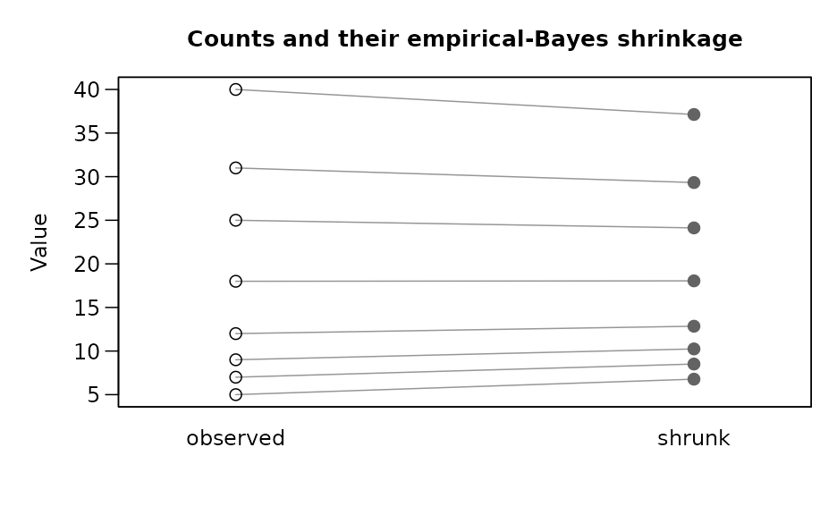

## Space-time scan statistic of incidents

[`kscan()`](https://rootcoder007.github.io/crimlab/reference/kscan.md):
Kulldorff’s space-time permutation scan (Kulldorff, Heffernan, Hartman,
Assuncao and Mostashari 2005), which needs the incidents alone, no
population: cylinders are circles of radius `r` about each distinct
incident location times windows \[s, s + tw) that start at each distinct
incident time. A cylinder holding `c` incidents, of `n_C` in its circle
(at any time) and `n_W` in its window (anywhere), expects e = n_C n_W /
n when place and time are independent, and scores the Poisson
log-likelihood ratio c log(c / e) + (n - c) `log((n - c) / (n - e))`
when `c > e`, 0 otherwise (Kulldorff 1997). The most likely cluster has
the largest ratio; secondary clusters follow in order of their ratio,
each the best of its circle among those whose circles overlap none
chosen before. Each p-value compares the cluster’s ratio with the
largest ratio of the whole scan with the times shuffled among the
locations `nsim` times from `seed`, so a secondary cluster’s p-value is
conservative. The shuffles run over the incidents in the order of their
coordinates and times, so the clusters and the p-values do not depend on
the order of the rows; a tie in the ratio goes to the centre first in
that order. That the ratio is never negative is proved in Lean: see
`proof("kscan")`. The work grows as the number of locations times
`length(r)` times the distinct times times `length(tw)`, for the scan
and for each permutation.

``` r

set.seed(1)
p <- cbind(x = c(runif(150, 0, 20), rnorm(20, 5, 0.3)),
           y = c(runif(150, 0, 20), rnorm(20, 15, 0.3)))
t <- c(sample(0:99, 150, TRUE), sample(40:44, 20, TRUE))
s <- kscan(p, t = t, r = c(1, 3), tw = c(5, 20), top = 2, nsim = 99,
           seed = 1)
s
#> kscan: 2 clusters of 170 incidents, 99 permutations
#>         x        y r start end  n       exp ncirc nwin        rr       llr    p
#>  4.959446 15.23629 1    40  45 20 3.4117647    20   29  6.510345 19.636580 0.01
#>  9.544601 11.09801 3     4   9  4 0.3235294    11    5 12.637459  6.422689 0.08
```

``` r

plot(s)
```

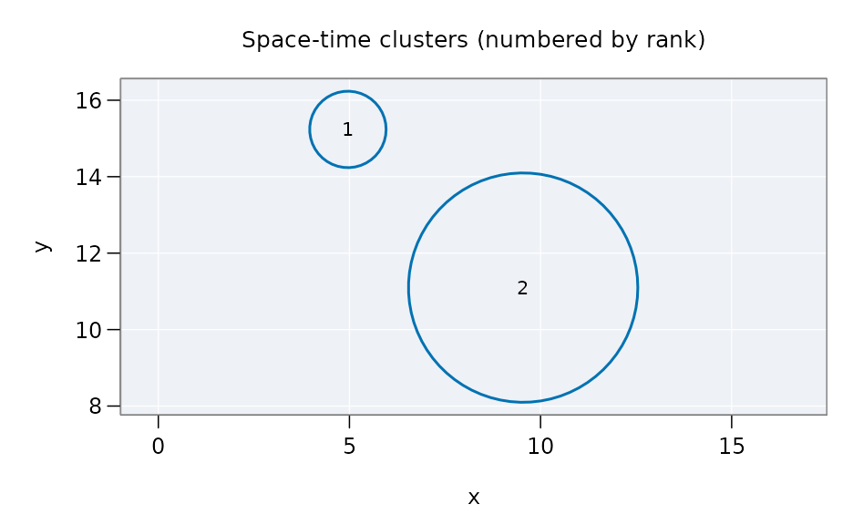

## Global Moran’s I with its inference

[`gmoran()`](https://rootcoder007.github.io/crimlab/reference/gmoran.md):
Moran’s (1950) I of values on units with spatial weights `w`: with
`z = x - mean(x)`, I = n / S0 sum_ij w_ij z_i z_j / sum z_i^2, its
expectation `-1 / (n - 1)` and its variance under normality and under
randomisation (Cliff and Ord 1981), the z statistics and their upper
normal tails (positive autocorrelation: neighbours alike), and, with
`nsim > 0`, the permutation p-value (1 + \#{I\* \>= I}) / (nsim + 1),
the values shuffled over the units from `seed`. These are the statistics
of `spdep::moran.test()` and `spdep::moran.mc()`. Given a matrix or data
frame, each column is tested on the same weights: one row per category
or year, a sweep of a variable across a polygon surface.
[`lmorn()`](https://rootcoder007.github.io/crimlab/reference/lmorn.md)
gives the local statistics, which add up to S0 I with row-standardised
weights.

``` r

set.seed(1)
p <- cbind(x = runif(50), y = runif(50))
w <- spwt(p, k = 4)
gmoran(p[, 1] + rnorm(50, sd = 0.2), w, nsim = 99, seed = 1)
#>   var         i           e          vn          vr      zn       zr           pn
#> 1   x 0.6251582 -0.02040816 0.007802795 0.007875543 7.30829 7.274458 1.352813e-13
#>             pr pperm s0
#> 1 1.739075e-13  0.01 50
# a sweep over three yearly counts
gmoran(data.frame(y1 = rpois(50, 3), y2 = rpois(50, 3 + 4 * p[, 1]),
                  y3 = rpois(50, 9 * p[, 1])), w)
#>   var             i           e          vn          vr        zn        zr
#> 1  y1 -0.0008085382 -0.02040816 0.007802795 0.007858451 0.2218823 0.2210952
#> 2  y2  0.1023809524 -0.02040816 0.007802795 0.007581203 1.3900640 1.4102328
#> 3  y3  0.3831195986 -0.02040816 0.007802795 0.007584193 4.5682339 4.6336020
#>             pn           pr pperm s0
#> 1 4.122028e-01 4.125092e-01   NaN 50
#> 2 8.225473e-02 7.923548e-02   NaN 50
#> 3 2.459255e-06 1.796788e-06   NaN 50
```

## Bivariate Moran’s I

[`bvmor()`](https://rootcoder007.github.io/crimlab/reference/bvmor.md):
Whether high values of one variable sit next to high values of another
(Wartenberg 1985): with `zx` and `zy` the centred values, I = n / S0
sum_ij w_ij zx_i zy_j / sqrt(sum zx^2 sum zy^2), which is Moran’s I
([`gmoran()`](https://rootcoder007.github.io/crimlab/reference/gmoran.md))
when `y` is `x` (proved in Lean: see `proof("bvmor")`) and, with
row-standardised weights, `spdep::moran_bv()`‘s statistic. Inference is
by permutation: `y`’s values are shuffled over the units `nsim` times
from `seed` while `x` stays, so under the null its expectation is 0. The
statistic mixes the two variables’ correlation at a unit with their
spatial association; it is not a test of spillover from `x` to `y`.

``` r

set.seed(1)
p <- cbind(x = runif(60), y = runif(60))
a <- p[, 1] + rnorm(60, sd = 0.3)
b <- p[, 1] + rnorm(60, sd = 0.3)
bvmor(a, b, spwt(p, k = 5), nsim = 199, seed = 1)
#>            i         mean           sd            z            p         ptwo 
#> 0.4279403762 0.0002540543 0.0982550720 4.3528167375 0.0050000000 0.0050000000
```

## Spatial regression: lag, error and combined models

[`sarml()`](https://rootcoder007.github.io/crimlab/reference/sarml.md):
Fits the spatial lag model y = rho W y + X beta + e, the spatial error
model y = X beta + u with u = lambda W u + e, or both at once (`"sac"`,
one weights matrix for both), with normal errors, by maximum likelihood
(Ord 1975; Anselin 1988): the likelihood is concentrated in `rho` or
`lambda` and maximised by Brent’s method on (-1 / m, 1 / m), `m` the
largest row sum of `W` (which bounds its spectral radius), with log
\|I - rho W\| from a dense LU factorisation, so the cost grows as `n^3`
per evaluation (at most 5000 units). The combined model is maximised
over both parameters by Nelder and Mead’s simplex. Standard errors come
from the inverse of the expected information matrix (Anselin 1988,
ch. 6); these are the estimates of `spatialreg::lagsarlm()`,
`errorsarlm()` and `sacsarlm()`. `durbin = TRUE` adds the lags W x of
the varying columns (the spatial Durbin model, or the Durbin error
model). `method = "2sls"` fits the lag model by two-stage least squares
with the instruments W x and W^2 x (Kelejian and Prucha 1998), as
`spatialreg::stsls()` does, without a likelihood; its standard errors
divide the residual sum of squares by `n` less the coefficients.

``` r

set.seed(1)
p <- cbind(x = runif(80), y = runif(80))
w <- spwt(p, k = 5)
W <- matrix(0, 80, 80)
W[cbind(w$i, w$j)] <- w$w
x <- rnorm(80)
y <- solve(diag(80) - 0.5 * W, 1 + 2 * x + rnorm(80))
f <- sarml(y, x, w)
f
#> sarml: lag model by ml, 80 units, log-likelihood -119.34 (OLS -128.625)
#>         term       est         se         z            p      ols     olsse
#>  (Intercept) 1.0772273 0.20235921  5.323342 1.018778e-07 1.973029 0.1375247
#>            x 1.9786039 0.12851286 15.396156 1.736932e-53 1.900068 0.1489361
#>          rho 0.4874943 0.08976277  5.430919 5.606463e-08      NaN       NaN
spill(f)
#>   term   direct indirect    total       sed       sei       set
#> 1    x 2.084212 1.776436 3.860648 0.1485669 0.6471067 0.7425332
```

``` r

plot(f)
```

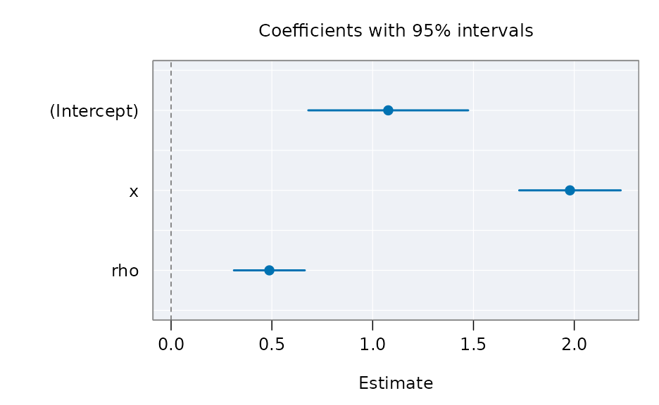

## Direct, indirect and total effects of a spatial lag model

[`spill()`](https://rootcoder007.github.io/crimlab/reference/spill.md):
In a model with a spatial lag of the outcome, y = rho W y + X beta + W X
`theta + e`, a change in covariate `k` at every unit moves the outcomes
by S_k = (I - rho W)^-1 (beta_k I + theta_k W): the mean of its diagonal
is the direct effect, the mean row sum the total, and their difference
the indirect effect, the spillover to other units (LeSage and Pace
2009). An analysis that reads `beta_k` alone can report “no effect”
where the effect is all spillover. With row-standardised weights the
total is `(beta_k + theta_k) / (1 - rho)`, proved in Lean: see
`proof("spill")`. Standard errors are by the delta method in `rho`,
`beta_k` and `theta_k`, with the exact derivatives d (I - rho W)^-1 / d
rho = (I - rho W)^-1 W (I - rho W)^-1. The effects are those of
`spatialreg::impacts()`, which gives simulated rather than delta-method
standard errors.

``` r

set.seed(2)
p <- cbind(x = runif(40), y = runif(40))
w <- spwt(p, k = 4)
spill(w = w, rho = 0.4, b = c(gent = 0.1), th = 0.3)
#>   term    direct  indirect     total sed sei set
#> 1 gent 0.1373729 0.5292938 0.6666667 NaN NaN NaN
```

## Cross-type K function and the segregation test

[`crossk()`](https://rootcoder007.github.io/crimlab/reference/crossk.md):
Whether incidents of one type (`i`) have incidents of another (`j`) near
them more than independence gives: the cross-type K function K_ij(r) = A
/ (n_i n_j) sum e_ab 1(d_ab \<= r) over pairs of a point `a` of type `i`
and a point `b` of type `j` in the rectangle `win` of area `A`, with
Ripley’s (1977) isotropic correction `e_ab` (the length of the circle
about `a` through `b` over its length inside `win`), and
`L = sqrt(K / pi)` (Lotwick and Silverman 1982). Under independence K =
pi r^2. With `i` equal to `j` it is Ripley’s K of that type. These are
the values of `spatstat.explore::Kcross()` with
`correction = "isotropic"`.

``` r

set.seed(1)
p <- cbind(x = runif(120), y = runif(120))
m <- ifelse(p[, 1] < 0.5, "burglary", "robbery")
crossk(p, marks = m, i = "burglary", j = "robbery",
       win = c(0, 1, 0, 1), r = c(0.05, 0.1, 0.2), sigma = 0.1,
       nsim = 19, seed = 1)
#> crossk: K of robbery about burglary
#>     r           k           l        theo
#>  0.05 0.000278474 0.009414936 0.007853982
#>  0.10 0.001113896 0.018829872 0.031415927
#>  0.20 0.023148107 0.085838634 0.125663706
#> segregation T 47.42, p 0.05 (19 relabellings)
```

``` r

res <- crossk(p, marks = m, i = "burglary", j = "robbery",
              win = c(0, 1, 0, 1), r = c(0.05, 0.1, 0.2), sigma = 0.1,
              nsim = 19, seed = 1)
plot(res)
```

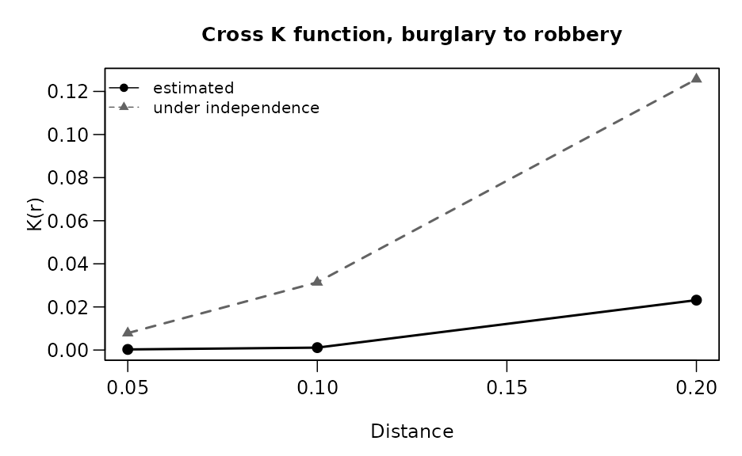

## Quadrat count test

[`qdrtst()`](https://rootcoder007.github.io/crimlab/reference/qdrtst.md):
Counts the points in an `nx` by `ny` grid of equal tiles of the
rectangle `win` and tests complete spatial randomness by Pearson’s
chi-square, `X2 = sum (n_k - e)^2 / e` with `e` the mean count, on nx
ny - 1 degrees of freedom: the upper tail against clustering and the
two-sided p-value (twice the smaller tail, `quadrat.test()`’s default),
which also flags regular patterns. A point on an inner tile boundary
goes to the tile above or to its right, one on the outer edge to the
tile inside. These are the values of `spatstat.explore::quadrat.test()`.
The counts feed
[`morsta()`](https://rootcoder007.github.io/crimlab/reference/morsta.md).

``` r

set.seed(1)
p <- cbind(x = runif(100, 0, 2), y = runif(100))
q <- qdrtst(p, win = c(0, 2, 0, 1), nx = 4, ny = 2)
q
#> qdrtst: X2 5.6 on 7 df, p 0.587 (two-sided 0.826)
#>      [,1] [,2] [,3] [,4]
#> [1,]   13   16   10   15
#> [2,]    7   16   11   12
morsta(q$counts)
#>       imor       mclu       muni       imst        chi          p 
#>  0.9858586  1.0910380  0.9463623 -0.1318235  5.6000000  0.5871510
```

``` r

plot(q)
```

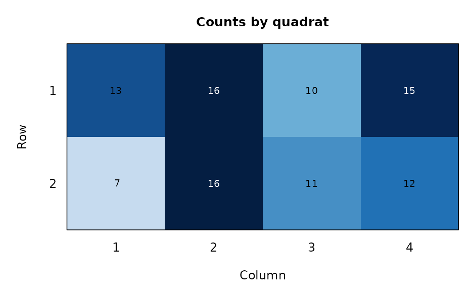

## Morisita’s index of dispersion

[`morsta()`](https://rootcoder007.github.io/crimlab/reference/morsta.md):
Morisita’s (1959) index of the counts in `n` equal quadrats, I = n (sum
x^2 - S) / (S^2 - S) with `S` the total: 1 for a random pattern, above
for clumping (`n` when all fall in one quadrat), below for an even
spread. The uniform and clumped indices are the values of `I` at the
`crit / 2` tails of chi-square on `n - 1` degrees of freedom, and the
standardised index of Smith-Gill (1975) maps `I` onto \[-1, 1\] with
them at `-0.5` and `0.5`; `chi = I (S - 1) + n - S` has the chi-square
distribution under randomness. These are the values of
`vegan::dispindmorisita()`.

``` r

morsta(c(3, 0, 7, 12, 1, 4, 0, 9))
#>         imor         mclu         muni         imst          chi            p 
#> 1.676190e+00 1.257508e+00 8.482820e-01 5.310481e-01 3.066667e+01 7.161935e-05
```

## Indices of residential segregation

[`dissix()`](https://rootcoder007.github.io/crimlab/reference/dissix.md):
The evenness of groups across areal units (Massey and Denton 1988), from
a table of counts with one row per unit and one column per group:
Duncan’s dissimilarity D = sum \|x_ik / X_k - x_il / X_l\| / 2 between
each pair of groups (the share of either group that would have to move
for the two to be spread alike), and for each group against the rest the
segregation index `IS`, Theil’s entropy index `H`, Atkinson’s index with
shape `delta` and the Gini index. With weights `w` between the units,
Morrill’s (1991) adjusted `D` subtracts the weighted mean absolute
difference of the pair’s shares between neighbouring units, so that
segregation across a boundary counts less than segregation within. Units
with no one in them are left out. That `D` lies between 0 and 1 is
proved in Lean: see `proof("dissix")`.

``` r

x <- cbind(a = c(90, 80, 10, 5, 50), b = c(10, 20, 85, 95, 50))
dissix(x)
#> dissix: dissimilarity between groups
#>           a         b
#> a 0.0000000 0.6284779
#> b 0.6284779 0.0000000
#>  group        is         h       atk      gini
#>      a 0.6284779 0.4052672 0.5217079 0.7680033
#>      b 0.6284779 0.4052672 0.5217079 0.7680033
dissix(x, w = spwt(nb = list(2, c(1, 3), c(2, 4), c(3, 5), 4),
                   type = "contig"))$dm
#>           a         b
#> a 0.0000000 0.3134779
#> b 0.3134779 0.0000000
```

``` r

res <- dissix(x)
plot(res)
```

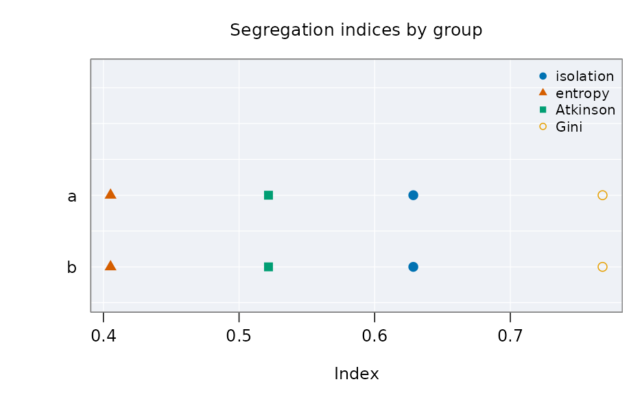

## Points in polygons, and the population the units cover

[`pinpl()`](https://rootcoder007.github.io/crimlab/reference/pinpl.md):
Finds the region holding each point (a facility, a station, an incident)
by the even-odd rule, a point on a boundary counting as inside; a region
given as several rings (parts and holes) is one region, and a hole is
any ring inside another of the same region. A point outside every region
gets `NA`; one inside overlapping regions takes the first by label and
`nreg` says how many hold it. Coordinates are taken as planar (longitude
and latitude work for regions small enough that their edges are straight
in degrees).

``` r

sq <- function(x0, id) {
  data.frame(x = x0 + c(0, 1, 1, 0), y = c(0, 0, 1, 1), id = id)
}
poly <- rbind(sq(0, "A"), sq(1, "B"), sq(2, "C"))
u <- pinpl(cbind(x = c(0.5, 0.2, 2.5, 9), y = c(0.5, 0.7, 0.5, 9)),
           poly = poly, pop = c(1200, 800, 450))
u
#> pinpl: 3 of 4 points in 2 of 3 regions; they cover 67.3% of the population, which is not a rate denominator
#>  region units  pop hasunit    popshr
#>       A     2 1200    TRUE 0.4897959
#>       B     0  800   FALSE 0.3265306
#>       C     1  450    TRUE 0.1836735
u$reg
#> [1] "A" "A" "C" NA
```

``` r

plot(u)
```

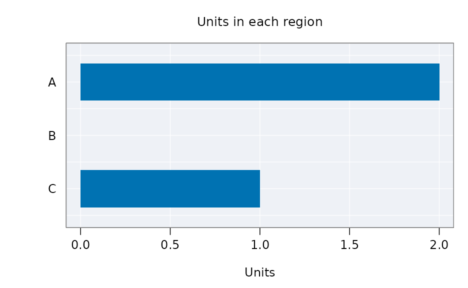

## Crosswalk of counts between two sets of areal units

[`arwt()`](https://rootcoder007.github.io/crimlab/reference/arwt.md):
Moves values (counts, populations) kept on one set of units (an old
boundary version, say) onto another, through the pairs of a source and a
target unit that overlap: each source’s value is split among its targets
in proportion to `area`, the size of the overlap (its area, or its
population for a population-weighted crosswalk), which assumes the value
spread uniformly over the source. Where each source lies in one target
(a boundary version that only merges units) the result is exact
aggregation and `exact` is `TRUE`; splitting a source is an
approximation. A source with no pair is lost (`lost`), and each source’s
main target (its largest share) maps an old identifier onto the new
scheme. The concentration of the result across the targets is reported
as the Gini coefficient and the share of the largest `top` targets.

``` r

# four old units onto three new ones; unit d is split 70/30 by area
arwt(c(a = 120, b = 40, c = 60, d = 100),
     from = c("a", "b", "c", "d", "d"), to = c("N1", "N1", "N2", "N2", "N3"),
     area = c(1, 1, 1, 7, 3), top = 1)
#> arwt: 4 sources onto 3 targets, sources split by overlap
#>  to value
#>  N1   160
#>  N2   130
#>  N3    30
#>   gini   top1 
#> 0.2708 0.5000
```

``` r

res <-
  arwt(c(a = 120, b = 40, c = 60, d = 100),
       from = c("a", "b", "c", "d", "d"), to = c("N1", "N1", "N2", "N2", "N3"),
       area = c(1, 1, 1, 7, 3), top = 1)
plot(res)
```

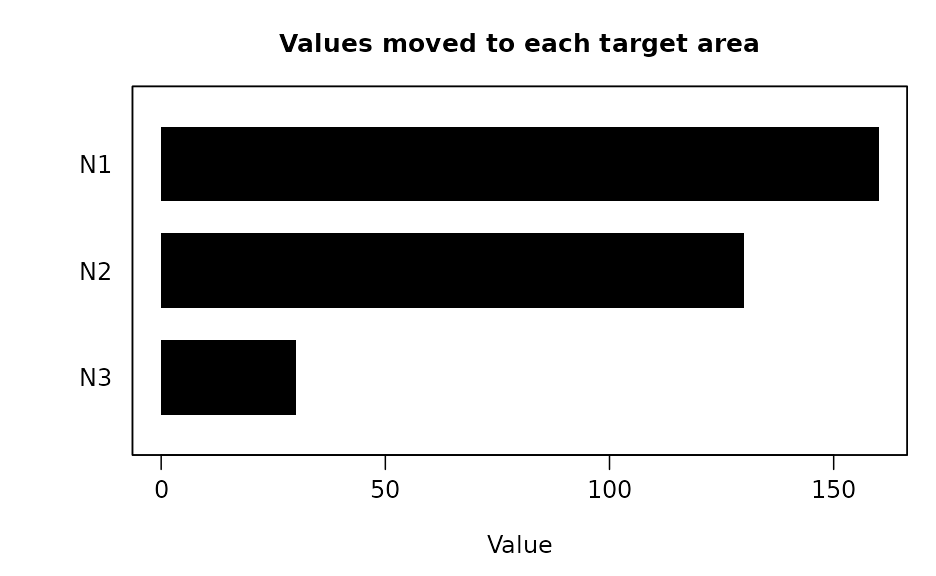

## Crosswalk between boundary versions

[`bndxw()`](https://rootcoder007.github.io/crimlab/reference/bndxw.md):
Carries values kept on one set of areas (the 158 neighbourhoods of a
city’s new boundaries, a census vintage’s tracts) to another (the 140
old neighbourhoods) through a correspondence table: each link says what
share `w` of a source area’s value falls in a target area. Counts of a
source wholly inside one target move whole (weight 1, exact); a source
split between targets is shared by area or population (uniform density
within the source, an assumption). The same table read the other way
disaggregates. `map` also gives each source’s main target, the column to
add to a table keyed by the source areas.

``` r

# old areas a, b merge into A; c splits between A and B by area
bndxw(from = c("a", "b", "c", "c"), to = c("A", "A", "A", "B"),
      x = c(3, 4, 5, 8), unit = c("a", "b", "b", "c"),
      w = c(1, 1, 0.25, 0.75))
#> $tab
#>   to value
#> 1  A    14
#> 2  B     6
#> 
#> $map
#>   from to share wsum
#> 1    a  A  1.00    1
#> 2    b  A  1.00    1
#> 3    c  B  0.75    1
#> 
#> $lost
#> [1] 0
#> 
#> $unmatched
#> character(0)
```

## Synthetic exposure of areas from a survey

[`synexp()`](https://rootcoder007.github.io/crimlab/reference/synexp.md):
A small-area synthetic estimate (Gonzalez and Hoza 1978): the prevalence
of a trait (serious mental illness, say, for the benchmark of a
disparity in police use of force) is modelled on survey microdata by
logistic regression
([`lgtreg()`](https://rootcoder007.github.io/crimlab/reference/lgtreg.md));
applied to each area’s covariates it gives the area’s rate, and times
its population the number of people with the trait, the exposure a rate
per person needs. The area covariates must be on the scale of the
survey’s (shares of an area for indicators read as the probability of
the indicator, a plug-in that assumes the model holds within areas).

``` r

set.seed(1)
s <- data.frame(age = runif(400, 18, 80), male = rbinom(400, 1, 0.5))
y <- rbinom(400, 1, plogis(-3 + 0.02 * s$age + 0.4 * s$male))
areas <- data.frame(age = c(35, 52), male = c(0.48, 0.51))
synexp(y, s, areas, pop = c(12000, 8000))$areas
#>         rate   pop     expo
#> 1 0.09284222 12000 1114.107
#> 2 0.14551661  8000 1164.133
```

## Treated, comparison and excluded places around sites

[`bufas()`](https://rootcoder007.github.io/crimlab/reference/bufas.md):
The buffer design of place-based evaluations: a place (a block, an
address) within distance `r` of a site (a new facility, a treated
corner) is treated; one within `r` of a comparison point and farther
than `buf` from every site is a comparison; the rest are excluded, so
that spillover from the sites (displacement or a diffusion of benefits,
Bowers and Johnson 2003) does not reach the comparison. `buf` should be
several times `r`.

``` r

set.seed(4)
p <- cbind(x = runif(200, 0, 5000), y = runif(200, 0, 5000))
b <- bufas(p, site = cbind(c(1000, 3500), c(1200, 3000)),
           comp = cbind(c(2500, 4500), c(500, 4000)), r = 330)
b
#> bufas: radius 330, buffer 990
#>    treated comparison   excluded 
#>          5          4        191
```

``` r

plot(b)
```

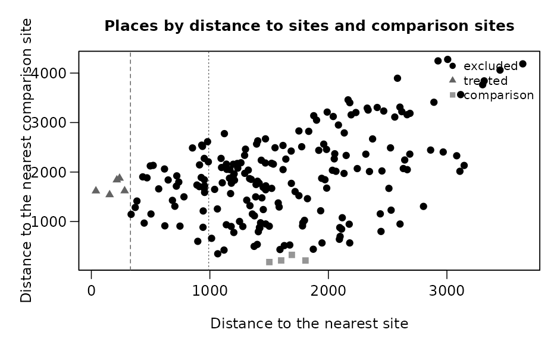

## Weighted displacement quotient: did crime move next door?

[`wdqx()`](https://rootcoder007.github.io/crimlab/reference/wdqx.md):
Asks whether an intervention in an area pushed crime into the area
around it (displacement) or reduced it there too (a diffusion of
benefits). Counts before and after the intervention are needed for the
treated area `a`, a buffer `b` around it and a control area `c` that
neither can reach (see
[`bufas()`](https://rootcoder007.github.io/crimlab/reference/bufas.md)
for drawing them). With subscripts 0 before and 1 after, the measures of
Bowers and Johnson (2003), as Guerette (2009, Appendix B, equations 1 to
4) states them:

``` r

# burglaries: treated 100 -> 60, buffer 50 -> 40, control 200 -> 180
wdqx(a = c(100, 60), b = c(50, 40), c = c(200, 180))
#>          sm         bdm         wdq          ge          ne          ea          eb 
#> -0.16666667 -0.02777778  0.16666667 40.00000000  0.16666667 90.00000000 45.00000000 
#>         tne 
#> 35.00000000
# Guerette (2009), Appendix D
wdqx(a = c(207, 110), b = c(178, 157), c = c(308, 318))
#>           sm          bdm          wdq           ge           ne           ea 
#>  -0.32616597  -0.08421139   0.25818569  97.00000000   0.32616597 213.72077922 
#>           eb          tne 
#> 183.77922078 130.50000000
```

## Prospective hot-spotting: where the next burglaries are likely

[`prohs()`](https://rootcoder007.github.io/crimlab/reference/prohs.md):
Asks which places are at most risk in the coming days, given where and
when crimes happened recently. Burglary risk is raised near a recent
burglary for a few weeks (the near-repeat pattern), so Bowers, Johnson
and Pease (2004) score each cell of a grid by the recent incidents near
it, each weighted down with its distance and its age:

``` r

set.seed(6)
n <- 300
p <- cbind(x = runif(n, 0, 2000), y = runif(n, 0, 2000))
day <- sort(sample(1:120, n, TRUE))
r <- prohs(p, t = day, at = 100, win = c(0, 2000, 0, 2000), cell = 100,
           bw = 400, ahead = 14)
r$eval
#>          n       hits        hit       area        pai 
#> 36.0000000  4.0000000  0.1111111  0.1000000  1.1111111
image(r$x, r$y, r$z)
```

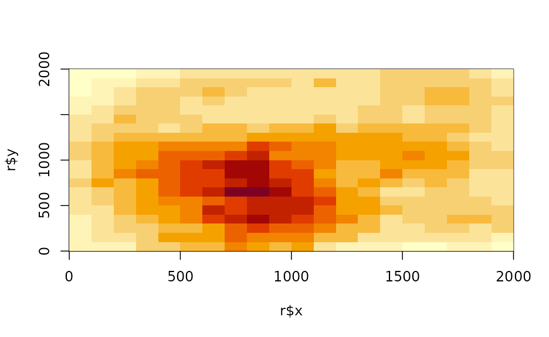

``` r

plot(r)
```

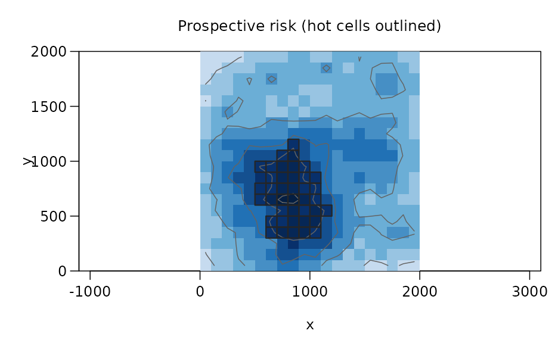

## Crime linkage: which crimes belong to one series

[`lnkpr()`](https://rootcoder007.github.io/crimlab/reference/lnkpr.md):
Asks whether two crimes were committed by the same offender, from how
far apart they are in space and time and how alike the offender behaved
(the modus operandi: entry method, property taken, a weapon shown). For
every pair of crimes it gives the distance, the time between them and
the Jaccard similarity of their behaviours (the behaviours present in
both over those present in either; 0 when neither shows any). On the
pairs of solved crimes, linked when they belong to the same series, a
logistic regression of being linked on the three measures is fitted and
each measure’s power to tell linked from unlinked pairs is the area
under its ROC curve (AUC: the chance that a linked pair is closer,
sooner or more alike than an unlinked one; 0.5 is no better than
chance), as Bennell and Canter (2002) did for commercial burglaries. The
fitted model then scores every pair, including those with an unsolved
crime: `prob` is the estimated chance that the two are linked.

``` r

set.seed(9)
s <- rep(1:6, each = 5)
cx <- runif(6, 0, 5000)[s] + rnorm(30, 0, 1500)
cy <- runif(6, 0, 5000)[s] + rnorm(30, 0, 1500)
day <- runif(6, 0, 300)[s] + rnorm(30, 0, 60)
mo <- matrix(rbinom(30 * 5, 1, 0.3), 30)
sr <- ifelse(runif(30) < 0.2, NA, s)
r <- lnkpr(cbind(x = cx, y = cy), t = day, series = sr, mo = mo)
r$coef
#>          term           est           se          z            p
#> 1 (Intercept)  0.1466816977 0.4786319854  0.3064603 7.592542e-01
#> 2        dist -0.0001929138 0.0001228189 -1.5707178 1.162482e-01
#> 3          dt -0.0157565696 0.0033891231 -4.6491582 3.332925e-06
#> 4         jac  0.5344187921 0.8865379558  0.6028155 5.466315e-01
r$auc
#>      dist        dt       jac     model 
#> 0.5950469 0.7775642 0.5022617 0.7888726
```

``` r

plot(r)
```

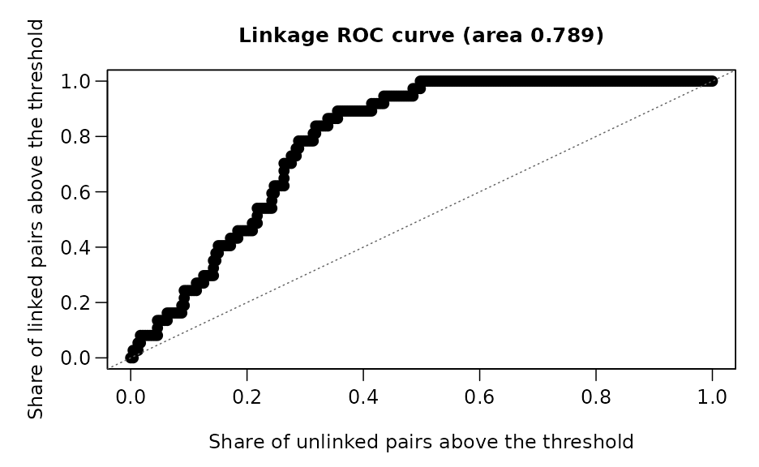

## Accuracy of a hot-spot map

[`hsacc()`](https://rootcoder007.github.io/crimlab/reference/hsacc.md):
Asks how well a map of predicted hot spots (from
[`kdsurf()`](https://rootcoder007.github.io/crimlab/reference/kdsurf.md),
[`prohs()`](https://rootcoder007.github.io/crimlab/reference/prohs.md),
[`rtmfit()`](https://rootcoder007.github.io/crimlab/reference/rtmfit.md)
or any score per cell) caught the crimes that followed. The hot cells
are those of highest predicted score whose areas together first reach
the share `top` of the study area (or the cells marked `TRUE` when
`pred` is logical). Then:

``` r

set.seed(12)
risk <- rgamma(400, 0.5)
before <- rpois(400, risk)
after <- rpois(400, risk)
hsacc(pred = before, obs = after, top = c(0.05, 0.1, 0.2), prev = before)
#>    top cells area ashare   n   N       hit      pai nmax       pei       rri
#> 1 0.05    42   42  0.105  59 177 0.3333333 3.174603  110 0.5363636 0.5451713
#> 2 0.10    42   42  0.105  59 177 0.3333333 3.174603  110 0.5363636 0.5451713
#> 3 0.20   110  110  0.275 107 177 0.6045198 2.198254  177 0.6045198 0.6045198
```

## Risk terrain model

[`rtmfit()`](https://rootcoder007.github.io/crimlab/reference/rtmfit.md):
Risk terrain modelling (Caplan, Kennedy and Miller 2011) relates the
crimes counted in the cells of a grid to risk layers, the presence or
density of features (bars, transit stops, vacant lots) around each cell,
by Poisson regression. The exponentiated coefficient of a layer is its
relative risk value; the cells’ relative risk combines the layers.

``` r

rtmfit(c(1, 2, 4, 8, 3, 5), list(bars = c(0, 1, 0, 1, 0, 1),
                                 stops = c(0, 0, 1, 1, 1, 0)))
#> $coef
#>          term       est        se         z          p      rrv        lo       hi
#> 1 (Intercept) 0.2876821 0.5188745 0.5544348 0.57928134 1.333333 0.4822497 3.686426
#> 2        bars 0.9162907 0.4557327 2.0105880 0.04436899 2.500000 1.0233392 6.107457
#> 3       stops 0.9162907 0.4557327 2.0105880 0.04436899 2.500000 1.0233392 6.107457
#> 
#> $cells
#>     rr score   fitted y
#> 1 1.00  1.00 1.333333 1
#> 2 2.50  2.50 3.333333 2
#> 3 2.50  2.50 3.333333 4
#> 4 6.25  6.25 8.333333 8
#> 5 2.50  2.50 3.333333 3
#> 6 2.50  2.50 3.333333 5
#> 
#> $lay
#>      bars stops
#> [1,]    0     0
#> [2,]    1     0
#> [3,]    0     1
#> [4,]    1     1
#> [5,]    0     1
#> [6,]    1     0
#> 
#> $dev
#> [1] 1.609242
#> 
#> $aic
#> [1] 25.89929
#> 
#> $conv
#> [1] TRUE
#> 
#> $level
#> [1] 0.95
# layers from feature locations
cell <- as.matrix(expand.grid(x = 1:4, y = 1:4))
bars <- rbind(c(1, 1), c(3, 4))
y <- c(3, 1, 0, 0, 2, 1, 0, 1, 0, 0, 1, 2, 0, 1, 2, 3)
rtmfit(y, list(bars = bars), cell = cell, rad = 1.5, kind = "dens")$coef
#>          term       est       se         z         p       rrv         lo        hi
#> 1 (Intercept) -1.791759 1.000000 -1.791760 0.0731715 0.1666667 0.02347725  1.183179
#> 2        bars  2.261763 1.030776  2.194233 0.0282187 9.6000000 1.27313009 72.388518
```

## Choropleth maps in base graphics

[`chomap()`](https://rootcoder007.github.io/crimlab/reference/chomap.md):
[`chomap()`](https://rootcoder007.github.io/crimlab/reference/chomap.md)
shades each area of a map by the class of its value, with no spatial
package: an area is a matrix of coordinates. The class breaks, the class
of each value and the bounding box are computed by the compiled kernel;
R only draws. Areas are drawn with
[`polypath()`](https://rdrr.io/r/graphics/polypath.html), so a ring
inside another is a hole.

``` r

sq <- function(x0, y0) cbind(x0 + c(0, 1, 1, 0), y0 + c(0, 0, 1, 1))
p <- list(a = sq(0, 0), b = sq(1, 0), c = sq(0, 1), d = sq(1, 1))
chomap(p, c(12, 3, 7, 25), brk = 2)
```

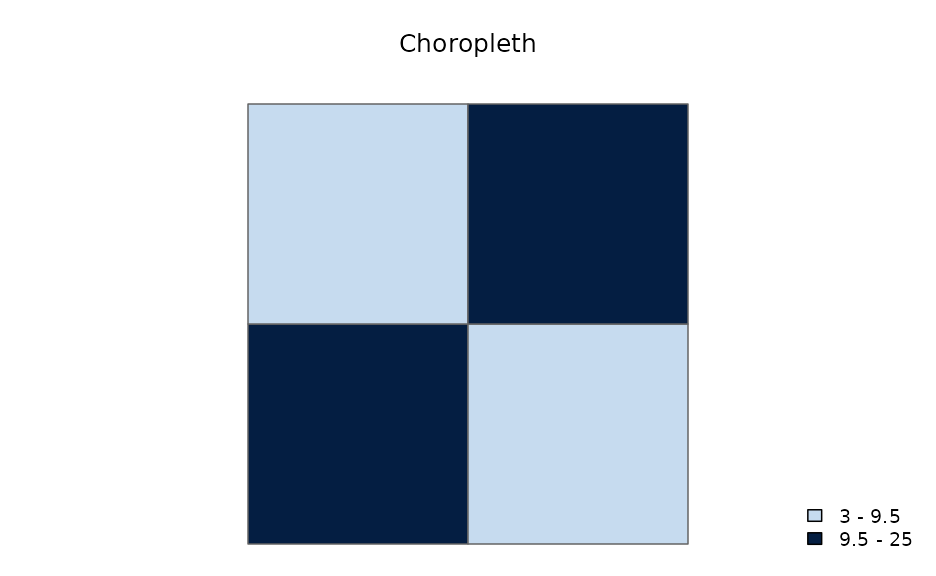

``` r

chomap(p, c(12, 3, 7, 25), brk = c(0, 5, 10, 30), main = "Rates")
```

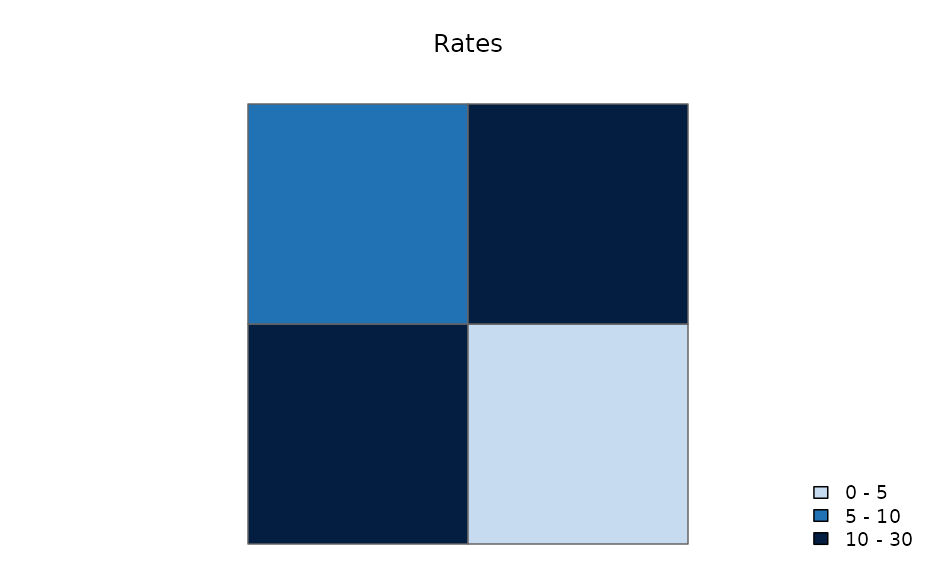

## Small multiples of a choropleth map by period

[`smmap()`](https://rootcoder007.github.io/crimlab/reference/smmap.md):
[`smmap()`](https://rootcoder007.github.io/crimlab/reference/smmap.md)
draws one choropleth map per period in a grid of panels, all with the
same class breaks and colours, so that a change between periods is a
change of shade. The areas, breaks and classes are those of
[`chomap()`](https://rootcoder007.github.io/crimlab/reference/chomap.md),
the breaks computed from the values of every period together; the legend
is drawn in the last panel.

``` r

sq <- function(x0, y0) cbind(x0 + c(0, 1, 1, 0), y0 + c(0, 0, 1, 1))
p <- list(sq(0, 0), sq(1, 0), sq(0, 1), sq(1, 1))
v <- cbind(`2022` = c(3, 8, 5, 1), `2023` = c(4, 9, 2, 1),
           `2024` = c(6, 12, 2, 0))
smmap(p, v, brk = 3)
```

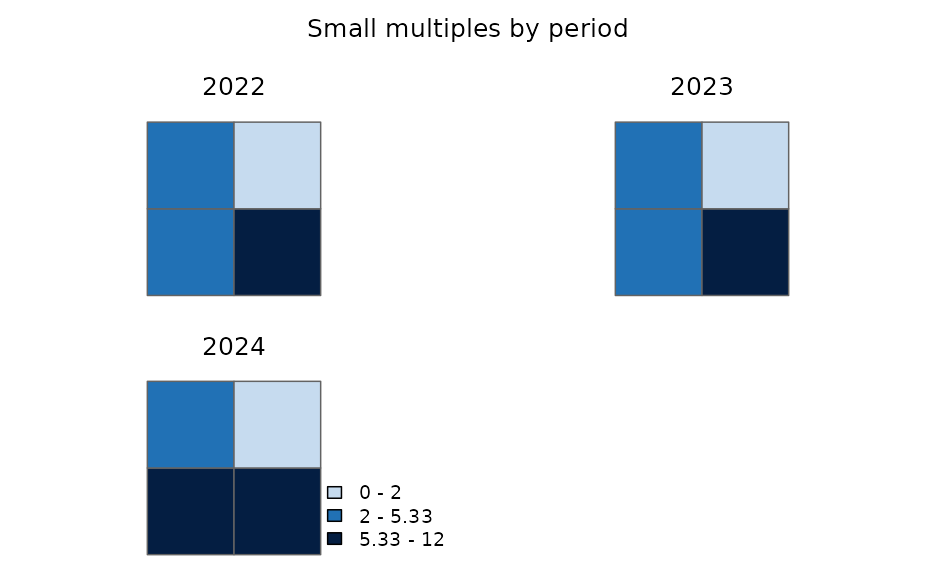

## Point maps, with clusters

[`ptmap()`](https://rootcoder007.github.io/crimlab/reference/ptmap.md):
[`ptmap()`](https://rootcoder007.github.io/crimlab/reference/ptmap.md)
draws points on a map at an aspect of 1, optionally coloured by cluster:
a result of
[`dbscn()`](https://rootcoder007.github.io/crimlab/reference/dbscn.md)
or a cluster number per point. Each cluster has its own colour and point
shape (so the clusters read in grey print too) and its number at its
centre, the mean of its points; noise is drawn as grey crosses. The box
and the cluster centres are computed by the compiled kernel; R only
draws. [`plot()`](https://rdrr.io/r/graphics/plot.default.html) of a
[`dbscn()`](https://rootcoder007.github.io/crimlab/reference/dbscn.md)
result draws it through
[`ptmap()`](https://rootcoder007.github.io/crimlab/reference/ptmap.md),
given the points it was found in.

``` r

set.seed(1)
p <- rbind(cbind(rnorm(30, 0, 0.2), rnorm(30, 0, 0.2)),
           cbind(rnorm(30, 3, 0.2), rnorm(30, 1, 0.2)),
           cbind(runif(10, -2, 5), runif(10, -2, 3)))
ptmap(p)
```

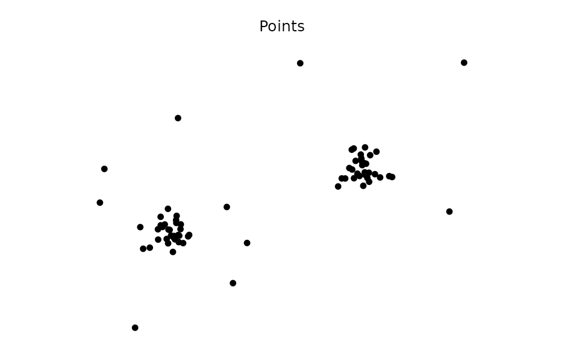

``` r

d <- dbscn(p, eps = 0.3, minpts = 5)
plot(d, p)
```

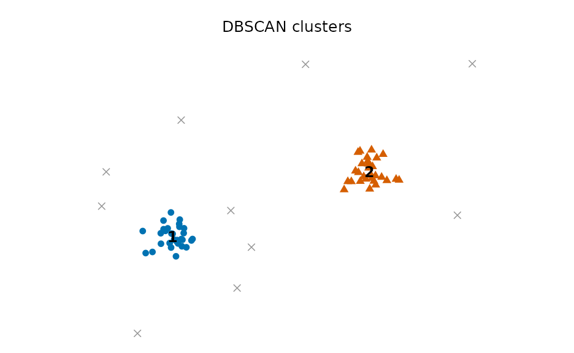

## Proportional symbol maps

[`prpmap()`](https://rootcoder007.github.io/crimlab/reference/prpmap.md):
[`prpmap()`](https://rootcoder007.github.io/crimlab/reference/prpmap.md)
draws a circle at each point (a district’s centre, say) whose area is
proportional to its value: the radius is `rmax` times the square root of
the value over the largest value, so the largest has radius `rmax`. The
circles are drawn largest first, so that the smaller stay visible over
them, and filled half-transparent. The radii, the drawing order and the
box (widened by `rmax` on every side so the circles fit) are computed by
the compiled kernel; R only draws.

``` r

x <- c(0, 4, 1, 3, 2)
y <- c(0, 1, 3, 4, 2)
prpmap(x, y, c(120, 30, 5, 60, 0))
```

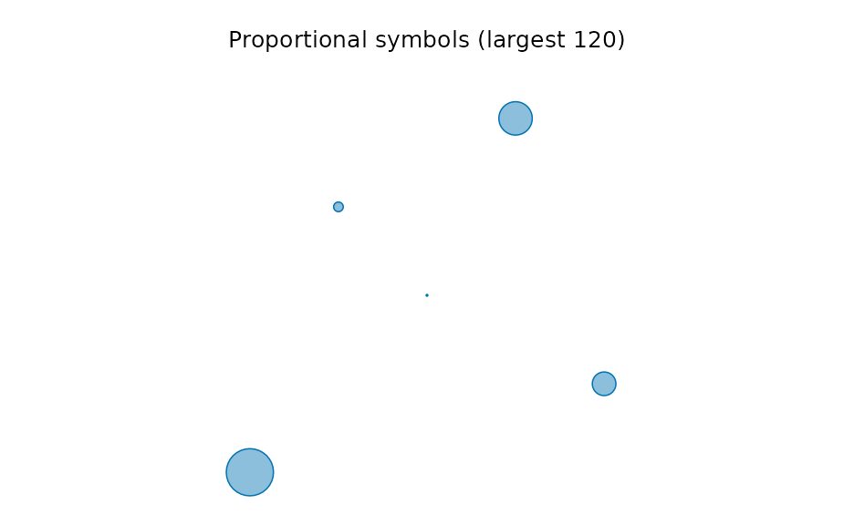

``` r

prpmap(cbind(x, y), v = c(120, 30, NA, 60, 10), rmax = 1)
```

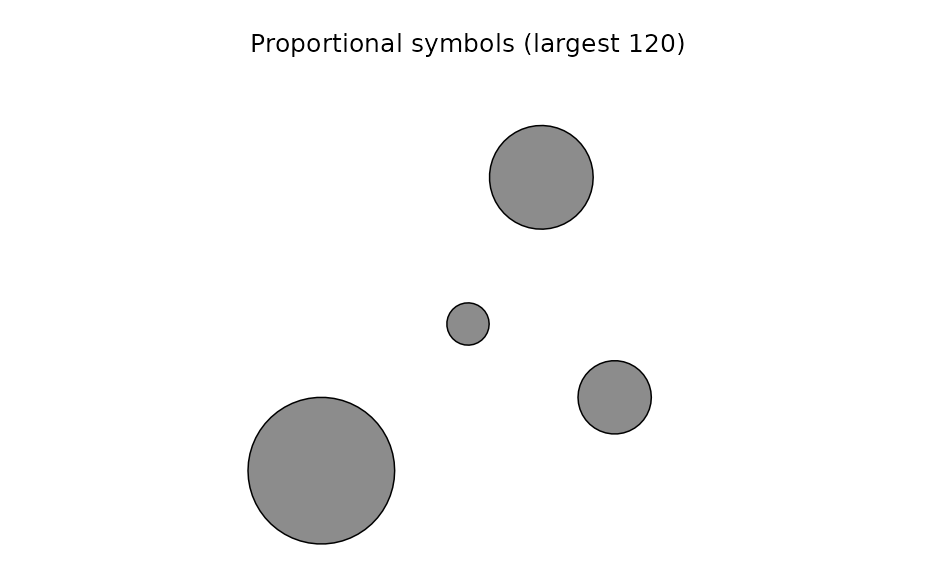

## Empirical orthogonal functions of a space-time matrix

[`eofst()`](https://rootcoder007.github.io/crimlab/reference/eofst.md):
[`eofst()`](https://rootcoder007.github.io/crimlab/reference/eofst.md)
decomposes a matrix of counts or rates, one row per period and one
column per place, into empirical orthogonal functions (EOFs): spatial
patterns (the columns of `eofs`) whose weights over time (the principal
component series, the columns of `pcs`) reproduce the centred matrix,
ordered by the share of its variance each explains. A leading pattern
that loads on a cluster of places, with a series that rises, is a hot
spot that grows; a second pattern of opposite signs is a shift of crime
from one set of places to another.

``` r

set.seed(3)
yr <- 1:10
z <- outer(yr, c(1, 1, 1, 0, 0, 0)) + matrix(rnorm(60), 10)
colnames(z) <- paste0("ward", 1:6)
e <- eofst(z)
e
#> eofst: 6 components of 10 periods by 6 places
#>  component   sdev explained cumulative
#>          1 5.8950  0.893300     0.8933
#>          2 1.4340  0.052830     0.9461
#>          3 1.0370  0.027640     0.9737
#>          4 0.7186  0.013270     0.9870
#>          5 0.6166  0.009773     0.9968
#>          6 0.3538  0.003218     1.0000
round(e$eofs[, 1], 2)
#> ward1 ward2 ward3 ward4 ward5 ward6 
#>  0.58  0.57  0.57 -0.05 -0.05  0.03
```

## Thin-plate spline surface

[`tpsurf()`](https://rootcoder007.github.io/crimlab/reference/tpsurf.md):
[`tpsurf()`](https://rootcoder007.github.io/crimlab/reference/tpsurf.md)
fits a thin-plate spline to values measured at points in the plane
(rates at area centroids, say) and evaluates it on a grid over their
box: a smooth surface that passes through the values when `lam` is 0 and
is smoothed towards a plane as `lam` grows. It complements
[`kdsurf()`](https://rootcoder007.github.io/crimlab/reference/kdsurf.md),
which smooths the points themselves rather than values at them.

``` r

set.seed(2)
x <- runif(40)
y <- runif(40)
s <- tpsurf(x, y, sin(4 * x) + y^2 + rnorm(40, sd = 0.05), lam = 0.001,
            nx = 30)
s
#> tpsurf: thin-plate spline of 40 points, lambda 0.001, residual sum of squares 0.002046; grid 30 x 30
plot(s)
```

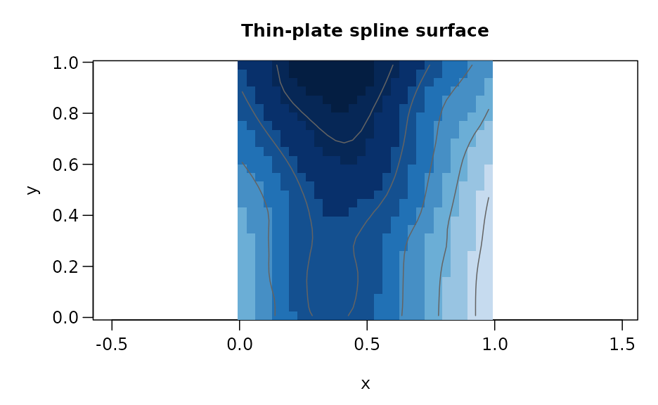

``` r

plot(s)
```


