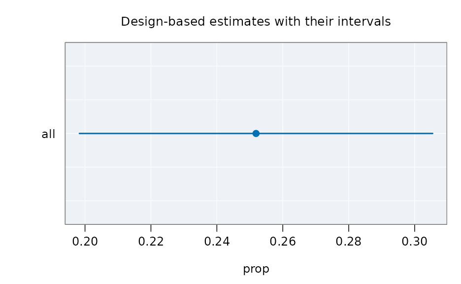

# Surveys and summary statistics

Survey estimates with their design, and the summary statistics the rest
of the package is built on.

Each section is one help page: what the function is for, the example of
its help page as it runs, and the plot of its result where the package
draws one. [`?name`](https://rdrr.io/r/base/name.html) gives the
arguments and the value in full.

## Surveys

### Design-based estimates from a complex survey

[`svymx()`](https://rootcoder007.github.io/crimlab/reference/svymx.md):
Means, totals, proportions, ratios and variances from a stratified,
clustered, weighted sample (a victimisation survey, say), with standard
errors by linearisation that respect the design, by domain and with the
differences between domains; and a description of the design.

``` r

set.seed(1)
d <- data.frame(region = rep(c("north", "south"), each = 60),
                block = rep(1:12, each = 10),
                victim = rbinom(120, 1, rep(c(0.2, 0.35), each = 60)),
                w = runif(120, 50, 150))
svymx(d$victim, d$w, d$region, d$block, stat = "prop")
#> svymx: prop, 120 respondents, 2 strata, 12 first-stage units
#>  dom       est         se        lo        hi      cv   n df
#>  all 0.2518814 0.02405017 0.1982943 0.3054685 9.54821 120 10
svymx(d$victim, d$w, d$region, d$block, stat = "prop", by = d$region)$cmp
#>     dom      diff         se     stat            p
#> 1 south 0.2234697 0.04419731 5.056184 0.0004947409
```

``` r

res <- svymx(d$victim, d$w, d$region, d$block, stat = "prop")
plot(res)
```



### Rao-Scott chi-square test for a survey table

[`rscchi()`](https://rootcoder007.github.io/crimlab/reference/rscchi.md):
The test of independence of two categorical variables in a two-way table
from a stratified, clustered and weighted sample (a victimisation or
justice survey, say), with Rao and Scott’s corrections for the design,
to go with the estimates of
[`svymx()`](https://rootcoder007.github.io/crimlab/reference/svymx.md)
and the tables of
[`ctabx()`](https://rootcoder007.github.io/crimlab/reference/ctabx.md).
Pearson’s statistic on such data is too large: the design makes the cell
proportions vary more than simple random sampling, and the corrections
divide it by the design effects.

``` r

set.seed(1)
d <- data.frame(region = rep(c("north", "south"), each = 60),
                block = rep(1:12, each = 10),
                age = sample(c("young", "middle", "old"), 120, TRUE),
                w = runif(120, 50, 150))
d$victim <- rbinom(120, 1, ifelse(d$age == "young", 0.35, 0.2))
rscchi(d$age, d$victim, d$w, d$region, d$block)
#> rscchi: 3 x 2 table, 120 respondents, 2 strata, 12 first-stage units
#>     test  stat   df1   df2       p
#>  pearson 5.539 2.000    NA 0.06271
#>      rs1 3.254 2.000    NA 0.19650
#>      rs2 3.134 1.926    NA 0.19750
#>        f 1.627 1.926 19.26 0.22264
```

## Summary statistics

### Mean, variance and correlation (C backend)

[`cmn()`](https://rootcoder007.github.io/crimlab/reference/cstat.md),
[`cvari()`](https://rootcoder007.github.io/crimlab/reference/cstat.md),
[`ccorr()`](https://rootcoder007.github.io/crimlab/reference/cstat.md):
[`cmn()`](https://rootcoder007.github.io/crimlab/reference/cstat.md),
[`cvari()`](https://rootcoder007.github.io/crimlab/reference/cstat.md)
and
[`ccorr()`](https://rootcoder007.github.io/crimlab/reference/cstat.md)
compute the mean, the sample variance and the Pearson correlation in
compiled code, the same kernels that crimlab’s other front ends (the
command line, Python and the bindings) call, so a result computed here
is the result they give. For everyday work
[`mean()`](https://rdrr.io/r/base/mean.html),
[`var()`](https://rdrr.io/r/stats/cor.html) and
[`cor()`](https://rdrr.io/r/stats/cor.html) give the same numbers.

``` r

cmn(1:10)
#> [1] 5.5
cmn(c(1, 2, NA))
#> [1] NA
cmn(c(1e308, 1e308))
#> [1] 1e+308
cvari(c(2, 4, 4, 4, 5, 5, 7, 9))
#> [1] 4.571429
all.equal(cvari(1:10), stats::var(1:10))
#> [1] TRUE
ccorr(1:10, (1:10)^2)
#> [1] 0.9745586
ccorr(1:10, 10:1)
#> [1] -1
try(cmn(c("1", "2")))
#> Error : cmn: `x` must be numbers (or TRUE and FALSE).
try(ccorr(1:3, 1:4))
#> Error : ccorr: `x` and `y` must have the same length.
```

### Standard deviation and Euclidean distance (C backend)

[`csdev()`](https://rootcoder007.github.io/crimlab/reference/cspread.md),
[`cdistm()`](https://rootcoder007.github.io/crimlab/reference/cspread.md):
[`csdev()`](https://rootcoder007.github.io/crimlab/reference/cspread.md)
returns the standard deviation of a numeric vector and
[`cdistm()`](https://rootcoder007.github.io/crimlab/reference/cspread.md)
the straight-line (Euclidean) distance between two vectors of the same
length.

``` r

csdev(c(2, 4, 4, 4, 5, 5, 7, 9))
#> [1] 2.13809
all.equal(csdev(1:10), stats::sd(1:10))
#> [1] TRUE
csdev(1:10, ddof = 0)
#> [1] 2.872281
csdev(c(3, NA, 5))
#> [1] NA
cdistm(c(0, 0), c(3, 4))
#> [1] 5
try(cdistm(1:3, 1:2))
#> Error : cdistm: `a` and `b` must have the same length.
```

### Normal density and log-density (C backend)

[`cnormpdf()`](https://rootcoder007.github.io/crimlab/reference/cnorm.md),
[`cnormlpdf()`](https://rootcoder007.github.io/crimlab/reference/cnorm.md):
[`cnormpdf()`](https://rootcoder007.github.io/crimlab/reference/cnorm.md)
evaluates the density of the normal distribution with a given mean and
standard deviation at each value of `x`;
[`cnormlpdf()`](https://rootcoder007.github.io/crimlab/reference/cnorm.md)
its logarithm, computed directly from the formula rather than as
`log(dnorm(x))`. Summing log-densities is how a normal model is scored,
and computing them directly keeps the sum finite far into the tails,
where the density itself underflows to zero.

``` r

cnormpdf(c(-1, 0, 1))
#> [1] 0.2419707 0.3989423 0.2419707
cnormpdf(c(0, 5, 10), mean = 5, sd = 2)
#> [1] 0.00876415 0.19947114 0.00876415
all.equal(cnormpdf(-2:2), stats::dnorm(-2:2))
#> [1] TRUE
stats::dnorm(50)
#> [1] 0
cnormlpdf(50)
#> [1] -1250.919
y <- c(4.8, 5.1, 5.6, 4.9, 5.3)
sum(cnormlpdf(y, mean = mean(y), sd = stats::sd(y)))
#> [1] -0.9121269
try(cnormpdf(0, sd = 0))
#> Error : cnormpdf: `sd` must be one positive finite number.
try(cnormlpdf(1, mean = c(0, 1)))
#> Error : cnormlpdf: `mean` must be one finite number.
```

### Mean, variance, skewness and kurtosis (C backend)

[`cmom()`](https://rootcoder007.github.io/crimlab/reference/cmom.md):
The four standard descriptive moments of a numeric vector in one call:
where it is centred, how spread out it is, whether it leans to one side
and how heavy its tails are.

``` r

cmom(c(2, 4, 4, 4, 5, 5, 7, 9))
#>      mean  variance  skewness  kurtosis 
#>  5.000000  4.571429  0.656250 -0.218750
m <- cmom(1:10)
all.equal(m[["variance"]], stats::var(1:10))
#> [1] TRUE
cmom(c(-2, -1, 0, 1, 2))[["skewness"]]
#> [1] 0
cmom(c(1, 2))
#>     mean variance skewness kurtosis 
#>      1.5      0.5      NaN      NaN
```

### Quantiles, median and robust spread (C backend)

[`cqnt()`](https://rootcoder007.github.io/crimlab/reference/crob.md),
[`cmed()`](https://rootcoder007.github.io/crimlab/reference/crob.md),
[`cmad()`](https://rootcoder007.github.io/crimlab/reference/crob.md),
[`ciqr()`](https://rootcoder007.github.io/crimlab/reference/crob.md) and
others:
[`cqnt()`](https://rootcoder007.github.io/crimlab/reference/crob.md) is
the type-7 quantile, R’s default, so it agrees with
`stats::quantile(x, probs)`.
[`cmed()`](https://rootcoder007.github.io/crimlab/reference/crob.md) is
the 50% point.
[`cmad()`](https://rootcoder007.github.io/crimlab/reference/crob.md) is
the median absolute deviation scaled by `const` so that it estimates the
standard deviation of a normal sample.
[`ciqr()`](https://rootcoder007.github.io/crimlab/reference/crob.md) is
the interquartile range and
[`ctkyfnc()`](https://rootcoder007.github.io/crimlab/reference/crob.md)
the outlier fences drawn `k` IQRs beyond the quartiles. A single
corrupted row can move a mean or a variance arbitrarily far, but moves a
median or a MAD hardly at all, which is what is wanted when screening a
column of a released table for values to inspect by hand.

``` r

x <- c(2, 4, 4, 4, 5, 5, 7, 9)
cqnt(x, c(0.25, 0.5, 0.75))
#> 25% 50% 75% 
#> 4.0 4.5 5.5
cmed(x)
#> [1] 4.5
cmad(x)
#> [1] 0.7413
all.equal(cmad(x), stats::mad(x))
#> [1] TRUE
ciqr(x)
#> [1] 1.5
ctkyfnc(x)
#> lower upper 
#>  1.75  7.75
wild <- c(x, 1000)
f <- ctkyfnc(wild)
wild[wild < f[["lower"]] | wild > f[["upper"]]]
#> [1] 1000
cmed(c(1, NA, 3))
#> [1] NaN
try(cqnt(x, 1.5))
#> Error : cqnt: `probs` must lie in [0, 1].
```

### Trimmed and winsorized means (C backend)

[`ctrmmean()`](https://rootcoder007.github.io/crimlab/reference/ctrm.md),
[`cwinsmean()`](https://rootcoder007.github.io/crimlab/reference/ctrm.md):
Two ways to stop a handful of extreme rows dominating a column’s centre.
[`ctrmmean()`](https://rootcoder007.github.io/crimlab/reference/ctrm.md)
DISCARDS the `floor(n * trim)` largest and smallest values, as
`mean(x, trim = )` does.
[`cwinsmean()`](https://rootcoder007.github.io/crimlab/reference/ctrm.md)
instead PULLS THEM IN to the most extreme surviving values, so every
observation still counts, usually the better choice when the extremes
are real measurements rather than errors.

``` r

x <- c(1, 2, 3, 4, 5, 6, 7, 8, 9, 100)
mean(x)
#> [1] 14.5
ctrmmean(x, 0.1)
#> [1] 5.5
cwinsmean(x, 0.1)
#> [1] 5.5
all.equal(ctrmmean(x, 0.2), mean(x, trim = 0.2))
#> [1] TRUE
all.equal(ctrmmean(x, 0.5), cmed(x))
#> [1] TRUE
try(cwinsmean(x, 0.7))
#> Error : cwinsmean: `trim` must be one number from 0 to 0.5.
```

### Weighted mean and variance (C backend)

[`cwtd()`](https://rootcoder007.github.io/crimlab/reference/cwtd.md):
The weighted mean and variance of a numeric vector, for data where some
observations count for more than others: an average over areas weighted
by population, or measurements weighted by their precision.

``` r

x <- c(10, 20, 30, 40)
w <- c(1, 1, 2, 4)
cwtd(x, w)
#>     mean variance 
#>  31.2500 169.0476
all.equal(cwtd(x, w)[["mean"]], stats::weighted.mean(x, w))
#> [1] TRUE
all.equal(cwtd(x, rep(1, 4))[["variance"]], stats::var(x))
#> [1] TRUE
try(cwtd(x, c(1, -1, 1, 1)))
#> Error : cwtd: `w` must be non-negative and finite, not all zero.
```

### Rank correlation and midranks (C backend)

[`cspr()`](https://rootcoder007.github.io/crimlab/reference/crank.md),
[`cmidrk()`](https://rootcoder007.github.io/crimlab/reference/crank.md):
[`cspr()`](https://rootcoder007.github.io/crimlab/reference/crank.md) is
Spearman’s rho, the Pearson correlation of the ranks: it measures
monotone association and is unaffected by any order-preserving
transformation of either variable.
[`cmidrk()`](https://rootcoder007.github.io/crimlab/reference/crank.md)
gives the ranks themselves; tied values share the average of the ranks
they span, which is what makes the result agree with
[`stats::cor()`](https://rdrr.io/r/stats/cor.html) on tied data.

``` r

x <- c(1, 2, 3, 4, 5)
y <- c(2, 4, 9, 16, 25)
cspr(x, y)
#> [1] 1
ccorr(x, y)
#> [1] 0.9737247
xt <- c(1, 2, 2, 2, 5, 5, 7)
yt <- c(3, 1, 1, 4, 4, 9, 2)
all.equal(cspr(xt, yt), stats::cor(xt, yt, method = "spearman"))
#> [1] TRUE
cmidrk(xt)
#> [1] 1.0 3.0 3.0 3.0 5.5 5.5 7.0
cmidrk(c(3, NA, 1, 3))
#> [1] 2.5  NA 1.0 2.5
try(cspr(1:3, 1:4))
#> Error : cspr: `x` and `y` must have the same length.
```

### Covariance matrix (C backend)

[`ccovm()`](https://rootcoder007.github.io/crimlab/reference/ccovm.md):
The covariance of every pair of columns of a numeric matrix or data
frame. Column names are carried to both dimensions of the result.

``` r

X <- cbind(a = c(1, 2, 3, 4), b = c(2, 4, 7, 8), c = c(5, 3, 2, 1))
ccovm(X)
#>           a         b         c
#> a  1.666667  3.500000 -2.166667
#> b  3.500000  7.583333 -4.583333
#> c -2.166667 -4.583333  2.916667
all.equal(ccovm(X), stats::cov(X))
#> [1] TRUE
ccovm(data.frame(u = 1:5, v = c(2, 1, 4, 3, 6)))
#>     u   v
#> u 2.5 2.5
#> v 2.5 3.7
try(ccovm(1:5))
#> Error : ccovm: `x` must be a numeric matrix or data frame.
```

### Bootstrap replicate means (C backend)

[`cbootmean()`](https://rootcoder007.github.io/crimlab/reference/cbootmean.md):
`B` resamples of `x`, drawn with replacement and each the length of `x`,
with the mean of each. The spread of these replicate means estimates the
standard error of the sample mean, and their quantiles give a percentile
interval, without assuming the data are normal (Efron and Tibshirani,
1993). The draws come from the core’s own 64-bit Mersenne Twister seeded
by `seed`, not from R’s generator, so a seed gives the same replicates
in every front end and on every platform, and R’s random stream is left
untouched.

``` r

set.seed(1)
x <- stats::rnorm(50, mean = 5)
reps <- cbootmean(x, B = 500, seed = 7)
c(sample = mean(x), bootstrap = mean(reps))
#>    sample bootstrap 
#>  5.100448  5.097066
stats::quantile(reps, c(0.025, 0.975))
#>     2.5%    97.5% 
#> 4.864298 5.311439
identical(cbootmean(x, 10, seed = 1), cbootmean(x, 100, seed = 1)[1:10])
#> [1] TRUE
try(cbootmean(x, B = 0))
#> Error : cbootmean: `B` must be one whole number from 1.
```

### Trimmed inverse-probability weights (C backend)

[`cipw()`](https://rootcoder007.github.io/crimlab/reference/cipw.md):
The inverse-probability-of-treatment weights 1/e for the treated and
1/(1-e) for the untreated, with the propensity score clamped into
\[trimlo, trimhi\] first: an untrimmed score near 0 or 1 gives one
observation a weight large enough to dominate the estimate. The weights
reweight a treated and an untreated group so that each resembles the
whole sample on the covariates behind the propensity score (Rosenbaum
and Rubin, 1983).

``` r

cipw(c(1, 0, 1, 0), c(0.5, 0.25, 0.02, 0.9))
#> [1]  2.000000  1.333333 50.000000 10.000000
cipw(c(1, 0, 1, 0), c(0.5, 0.25, 0.02, 0.9), trimlo = 0.1)
#> [1]  2.000000  1.333333 10.000000 10.000000
cipw(c(TRUE, FALSE), c(0.4, 0.4))
#> [1] 2.500000 1.666667
try(cipw(c(1, 2), c(0.5, 0.5)))
#> Error : cipw: `treat` must be coded 0/1.
```

### Regularized incomplete gamma function (C backend)

[`cgamcdf()`](https://rootcoder007.github.io/crimlab/reference/cgamcdf.md):
The lower regularized incomplete gamma function P(a, x), the
distribution function of a gamma distribution with shape `a` and unit
rate; the p-value of a chi-square statistic q on k degrees of freedom is
1 - P(k/2, q/2).

``` r

cgamcdf(3.5, c(0.5, 1, 4, 12))
#> [1] 0.005171463 0.040159631 0.667406097 0.998860649
all.equal(cgamcdf(3.5, c(0.5, 1, 4, 12)),
          stats::pgamma(c(0.5, 1, 4, 12), shape = 3.5))
#> [1] TRUE
1 - cgamcdf(2 / 2, 5.99 / 2)
#> [1] 0.05003663
try(cgamcdf(0, 1))
#> Error : cgamcdf: `shape` must be one positive number.
```

### Reproducible uniforms (splitmix64)

[`cunif()`](https://rootcoder007.github.io/crimlab/reference/cunif.md):
Returns `n` pseudo-random numbers on \[0, 1) from a 64-bit seed with the
splitmix64 generator. The stream depends only on `seed`, and any program
that implements splitmix64 (Python, Go, a spreadsheet macro) computes
the same numbers, so a subsample or a jitter drawn in one language can
be reproduced exactly in another.

``` r

cunif(3, 42)
#> [1] 0.7415649 0.1599104 0.2786011
all.equal(cunif(3, 7), cunif(10, 7)[1:3])
#> [1] TRUE
set.seed(1)
a <- runif(1)
set.seed(1)
invisible(cunif(100, 9))
b <- runif(1)
identical(a, b)
#> [1] TRUE
try(cunif(-1, 1))
#> Error : cunif: `n` must be one whole number from 0.
try(cunif(2, 2^53))
#> Error : cunif: `seed` must be one whole number from 0, below 2^53.
```
