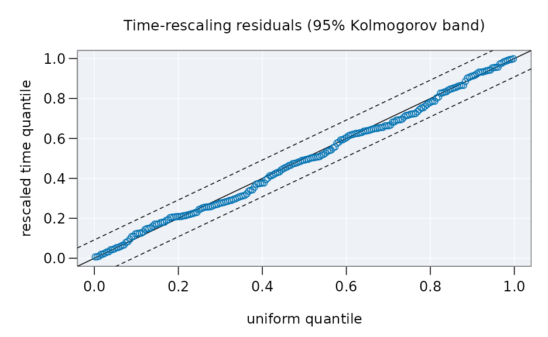
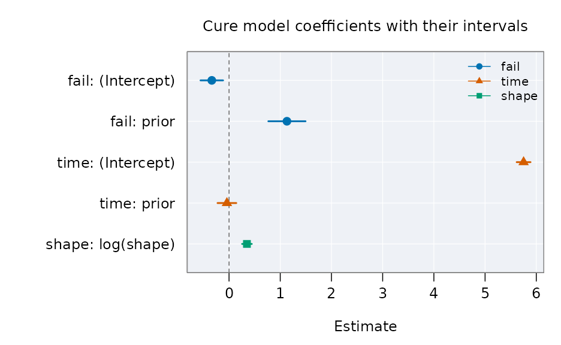
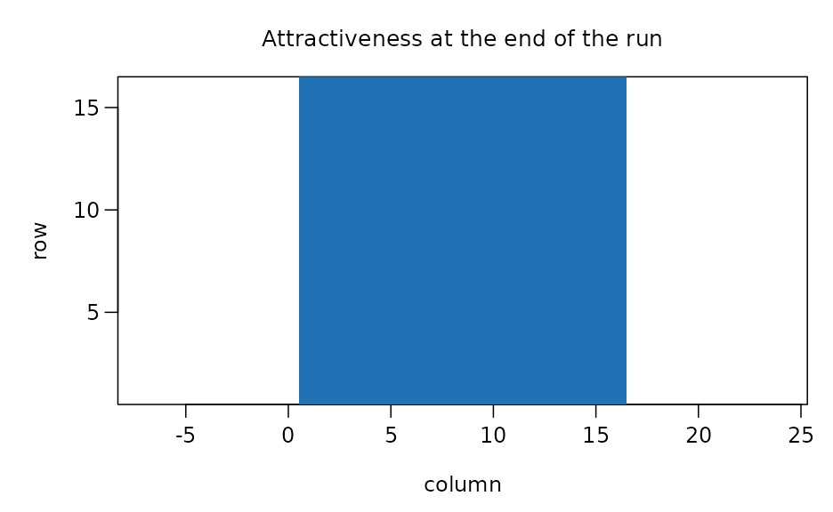

# Events in time: contagion, trends and operations

Self-exciting processes, trends, change points, survival, forecasts and
the other methods for events in time.

Each section is one help page: what the function is for, the example of
its help page as it runs, and the plot of its result where the package
draws one. [`?name`](https://rdrr.io/r/base/name.html) gives the
arguments and the value in full.

## Time, contagion and operations

### Hawkes process: self-exciting event times

[`hwkfit()`](https://rootcoder007.github.io/crimlab/reference/hwkfit.md):
Fits a self-exciting (Hawkes) point process to event times, such as the
times of shootings, burglaries or calls for service, by maximum
likelihood: a background rate and, on top of it, a rise in the rate
after each event that dies away with the time since. The fitted
branching ratio `eta` is the expected number of events each event
triggers; it says how much of the record is contagion rather than
background.

``` r

x <- hwksim(c(a0 = log(0.5), eta = 0.5, beta = 2), 200, seed = 1)
fit <- hwkfit(x$t, 200)
fit
#> hwkfit: 219 events in [0, 200]; exp kernel, const baseline
#>             est         se
#> a0   -0.3948088 0.13638108
#> eta   0.3874376 0.07837729
#> beta  2.4507950 0.80140193
#> branching ratio 0.3874376, mean cluster size 1.632487; log-likelihood -177.8257, AIC 361.6514
hwkfit(x$t, 200, kernel = c("exp", "lomax"))$cmp
#>   kernel  base    loglik k      aic      bic       eta conv
#> 1    exp const -177.8257 3 361.6514 371.8186 0.3874376 TRUE
#> 2  lomax const -177.8102 4 363.6204 377.1767 0.3948362 TRUE
```

### Hawkes process: time-rescaling residuals

[`hwkres()`](https://rootcoder007.github.io/crimlab/reference/hwkres.md):
Transforms event times by the compensator of a Hawkes process, Lambda(t)
= *0^t lambda: under the model the gaps tau_i = Lambda(t_i) -
Lambda(t*{i-1}) (with t_0 = 0) are independent standard exponentials, so
`u = 1 - exp(-tau)` are uniform on \[0, 1\]. The Kolmogorov-Smirnov test
compares `u` with the uniform, with R’s exact p-value below 100 events
without ties and the limiting distribution otherwise, as
[`stats::ks.test()`](https://rdrr.io/r/stats/ks.test.html) does.
[`plot()`](https://rdrr.io/r/graphics/plot.default.html) draws the
uniform quantile plot with the test’s 95% band.

``` r

x <- hwksim(c(a0 = log(0.5), eta = 0.5, beta = 2), 200, seed = 1)
r <- hwkres(hwkfit(x$t, 200))
r
#> hwkres: 219 rescaled gaps, mean 0.9965042 (1 under the model)
#> Kolmogorov-Smirnov D 0.04543387, p 0.7566163
plot(r)
```


``` r

plot(r)
```



### Hawkes process: simulation

[`hwksim()`](https://rootcoder007.github.io/crimlab/reference/hwksim.md):
Simulates a Hawkes process on \[0, hor\] by its branching construction
(Hawkes and Oakes 1974): background events from the baseline (by
thinning for the `"cycle"` baseline), and from each event a Poisson
number, mean `eta`, of offspring at lags drawn from the kernel, and so
on over the generations. With `win` the process is in space and time:
background events fall uniformly in the rectangle, the baseline is then
per unit area, and each offspring lands at a normal offset (standard
deviation `sigma`) from its parent; offspring outside the window or past
`hor` are not recorded and have no offspring of their own.

``` r

hwksim(c(a0 = log(0.2), eta = 0.6, beta = 1), 50, seed = 2)
#>           t gen
#> 1  3.779322   0
#> 2  5.409217   0
#> 3  5.830663   1
#> 4 19.823215   0
#> 5 41.169353   0
#> 6 43.814177   0
#> 7 47.958169   0
hwksim(c(a0 = log(0.01), eta = 0.5, beta = 1), 50,
       win = c(0, 10, 0, 10), sigma = 0.5, seed = 2)
#>             t         x          y gen
#> 1   0.7558644 2.7817962 9.44022175   0
#> 2   5.0250919 4.1078544 5.63426436   0
#> 3   5.6439173 7.9226136 8.71437679   0
#> 4   5.8455903 4.3860809 2.51810339   0
#> 5   6.2600360 2.5425145 3.53493812   0
#> 6   6.2795482 3.8141362 3.00022453   1
#> 7   6.6432253 5.2072984 6.15998044   0
#> 8   6.7455495 3.2657857 2.31626277   2
#> 9   6.8278771 2.4776334 3.29482576   1
#> 10  6.9425536 5.5879856 6.95949979   1
#> 11  6.9822829 6.0630669 6.86957430   2
#> 12  7.1181333 5.2380366 6.99909144   2
#> 13  7.3132013 2.1007573 3.96759684   2
#> 14  7.5838953 6.0267515 6.38383203   3
#> 15  7.6171488 0.2010294 7.68373046   0
#> 16  7.8070600 2.3098969 3.22328722   2
#> 17  7.9725648 4.3991280 8.65889161   0
#> 18  8.4336242 2.4998831 1.23978171   0
#> 19  8.7651830 3.0451196 1.92151322   0
#> 20  9.5973703 3.0282385 2.08734045   1
#> 21  9.9788630 2.7943792 1.72271002   2
#> 22 10.2815589 2.3280140 2.00603858   1
#> 23 10.5906681 9.8982000 6.65449348   0
#> 24 13.2249343 4.8022337 6.35120197   0
#> 25 13.7762147 9.3813953 9.86344192   0
#> 26 16.4964749 7.4380201 3.08627689   0
#> 27 19.4665738 3.6378755 1.11373616   0
#> 28 21.4640228 0.1711280 9.44328030   0
#> 29 21.7501895 1.7312635 2.79493744   0
#> 30 23.3361286 5.8550391 2.04369776   0
#> 31 23.3930484 3.6732670 2.49637951   0
#> 32 23.3997964 3.0788325 2.26006603   1
#> 33 24.8991851 6.2916273 4.93009234   0
#> 34 25.7717035 6.0225505 0.87353454   0
#> 35 26.2174343 5.3501118 0.04506395   1
#> 36 27.1796741 2.8546811 7.53480398   0
#> 37 27.2687672 3.1381133 7.94929237   1
#> 38 27.5287415 5.4643075 2.53895429   0
#> 39 27.8868844 3.5697834 7.94786103   2
#> 40 28.0487951 0.7400589 9.82128435   0
#> 41 28.1332378 0.8370355 9.73453659   1
#> 42 28.1346901 3.2400848 7.69178375   2
#> 43 28.4063694 3.3726705 6.98303480   2
#> 44 28.4593287 2.4103222 7.10749793   1
#> 45 28.5613906 4.8372020 5.57398610   0
#> 46 29.2513541 5.3811953 4.92634279   0
#> 47 29.3118715 2.1577357 6.90245744   2
#> 48 29.7729072 8.9359034 6.66480829   0
#> 49 29.8214111 0.4276242 0.46665971   0
#> 50 30.0611117 7.8460784 3.66011738   0
#> 51 30.2281297 9.2622706 6.80716938   1
#> 52 30.8340483 0.5566726 0.24743524   1
#> 53 30.8766715 0.8165569 0.40163501   2
#> 54 31.2352188 5.7934013 8.17072591   0
#> 55 31.2354094 9.7051802 6.81376968   0
#> 56 31.3940936 1.2732222 0.60715997   3
#> 57 31.4649534 5.6895603 8.03720520   1
#> 58 31.5320979 1.7367810 3.56895007   0
#> 59 31.8004552 3.7444842 3.14122021   0
#> 60 32.1840270 3.6770851 3.23390385   1
#> 61 32.2146054 3.4482675 2.74369493   2
#> 62 32.9851182 9.8808796 7.55774944   0
#> 63 34.7650142 7.9132115 1.54451736   0
#> 64 36.1191620 0.3849985 2.14207087   0
#> 65 37.2177942 3.9058574 8.06508471   0
#> 66 37.3812730 7.2581543 8.14312801   0
#> 67 37.9381993 8.0282612 7.85203250   1
#> 68 40.5743322 8.4680500 9.83591484   0
#> 69 41.6675908 0.7652759 0.62137742   0
#> 70 42.9158813 5.7905562 6.62290269   0
#> 71 44.0135007 2.8361013 3.24418025   0
#> 72 44.7267301 5.8962074 4.27983436   0
#> 73 45.1094756 8.9836127 8.42937211   0
#> 74 45.5569744 9.3018814 4.29741470   0
#> 75 46.1837316 3.1484411 3.34648292   0
#> 76 46.2307686 4.0845319 3.52856534   1
#> 77 46.3697213 5.7224492 8.52444086   0
#> 78 46.4604868 6.1189641 8.06749945   1
#> 79 46.7984921 5.5727714 8.62358994   1
#> 80 46.9345880 8.8856033 8.02889160   0
#> 81 47.4210017 3.5381063 4.88175888   0
#> 82 47.8285310 5.3805381 8.57126602   2
#> 83 48.2430301 4.2879965 5.08231324   0
#> 84 48.3392036 5.5440290 3.58823525   1
#> 85 48.6693339 3.5373848 5.51006011   0
#> 86 49.3792075 2.4273647 6.14111389   0
#> 87 49.3883882 6.0146442 3.40040331   2
```

### Trend in a series: rate ratio, Mann-Kendall and Theil-Sen

[`trndrr()`](https://rootcoder007.github.io/crimlab/reference/trndrr.md):
Measures the trend in a short series of counts (admissions, incidents or
placements per year) three ways. The Poisson log-linear model mu_t =
b_0 + b_1 (x_t - x) + e_t gives the rate ratio per unit of `x`,
`exp(b1)` (0.85: a fall of 15% a period), with the exposure `expo` as
offset so that the trend is in the rate; when the Pearson dispersion
(over `n - 2`) is above 1.5 the interval and p-value are the
quasi-Poisson ones (standard error times the square root of the
dispersion, the t distribution on `n - 2` degrees of freedom). The fit
takes the steps of [`stats::glm()`](https://rdrr.io/r/stats/glm.html).
Mann-Kendall’s rank test and the Theil-Sen slope (the median of the
pairwise slopes, with Sen’s distribution-free interval) make no
distributional assumption; the p-value is exact over every ordering of
the observed values up to 8 periods (ties kept) and normal with the tie
and continuity corrections beyond. Negating the series negates S, so
rises and falls are treated alike (`proof("trndrr")`). `yoy` holds the
change on the period before, and with `seas` the totals by season are
tested for equality (chi-square). Given the counts of one cycle with
each season once (incidents by month of the year, by day of the week or
by hour of the day), that test is the one that the counts are spread
evenly over the cycle, as `chisq.test(y)`.

``` r

y <- c(402, 377, 390, 368, 331, 310, 305)
trndrr(y, 2017:2023)
#> trndrr: 7 periods
#> rate ratio per period 0.9523448 (95% 0.9337437 to 0.9713165), p 1.223921e-06
#> Mann-Kendall S -19, p 0.002777778; Theil-Sen slope -17.75
# a rate: counts over a growing population
trndrr(c(20, 25, 30, 33), expo = c(1000, 1500, 2500, 2600))$rr
#>          rr        lo       hi          p          b         se      disp  over
#> 1 0.8494552 0.7109716 1.014913 0.07234571 -0.1631601 0.09079901 0.4268193 FALSE
# equal totals by quarter?
trndrr(c(5, 9, 7, 4, 6, 10, 8, 5), seas = rep(1:4, 2))$seas
#> $tab
#>   season  n expd
#> 1      1 11 13.5
#> 2      2 19 13.5
#> 3      3 15 13.5
#> 4      4  9 13.5
#> 
#> $stat
#> [1] 4.37037
#> 
#> $df
#> [1] 3
#> 
#> $p
#> [1] 0.2241485
```

### Change point: a step in a series and Pettitt’s test

[`stpcp()`](https://rootcoder007.github.io/crimlab/reference/stpcp.md):
Asks whether a series moved to a new level, and where. The step scan
takes every split after period `k` with at least `minseg` periods on
each side, and the largest between-segment sum of squares T_k = k (n -
k) / n (y_a - y_b)^2; its p-value comes from the same maximum over
reorderings of the series (every ordering when n! is at most `nperm`,
giving an exact p-value; otherwise `nperm` random ones, (1 + \#{T\* \>=
T}) / (1 + nperm)), so it is a test of a step anywhere, not of the best
split alone. Pettitt’s rank test takes the split with the largest
\|U_t\|, U_t = sum\_{i \<= t \< j} sign(y_j - y_i), with its approximate
p-value 2 (-6 K^2 / (n^3 + n^2)). Both assume exchangeable periods under
no change: a steady trend can read as a step.

``` r

stpcp(c(100, 104, 98, 60, 63, 58), x = 2018:2023)
#> stpcp: 6 periods; step p-value exact over 720 orderings
#>     test k   before    after     stat         p   at
#>     step 3 100.6667 60.33333 2440.167 0.1000000 2020
#>  pettitt 3 100.6667 60.33333    9.000 0.2907114 2020
stpcp(c(100, 104, 98, 101, 97, 60, 63, 58, 61, 59), nperm = 999, seed = 1)
#> stpcp: 10 periods; step p-value from 999 orderings
#>     test k before after   stat         p
#>     step 5    100  60.2 3960.1 0.0100000
#>  pettitt 5    100  60.2   25.0 0.0661425
```

### CUSUM surveillance of counts

[`cusrv()`](https://rootcoder007.github.io/crimlab/reference/cusrv.md):
Watches a series of counts for a rise above what is expected: the
cumulative sum s_t = (0, s\_{t-1} + z_t - k) of the standardised excess
z_t raises an alarm where s_t \>= h. The expected counts are given
(`expd`), or are the mean of the counts before `start`, the first period
watched. `z` is `(y - m) / sqrt(m)` (`"std"`), Rossi’s transform (y - 3
m + 2 sqrt(y m)) / (2 sqrt(m)) (`"rossi"`), Anscombe’s
`1.5 (y^(2/3) - m^(2/3)) / m^(1/6)` (`"anscombe"`) or the count itself
(`"none"`, for `k` and `h` on the count scale). With `reset` the sum
starts again from 0 after an alarm.

``` r

y <- c(10, 12, 9, 11, 10, 13, 19, 22, 25, 12)
cusrv(y, start = 6)
#>    i  y expd         z        s alarm
#> 1  6 13 10.4 0.8062258 0.000000 FALSE
#> 2  7 19 10.4 2.6667468 1.626747 FALSE
#> 3  8 22 10.4 3.5970073 4.183754  TRUE
#> 4  9 25 10.4 4.5272678 7.671022  TRUE
#> 5 10 12 10.4 0.4961389 7.127161  TRUE
cusrv(y, expd = rep(11, 10), trans = "rossi", reset = TRUE)
#>     i  y expd          z        s alarm
#> 1   1 10   11 -0.3051028 0.000000 FALSE
#> 2   2 12   11  0.2982325 0.000000 FALSE
#> 3   3  9   11 -0.6181361 0.000000 FALSE
#> 4   4 11   11  0.0000000 0.000000 FALSE
#> 5   5 10   11 -0.3051028 0.000000 FALSE
#> 6   6 13   11  0.5904378 0.000000 FALSE
#> 7   7 19   11  2.2483195 1.208320 FALSE
#> 8   8 22   11  3.0321034 3.200423  TRUE
#> 9   9 25   11  3.7939546 2.753955  TRUE
#> 10 10 12   11  0.2982325 0.000000 FALSE
```

### Correlation of two series, at lags

[`xcser()`](https://rootcoder007.github.io/crimlab/reference/xcser.md):
Correlates two series period by period: Pearson’s r with Fisher’s
interval and the t-test p-value of
[`stats::cor.test()`](https://rdrr.io/r/stats/cor.test.html), and the
cross-correlations at lags -K..K as
[`stats::ccf()`](https://rdrr.io/r/stats/acf.html) estimates them (lag
`k` is the correlation of `x[t + k]` with `y[t]`; the default `K` is
[`ccf()`](https://rdrr.io/r/stats/acf.html)’s, floor(10 log10(n / 2))).
Two named series are matched by name (the periods both have, in the
order of `x`), so counts from two sources for the same years line up
whatever years each covers. With `dif` the changes from one period to
the next are correlated instead of the levels: two series that both
trend correlate in level whether or not they move together. Every
correlation lies in \[-1, 1\] (Cauchy-Schwarz, `proof("xcser")`).

``` r

a <- c("2019" = 120, "2020" = 98, "2021" = 105, "2022" = 130, "2023" = 141)
b <- c("2018" = 50, "2019" = 61, "2020" = 44, "2021" = 52, "2022" = 66,
       "2023" = 70)
xcser(a, b)
#> xcser: 5 periods; r 0.9840288 (95% 0.7719537 to 0.9989935), p 0.002417117
#>  lag          r
#>   -3 -0.3061542
#>   -2 -0.4281115
#>   -1  0.1949278
#>    0  0.9840288
#>    1  0.3245041
#>    2 -0.4603044
#>    3 -0.3987087
xcser(a, b, dif = TRUE)$cor
#>           r        lo        hi          p n
#> 1 0.9734683 0.1922192 0.9994666 0.02653166 4
```

### Kaplan-Meier survival and recurrence

[`kmrec()`](https://rootcoder007.github.io/crimlab/reference/kmrec.md):
Estimates the share still without an event at each time since the start
(release, placement, a case opening, the last incident at a place) by
Kaplan-Meier, by group, with Greenwood’s standard error and the
log-scale interval of
[`survival::survfit()`](https://rdrr.io/pkg/survival/man/survfit.html)
(its default), each group’s median (where the curve sits at exactly 1/2,
halfway to its next fall, as `survfit()` does), and the log-rank test
between groups
([`survival::survdiff()`](https://rdrr.io/pkg/survival/man/survdiff.html)).
Each product step is a factor in \[0, 1\], so the curve starts at most 1
and never rises (`proof("kmrec")`).

``` r

kmrec(c(3, 8, 8, 12, 20, 24), event = c(1, 1, 0, 1, 0, 1),
      grp = c("a", "a", "a", "b", "b", "b"))
#> kmrec: 6 durations
#>  grp n events median
#>    a 3      2      8
#>    b 3      2     24
#> log-rank chi-square 2.469388 on 1 df, p 0.1160831
# repeat incidents at three places, watched to day 100
kmrec(c(2, 9, 30, 5, 70, 11, 12, 13),
      unit = rep(c("p", "q", "r"), c(3, 2, 3)), end = 100)$med
#>   grp n events median
#> 1 all 8      5     43
```

### Split-population (cure) model of recidivism

[`spcure()`](https://rootcoder007.github.io/crimlab/reference/spcure.md):
Asks two questions that an ordinary survival model runs together: what
share of people released will ever be reconvicted, and how soon those
who are reconvicted fail. A Kaplan-Meier curve of time to reconviction
levels off well above 0: many released people never fail, however long
they are followed. Schmidt and Witte (1989) model this with a split
population: each person would eventually fail with chance delta = 1 /
(1 + exp(-x’gamma)) (the `"fail"` part), and the time to failure of
those who would fail follows a distribution with scale exp(x’beta) (the
`"time"` part): a Weibull with a common shape, an exponential, or a
lognormal (log time normal with mean x’beta and a common standard
deviation `sigma`). A person followed to time `t` without failing
contributes 1 - delta + delta S(t), one who failed at `t` contributes
delta f(t). The parameters are estimated by maximum likelihood
(quasi-Newton steps with the analytic gradient) with standard errors
from the inverse of the Hessian.

``` r

set.seed(10)
n <- 600
prior <- rbinom(n, 1, 0.4)
fail <- rbinom(n, 1, plogis(-0.5 + 1.2 * prior))
tt <- ifelse(fail == 1, rweibull(n, 1.3, 300), Inf)
cens <- runif(n, 365, 1500)
r <- spcure(pmin(tt, cens), as.numeric(tt <= cens), data.frame(prior))
r
#> spcure: 600 people, weibull times; share who would ever fail 0.5268; log-likelihood -2343.2
#>   part        term        est         se         lo         hi          z            p
#>   fail (Intercept) -0.3366152 0.11268803 -0.5574797 -0.1157507 -2.9871424 2.815985e-03
#>   fail       prior  1.1306239 0.18545011  0.7671484  1.4940995  6.0966475 1.083160e-09
#>   time (Intercept)  5.7522378 0.06907445  5.6168543  5.8876212 83.2759080 0.000000e+00
#>   time       prior -0.0414838 0.09364132 -0.2250174  0.1420498 -0.4430074 6.577604e-01
#>  shape  log(shape)  0.3494171 0.04854205  0.2542765  0.4445578  7.1982364 6.099631e-13
```

``` r

plot(r)
```



### Hypercube queue of patrol units

[`hypq()`](https://rootcoder007.github.io/crimlab/reference/hypq.md):
Larson’s hypercube model of patrol cars: calls arrive from each atom
(beat, reporting area) at rate `lam` and go to the first free unit in
the atom’s order of preference; each unit serves at rate `mu`. The state
is the set of busy units, 2^n states for `n` units, and the stationary
distribution is found exactly. From it come each unit’s workload (the
share of time busy), the share of calls each unit answers from each
atom, the probability that every unit is busy (a lost call, or with
`queue = "wait"` a call that waits; Larson’s infinite-line model, the
queue lumped into the all-busy state), the mean queue and wait, and with
travel times the mean response travel time. Whatever the orders, the
number of busy units follows Erlang’s loss or delay system. The noisy-OR
chance that patrols detect an event is
[`nordet()`](https://rootcoder007.github.io/crimlab/reference/nordet.md).

``` r

pref <- rbind(c(1, 2, 3), c(2, 1, 3), c(3, 2, 1), c(3, 1, 2))
tt <- matrix(c(2, 5, 8, 6, 3, 7, 9, 6, 2, 7, 8, 3), 3)
hypq(c(0.4, 0.7, 0.3, 0.6), pref, mu = 1.5, tt = tt)
#> hypq: 3 units, rho 0.4444444; P(all busy) 0.109215
#> workloads: 0.3722186 0.4025169 0.4129779
#> mean travel time 3.944009
```

### Square-root law of response distance

[`sqrtlw()`](https://rootcoder007.github.io/crimlab/reference/sqrtlw.md):
Kolesar and Blum’s square-root law: with available units spread like a
random (Poisson) pattern over a region of area `area`, the mean distance
from a call to the nearest available unit is c sqrt{A / (u (1 - b))} for
`units` u of which a share `busy` b is busy; c = 1/2 in straight lines
and sqrt{2 pi} / 4 on a rectangular street grid. Quadrupling the units
halves the distance and scaling area and units together leaves it
unchanged (`proof("sqrtlw")`). The busy share can come from
[`hypq()`](https://rootcoder007.github.io/crimlab/reference/hypq.md)’s
workloads.

``` r

sqrtlw(100, 4)
#> $dist
#> [1] 2.5
#> 
#> $const
#> [1] 0.5
#> 
#> $avail
#> [1] 4
#> 
#> $time
#> [1] NA
sqrtlw(100, 8, busy = 0.3, metric = "grid", speed = 0.5)
#> $dist
#> [1] 2.648109
#> 
#> $const
#> [1] 0.6266571
#> 
#> $avail
#> [1] 5.6
#> 
#> $time
#> [1] 5.296219
```

### Hot-spot dynamics: the Short-D’Orsogna-Brantingham model

[`sdbsim()`](https://rootcoder007.github.io/crimlab/reference/sdbsim.md):
Simulates the model of residential burglary of Short et al. (2008) on an
`n` by `n` grid of houses that wraps at its edges. Each site has an
attractiveness `a0 + b`; `b` rises by `theta` with every burglary there,
spreads to the four neighbours at rate `eta` and decays at rate `omega`,
so that burglaries draw further burglaries (repeat and near-repeat
victimisation). In the `"agent"` model offenders (`rho`, whole numbers
per site) burgle with probability 1 - e^{-(a_0 + b) dt} and leave, or
else move to a neighbouring site chosen in proportion to its
attractiveness; new offenders arrive at `gam` per site per unit time. In
the `"pde"` model the densities follow the continuum limit, b_t = (eta D
/ z) Delta b - omega b + epsilon D rho A and rho_t = (D / z)(Delta rho -
2 (rho A / A)) - rho A + gamma with A = a_0 + b, by explicit Euler steps
on a grid of spacing `dx`; `sup` marks sites where policing suppresses
crime (no burglaries there). The step must satisfy dt \<= z dx^2 / (4
dif max(1, eta)).

``` r

s <- sdbsim(20, 50, a0 = 1 / 30, omega = 1 / 15, eta = 0.03,
            gam = 0.02, theta = 0.5, seed = 1)
s
#> sdbsim: agent model, 20 x 20 grid, 50 steps; burglaries 392; mean attractiveness at the end 0.1493598
p <- sdbsim(16, 200, mode = "pde", eps = 2, dt = 0.05,
            rho = matrix(0.07, 16, 16))
range(p$b)
#> [1] 0.05691214 0.05691214
```

``` r

plot(p)
#> Warning in contour.default(x, y, z, add = TRUE, drawlabels = FALSE, col = "#636363", :
#> all z values are equal
```



### Hot-spot threshold of the Short-D’Orsogna-Brantingham model

[`sdbthr()`](https://rootcoder007.github.io/crimlab/reference/sdbthr.md):
The continuum model of
[`sdbsim()`](https://rootcoder007.github.io/crimlab/reference/sdbsim.md)
has one uniform steady state, b = epsilon D gamma / omega, A = a_0 + b,
= gamma / A. Linearised about it, a disturbance of wavenumber-squared k
evolves by a 2 by 2 matrix whose trace is negative at every k and whose
determinant is P k^2 - Q k + R, R = omega A \> 0: a mode grows exactly
when the determinant is negative. So hot spots form when Q \> 0, that is
3 epsilon D \> omega + eta A (repeat victimisation outweighs decay and
spreading), and Q^2 \> 4 P R; the fastest-growing mode is near k^\* = Q
/ (2 P). Without reinforcement (`eps = 0`) the uniform state is stable
at every wavelength (`proof("sdbthr")`). `z` places the lattice’s
neighbour count on both diffusion terms, as
[`sdbsim()`](https://rootcoder007.github.io/crimlab/reference/sdbsim.md)
does (`z = 1` is the continuum form).

``` r

sdbthr(a0 = 1, omega = 1, eps = 2, dif = 1, gam = 1, eta = 0.01)
#> sdbthr: steady b 2, rho 0.3333333; 3 eps dif rho = 2 against omega + eta A = 1.03
#> hot spots form; critical k 48.5
sdbthr(a0 = 1, omega = 1, eps = 0, dif = 1, gam = 1, eta = 0.01)$unstable
#> [1] FALSE
```

### ETAS: a self-exciting process with marks and the Omori law

[`etasf()`](https://rootcoder007.github.io/crimlab/reference/etasf.md):
Fits the temporal epidemic-type aftershock sequence (ETAS) model of
Ogata (1988) to event times with marks (a magnitude, the number of
victims, the severity of an incident):

``` r

x <- hwksim(c(log(0.3), 0.5, 0.6, 1), 800, kernel = "lomax", seed = 5)
etasf(x$t, 800)
#> etasf: 530 events in [0, 800]; no marks, alpha fixed at 0
#>             est         se
#> mu    0.3327782 0.08931391
#> k     0.4373506 0.87721720
#> alpha 0.0000000         NA
#> c     1.3824477 1.65692065
#> p     1.6791760 0.82290541
#> branching ratio 0.5167995; log-likelihood -724.0694, AIC 1456.139
```

### Multivariate Hawkes process: types that excite each other

[`mvhwk()`](https://rootcoder007.github.io/crimlab/reference/mvhwk.md):
Fits a multivariate Hawkes process with exponential kernels to event
times of several types (offence types, gangs, areas):

``` r

a <- hwksim(c(log(0.3), 0.3, 1), 400, seed = 1)
b <- hwksim(c(log(0.2), 0.4, 1), 400, seed = 2)
d <- rbind(data.frame(t = a$t, type = "a"), data.frame(t = b$t, type = "b"))
d <- d[order(d$t), ]
mvhwk(d$t, d$type, 400)
#> mvhwk: 302 events of 2 types; beta 0.9417787, spectral radius 0.2974369
#> background rates:
#>         a         b 
#> 0.3202407 0.2003798 
#> excitation (row: triggered, column: triggering):
#>              a          b
#> a 2.794820e-01 0.06558192
#> b 5.088176e-09 0.29743689
```

### Space-time Hawkes process

[`sthwk()`](https://rootcoder007.github.io/crimlab/reference/sthwk.md):
Fits the self-exciting point process of crime in space and time of
Mohler et al. (2011):

``` r

s <- hwksim(c(log(0.02), 0.5, 1), 100, win = c(0, 10, 0, 10),
            sigma = 0.3, seed = 3)
f <- sthwk(s$t, s$x, s$y, 100, win = c(0, 10, 0, 10))
f
#> sthwk: 343 events in [0, 100] over an area of 100
#>              est          se
#> mu    0.01908445 0.001555915
#> eta   0.45225241 0.042523094
#> beta  0.95205502 0.114791215
#> sigma 0.29276704 0.021369007
#> log-likelihood -1288.096
sthwk(s$t, s$x, s$y, 100, win = c(0, 10, 0, 10), par = f$par,
      at = data.frame(t = 50, x = 5, y = 5))$lam
#> [1] 0.01938062
```

### Aoristic weights

[`aorwt()`](https://rootcoder007.github.io/crimlab/reference/aorwt.md):
Spreads each event known only to have happened in an interval \[from,
to) with uniform density over that interval and counts each instant in
the bin of its local clock time (Ratcliffe 2002): with the defaults, the
168 hours of the week from Sunday 00:00. A change of clock (daylight
saving) moves the remaining time to the right hours: skipped hours get
nothing and a repeated hour gets both. Missing values follow stated
rules: an event with no `from` is left out; with no `to`, a reversed
interval or one shorter than `lo` seconds, its whole weight goes to the
start’s bin; one of at least `hi` seconds is spread evenly over all
bins.

``` r

f <- as.POSIXct(c("2024-03-04 22:00", "2024-03-05 09:30"), tz = "UTC")
t <- as.POSIXct(c("2024-03-05 02:00", "2024-03-05 10:30"), tz = "UTC")
a <- aorwt(f, t, bw = 3600, nb = 24, origin = 0)
a$tot
#>  [1] 0.25 0.25 0.00 0.00 0.00 0.00 0.00 0.00 0.00 0.50 0.50 0.00 0.00 0.00 0.00 0.00
#> [17] 0.00 0.00 0.00 0.00 0.00 0.00 0.25 0.25
```

## Counts over time and across categories

### ARIMA(1,1,1) forecast of a count series

[`arimfc()`](https://rootcoder007.github.io/crimlab/reference/arimfc.md):
Fits ARIMA(1,1,1) to a series of counts (monthly incidents, calls for
service, admissions) by exact maximum likelihood, the Kalman filter on
the state-space form with the conditional-sum-of-squares fit as its
start, as [`stats::arima()`](https://rdrr.io/r/stats/arima.html) does by
default, and forecasts `h` periods ahead with their standard errors. AIC
is -2 L + 2(k + 1); BIC is + (k + 1)(n - 2), k the ARMA coefficients.

``` r

# 48 simulated months of counts
set.seed(1)
y <- rpois(48, 50 + 10 * sin(1:48 / 6))
arimfc(y, h = 6)$fc
#> [1] 61.03613 61.69301 61.79991 61.81731 61.82014 61.82060
```

### Seasonal ARIMA forecast with a hold-out check

[`sarfc()`](https://rootcoder007.github.io/crimlab/reference/sarfc.md):
Fits SARIMA(p,d,q)(P,D,Q)\_s (by the method of
[`arimfc()`](https://rootcoder007.github.io/crimlab/reference/arimfc.md))
to all but the last `h` values of a count series, forecasts those `h`,
and scores the forecasts against them: the mean absolute percentage
error (each error over the larger of the count and 1) and the root mean
square error. The model must difference the series once at least
(`order[2]` or `seasonal[2]` above 0), so it has no mean.

``` r

set.seed(1)
y <- rpois(60, 50 + 10 * sin(2 * pi * (1:60) / 12))
sarfc(y, h = 6)[c("mape", "rmse")]
#> $mape
#> [1] 16.91721
#> 
#> $rmse
#> [1] 9.036581
```

### Ornstein-Uhlenbeck (Langevin) fit and simulation of a count series

[`ousim()`](https://rootcoder007.github.io/crimlab/reference/ousim.md):
Treats a daily count series as a noisy mean-reverting intensity, dX_t =
theta (mu - X_t) dt + sigma dW_t: theta, mu and sigma from the
least-squares regression of the first differences on the lagged values
(theta = -b, at least 10^{-6}, mu = -a/b, sigma the residual standard
deviation), then `npath` Euler-Maruyama paths of `days / dt` steps from
the last value. Draws come from `seed`, as
[`set.seed()`](https://rdrr.io/r/base/Random.html) takes it.

``` r

set.seed(1)
y <- rpois(200, 20)
ousim(y, npath = 20, days = 30)$q
#> [1] 11.14984 19.07234 24.60097
```

### Fokker-Planck evolution of a count density

[`fpdens()`](https://rootcoder007.github.io/crimlab/reference/fpdens.md):
The density of the Ornstein-Uhlenbeck process fitted as in
[`ousim()`](https://rootcoder007.github.io/crimlab/reference/ousim.md),
evolved by the Fokker-Planck equation \_t p = -\_x (theta (mu - x) p) +
sigma^2 \_x^2 p, here with the drift taken outside the derivative as in
the explicit scheme used: central differences on `ngrid` points from 0
to 1.5 times the largest count plus 1, `nstep` steps of 0.05, edges
copied from their neighbours, the density kept non-negative and of
total 1. It starts as a normal curve at the last count with standard
deviation sigma + 1. The stationary variance is sigma^2 / (2 theta).

``` r

set.seed(1)
f <- fpdens(rpois(200, 20))
f$peak
#> [1] 19.71429
```

### Lotka-Volterra rates of a yearly count series

[`lvfit()`](https://rootcoder007.github.io/crimlab/reference/lvfit.md):
Treats yearly counts as the prey x(t) and their three-year trailing mean
as a stand-in predator y(t) (an enforcement series can take its place)
in x = alpha x - beta x y, y = delta x y - gamma y: alpha is the median
log growth of x plus 0.05, gamma minus the median log growth of y plus
0.05, beta = alpha / (y), delta = gamma / (x), and the linearised cycle
has period 2pi / sqrt{alphagamma} (D’Orsogna and Perc 2015, section
3.4). The rates describe the series; they are not a fitted dynamical
model.

``` r

lvfit(c(410, 455, 430, 470, 520, 498, 515), year = 2017:2023)$period
#> [1] 299.0938
```

### Correlation of counts per unit between categories

[`catcor()`](https://rootcoder007.github.io/crimlab/reference/catcor.md):
Counts the events of each category (offence type, call type) by unit
(neighbourhood, beat, district), over the union of the units with a 0
where a category has none, and gives the Pearson correlations of those
counts between every pair of categories: whether the same places score
high on both.

``` r

# simulated events of three categories in 20 areas
set.seed(1)
a <- sprintf("%02d", 1:20)
u <- list(theft = sample(a, 200, TRUE), assault = sample(a, 80, TRUE),
          fraud = sample(a, 50, TRUE))
catcor(u)$r
#>             assault       fraud       theft
#> assault  1.00000000 -0.39207576  0.06201737
#> fraud   -0.39207576  1.00000000 -0.05721296
#> theft    0.06201737 -0.05721296  1.00000000
```
