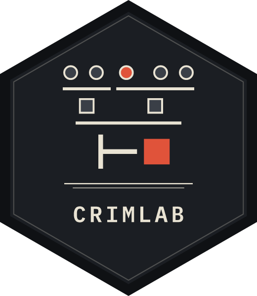

# crimlab for Go 

[](https://crimlab.dev/)
[](https://pkg.go.dev/github.com/rootcoder007/crimlab/bindings/go)

Documentation, guides and every function: <https://crimlab.dev/>.

Statistical Toolkit for Criminology and Sociolegal Research: the C++ kernels of the R and Python
packages [crimlab](https://github.com/rootcoder007/crimlab), compiled into
the package with cgo from the copy in `csrc/` (a C++17 compiler is all it
needs). No other dependencies.

Every function of the R package is here with its first letter capitalised
(`orrisk` is `Orrisk`); `Jrun` calls one by its R name. A function takes
its named arguments as a JSON object and returns its result as JSON, with
the names, checks and results of the R and Python packages: a data frame
is an object of columns, a named vector an object of numbers, a missing
value `null`, and a number JSON cannot hold `"NaN"`, `"Inf"` or `"-Inf"`.

```go
package main

import (
	"fmt"

	crimlab "github.com/rootcoder007/crimlab/bindings/go"
)

func main() {
	r, err := crimlab.Orrisk(`{"or": 2, "rate": 0.1, "share": 0.3}`)
	if err != nil {
		panic(err)
	}
	fmt.Println(r)
	// the same by name
	r, err = crimlab.Jrun("losbnd", `{"done": [30, 45, 60], "open": [100, 150]}`)
	fmt.Println(r, err)
}
```

A refused call returns an `*Error`, whose message names the function and
what is wrong, as in R and Python. Licence: Apache-2.0 WITH
LLVM-exception.

## Citation

> Ruhela, V. S. (2026). *crimlab: Statistical Toolkit for Criminology and
> Sociolegal Research.* <https://github.com/rootcoder007/crimlab>

`CITATION.cff` in the repository holds the same reference for reference
managers; in R, `citation("crimlab")` prints it.
