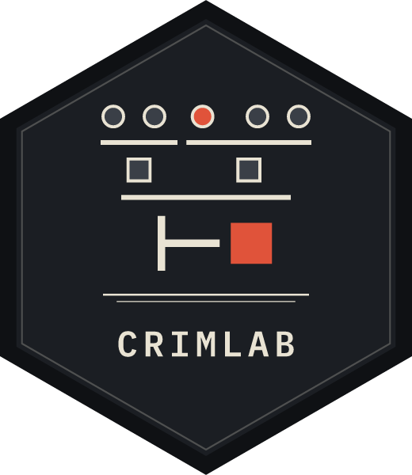

# crimlab for Java 

[](https://crimlab.dev/)
[](https://central.sonatype.com/artifact/io.github.rootcoder007/crimlab)

Documentation, guides and every function: <https://crimlab.dev/>.

Statistical Toolkit for Criminology and Sociolegal Research: every function of the R and Python
packages [crimlab](https://github.com/rootcoder007/crimlab), by its R
name, through the Foreign Function and Memory API (JDK 22 or later). The
jar carries the compiled library for each operating system and CPU it is
built for; nothing else to install.

A function takes its named arguments as a JSON object and returns its
result as JSON, with the names, checks and results of the R and Python
packages: a data frame is an object of columns, a named vector an object
of numbers, a missing value `null`, and a number JSON cannot hold `"NaN"`,
`"Inf"` or `"-Inf"`.

```xml
<dependency>
  <groupId>io.github.rootcoder007</groupId>
  <artifactId>crimlab</artifactId>
  <version>VERSION</version>
</dependency>
```

`VERSION` is the release on the badge above.

```java
import io.github.rootcoder007.crimlab.Crimlab;

String r = Crimlab.jrun("orrisk", "{\"or\": 2, \"rate\": 0.1, \"share\": 0.3}");
String fns = Crimlab.jfns();  // every function and its arguments
```

The shared library is the file named by the system property
`crimlab.library` or the environment variable `CRIMLAB_LIBRARY`; else the
copy the jar carries (`native/<os>-<arch>/`), unpacked to a private
temporary folder; else `libcrimlab` on the system's library path. A
refused call throws `IllegalArgumentException`, whose message names the
function and what is wrong. Licence: Apache-2.0 WITH LLVM-exception.

## Citation

> Ruhela, V. S. (2026). *crimlab: Statistical Toolkit for Criminology and
> Sociolegal Research.* <https://github.com/rootcoder007/crimlab>

`CITATION.cff` in the repository holds the same reference for reference
managers; in R, `citation("crimlab")` prints it.
