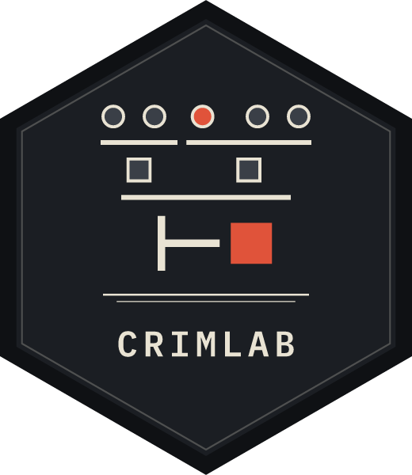

# crimlab for JavaScript 

[](https://crimlab.dev/)
[](https://github.com/rootcoder007/crimlab/actions/workflows/check.yml)
[](https://github.com/rootcoder007/crimlab/actions/workflows/coverage.yml)
[](https://github.com/rootcoder007/crimlab/actions/workflows/srr.yml)
[](https://github.com/rootcoder007/crimlab/actions/workflows/pkgdown.yml)
[](https://www.bestpractices.dev/projects/16873)
[](https://github.com/rootcoder007/crimlab/releases/latest)
[](https://pypi.org/project/crimlab/)
[](https://www.npmjs.com/package/crimlab)
[](https://docs.rs/crimlab/latest/crimlab/)
[](https://central.sonatype.com/artifact/io.github.rootcoder007/crimlab)
[](https://pkg.go.dev/github.com/rootcoder007/crimlab/bindings/go)
[](https://copr.fedorainfracloud.org/coprs/rootcoder007/crimlab/)
[](https://build.opensuse.org/package/show/home:rootcoder007/crimlab)
[](https://rootcoder007.r-universe.dev/crimlab)

Documentation, guides and every function: <https://crimlab.dev/>.

Statistical Toolkit for Criminology and Sociolegal Research: the C++ kernels of the R and Python
packages [crimlab](https://github.com/rootcoder007/crimlab), built to
WebAssembly, with the `crimlab` command. No dependencies; the module sees
no files and no network.

```sh
npx crimlab orrisk --or 2 --rate 0.1 --share 0.3
echo '{"done": [30, 45, 60], "open": [100, 150]}' | npx crimlab losbnd -j
npx crimlab -l          # every function and its arguments
```

```js
import crimlab, { jrun, jfns } from 'crimlab';

crimlab.orrisk({ or: 2, rate: 0.1, share: 0.3 });
// { exposed: 0.1475..., unexposed: 0.0796..., rr: 1.8524..., or: 2 }
jrun('vodtst', { day: { a: 40, b: 60 }, night: { a: 50, b: 50 }, ref: 'b' });
```

Every function of the Python package is here under its R name, with the
same named arguments, checks and results. A data frame is an object of
columns, a named vector an object of numbers, a missing value `null`, and
a number JSON cannot hold the string `"NaN"`, `"Inf"` or `"-Inf"`. An
object given for a per-group argument names the groups. A refused call
throws an `Error` whose message names the function and what is wrong.

Node 18 or later, or any browser with WebAssembly (the module is fetched
next to `lib/`). Licence: Apache-2.0 WITH LLVM-exception.

## Citation

> Ruhela, V. S. (2026). *crimlab: Statistical Toolkit for Criminology and
> Sociolegal Research.* <https://github.com/rootcoder007/crimlab>

`CITATION.cff` in the repository holds the same reference for reference
managers; in R, `citation("crimlab")` prints it.
