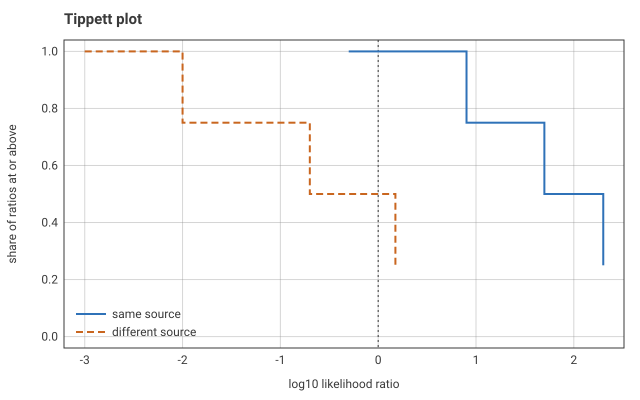

# crimlab for Python

Criminology and sociolegal statistics: the Python package binds the same
compiled kernels as the R package crimlab (`../src`), with the same
function names, the same argument names and the same results. Every
number in the parity tests (`tests/data/ref.json`, written by
`dev/pyref.R` from the R package) is bit-for-bit what R returns.

The package imports nothing outside Python's standard library: no
runtime dependencies, no optional ones. Results are dicts of its own that
print as R prints them, export themselves as CSV or JSON, and (tables)
sort, filter and join; the two plots draw themselves as SVG, by the same
compiled code every binding can use.

## Install

From a clone of the repository (a C++17 compiler is needed):

    pip install ./py

The CI workflow (`.github/workflows/py.yml`) also builds wheels (one per
platform, stable ABI, Python 3.10 and later) and an sdist as workflow
artifacts. The package is not published on PyPI.

## Examples

Disparity:

```python
>>> from crimlab import vodtst, dspbm
>>> vodtst(day={"white": 600, "black": 400}, night={"white": 700, "black": 300})
  group   ref shday shnight    ratio sign
1 white  TRUE   0.6     0.7 1.000000   -1
2 black FALSE   0.4     0.3 1.555556    1

>>> dspbm(pop={"a": 9000, "b": 1000}, contact={"a": 900, "b": 300},
...       force={"a": 9, "b": 6})["rd"]
[1.0, 6.0]

```

Forensics:

```python
>>> from crimlab import gtmp, cllrmin, kinidx
>>> round(gtmp(p={"D3": 0.1, "vWA": 0.2}, q=[0.3, None], hom=[False, True],
...            theta=0.03)["log10lr"], 4)
2.3068
>>> kinidx({"D3": [12, 14]}, {"D3": [12, 14]}, {"D3": [0.1, 0.2]}, rel="sibling")["locus"]
  locus   idx
1    D3 8.375
>>> cllrmin([50, 200, 8], [0.01, 0.2, 1.5])
     cllr       min       cal
0.3008346 0.0000000 0.3008346

```

Policing:

```python
>>> from crimlab import clrsmp, expbnd
>>> clrsmp(clra={"minor": 90, "serious": 20}, reca=[100, 50],
...        clrb=[19, 60], recb=[20, 140])["total"]["simpson"]
2.0
>>> expbnd(y={"white": 100, "black": 300}, m=[1000, 1000], gamma=1.5)["sign"]
[0, 1]

```

Corrections:

```python
>>> from crimlab import incap, sntbnd
>>> incap(lam={"low": 2, "high": 10}, q=0.1, s=1, share=[0.8, 0.2])["group"]
['low', 'high', 'all']
>>> sntbnd([1, 0, 1, 1, 0, 0], ["a", "a", "b", "b", "b", "a"], treat="b")["term"]
['a', 'b', 'effect']

```

Proofs and the self-test:

```python
>>> from crimlab import proof, selftest
>>> proof("orrisk")["theorem"][0]
'Crimlab.RelRisk.or_eq_rr_mul'
>>> selftest()["nfail"]
0

```

## Results

| R | Python |
|---|---|
| data frame | `Table`: a dict of columns (lists), in R's column order |
| named numeric vector | `Vector`: a dict of floats |
| list | `Record`: a dict of results |
| `NA` | `None` |
| `NaN`, `Inf` | `float("nan")`, `float("inf")` |

Each is still the dict it was (`r["ratio"]`, `dict(r)`, `r.items()` work
as for any dict) and prints as R prints it: a table with row numbers
first, numbers to 7 significant digits, a long table cut to its first 10
and last 5 rows with the row count; a vector with names above values; a
record part by part under `$name`. A `Table` also has:

- `shape`, `rows()` (a list of dicts), `row(i)`;
- `csv()`: RFC 4180 text, CRLF line ends, numbers in full (the shortest
  text that reads back to the same double), None as an empty field, NaN
  and the infinities as `NaN`, `Inf`, `-Inf`, bools as `TRUE`, `FALSE`;
- `json()` (also on `Vector` and `Record`): None is `null`; NaN and the
  infinities, which JSON has no numbers for, are the strings `"NaN"`,
  `"Inf"` and `"-Inf"`;
- `sort(by, desc=False)`: by a column or a list of them; stable; `desc` one
  bool or one per column; None and NaN last either way; text by code point,
  numbers (bools as 0 and 1) numerically; text and numbers in one column is
  an error;
- `filter(f=None, **conds)`: `col=(op, value)` with op one of `==`, `!=`,
  `<`, `<=`, `>`, `>=`, `in` (value a list), `col=value` for `==`, and f a
  function of a row (a dict); conditions combine with and; a missing value
  never passes; an unknown column or operator is an error;
- `join(other, on, how="inner")`: with another table or any dict of
  equal-length columns, on one key column or a list; `how` is inner, left,
  right or full. Keys match by exact equality, text with text, numbers with
  numbers (1 with 1.0), bools with bools; a missing key (None or NaN)
  matches nothing. Rows come in this table's order, each with its matches
  in the other's order, then the other's unmatched rows (right, full); a key
  on n rows here and m there gives n * m rows; unmatched cells are None.
  Columns: the keys once, then this table's, then the other's; a name in
  both that is not a key gets `.x` here and `.y` there. Hash-based, linear
  time.

Each returns a new table and leaves the first unchanged. There is no
`select`: a dict comprehension is one, `Table({k: t[k] for k in cols})`.

```python
>>> from crimlab import expbnd
>>> r = expbnd(y={"a": 100, "b": 300, "c": 7}, m={"a": 1000, "b": 1000, "c": 70},
...            gamma=1.5)
>>> r.filter(ratio=(">", 1)).sort("rate", desc=True)
  group   ref rate  lo   hi ratio      rlo  rhi sign
1     b FALSE  0.3 0.2 0.45     3 1.333333 6.75    1
>>> r.csv().splitlines()[1]
'a,TRUE,0.1,0.06666666666666667,0.15000000000000002,1.0,0.4444444444444444,2.25,0'

```

## Plots

`tipplt()` and `eceplt()` return the data of the plot. Their result has
`svg()`, which returns the plot as a standalone SVG document: axes with
tick labels, the curves, a legend, a title and axis labels; text as text
(a system sans-serif stack) and colours that read on light and dark
backgrounds; the same bytes on every machine. A method, not a file
argument: the result stays data first, the picture is asked for when it is
wanted, and where it goes (a file, a web page, a notebook) is the
caller's choice, with no paths or file handling in the package.

```python
>>> from crimlab import tipplt
>>> svg = tipplt([50, 200, 8, 0.5], [0.01, 0.2, 1.5, 0.001]).svg()
>>> svg.splitlines()[1][:40]
'<svg xmlns="http://www.w3.org/2000/svg" '

```



## Optional packages (never required)

NumPy, pandas and matplotlib are never imported by crimlab, but work with
it through their own generic protocols:

```python
import numpy, pandas
vodtst(numpy.array([600.0, 400.0]), [700, 300])   # an array as input, zero copy
pandas.DataFrame(vodtst({"w": 600, "b": 400}, {"w": 700, "b": 300}))  # a result as a frame
plt.step(t["same"]["log10lr"], t["same"]["share"], where="post")  # t = tipplt(...)
```

A pandas Series is read as its values, by position; for its index as group
names, pass `dict(s)`. A DataFrame is a table of rows by
`df.to_dict("index")` (a mapping of mappings).

## Inputs

**Numbers** are one number (Python has no vector of one), a sequence
(list, tuple, `array.array`, `memoryview`, `range`) or an array: any
object with `__array_interface__` (a NumPy array, for one). An array of
contiguous float64 is read in place, without a copy; other numeric types
(float32, any integer type), strided arrays and object arrays are
converted; an array whose byte order is not the machine's is read as a
sequence when it is one. A 2-D array with one row or one column is the
vector it holds; an array with more than one dimension above 1 is refused
with R's message ("must be a vector, not a matrix ..."). A nested list is
not flattened: it is refused as not numbers.

Not numbers (TypeError): text, bytes, bools (as in R, a logical is not a
number), dates, complex numbers, dicts and sets where numbers are expected,
iterators and generators, nested sequences.

**Missing values** are `None` and `float("nan")`, both read as R's `NA`.
Where R refuses `NA` they are refused with R's message (ValueError); where
R accepts it (`q` at a homozygous locus of `gtmp()`, `y` for a detained
defendant in `sellab()`), so does Python.

**Logical** arguments (`hom`, `rel`, `rule`) take bools (any type named
`bool`, so NumPy's too), one or a sequence or a bool array; numbers are
refused as in R.

**Labels** (the sentences `z` of `sntbnd()`, alleles) are text, numbers or
bools, written as R's `as.character()` writes them: `2.0` is `"2"`,
`0.1 + 0.2` is `"0.3"`, `1e5` is `"1e+05"`, `True` is `"TRUE"`.

**Named values** are a mapping (dict) from name to value, or, where a name
repeats (which a dict cannot hold), a list of `(name, value)` tuples:
`[("a", 1), ("a", 2)]`.

**Tables** (`count` of `dyadrt()`, genotypes, `freq`, the one-table form of
`vodtst()`) are a sequence of rows, a 2-D array, or a mapping from row name
to row; a row is a sequence, or a mapping from column name to value (every
row naming the same columns), so a table with row and column names is a
mapping of mappings: `{"a": {"a": 640, "b": 160}, "b": {"a": 100, "b": 40}}`.
Row names that repeat: a list of `(row name, row)` tuples. Genotypes have
two columns, one row per locus; two values are one locus.

## Names

Names are the identity of a group, under the rule of the R package
(`src/bind.cpp`, `align()`). An argument is named when it is a mapping
(dict) or a list of `(name, value)` tuples; a table names its rows when it
is a mapping (see Inputs).

- All the arguments of a call that hold one value per group (or per unit,
  per locus, per arm) named, with the same names: each is matched to the
  first by name, in any order. `vodtst({"a": 6, "b": 4}, {"b": 5, "a": 5})`
  pairs `a` with `a`.
- All named, with different names: an error that lists them,
  ``vodtst: `night` must name the same groups as `day`; missing: b; extra: c.``
- Some named, some not: positions, as given. Only names protect against a
  mismatch.
- A name given twice in a per-group argument is an error
  (``vodtst: `day` names a group twice: a.``); in a per-unit argument
  (`outtst()`, `lrpost()`, `rtmhs()`, `sellab()`, `sntbnd()`) it leaves
  positions in use.
- Only arguments of the length of the first take part: one value to be
  recycled keeps its place.
- The groups are named by the first argument that names them, else `"1"`,
  `"2"`, ...; the output keeps the order of the first argument. `ref` is a
  position from 1 in that order when it is a number, a group name
  otherwise, and is never chosen by sorting; `vodtst()`, `dspbm()` and
  `expbnd()` mark it in their `ref` column.
- `vodtst(day=table)`: with `night` left out, `day` is one table whose two
  columns are named `day` and `night`: a dict of the two columns, or a
  mapping from group to `{"day": ..., "night": ...}`.
- `dyadrt()`: a `count` that names its rows and its columns (a mapping of
  mappings) has
  its columns matched to its rows by name, and both to `pop` when `pop` is
  named.
- Genotype tables and `freq` that all name their loci are matched by locus
  to the first.
- `hzdsel()`: `surh` and `surl` both named `control` and `treated`, in
  either order, are read by name; otherwise the first value is the control
  arm.

## Errors

Errors are exceptions whose message is R's, word for word, starting with
the function's name: `ValueError` for a value outside what the function
takes (missing, not finite, out of range, wrong length), `TypeError` for an
argument of the wrong kind. A failed allocation is a `MemoryError`.

## Differences from R

1. `orrisk()`'s first argument is `or`, as in R, but `or` is a Python
   keyword: give it by position, or as `orrisk(**{"or": 3}, rate=0.4,
   share=0.5)`.
2. Results are dicts of the package's own classes (see Results). An
   unnamed result of one number is a float for `cllr()`; `lrpost()` always
   returns a list; `lrcal()` returns a `Record` of two lists.
3. R's forms of a named vector (a 1-d table, a list of single numbers, a
   one-row data frame) are a dict, or a list of `(name, value)` tuples, in
   Python; a matrix with row and column names is a mapping of mappings.
4. `ref`: a bool or None is refused with a TypeError; a number is always a
   position, so a group named by a number cannot be chosen by name. R
   reads a factor `ref` by its label; Python has no one-value categorical.
5. `tipplt()` and `eceplt()` return the plotted data and draw nothing; the
   picture is `svg()` on the result (R draws on the current device with
   base graphics and returns the data invisibly).
6. None and NaN are both R's `NA` on input. On output R's `NA` is None and
   `NaN` is NaN.
7. A nested list where a vector is expected is refused as not numbers
   (TypeError); R's message for a matrix is given for arrays with more
   than one dimension above 1. For the allele names of `mixlr()` a 2-D
   array is refused as not names of `p`.
8. `treat` in `sntbnd()` must be one label; a list, even of one label, is
   refused (R accepts a vector of length 1). The default (True for bools,
   1 for numbers 0 and 1) follows R.
9. A one-row genotype table is named `"1"` unless it is named (mapping
   key); R names a one-row matrix by its only column name when it has
   column names but no row names. Column names that repeat cannot be
   given as a mapping; such a table is given by position.
10. `proof()`: `None` means every function (R's `NULL`); R's `NA` has no
    Python spelling, and `[None]` is refused. `proof()` lists the network
    functions too, which are not bound in Python yet.
11. When several arguments are wrong at once the first error reported may
    differ: names and labels are checked in Python before the numbers are
    checked in the compiled module.
12. R conditions carry a call; Python exceptions have none.
13. `selftest()` is exported (R runs the self-test through an internal
    `.Call`).
14. R-only kinds of input have no counterpart: `"bytes"`-encoded strings,
    classed numbers with units, labelled vectors (R refuses them with a
    message of its own), factors, environments.
15. Tables print with R's layout but are not R's printing in every detail
    (column widths, the choice between fixed and scientific per column).
16. Not bound yet: the network functions `ntdeg`, `ntbtw`, `ntcls`,
    `ntevc`, `ntcore`, `ntcmp`, `ntlvn`, `ntmod`, `ntbrk`, `ntchg` and
    `coofg`. Their kernels are compiled into the module and run in
    `selftest()`.

## Development

From the repository root:

    pip install ./py pytest
    cd py/tests && python -m pytest        # pytest only, nothing else
    python -m pytest opt.py                # NumPy, pandas, matplotlib, if installed
    python -m pytest --doctest-modules --pyargs crimlab
    Rscript dev/pyref.R LIB     # regenerate tests/data/ref.json from R

`setup.py` copies the kernel sources (`../src/*.cpp` and `*.h` that do not
include R), the version (`../DESCRIPTION`), the proof table
(`../src/bind.cpp`), the Lean files (`../inst/lean`) and the licence into
`py/` before every build; those copies are build output and are not
committed. An sdist carries them and builds on its own.

Adding a function: its entry point in `ext/clab.cpp` (one function and one
line in the method table), its wrapper with a docstring in `crimlab/`, its
name in `__all__` and `_clab.pyi`, and its cases in `dev/pyref.R`.

A documentation site is left to the maintainer; the docstrings follow the
numpydoc layout, so Sphinx with `numpydoc` or `napoleon` can render them.
